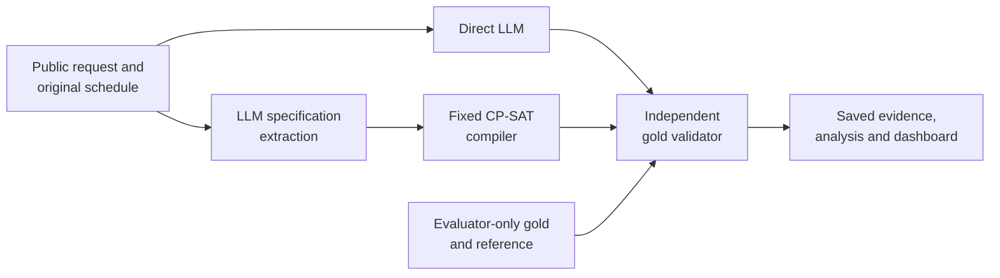

# Dynamic Constraint-Aware Scheduling

**CS3263 Foundations of Artificial Intelligence · Group 23 · NUS AY2026/27**

A research system for generating schedules and repairing them when requirements change. It compares a language model that proposes a schedule directly with the same model translating a request into a specification for **OR-Tools CP-SAT**. An independent validator checks both against the original requirements.

The implementation works end to end. Two complete SoCLaaS development benchmarks contain **600 scheduling attempts each**. Results, figures and replayable evidence are included. The report is prepared for member review; course model eligibility, genuine contributions/review and final submission arrangements remain open.

[Report](docs/submission-report.md) · [PDF](docs/submission-report.pdf) · [Documentation](docs/README.md) · [Evidence and replay](docs/evidence.md) · [Development plan](planning.md) · [Agent instructions](AGENTS.md)

## What it does

- Generates single-day schedules with fixed durations, participants and resources on a 30-minute grid.
- Enforces availability, release times, deadlines, appointments, precedence and non-overlap.
- Repairs schedules by minimizing moved activities, then total time shift, then preference penalties.
- Separately records extraction fidelity, solver proof status, gold validity, objective quality, failures, time and tokens.
- Provides offline replay, a read-only dashboard and explanations grounded in recorded results.

Inputs are synthetic or AI-assisted fictional scenarios. The system does not connect to real calendars or change commitments. Multi-day scheduling, participant assignment and model training are outside scope.

## How it works



Both approaches receive equivalent task information and one model call. Gold specifications and labels remain evaluator-only. Solver success establishes a property of the **extracted problem**; it does not establish that extraction preserved the request. [The plan](planning.md#6-system-architecture-and-contract) documents the interfaces and mathematical semantics.

## Quick start

Requires **Python 3.12** and Git. Development checks also use Node.js and `openssl`. CPU-only macOS and Linux workflows are supported; native Windows has not been qualified.

```sh
git clone https://github.com/JellyPenguinnn/cs3263_group23.git
cd cs3263_group23
python3.12 -m venv .venv
.venv/bin/python -m pip install --require-hashes -r requirements.lock
.venv/bin/python -m pip install --no-deps --no-build-isolation .
.venv/bin/python scripts/check_installed.py

# Solve a formal fixture with CP-SAT; no API key needed.
.venv/bin/scheduling solve --spec tests/examples/formal-generation.json

# Exercise both pipelines, validation and replay with canned responses.
.venv/bin/python evaluation/offline_demo.py runs/quickstart-offline

# View saved results locally.
.venv/bin/scheduling dashboard --runs-dir runs --port 8876
```

Open [the local dashboard](http://127.0.0.1:8876). Use an unused output directory for each new experiment. The offline demo deliberately includes invalid answers to exercise failure handling; its results are integration checks, not model-performance measurements. [Usage and operations](docs/usage.md) covers further demos, explanations, live configuration and durable campaigns.

## Results

Accepted means a gold-valid feasible schedule or a correct UNSAT answer. **Every failure remains in the denominator; acceptance does not imply optimality.** Each model used the same cases, request prompts, source snapshot, runtime and configured budgets.

| Evaluation block | Qwen3.6 Direct / CP-SAT | Qwen3.8 Direct / CP-SAT |
| --- | ---: | ---: |
| Controlled | 95/240 / 229/240 | 239/240 / 240/240 |
| Realistic scenarios | 6/12 / 12/12 | 11/12 / 11/12 |
| Additional wording | 8/48 / 47/48 | 46/48 / 44/48 |


Solver assistance substantially improves Qwen3.6's validity and optimization quality. Qwen3.8 nearly saturates validity; CP-SAT still matches the reference optimum on all 60 controlled repairs, compared with 59/60 for Direct. All nine Qwen3.8 rejected attempts are provider failures. Model-call time and token use are higher for the solver-assisted pipeline.

See the [realistic](results/figures/two-model-development-20261002/realistic-accepted.png) and [wording](results/figures/two-model-development-20261002/language-accepted.png) charts, [complete analysis](docs/two-model-development-audit.md) and [machine-readable summary](results/summary/two-model-development-20261002.json). These are exploratory results on known development inputs. Wording reuses 24 controlled bases; the realistic set has only 12 AI-assisted scenarios. Hosted backend versions and hidden defaults prevent a causal comparison of model weights or hardware speed.

## Reproduce the evidence

The [evidence guide](docs/evidence.md) identifies the two immutable reproduction archives, their checksums, exact-source replay commands and preservation of earlier/operational evidence. Offline replay requires no credentials or new model calls. Historical experiments retain their original configurations and are not pooled with the two-model study.

Regenerate the three grouped bar charts from the checked-in summary:

```sh
MPLCONFIGDIR=.cache/matplotlib .venv/bin/python scripts/render_benchmark_results.py
```

## Verify changes

```sh
.venv/bin/python -m pytest -q
node --test tests/frontend/dashboard.test.cjs
.venv/bin/python -m pip check
.venv/bin/python scripts/check_installed.py
```

Reinstall after source changes before checking a noneditable installation. Check the [publication verification](docs/publication-verification.md) for the exact tested version and platform limits.

## Repository layout

| Path | Contents |
| --- | --- |
| `src/scheduling/` | Schema, solver, pipelines, providers, validator, evaluation and dashboard |
| `evaluation/` | Offline demos, campaign preparation, execution and analysis entry points |
| `benchmarks/`, `configs/`, `prompts/` | Versioned synthetic fixtures, manifests and experiment settings |
| `tests/` | Independent mathematical fixtures, unit/integration and frontend checks |
| `results/` | Audited summaries, figures and immutable reproduction archives |
| `docs/` | Report, methods, usage, evidence, review checklist and historical handoffs |
| `presentation/` | Demonstration inputs and presentation/rehearsal preparation |

## Contributing and course delivery

Read [AGENTS.md](AGENTS.md) and [planning.md](planning.md) before edits. Preserve raw evidence, equivalent comparison conditions and explicit proof/status distinctions. New live runs require a separate agreed model and budget. Never commit API keys; configure credentials locally using `.env.example` and the usage guide.

A useful agent prompt is:

> Read README.md, AGENTS.md and planning.md. Inspect the current checkout and Section 5, confirm only consequential missing details, and complete my agreed next deliverable. Preserve recorded experiments, test relevant changes, update evidence and documentation, and ask before scientific scope changes or live spending.

The [submission checklist](docs/submission-checklist.md) records genuine human review, model eligibility, private title-page details, report/presentation checks and course deadlines. Publication of this repository is not submission to Canvas or teaching-team approval.
