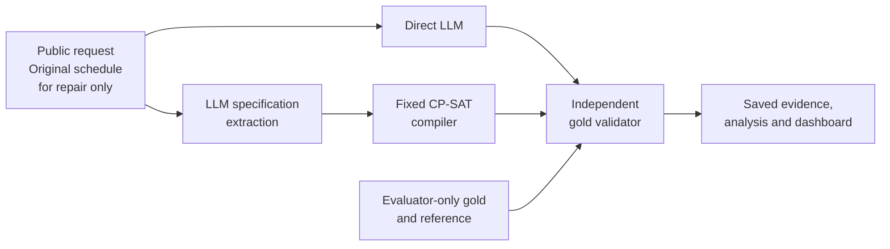
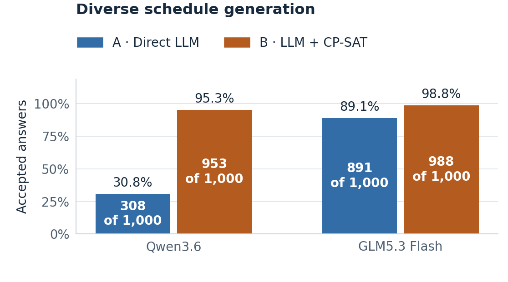

# Dynamic Constraint-Aware Scheduling

**CS3263 Foundations of Artificial Intelligence · Group 23 · NUS AY2026/27**

A research system whose core task is **schedule generation**. Minimum-disruption repair is a completed, bounded extension. It compares a language model that proposes a schedule directly with the same model translating a request into a specification for **OR-Tools CP-SAT**. An independent validator checks both against the original requirements.

The latest SoCLaaS comparison completed **2,000 scheduling attempts each for Qwen3.6 and GLM5.3 Flash**: the same 1,000 generation cases, two methods, 500 feasible and 500 infeasible cases. Ten construction families and five activity-count strata broaden the earlier balanced study. All **4,000 attempts**, including failures, are retained and replay-validated. The separate 96-, 200- and 600-attempt studies remain preserved.

The report is prepared for member review. Course model eligibility, genuine human contributions and interpretation, presentation and submission arrangements remain open. This is a research prototype evaluated on known synthetic/AI-assisted development cases.

[Report](docs/submission-report.md) · [PDF](docs/submission-report.pdf) · [Report supplement](docs/report-details.md) · [Documentation](docs/README.md) · [Evidence and replay](docs/evidence.md) · [Development plan](planning.md) · [Agent instructions](AGENTS.md)

## What it does

- Generates single-day schedules with fixed durations, participants and resources on a 30-minute grid.
- Enforces availability, release times, deadlines, appointments, precedence and non-overlap.
- As an extension, repairs schedules by minimizing moved activities, then total start-time shift, then preference penalties.
- Separately records extraction fidelity, solver proof status, gold validity, objective quality, failures, time and tokens.
- Provides offline replay, a read-only dashboard and explanations grounded in recorded results.

The [TA-feedback alignment](docs/ta-feedback-alignment.md) defines the generation-first scope, its stopping point and executable small office examples. The current schema supports preferred start windows; weekly calendars, consecutive-meeting penalties and same-day clustering are not implemented.

Inputs are synthetic or AI-assisted fictional scenarios. The system does not connect to real calendars or change commitments. Multi-day scheduling, participant assignment and model training are outside scope.

## How it works



Both approaches receive equivalent task information and one model call. Gold specifications and labels remain evaluator-only. Solver success establishes a property of the **extracted problem**; it does not establish that extraction preserved the request. [The plan](planning.md#6-system-architecture-and-contract) documents the interfaces and mathematical semantics.

## Quick start

Requires **Python 3.12** and Git. Development checks also use Node.js and `openssl`. CPU-only macOS and Linux workflows are supported; native Windows has not been qualified.

```sh
git clone https://github.com/JellyPenguinnn/cs3263_group23.git
cd cs3263_group23
python3.12 -m venv .venv
.venv/bin/python -m pip install --require-hashes -r requirements.lock
.venv/bin/python -m pip install --no-deps --no-build-isolation .
.venv/bin/python scripts/check_installed.py

# Solve a formal fixture with CP-SAT; no API key needed.
.venv/bin/scheduling solve --spec tests/examples/formal-generation.json

# Exercise both pipelines, validation and replay with canned responses.
.venv/bin/python evaluation/offline_demo.py runs/quickstart-offline

# View saved results locally.
.venv/bin/scheduling dashboard --runs-dir runs --port 8876
```

Open [the local dashboard](http://127.0.0.1:8876). Use an unused output directory for each new experiment. The offline demo deliberately includes invalid answers to exercise failure handling; its results are integration checks, not model-performance measurements. [Usage and operations](docs/usage.md) covers further demos, explanations, live configuration and durable campaigns.

## Results

Accepted means a gold-valid feasible schedule or a correct UNSAT answer. **Every failure remains in the denominator; acceptance does not imply optimality.** Cases, prompts, scientific source and configured model/solver limits match across models, with one call per method/case and no retries. Execution concurrency and OS changed during the study and are disclosed separately.

| Model | Direct LLM | LLM + CP-SAT |
| --- | ---: | ---: |
| Qwen3.6 `qwen3.6:35b` | 30.8% (308/1,000) | 95.3% (953/1,000) |
| GLM5.3 Flash `glm-5.3-flash` | 89.1% (891/1,000) | 98.8% (988/1,000) |



Qwen direct produces only **1/500 valid feasible schedules**, versus 467/500 with CP-SAT; most direct successes are correct infeasibility predictions. GLM produces 404/500 versus 492/500. Solver assistance improves this measured comparison, but extraction can still invent or omit constraints even when the solver is correct.

Infrastructure accounts for **51 Qwen failures and 68 GLM failures**, separate from format and scheduling errors. Among matched cases with both responses delivered, GLM accepts 891/935 direct versus 927/935 solver-assisted; this is a secondary diagnostic, not a replacement score. Four GLM timeouts overlapped laptop sleep. OS/concurrency phases have **no fully matched cross-model timing subset**, so aggregate latency is not a controlled speed comparison.

The [comparison audit](docs/diverse-comparison-audit.md), [protocol](docs/diverse-generation.md), [report](docs/submission-report.md) and [reproducible summary](results/summary/diverse-comparison-20261018.json) give failure traces, conditional optimality, mechanism/size views and phase-separated resources. These synthetic, AI-assisted development inputs have **ten related construction families**, not 1,000 independent real-world samples. Human prose/gold review and course model clarification remain pending.

The [48-case balanced study](docs/balanced-comparison-audit.md), [200-attempt difficulty comparison](docs/difficulty-comparison-audit.md) and [600-attempt historical Qwen studies](docs/two-model-development-audit.md) retain their original scores, repair/wording extensions and limitations. **Different designs are not pooled.**

## Reproduce the evidence

The [evidence guide](docs/evidence.md) distinguishes original private operational archives from portable replay packages. New portable archives redact only local campaign paths and update their derived checksums; **all 4,000 attempt records, public inputs, references and scientific source remain byte-identical**. Original archives remain preserved. No credentials or new model calls are needed:

```sh
.venv/bin/python scripts/verify_evidence.py --manifest results/diverse-evidence-manifest.json
.venv/bin/python scripts/build_diverse_comparison.py --manifest results/diverse-evidence-manifest.json
MPLCONFIGDIR=.cache/matplotlib .venv/bin/python scripts/render_diverse_results.py
```

Use fresh extraction/replay directories. [The audit](docs/diverse-comparison-audit.md) describes the validation, phase provenance and portability changes; earlier manifests remain unchanged.

## Verify changes

```sh
.venv/bin/python -m pytest -q
node --test tests/frontend/dashboard.test.cjs
.venv/bin/python -m pip check
.venv/bin/python scripts/check_installed.py
```

Reinstall after source changes before checking a noneditable installation. Check the [publication verification](docs/publication-verification.md) for the exact tested version and platform limits.

## Repository layout

| Path | Contents |
| --- | --- |
| `src/scheduling/` | Schema, solver, pipelines, providers, validator, evaluation and dashboard |
| `evaluation/` | Offline demos, campaign preparation, execution and analysis entry points |
| `benchmarks/`, `configs/`, `prompts/` | Versioned synthetic fixtures, manifests and experiment settings |
| `tests/` | Independent mathematical fixtures, unit/integration and frontend checks |
| `results/` | Audited summaries, figures and immutable reproduction archives |
| `docs/` | Report, methods, usage, evidence, review checklist and historical handoffs |
| `presentation/` | Demonstration inputs and presentation/rehearsal preparation |

## Contributing and course delivery

Read [AGENTS.md](AGENTS.md) and [planning.md](planning.md) before edits. Preserve raw evidence, equivalent comparison conditions and explicit proof/status distinctions. New live runs require a separate agreed model and budget. Never commit API keys; configure credentials locally using `.env.example` and the usage guide.

A useful agent prompt is:

> Read README.md, AGENTS.md and planning.md. Inspect the current checkout and Section 5, confirm only consequential missing details, and complete my agreed next deliverable. Preserve recorded experiments, test relevant changes, update evidence and documentation, and ask before scientific scope changes or live spending.

The [submission checklist](docs/submission-checklist.md) records genuine human review, model eligibility, private title-page details, report/presentation checks and course deadlines. Publication of this repository is not submission to Canvas or teaching-team approval.
