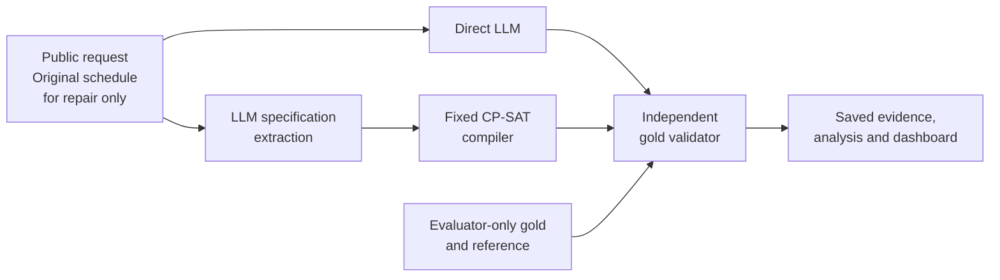

# Dynamic Constraint-Aware Scheduling

**CS3263 Foundations of Artificial Intelligence · Group 23 · NUS AY2026/27**

A research system whose core task is **schedule generation**. Minimum-disruption repair is a completed, bounded extension. It compares a language model that proposes a schedule directly with the same model translating a request into a specification for **OR-Tools CP-SAT**. An independent validator checks both against the original requirements.

The generation pipeline, independent validator and repair extension work end to end. The latest SoCLaaS comparison completed **96 scheduling attempts each for Qwen3.6 and GLM5.3 Flash** on 48 balanced generation cases: 24 feasible and 24 infeasible. It tests deadlines and fixed appointments in both labels after an audit found a constraint-presence confound in the earlier dataset. The separate 200-attempt difficulty studies and 600-attempt historical Qwen studies remain preserved.

The report is prepared for member review. Course model eligibility, genuine human contributions and interpretation, presentation and submission arrangements remain open. This is a research prototype evaluated on known synthetic/AI-assisted development cases.

[Report](docs/submission-report.md) · [PDF](docs/submission-report.pdf) · [Documentation](docs/README.md) · [Evidence and replay](docs/evidence.md) · [Development plan](planning.md) · [Agent instructions](AGENTS.md)

## What it does

- Generates single-day schedules with fixed durations, participants and resources on a 30-minute grid.
- Enforces availability, release times, deadlines, appointments, precedence and non-overlap.
- As an extension, repairs schedules by minimizing moved activities, then total start-time shift, then preference penalties.
- Separately records extraction fidelity, solver proof status, gold validity, objective quality, failures, time and tokens.
- Provides offline replay, a read-only dashboard and explanations grounded in recorded results.

The [TA-feedback alignment](docs/ta-feedback-alignment.md) defines the generation-first scope, its stopping point and executable small office examples. The current schema supports preferred start windows; weekly calendars, consecutive-meeting penalties and same-day clustering are not implemented.

Inputs are synthetic or AI-assisted fictional scenarios. The system does not connect to real calendars or change commitments. Multi-day scheduling, participant assignment and model training are outside scope.

## How it works



Both approaches receive equivalent task information and one model call. Gold specifications and labels remain evaluator-only. Solver success establishes a property of the **extracted problem**; it does not establish that extraction preserved the request. [The plan](planning.md#6-system-architecture-and-contract) documents the interfaces and mathematical semantics.

## Quick start

Requires **Python 3.12** and Git. Development checks also use Node.js and `openssl`. CPU-only macOS and Linux workflows are supported; native Windows has not been qualified.

```sh
git clone https://github.com/JellyPenguinnn/cs3263_group23.git
cd cs3263_group23
python3.12 -m venv .venv
.venv/bin/python -m pip install --require-hashes -r requirements.lock
.venv/bin/python -m pip install --no-deps --no-build-isolation .
.venv/bin/python scripts/check_installed.py

# Solve a formal fixture with CP-SAT; no API key needed.
.venv/bin/scheduling solve --spec tests/examples/formal-generation.json

# Exercise both pipelines, validation and replay with canned responses.
.venv/bin/python evaluation/offline_demo.py runs/quickstart-offline

# View saved results locally.
.venv/bin/scheduling dashboard --runs-dir runs --port 8876
```

Open [the local dashboard](http://127.0.0.1:8876). Use an unused output directory for each new experiment. The offline demo deliberately includes invalid answers to exercise failure handling; its results are integration checks, not model-performance measurements. [Usage and operations](docs/usage.md) covers further demos, explanations, live configuration and durable campaigns.

## Results

Accepted means a gold-valid feasible schedule or a correct UNSAT answer. **Every failure remains in the denominator; acceptance does not imply optimality.** Both models used the same 48 cases, prompts, runtime and configured budgets, with one call per method/case and no retries.

| Model | Direct LLM | LLM + CP-SAT |
| --- | ---: | ---: |
| Qwen3.6 `qwen3.6:35b` | 12.5% (6/48) | 100.0% (48/48) |
| GLM5.3 Flash `glm-5.3-flash` | 97.9% (47/48) | 100.0% (48/48) |


Qwen direct produced 23 constraint violations, nine false UNSAT answers and ten strict JSON-format failures. Format noncompliance is distinct from scheduling reasoning. GLM direct's only failure was a transport error; all 47 returned direct answers were accepted. Its 47/48 primary result retains that failure, so the one-case gap does not demonstrate a solver reasoning advantage. All returned GLM responses matched the required model identity.

The [balanced audit](docs/balanced-comparison-audit.md) and [protocol](docs/balanced-generation.md) give SAT/UNSAT, constraint-profile, objective-quality, time/token and trace-level details. The 48 synthetic/AI-assisted cases belong to **three construction families**; they are not 48 independent samples or a held-out test. Balancing removes the identified presence/label shortcut, not all template bias. Shared serving conditions limit causal model comparisons; human prose/gold review remains pending.

The [200-attempt difficulty comparison](docs/difficulty-comparison-audit.md) retains repair, fictional and wording extensions, including concrete extraction omissions and valid but suboptimal direct answers. Its constraint-presence confound remains disclosed in the [course/code audit](docs/course-code-audit.md). The [600-attempt Qwen3.6/Qwen3.8 studies](docs/two-model-development-audit.md) remain historical evidence. **These different designs are not pooled.**

## Reproduce the evidence

The [evidence guide](docs/evidence.md) identifies the immutable archives, checksums and exact-source offline replay. No credentials or new model calls are needed. Verify and regenerate the latest summary and charts:

```sh
.venv/bin/python scripts/verify_evidence.py --manifest results/balanced-evidence-manifest.json
.venv/bin/python scripts/build_balanced_comparison.py
MPLCONFIGDIR=.cache/matplotlib .venv/bin/python scripts/render_balanced_results.py
```

The evidence guide also covers the separate difficulty and historical archives. Regeneration and replay are offline; use fresh extraction directories and preserve every original record.

## Verify changes

```sh
.venv/bin/python -m pytest -q
node --test tests/frontend/dashboard.test.cjs
.venv/bin/python -m pip check
.venv/bin/python scripts/check_installed.py
```

Reinstall after source changes before checking a noneditable installation. Check the [publication verification](docs/publication-verification.md) for the exact tested version and platform limits.

## Repository layout

| Path | Contents |
| --- | --- |
| `src/scheduling/` | Schema, solver, pipelines, providers, validator, evaluation and dashboard |
| `evaluation/` | Offline demos, campaign preparation, execution and analysis entry points |
| `benchmarks/`, `configs/`, `prompts/` | Versioned synthetic fixtures, manifests and experiment settings |
| `tests/` | Independent mathematical fixtures, unit/integration and frontend checks |
| `results/` | Audited summaries, figures and immutable reproduction archives |
| `docs/` | Report, methods, usage, evidence, review checklist and historical handoffs |
| `presentation/` | Demonstration inputs and presentation/rehearsal preparation |

## Contributing and course delivery

Read [AGENTS.md](AGENTS.md) and [planning.md](planning.md) before edits. Preserve raw evidence, equivalent comparison conditions and explicit proof/status distinctions. New live runs require a separate agreed model and budget. Never commit API keys; configure credentials locally using `.env.example` and the usage guide.

A useful agent prompt is:

> Read README.md, AGENTS.md and planning.md. Inspect the current checkout and Section 5, confirm only consequential missing details, and complete my agreed next deliverable. Preserve recorded experiments, test relevant changes, update evidence and documentation, and ask before scientific scope changes or live spending.

The [submission checklist](docs/submission-checklist.md) records genuine human review, model eligibility, private title-page details, report/presentation checks and course deadlines. Publication of this repository is not submission to Canvas or teaching-team approval.
