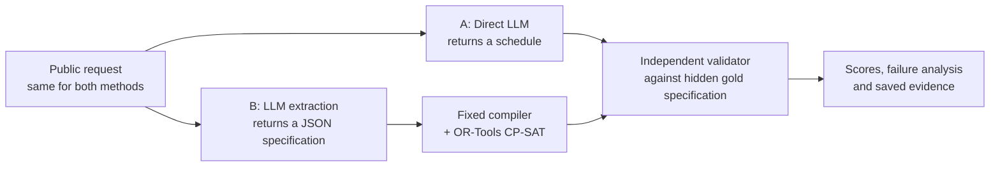

# Scheduling with Language Models: Direct Reasoning or Solver Assistance?

**CS3263 Foundations of Artificial Intelligence · National University of Singapore · AY2026/27 Semester 1 · Group 23**
Tham Yao Xiang (team leader) · Woo Yong Qing · Tea Li Hao

Should a language model build a schedule itself, or translate the request into constraints for a solver? We compare both routes on the same 1,000 synthetic scheduling requests with two models, check every answer with an independent validator, and analyse not only how often each route succeeds but why it fails.

**[Final report (PDF)](docs/submission-report.pdf)** · [Report source](docs/submission-report.md) · [Supplement](docs/report-details.md) · [Video slides](presentation/CS3263_Group23_Presentation_Slides.pptx) · [Documentation index](docs/README.md)

## The answer in brief

On these cases, **let the model extract the constraints and let the solver build the schedule.**

| Model | Direct LLM | LLM + CP-SAT |
| --- | ---: | ---: |
| Qwen3.6 35B A3B | 30.8% (308/1,000) | 95.3% (953/1,000) |
| GLM5.3 Flash | 89.1% (891/1,000) | 98.8% (988/1,000) |

An answer is accepted if it is a valid schedule or correctly reports that none exists; every failure, including service errors, stays in the denominator.


- **The gap is in building schedules.** Qwen3.6 directly builds 1 valid schedule out of 500 feasible cases, versus 467 with CP-SAT. Its direct "no solution" answers barely discriminate: it gives them for 58% of feasible and 61% of infeasible cases.
- **A correct solver can still solve the wrong problem.** Given the gold specifications, the same compiler labels all 1,000 cases correctly, so every wrong solver-assisted answer (20 for Qwen3.6, 4 for GLM5.3 Flash) comes from requirements invented, omitted or altered during extraction.
- **Infrastructure failures shape the observed gap.** 65 of GLM5.3 Flash's 109 direct failures are infrastructure failures (service errors or timeouts, so no answer arrived); excluding cases without both responses shrinks its gain from 9.7 to 3.85 percentage points.
- **Every valid solver-assisted schedule was also optimal**, and local CP-SAT solving took a median of about 10 ms.
- **Earlier, separate studies point the same way**: a small office scenario (Qwen3.6 6 → 48 of 48), schedule repair (6 → 29 of 30) and reworded requests (4 → 19 of 20), with GLM5.3 Flash near ceiling either way.

These are synthetic, template-generated one-day cases from ten related case families, with one answer per condition. See the report's Section 8 for limitations.

## How it works



- **Scheduling model.** Activities have fixed durations and assigned people or rooms, start on 30-minute slots within one day, and must respect availability, release times, deadlines, fixed appointments, precedence and no-overlap of shared people and rooms. Among valid schedules, a weighted penalty for missed preferred start windows is minimized (a constraint optimization problem).
- **Method A (direct).** One model call returns a schedule or a "no solution" answer.
- **Method B (solver-assisted).** One model call extracts a structured specification; a fixed compiler builds a CP-SAT model that returns an optimal schedule or proves infeasibility.
- **Evaluation.** Gold specifications and labels never reach the models. An arithmetic validator, independent of the solver, checks every answer against the original requirements. Every feasible case has a checked witness schedule and every infeasible case a checked certificate.

Details: [architecture](docs/architecture.md) · [study protocol](docs/studies/diverse-generation.md) · [comparison audit](docs/studies/diverse-comparison-audit.md).

## Quick start

Requires **Python 3.12** and Git; tested on macOS (ARM64), and the CI targets macOS and Ubuntu. No API key is needed for anything in this section.

```sh
git clone https://github.com/JellyPenguinnn/cs3263_group23.git
cd cs3263_group23
python3.12 -m venv .venv
.venv/bin/python -m pip install --require-hashes -r requirements.lock
.venv/bin/python -m pip install --no-deps --no-build-isolation .
.venv/bin/python scripts/check_installed.py

# Solve a small formal specification with CP-SAT
.venv/bin/scheduling solve --spec tests/examples/formal-generation.json

# Run both pipelines, validation and replay with canned model responses
# (180 attempts; six answers are deliberately invalid to exercise failure handling)
.venv/bin/python evaluation/offline_demo.py runs/quickstart-offline

# Browse saved runs in a read-only local dashboard, then open http://127.0.0.1:8876
.venv/bin/scheduling dashboard --runs-dir runs --port 8876
```

Use a new output directory for each run. Live model runs need a SoCLaaS credential; see [usage](docs/usage.md).

## Reproduce the results

All 4,000 attempts, with their inputs, gold references, outputs or failures, and settings, are stored in checksummed archives under `results/archives/`. Rebuilding the headline summary needs no credentials or model calls:

```sh
mkdir -p runs/reproduce-diverse
.venv/bin/python scripts/verify_evidence.py --manifest results/diverse-evidence-manifest.json
.venv/bin/python scripts/build_diverse_comparison.py \
  --manifest results/diverse-evidence-manifest.json \
  --output runs/reproduce-diverse/comparison.json
cmp results/summary/diverse-comparison-20261018.json runs/reproduce-diverse/comparison.json
```

`cmp` prints nothing when the rebuilt summary is byte-identical to the committed one. The [evidence guide](docs/evidence.md) covers exact-source replay and the earlier studies; the [claim index](docs/claim-evidence.md) maps report claims to their sources. `scripts/search_space_summary.py` reproduces the search-space sizes quoted in the report.

## Tests

```sh
.venv/bin/python -m pytest -q          # 1,031 tests; network access is blocked during tests
node --test tests/frontend/dashboard.test.cjs
```

The suite includes brute-force enumeration checks of the solver and validator on small instances. All 1,031 tests passed on a fresh install from `requirements.lock`.

## Repository layout

| Path | Contents |
| --- | --- |
| `src/scheduling/` | Problem schema, CP-SAT compiler, independent validator, both pipelines, model provider, evaluation runner and dashboard |
| `prompts/` | Direct-scheduling and extraction prompts used in the experiments |
| `benchmarks/` | Case fixtures and manifests; the main study is `fixtures/diverse-generation-v1/` |
| `evaluation/` | Campaign preparation and execution, offline demos and analysis entry points |
| `scripts/` | Evidence verification, comparison builders and report/figure rendering |
| `results/` | Evidence manifests, replay archives, derived summaries and figures ([guide](results/README.md)) |
| `docs/` | Report, supplement, architecture, usage, evidence, study audits, reviews and history ([index](docs/README.md)) |
| `presentation/` | 16-slide video deck, narration script and rehearsal guide |
| `tests/` | Unit, integration and frontend tests |

## Team and AI use

The division of work changed from the proposal. **Tham Yao Xiang** (team leader) led the formal model; **Woo Yong Qing** led the evaluation; **Tea Li Hao** led integration and operations. All three attended the TA consultation, made the research and scope decisions together, reviewed eight of the 24 manually checked cases each, and present the video.

We used Codex and Claude Code throughout. Tea Li Hao operated Codex and committed the work for the team, so commit authorship does not reflect individual contributions. From our specifications, these tools wrote most of the code, tests and experiment scripts, and drafted or revised much of the report and slide text; the research question, formulation, evaluation design, model choice, scope and interpretation came from our discussions. See [contributions](docs/contributions.md) and Section 9 of the report.

## References

The report cites NATURAL PLAN, SCHEDBench, formal-verification planning (Hao et al.), planning formalization limits (Huang and Zhang), the CP-SAT solver and OR-Tools documentation, evaluation statistics (Miller), minimal-perturbation repair (Barták et al.) and NP-completeness of sequencing (Garey and Johnson); full citations are in the [report](docs/submission-report.md#references).
