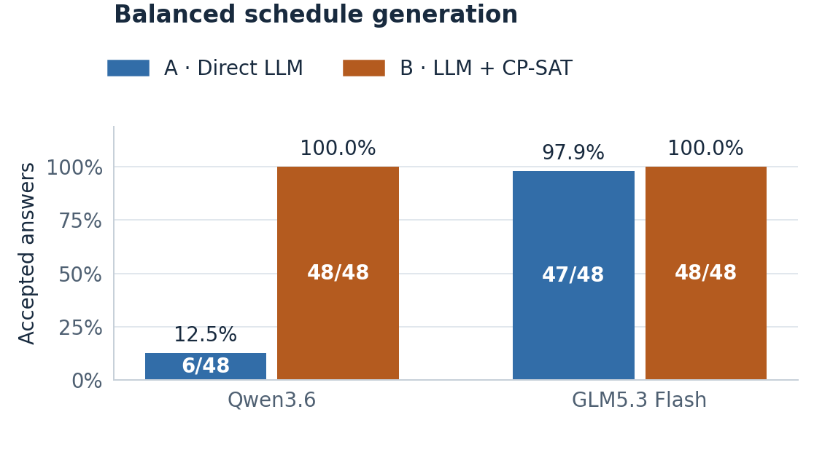
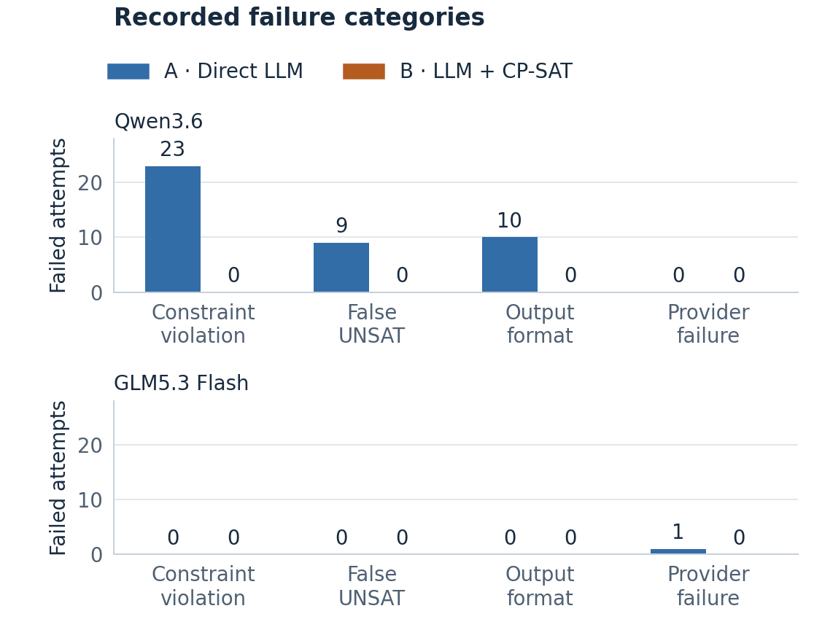

# Balanced generation comparison audit

The current generation study contains **96 scheduling attempts per model**: the same 48 cases attempted once by direct LLM (A) and once by LLM + CP-SAT (B). Both campaigns completed. This is shared-service synthetic/AI-assisted development evidence, with actual human prose/gold review still pending. Earlier studies retain their own datasets, denominators and results.

## Evidence and comparison controls

The [manifest](../results/balanced-evidence-manifest.json) binds two original replay archives, each containing 211 checksummed files. The [derived summary](../results/summary/balanced-comparison-20261017.json) is reproducible with [the comparison builder](../scripts/build_balanced_comparison.py). Its checks establish equal case bundles, source/runtime, non-model settings and all 96 paired prompt hashes/public views across models. Each method has exactly one completed record per case, including failures; no attempt was retried or removed. Fresh analysis using each archive's own source reproduces every saved analysis field.

Qwen requests and returned answers identify `qwen3.6:35b`. GLM requests use the service alias `x-test-1`; every returned answer identifies the required `glm-5.3-flash`. Identity means provider-reported identity, not independent attestation of weights. Each campaign used 96 scheduling requests, two successful capability requests and one metadata request: **99 HTTP requests**, of which only 96 enter evaluation. Both allowances are consumed. This publication made zero model calls.

Settings were one call per case/method, no retries, 32,768 maximum output tokens per completion, 30-second connection and 1,800-second read timeouts, and 30/60-second pipeline/reference solver budgets. The transient-failure policy records eligible service errors and continues to the next distinct attempt. The exact-model policy records backend variation. Fatal identity, authorization, TLS or integrity failures still stop; none was silently bypassed.

## What the balanced design corrects

The [protocol](balanced-generation.md) and [offline construction receipt](../results/summary/balanced-generation-verification-20261015.json) describe 24 SAT and 24 UNSAT cases with independent SAT witnesses and arithmetic UNSAT certificates. Every case has eight activities lasting one or two hours, two participants and one shared room, on a single 09:00–17:00 day with 30-minute slots. Public prose includes its date. Three interaction mechanisms, two numeric layouts and four constraint-presence profiles give 48 cases.

Each profile—neither deadline nor fixed start, deadline only, fixed start only, both—contains six SAT and six UNSAT cases. Twelve deadline and twelve fixed-start counterexamples verify that these constraints can affect feasibility. This removes the earlier difficulty set's perfect association between constraint presence and label. It neither proves that a model exploited the old shortcut nor removes all construction bias. The cases belong to **three conservative construction families**, not 48 independent samples; seeds rename activities rather than create independent scheduling geometries. Do not pool the new scores with earlier studies or present this as a same-dataset before/after experiment.

## Primary and conditional outcomes

Accepted means a schedule valid against gold hard constraints or a correct UNSAT answer. It does not imply optimum preference quality.

| Model / method | Accepted, all attempts | Valid SAT schedules | Correct UNSAT | Optimum among valid SAT schedules |
| --- | ---: | ---: | ---: | ---: |
| Qwen / direct | 6/48 (12.5%) | 1/24 | 5/24 | 0/1 |
| Qwen / CP-SAT | 48/48 (100.0%) | 24/24 | 24/24 | 24/24 |
| GLM / direct | 47/48 (97.9%) | 23/24 | 24/24 | 22/23 |
| GLM / CP-SAT | 48/48 (100.0%) | 24/24 | 24/24 | 24/24 |

Both B paths have 48/48 structurally equivalent extractions in the recorded comparison. This is a finite-case finding, not a general semantic-equivalence guarantee. The independent validator checks concrete schedules without calling CP-SAT; the reference and B solver share a compiler, a limitation supplemented by independent arithmetic certificates and formal regression tests.

## Failure mechanisms and concrete traces

Qwen A's 42 rejections consist of **23 schedules violating hard constraints, nine false UNSAT answers and ten `invalid_json` format failures**. The latter contain prose before the JSON, sometimes with code fences, despite the explicit JSON-only contract. They establish interface noncompliance, not necessarily inability to reason about scheduling. Do not recover their content after the fact and silently replace primary scores. A permissive-parser study would be a separately labelled analysis.

For case `bg-071dcc04607137c07c53df2a`, Qwen starts A7 at slot 2 for four slots, then starts its successor A2 at slot 4, before A7 finishes at slot 6. The saved schedule also places A3 outside availability and overlaps A5/A4 for participant P2. This is a concrete scheduling error beyond format. Qwen's one valid SAT schedule, `bg-4820d9a82a894a3384266377`, has preference penalty 6 against proven optimum 2.

GLM A's sole rejection, case `bg-9ff6d130d56449866109a902`, is a transport failure classified `remote_protocol_error`, after approximately **34.18 seconds**. There is no returned model identity, HTTP status, answer or reported token usage for that request; these fields remain unknown. It is neither a model mismatch nor the 1,800-second read timeout. Subsequent attempts completed. The available evidence identifies a failed connection/response exchange, not its precise remote-server cause. All **47 returned direct answers were accepted**, a secondary conditional result; the primary denominator stays 48. The one-case acceptance gap therefore does not demonstrate poorer direct reasoning. GLM's valid schedule for `bg-12b4e9cdefec3402d2b9c0fe` has penalty 4 against proven optimum 3, providing separate evidence about optimization quality.

After extracting the matching model archive, records are under `runs/controlled/controlled/attempts/`:

| Model / example | Exact record filename |
| --- | --- |
| Qwen precedence/availability/resource violations | `6b140c7b827a9c46aec3c62137c640779968de3b27b5738c36861e6dcc254c29.json` |
| Qwen valid but suboptimal schedule | `9f0aedc8ee0008e052dfeafa2f98d43ee4974b5c66e62a476246d308fb34ad67.json` |
| GLM transport failure | `59c4e2f919930a45f56e0d21ec9140c75f5f008448a9270cf79639fbebe5d23b.json` |
| GLM valid but suboptimal schedule | `9e3353122938995bd9b73445e8a0aa2f0e3619c07d28f71b373af8f6db9c5b46.json` |

The summary's `failure_catalogue` gives all rejected and proven-suboptimal observation identities, diagnostics, violations and resources; archived `cases.json` and `analysis.json` supply gold and reference comparisons. Reviewer-only information must stay out of measured prompts.

## Time, tokens and serving conditions

| Model / method | Mean model-call seconds | Mean pipeline seconds | Mean solver seconds | Mean reported total tokens | Token coverage |
| --- | ---: | ---: | ---: | ---: | ---: |
| Qwen / direct | 8.815 | 8.816 | — | 1,947.60 | 48/48 |
| Qwen / CP-SAT | 11.858 | 11.882 | 0.01757 | 3,112.85 | 48/48 |
| GLM / direct | 33.182 | 33.184 | — | 3,248.62 | 47/48 |
| GLM / CP-SAT | 23.263 | 23.290 | 0.02210 | 3,582.10 | 48/48 |

Model-call and pipeline time coverage is 48/48 in every row, including the transport failure. Token means use only reported observations; unknown usage is not zero. Solver averages describe recorded B pipeline solver timings. Pipeline time excludes study preparation, independent reference computation, analysis and campaign orchestration. Reserved output limits are not consumed tokens or currency costs.

Qwen reports two backends: `vllm-0.23.0-7cd694fa` for 26 A / 34 B calls and `vllm-0.28.0-f8aad13e` for 22 A / 14 B calls. GLM reports `vllm-0.31.0-tp2-64d866e2` for 47 A / 48 B calls, with one unknown. Runs were sequential on a shared service; hardware, load, hidden defaults and provider implementation were not controlled. Observed timing differences do not isolate model speed or parameter count. GLM B's shorter average call time here is a measurement, not a universal efficiency claim.

## Preservation and delivery boundary

All earlier archives, scores and figures remain unchanged. The previous report source, PDF and format receipt are preserved under [report history](history/20261017-before-balanced/). The original balanced run trees remain in place, with a separate verified private full-run backup covering 483 files; [evidence.md](evidence.md) explains its contents and same-device limitation. The public replay packages preserve recorded outputs, not hidden reasoning or unavailable HTTP traffic.

The reproducible code/evidence checkpoint does not complete human authorship, review, model eligibility or course submission. Follow [planning S1–S7](../planning.md#5-current-task-queue-and-acceptance-evidence) and the [submission checklist](submission-checklist.md): confirm course scope/model interpretation; record actual member contributions and AI assistance; review prose/gold and the results; finalize the private report title and PDF; build/rehearse the presentation; perform the recommended independent replay; verify Canvas dates and submit. No additional model run or feature is required solely to force a solver win.
