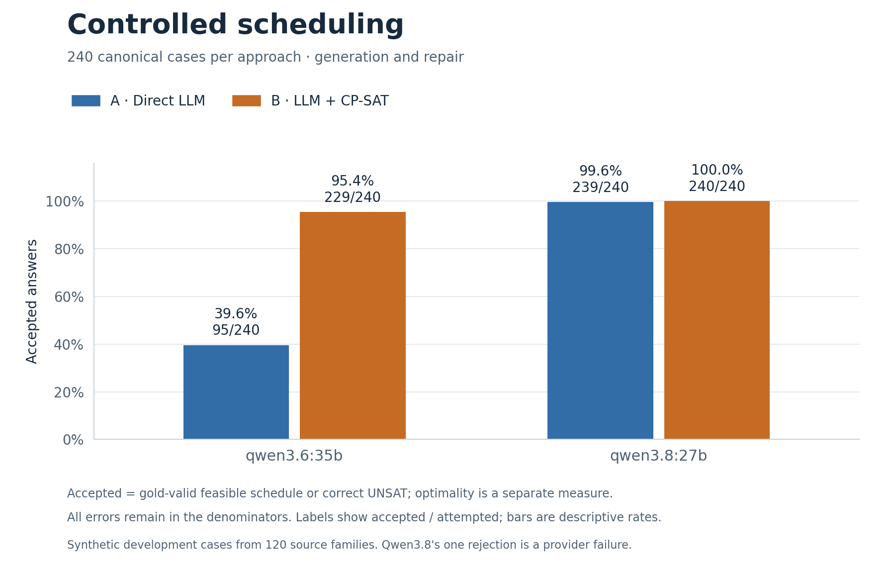
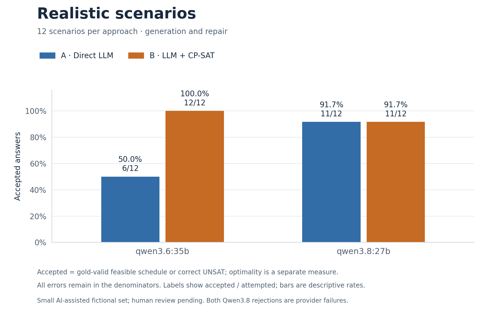
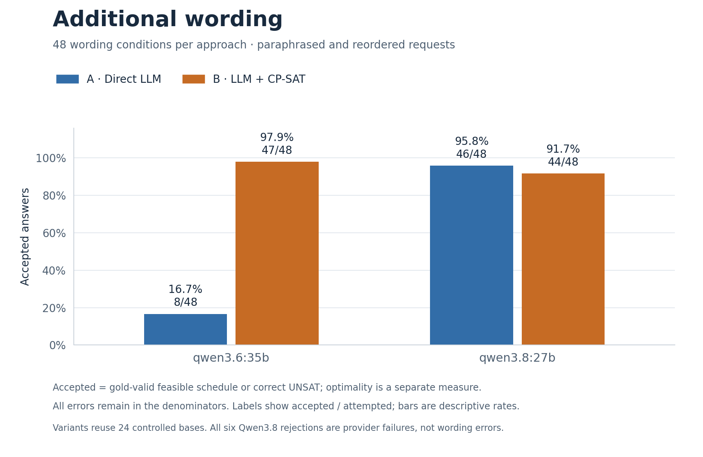

> Historical development reference, preserved 2 October 2026. The root README and planning.md define the current state and delivery work. Earlier pending-work statements and source versions below are historical.

# Dynamic Constraint-Aware Scheduling

**CS3263 Foundations of Artificial Intelligence · Group 23 · NUS AY2026/27 Semester 1**

Generate schedules and repair them when requirements change. This research system compares a language model that produces schedules directly with the same model translating requests into a structured problem solved by OR-Tools CP-SAT. An independent validator checks both approaches against the original requirements.

**Status: working end-to-end system with two complete, replay-validated development benchmarks.** SoCLaaS `qwen3.6:35b` and `qwen3.8:27b` each completed the full 600-attempt design: controlled scheduling, realistic scenarios and wording variants. Generation, minimum-disruption repair, extraction diagnostics, independent validation, replay and the read-only dashboard are implemented. The results are ready for analysis and report writing; **the course submission package is not yet complete**. The report/presentation, genuine member review and interpretation of the course's frontier-model requirement remain open. The internal delivery target is **30 October 2026**.

[Development and final-study plan](../planning.md) · [Contributor and agent instructions](../AGENTS.md) · [Two-model results and readiness audit](../docs/two-model-development-audit.md) · [Submission checklist](../docs/submission-checklist.md)

## Capabilities

- Mandatory, fixed-duration activities on a single-day, 30-minute grid.
- Availability, release times, deadlines, fixed appointments, precedence and participant/resource non-overlap.
- Preference optimization for generation; lexicographic repair minimizing moved activities, then total shift, then preference penalty.
- Shared repair invariants, strict model-output validation, typed extraction differences and bounded constraint-domain explanations.
- Deterministic before/after explanations with feasibility, objective and proof-status boundaries.
- Capped model calls, durable attempt records, guarded block resume, independent scoring, offline replay and CSV/JSON/PNG/PDF exports.
- Separate development/frozen modes, versioned exclusion registries and a localhost dashboard for inspecting saved evidence.

The inputs are synthetic. The system does not connect to real calendars or autonomously change commitments. Multi-day scheduling, participant assignment, model training and production deployment are outside the current scope.

## Architecture

| Component | Responsibility |
| --- | --- |
| Direct LLM — A | One public natural-language request → one model response → parsed schedule or feasibility prediction |
| LLM-to-Solver — B | The same public request → one extraction response → canonical specification → fixed CP-SAT compiler |
| Gold reference | Evaluator-only specification → reference feasibility and proven objective values/bounds |
| Independent validator | Arithmetic checks of each answer against gold, independent of solver compilation |
| Runner and analysis | Preflight, request accounting, immutable records, scoring, replay and figures |
| Explanation and dashboard | Read-only interpretation of solver/evaluation evidence, without new model calls |

Both approaches receive equivalent task information and, for repair, the same original schedule. Gold specifications, labels and review metadata remain evaluator-only. B receives a neutral request ID; evaluator IDs are restored locally after parsing. A solver can correctly solve an incorrectly extracted problem, so **extraction fidelity, solver proof and end-to-end validity are measured separately**.

The integrated components share one package, schema, completion interface and runner. The current live adapter supports the approved NUS SoCLaaS endpoint; another provider would require explicit integration and qualification. [Planning Sections 6–7](development-plan-history.md#system-architecture-and-data-flow) define the interfaces and formal semantics.

## Benchmark results

Both models used the **same source snapshot, runtime, datasets, 600 request prompts and configured budgets**; only the requested model ID changed. Each campaign contains 480 controlled, 24 realistic and 96 additional-wording attempts, plus two capability completions and one metadata request. These are **1,200 scheduling attempts across two models**, not 1,200 independent problems.

| Model | Evaluation block | Direct LLM — A | LLM-to-CP-SAT — B |
| --- | --- | ---: | ---: |
| `qwen3.6:35b` | Controlled | 95/240 — **39.6%** | 229/240 — **95.4%** |
| `qwen3.6:35b` | Realistic | 6/12 — **50.0%** | 12/12 — **100%** |
| `qwen3.6:35b` | Additional wording | 8/48 — **16.7%** | 47/48 — **97.9%** |
| `qwen3.8:27b` | Controlled | 239/240 — **99.6%** | 240/240 — **100%** |
| `qwen3.8:27b` | Realistic | 11/12 — **91.7%** | 11/12 — **91.7%** |
| `qwen3.8:27b` | Additional wording | 46/48 — **95.8%** | 44/48 — **91.7%** |

**Accepted** means a gold-valid feasible schedule or a correct UNSAT answer; it does not imply optimality. All errors remain in the denominators. Qwen3.6 had no provider failures. Qwen3.8 had nine: one timeout, five transport errors, one HTTP 502 and two HTTP 503s. Every non-error Qwen3.8 scheduling answer was accepted; its operational failures must not be described as reasoning or wording failures.







The charts use the same percentage scale and preserve each block's denominator. Download the vector PDFs for [controlled](../results/figures/two-model-development-20261002/controlled-accepted.pdf), [realistic](../results/figures/two-model-development-20261002/realistic-accepted.pdf) and [wording](../results/figures/two-model-development-20261002/language-accepted.pdf) results. [Offline regeneration and figure provenance](../docs/two-model-development-audit.md#regenerate-the-charts) are documented in the results report.

The main finding is **model-dependent benefit from solver assistance**. With Qwen3.6, B substantially improves validity and optimization quality. With Qwen3.8, both approaches nearly saturate controlled validity, while B still matches the gold optimum on all 60 valid controlled repairs; A matches it on 59/60. This supports analysis of reliability, optimization and resource trade-offs, not a universal claim that B is more accurate or that the dataset measures all scheduling abilities.

| Controlled requests | Mean observed model-call time A / B | Mean reported total tokens A / B |
| --- | ---: | ---: |
| Qwen3.6 | 3.57 s / 14.08 s | 1,778.8 / 4,254.1 |
| Qwen3.8 | 42.42 s / 90.46 s | 4,420.5 / 9,045.5 |

Times include observed request overhead and failures. Controlled token coverage is 240/240 for each model/approach except Qwen3.8 A (239/240). Across the complete campaigns, including capability checks, reported usage is **1,773,823 tokens** for Qwen3.6 (602/602 completions) and **3,994,657 tokens** for Qwen3.8 (593/602); missing usage is unknown. Qwen3.8 was safely paused twice without reissuing saved responses. Both pause intervals are recorded; total elapsed campaign time must not be presented as uninterrupted inference time.

**Validation:** all 600 attempts per model are present, with no retries. Fresh scoring matches both exported analyses; each reproduction archive passed all 941 file checksums and reproduced its analysis after extraction. The exact counts, conditional objective metrics, paired intervals, wording transitions, resources, failure taxonomy and evidence hashes are in the [two-model report](../docs/two-model-development-audit.md) and [portable summary](../results/summary/two-model-development-20261002.json).

**Evidence limits:** these are known synthetic/AI-assisted development inputs, not untouched held-out or production data. Wording variants reuse 24 controlled bases. Reported backend versions and unexposed server defaults differ across the hosted models, so the model-only configuration change is not a controlled hardware/weight experiment. Automated mathematical checks and replay do not substitute for human text/gold review or establish course model eligibility.

The earlier [200-call study](../docs/expanded-development-100.md), [original baseline](../docs/main-baseline-validation.md) and component pilots remain historical evidence. They used different packets/settings; do not pool their scores with the new campaigns.

## Submission readiness and next steps

The project follows the proposal's generation/repair, direct-versus-solver, difficulty, realistic-scenario and wording direction. The teaching materials explicitly allow **constructed or downloaded instances**; a public dataset is optional. They require meaningful comparison/analysis, responsible AI, clear reporting and genuine member understanding—not a particular accuracy or a predetermined solver win.

| Remaining work | Completion evidence |
| --- | --- |
| Resolve the course-model interpretation | Check actual proposal feedback or ask whether the two hosted Qwen models satisfy the handout's frontier-model comparison. SoCLaaS/open weights are suggested by the handout, but eligibility is not established by a successful API call |
| Decide the final report's study scope | Explicitly retain the planned fresh frozen study, or revise the plan to an exploratory report using the completed comparisons. Do not relabel inspected data as held out |
| Review and interpret the evidence | Members check text/gold meaning, reference assumptions, extraction failures, paired/conditional metrics, provider failures, responsible-AI limits and the stronger model's accuracy ceiling |
| Finish the report | Replace the old 200-call results and pending slots in [study-draft.md](../docs/study-draft.md), update [claim evidence](../docs/claim-evidence.md), then render and inspect the revised document |
| Finish the presentation and human records | Produce the actual deck/recording, rehearse the complete system and Q&A, and record actual contributions, sources and AI assistance |
| Publish and hand off the executed version | Review the preserved local implementation diff and evidence summaries, publish through the authorized Git workflow, and have a teammate replay the matching archive |

A fresh holdout, 600-call target, exclusively human-written realistic condition and pinned-backend policy are **team study choices**, not separate course mandates. Another full run or third model is not automatically required. If the team retains its stricter final-study plan, those gates remain binding until explicitly revised; no such revision or teaching-team approval is implied here.

Course delivery is a **15-minute presentation plus five-minute Q&A in the week of 9 November**, and a **report due 13 November** with at most ten single-column, single-spaced body pages, at least 11-point font and one-inch margins; title/references are excluded. Verify Canvas feedback, exact cutoffs and the mandatory proposal receipt privately. October 18 (freeze) and October 30 (complete draft) are internal targets. The [readiness audit](../docs/two-model-development-audit.md#course-proposal-and-remaining-delivery) distinguishes course requirements from proposal commitments and team choices; the [submission checklist](../docs/submission-checklist.md) tracks final review.

**Source and publication:** the executed source is an archived, uncommitted snapshot based on `2f0562b`. GitHub `main` was still `2f0562b` at the 2 October audit. The new resilience/backend implementation and these results therefore require review and publication; a fresh clone alone does not yet contain that exact execution snapshot. Exact live-response replay requires the separately supplied checksummed archives. This README update does not claim a commit, push, human sign-off or submission.

### Integrated preparation and preserved handoffs

The [target-size preparation](../docs/final-data-preparation.md) produced **240 development cases / 120 source families** with complete quotas, independently checked SAT witnesses and UNSAT certificates, and a pending human-review packet. Its cumulative registry preserves **1,429 inspected structures / 29 sources**, including rejected proposals. This verifies construction capacity; these inspected cases are not final data. The [integration audit](../docs/main-integration-audit-20261001.md) records current verification and the archive/model-accounting corrections.

The following member handoffs are historical evidence for their recorded source versions:

[Current archive follow-up](../docs/yongqing-archive-review.md): F5 now rejects
checkout-prompt drift, mismatched runtime dependency pins and linked archive inputs,
and excludes unrelated prompt notes. That checkpoint passed 623 tests on macOS/Linux ARM64; its
16-attempt canned rehearsal archive reproduces every analysis field in a separate
network-disabled Linux environment. This is offline engineering evidence; actual
human review and the final study remain pending.

[Earlier preparation handoff](../docs/yongqing-study-preparation.md): the provisional candidate policy, synthetic frozen rehearsal and checked multi-block analysis/archive pass 580 tests on macOS/Linux ARM64. The development policy pilot produced 24 distinct families / 48 cases. This establishes engineering readiness, not final data, human review or model accuracy.

After the locked noneditable installation, run each command with a new output directory:

```sh
.venv/bin/python evaluation/prepare_final_candidates.py runs/NEW-policy-pilot \
  --registry benchmarks/manifests/development-hard-fingerprints-v2-20261001-target-pilot.json --seed 3266303
.venv/bin/python evaluation/rehearse_study.py runs/NEW-frozen-rehearsal
.venv/bin/python evaluation/analyze_study.py runs/NEW-frozen-rehearsal/blocks.json \
  runs/NEW-study-export --figures
```

These commands use no model calls. Carry every new pilot's cumulative registry forward; never treat a pilot as final data. `--figures` uses the existing optional plotting dependency. The rehearsal's approvals and realistic-routing case are explicitly synthetic fixtures. Analysis accepts separate compatible frozen blocks, preserves failed attempts, rejects incomplete/incompatible input, and exports separate primary/realistic/wording summaries plus a checksummed local reproduction archive. `--no-archive` recomputes `analysis.json` from an existing block list. Actual final drawing/execution still requires the decisions and reviews in planning Sections 5 and 11.

To create a reviewer-only packet from an existing candidate output:

```sh
.venv/bin/python evaluation/prepare_case_review.py \
  runs/NEW-policy-pilot artifacts/NEW-case-review
```

This exports gold/reference evidence, all three public renderings and a CSV whose review fields begin pending. Never feed these reviewer files to a scheduling model. The final-data preparation report supplies the realistic-authorship worksheet and exact review procedure.

### Li Hao F2/F6 follow-up

[The current handoff](../docs/lihao-f2-followup.md) records a tested 24-case model
qualification packet and versioned provider execution metadata. New frozen runs
stop on reported backend fingerprint drift; historical replay remains supported.
The authorized live qualification stopped after its first pair because the
reference model returned two serving fingerprints. That original qualification used
six completions including capability checks (4,007 reported tokens). A separate
1 October six-call tiny-JSON diagnostic used 493 reported tokens and again observed
reference-backend variation. The user chose to retain the strict requirement;
that historical qualification remains stopped; its allowance cannot be reused. The separately authorized full development campaign below has a new identity. See the
[diagnostic receipt](../configs/development/lihao-f2-diagnostic-20261001.json).
That small diagnostic supports no quality conclusion by itself; the completed full comparisons are reported above.
See the [report draft](../docs/study-draft.md) and [claim index](../docs/claim-evidence.md)
for F6 preparation and explicitly pending human/final-study work.

The optional small workflow remains available through `evaluation/prepare_model_qualification.py` and `evaluation/run_model_qualification.py`: the default selects Qwen3.8 and 24 cases, giving 48 scheduling completions plus two capability checks and one metadata request. Repeated explicit `--model` arguments prepare a two-model packet; each model executes as its own 51-request session. These alternatives need separate authorization and are not a prerequisite or extra allowance for the selected full campaign. Do not repeat consumed historical attempts.

### Yao Xiang formal-review follow-up

The [1 October F3 review](../docs/yaoxiang-f3-formal-review.md) independently checks
all 48 saved development-pilot cases using arithmetic: SAT witnesses, repair starts
and three UNSAT mechanisms. Six SAT optima are exhaustively checked; 18 exceed the
review cap and retain their solver proofs. The final macOS suite passes 614 tests;
18 new tests and the complete arithmetic receipt also pass on Linux ARM64. Actual
human gold/text review remains pending. Fresh-clone regression needs no model key:

```sh
.venv/bin/python -m pytest -q tests/integration/test_candidate_formal_review.py
```

### Historical Yao Xiang F1 follow-up

[The F1 review](../docs/yaoxiang-f1-review.md) adds eight offline regressions for
the expanded study’s three extraction failures. Exact synthetic final responses
are included, so these tests need neither credentials nor a raw-run archive.
The full macOS suite passes 560 tests. Prompt revision 3 stays active; the reviewed
amendment awaits model qualification and its own bounded comparison.

## Data and evaluation scope

| Dataset | Origin and coverage | Current use |
| --- | --- | --- |
| Legacy v1 | Six project-authored fixtures plus 24 procedural cases; 17 generation/13 repair, 28 SAT/2 UNSAT | Baseline reproduction and regression checks |
| Structural v2 | 144 procedural cases per repetition; balanced task/label strata, structural variation and three repair events at each level | Development and offline qualification |
| Challenge v3 | 108 procedural cases in nine source families; coupled repairs, contradictions and preference trade-offs | Development, pilots and the expanded 100-case comparison |
| Authored drafts | Twelve AI-assisted fictional scenarios; six generation/six repair and six SAT/six UNSAT | Development integration; human prose/gold review pending |
| Source-family policy pilots | Procedural development inputs; latest target-size pilot has 240 cases / 120 families with balanced task/label strata | Construction-capacity and mathematical checks; all inspected structures excluded from future final data |

No public benchmark instances or real calendars have been imported. SCHEDBench, NATURAL PLAN and related work inform the methodology. The authored drafts are not independently human-written or untouched test data. [Planning Section 8](development-plan-history.md#8-benchmark-and-evaluation-design) describes provenance, construction limits, human review and the final study.

## Installation

Requirements: Python **3.12**, Git and a CPU-only macOS or Linux environment. Offline TLS tests require `openssl`; dashboard regression tests require Node.js. The dashboard itself uses no Node server or frontend build. Native Windows has not been qualified.

From your own checkout, using a POSIX shell:

```sh
git clone git@github.com:JellyPenguinnn/cs3263_group23.git
cd cs3263_group23
python3.12 -m venv .venv
.venv/bin/python -m pip install --require-hashes -r requirements.lock
.venv/bin/python -m pip install --no-deps --no-build-isolation .
.venv/bin/python scripts/check_installed.py
.venv/bin/python -m pytest -q
.venv/bin/python -m pip check
.venv/bin/scheduling --help
```

SSH requires configured GitHub access; HTTPS with your own authentication is also supported. Never embed credentials in URLs. Reinstall after source changes, or deliberately use an editable installation during development. `check_installed.py` requires a noneditable installation and compares packaged prompts, certificates and dashboard assets with the checkout. Dependency maintenance is in [planning.md](development-plan-history.md#portable-runtime-and-supported-environments).

## Run offline

No API key is required. Use new output directories so existing evidence is preserved:

```sh
# Solve a specification with real CP-SAT.
.venv/bin/scheduling solve --spec tests/examples/formal-generation.json

# Legacy integration: 180 canned attempts, including six intentional failures.
.venv/bin/python evaluation/offline_demo.py runs/quickstart-offline

# Full structural v2 integration: 144 cases × 3 renderings × 2 paths.
.venv/bin/python evaluation/v2_qualification.py runs/quickstart-v2

# Challenge v3: 108 cases × 3 renderings × 2 paths.
.venv/bin/python evaluation/v2_qualification.py runs/quickstart-v3 --version 3

# Authored drafts: 12 cases × 2 paths, canonical prose only.
.venv/bin/python evaluation/v2_qualification.py runs/quickstart-authored \
  --cases benchmarks/fixtures/realistic-drafts-v1.json
```

These workflows exercise generation/repair, both pipelines, reference checks, accounting, completed resume and replay. They use **gold-derived canned responses**, so their success is integration evidence rather than model performance.

### Dashboard and explanations

```sh
.venv/bin/scheduling dashboard --runs-dir runs --port 8876
```

Open [the local dashboard](http://127.0.0.1:8876). Select a saved run to inspect progress, results and before/after schedules. The dashboard is read-only and binds to localhost; live runs start through the CLI. For a nested qualification run, add `--run-dir runs/quickstart-authored/run`. A full campaign has separate `controlled`, `realistic` and `language` runs; select each block to inspect its own 480/24/96 counter.

```sh
.venv/bin/scheduling explain --run-dir runs/quickstart-authored/run \
  --case-id realistic-draft-07 --approach solver_augmented --format json
```

Explanations distinguish the extracted problem's proof from gold acceptance and report participant inconvenience without claiming fair allocation. For a standalone saved solve, use `--spec problem.json --result result.json` and, for repair, `--original-schedule original.json`. Newly saved results bind proof claims to their exact specification and repair context; mismatches are rejected. Legacy unbound standalone results retain candidate validation but cannot establish proof correspondence to a supplied problem. Historical checked-run replay remains supported.

## SoCLaaS and bounded live runs

SoCLaaS is the implemented provider for both completed comparisons. Confirm the
selected model's course eligibility and the team's final-study decision before any
additional experiment. A different provider needs explicit authorization and a
qualified adapter; neither a commercial API nor a third model is an automatic
course requirement. No additional-provider adapter is currently implemented.

```sh
[ -e .env ] || cp .env.example .env
chmod 600 .env
```

Configure your authorized credential locally. Never put keys in chat, source, issues or logs. The CLI reads process environment variables; it does not automatically load `.env`:

```sh
set +x
set -a
. ./.env
set +a
```

The environment uses `SOCLAAS_BASE_URL`, `SOCLAAS_API_KEY` and `SOCLAAS_MODEL`. Live configuration selects an explicit model; `default` is only a bootstrap alias. Verify current availability/capabilities and agree the request/token budget before each new run or session. **Previous pilot allowances are consumed.** A saved configuration or key grants no new spending permission. TLS certificate and hostname verification remain enabled. Current requests explicitly configure the model and output limit but leave sampling/reasoning controls to server defaults. Qualification must record those defaults or add verified options; do not assume temperature zero, JSON mode or an arbitrary compatible endpoint is supported.

### Full development campaign workflow

The completed campaigns selected **`qwen3.6:35b`** and **`qwen3.8:27b`** explicitly through `--model`, with unchanged revision-3 prompts, **32,768 requested output tokens per completion**, **30/1,800-second connect/read timeouts** and no retries. This timeout is configured by our client, not a documented SoCLaaS service limit. Both arms receive the same limits. B uses a 30-second solve; references use 60 seconds, one worker and seed 0. Sampling/reasoning options remain server defaults. The earlier published checkpoint passed **684 tests on both macOS and network-disabled Linux ARM64** and an exact-input **600-attempt mocked rehearsal**, as recorded in the [integration audit](../docs/main-integration-audit-20261001.md).

The preserved run `campaign-600-live-qwen38-20261001-01` used 900 seconds and the old stop-on-error policy. It stopped after **56 scheduling attempts: 55 returned responses and one timeout**, before the realistic and language blocks. It reserved 59 HTTP requests including metadata/capabilities, took 3,542 seconds, and reported 283,850 tokens with usage available for 57 of 58 completion attempts. Missing timeout usage is unknown, not zero. These partial records are not a completed comparison; their configuration and evidence remain unchanged.

The timeout-continuation checkpoint verified all **726 Python test cases**: 725 passed in the sandbox, and the remaining native macOS certificate check passed outside it (all eight TLS tests passed on that rerun). A mocked 600-attempt campaign retained five timeouts and one HTTP 503 as failures and completed all blocks with exactly 603 HTTP requests. Historical replay matched all 332 previous observations without changing 508 saved JSON files. These are offline regression checks, not a new live benchmark result.

The subsequent live run completed **40 attempts (39 accepted, one timeout)** before a host-app restart interrupted request 41. Its terminal-owned process had no independent supervisor. The [process-recovery note](../docs/benchmark-process-recovery.md) records the evidence and fix. Long local runs now use an OS-owned one-shot service, durable heartbeat/exit records, and dashboard activity verified through an OS-held lock. Keep the Mac awake with its lid open; a service does not keep inference progressing through sleep, logout or reboot.

The recovery and backend-observation implementation previously passed **785 Python tests** on a fresh noneditable macOS installation and **9 dashboard frontend tests**, with installed-source/assets and dependency checks. The completed two-model audit reverified the unchanged implementation, every planned attempt, both analysis exports and archive replay. Qwen3.6 completed across three observed backend fingerprints; Qwen3.8 reported one. The [audit](../docs/two-model-development-audit.md) separates this execution evidence from course submission readiness.

| Block | Development inputs | Scheduling completions |
| --- | --- | ---: |
| Controlled | 240 cases / 120 source families from the target-size pilot, seed `32661001`; canonical wording | 480 |
| Realistic | The 12 AI-assisted fictional cases in [`realistic-drafts-v1.json`](../benchmarks/fixtures/realistic-drafts-v1.json); canonical wording | 24 |
| Language | 24 selected controlled bases, six per task/label and from distinct families; paraphrase and reordered wording | 96 |

Selection precedes model outcomes and balances sweep/event counts within each language stratum. Family normalization and exact source hashes are recorded; language cases retain their controlled partners. The [target-pilot receipt](../benchmarks/manifests/f3-target-development-readiness-20261001.json) identifies the actual controlled bundle and its local archive. Import that preserved bundle before running the preparation example; it is not shipped as raw data in a clone. Human gold/text review remains pending, and the authored drafts retain their AI-assisted provenance. These inspected cases cannot become fresh final evaluation data.

The following sequence documents preparation, authorized execution and completed-run analysis. `runs/IMPORTED-target-pilot/cases.json` denotes the imported receipt-matched input; `NEW-*` paths must be unused. It does not grant another campaign allowance.

```sh
.venv/bin/python evaluation/prepare_development_campaign.py \
  runs/IMPORTED-target-pilot/cases.json runs/NEW-campaign-input \
  --model qwen3.6:35b \
  --qualification-policy strict_model_observe_backend_v1

# macOS: launch once, independently of the coding app. Output root must be new.
# Only for an authorized run; credentials remain in the private local file.
.venv/bin/python evaluation/launch_macos_campaign.py \
  runs/NEW-campaign-input runs/NEW-campaign-live \
  --env-file .env \
  --allow-live --authorization-reference 'ACTUAL_AUTHORIZATION_REFERENCE'

# The supervisor automatically exports analysis, figures and the archive into
# runs/NEW-campaign-live/analysis after the three blocks finish.
# Optional separate offline re-export, after completion; no model calls.
.venv/bin/python evaluation/analyze_study.py \
  runs/NEW-campaign-live/run/blocks.json artifacts/NEW-campaign-analysis \
  --development --figures
```

The launcher prints its `gui/<uid>/<label>` service identifier. Inspect it with `launchctl print SERVICE_IDENTIFIER`; `launchctl bootout SERVICE_IDENTIFIER` intentionally stops/removes it. Lifecycle evidence is under `supervisor/status.json` and `supervisor/exit.json`; `worker-exit.json` records campaign/export completion or interruption. The service has no automatic restart and is not installed for future logins. `evaluation/supervise_development_campaign.py` is the portable entry point for an equivalent one-shot Linux service. `evaluation/run_development_campaign.py` remains a foreground entry point for an intentionally attended terminal.

For projects under Documents, macOS may require **Documents Folder access for the Python executable itself** in Privacy & Security → Files & Folders. The independent service does not inherit the coding app's permission. A successful `launchctl bootstrap` only confirms registration: verify a fresh supervisor heartbeat and worker PID before declaring the run started. If Python is denied access before startup, inspect the adjacent `*-service.stderr.log`, grant the required folder permission and confirm that no provider request was reserved before launching again.

The helper shares a cap of **603 HTTP requests**: one model-list request, two tiny JSON capability completions at the configured ceiling, then 600 scheduling completions. The **19,726,336-token output reservation** covers all 602 completions; input tokens are additional, so it is not a total-token or currency cap. Each block has its own 480/24/96 cap under the shared budget.

Campaign policy `development-campaign-2` selects `provider_failure_policy: continue_transient_v1`. A scheduling timeout, transport error or HTTP 408/500/502/503/504 is saved as a failed attempt, followed by a 30-second cooldown before the **next distinct request**. This also applies to consecutive failures and block boundaries. Failed attempts are never retried, removed from denominators or labelled UNSAT; reservations and actual elapsed time remain recorded. New transport records include a sanitized subtype such as `read_timeout`. A completed campaign means every planned attempt has a record, not that every attempt succeeded.

Exact model checks span both capability responses and every block. The explicitly authorized `strict_model_observe_backend_v1` policy records backend variation, including missing metadata, without stopping. Capability hashes and all capability fingerprints are embedded in each runtime configuration; analysis reports backend coverage and descriptive outcome/pair breakdowns. These are shared-service development results, not a pinned-backend or causal comparison across backend versions. Authentication/permission/quota errors, TLS failures, malformed provider envelopes, missing/wrong returned models, capability failures and exhausted budgets still stop dispatch. The default `strict_model_backend_v1` policy and frozen evaluation continue to reject fingerprint changes. Old packets retain their original behavior and cannot run under changed source/settings; prepare a new packet and use a new authorized run ID. Completed timeout records are not reissued on block resume. Pending/interrupted reservations still require reconciliation, and the whole-campaign directory remains write-once.

The summary records actual request/output reservations, elapsed campaign time, provider failure counts and reported token sums with coverage. `--development` is an explicit analysis opt-in; the default analyzer still requires frozen blocks. Analysis retains all failures and reports controlled canonical, realistic and wording results separately. Stopped/incomplete campaigns do not yield a completed study export; inspect their preserved records without dropping failures. A completed campaign remains development evidence, with final eligibility, independent human authorship/review, fresh data and frozen authorization still pending.

### Expanded development profile

`configs/development/expanded-development-100.json` defines 200 calls, 16,384 output tokens per call, 30/600-second connect/read timeouts, no retries, 30-second B solves and 60-second references. The output reservation ceiling is 3,276,800 tokens, with input tokens additional. This is a generous tested profile for the selected packet, not blanket authorization for future calls. **The completed 200-call allowance is consumed.**

```sh
.venv/bin/python evaluation/prepare_development_expansion.py runs/NEW-expanded-input
.venv/bin/python evaluation/v2_qualification.py runs/NEW-expanded-offline \
  --cases runs/NEW-expanded-input/cases.json
```

Preparation, reference checks and canned qualification are offline. With a new execution authorization:

```sh
.venv/bin/scheduling evaluate-batch --allow-live \
  --cases runs/NEW-expanded-input/cases.json \
  --config configs/development/expanded-development-100.json \
  --run-dir runs/NEW-expanded-live
```

### Legacy baseline reproduction

The legacy configuration is paired with the legacy 30-case bundle. Generate references and inspect the request estimate offline:

```sh
.venv/bin/scheduling benchmark-generate --output runs/NEW-input/cases.json
.venv/bin/scheduling evaluate-plan --cases runs/NEW-input/cases.json \
  --config configs/development/main-baseline.json --output runs/NEW-input/preflight.json
```

It specifies 60 serial calls, at most 8,192 requested output tokens per call, no retries, a 180-second read timeout, ten seconds per B solve and thirty seconds per reference. Input tokens are additional. With a newly authorized cap:

```sh
.venv/bin/scheduling evaluate-batch --allow-live \
  --cases runs/NEW-input/cases.json --config configs/development/main-baseline.json \
  --run-dir runs/NEW-live
```

Do not apply a twelve-case pilot configuration to the full v2/v3 matrix. Create a separate configuration and cap for a different case set. Progress goes to stderr; a completed batch returns 0 even if model answers were rejected. Stopped/exhausted batches return 2. Provider failures stop without hidden retries. Resume requires a matching contract; changed source/configuration needs a new run, and uncertain interrupted requests require reconciliation.

### Replay and final-study controls

```sh
.venv/bin/scheduling evaluate-replay --run-dir runs/NEW-live \
  --export-dir artifacts/NEW-live --figures
```

Replay requires no credentials or new model requests. A fresh clone contains aggregate evidence, not raw live runs: obtain the reviewed synthetic archive/checksum for exact historical replay, or use the canned workflows for independent integration checks.

`freeze-draft` creates an intentionally non-runnable configuration until review, eligibility and authorization references are supplied. See `scheduling freeze-draft --help` and [planning Section 8](development-plan-history.md#8-benchmark-and-evaluation-design). The versioned registry identifies scheduling structure independently of calendar presentation, while provenance hashes retain exact inputs. Legacy unversioned registries and frozen protocols cannot authorize new runs. Rebuild registries from source cases rather than relabelling old digests; retain old archives for replay.

The current registry is [`development-hard-fingerprints-v2-20261001-target-pilot.json`](../benchmarks/manifests/development-hard-fingerprints-v2-20261001-target-pilot.json), covering 29 sources and 1,429 known structures after the target-size development pilot, earlier pilots and retained construction tests. Earlier registries are preserved; carry every subsequent pilot/test addition forward and review completeness before freeze. Supply this versioned object to `freeze-draft --development-registry`; protocol format 2.0 embeds it as `development_registry`. New benchmark manifests must declare `slot-graph-v2`. Historical protocols remain replayable, but cannot be resumed or used for new execution under the changed source contract.

To rebuild from preserved inputs, use repeatable `--bundle` and `--archive-bundle` arguments; include every known development source, including prior pilots. For example, this command creates a **limited registry for the named authored bundle only**:

```sh
.venv/bin/python evaluation/development_registry.py \
  --bundle benchmarks/fixtures/realistic-drafts-v1.json \
  --output artifacts/NEW-authored-registry.json
```

Do not substitute that limited example for the project's complete registry. Existing output files are never overwritten; raw archives referenced by the full registry must be obtained separately to rebuild it.

No run has been approved or executed under the team's held-out final-study protocol. If that protocol is retained, human review, fresh inputs and complete development exclusions, an eligible qualified model, the final protocol and an explicit cap remain prerequisites. The completed exploratory comparisons can be reported honestly without pretending they meet that stricter protocol. Development generators do not produce the planned fresh final packet automatically. F3 implements that preparation; F4 uses separate configurations for canonical and selected-language conditions, and F5 verifies their compatibility before analysis. The implemented standalone entry points are `evaluation/prepare_final_candidates.py`, `evaluation/rehearse_study.py` and `evaluation/analyze_study.py`; see the F3–F5 instructions above. Their offline checks do not satisfy the outstanding human or live-study gates.

## Verification

The [two-model audit](../docs/two-model-development-audit.md) records the latest full live outcomes, replay, archive integrity, matching source/configuration and remaining delivery work. The [integration audit](../docs/main-integration-audit-20261001.md) preserves earlier source, installation and regression evidence. The earlier [checkpoint readiness audit](../docs/checkpoint-readiness.md) records 521 Python and seven frontend tests against its historical source, the 200-attempt canned run and 332 historical replays. Canned success verifies integration; final scientific and submission gates remain open.

[Version 2 validation](../docs/version-2-validation.md) preserves the earlier source hashes, environments and residual limits. It includes proof/input correspondence, calendar-invariant development exclusions, installed-package checks, canned integration, replay, explanations and dashboard consumers. Historical receipts are not verification of later source changes.

```sh
node --check src/scheduling/dashboard/static/app.js
node --test tests/frontend/dashboard.test.cjs
```

Routine tests are offline. Native macOS TLS tests require OS certificate-service access; investigate environment errors without disabling verification. Hosted CI status is separate from local macOS/Linux qualification. Passing tests does not establish human review or final scientific conclusions.

## Repository layout

```text
src/scheduling/
  schema.py, solver.py, objectives.py  # canonical types, CP-SAT and repair
  domain_analysis.py                  # bounded constraint reasons
  validation.py                       # independent gold checks
  explanations.py                     # proof-aware evidence formatting
  providers/, pipelines/              # shared transport and A/B paths
  evaluation/                         # cases, manifests, frozen controls, scoring
  dashboard/                          # read-only server and static assets
prompts/                              # direct and extraction templates
configs/development/                  # bounded settings and verification receipts
configs/experiments/                  # final experiment configurations when approved
benchmarks/                           # fixtures, provenance and exclusion registries
evaluation/                           # offline qualification entry points
scripts/check_installed.py            # installed asset verification
tests/                               # unit, integration and frontend checks
results/summary/                      # reviewed development aggregates
docs/, presentation/               # methods, validation, figures and demo guidance
.github/workflows/                    # installed offline CI
```

Credentials, virtual environments, raw runs and large generated artifacts are ignored. Keep small fixtures, manifests, lockfiles and reviewed summaries versioned.

## Contributing and agent workflow

The team is Tea Li Hao, Tham Yao Xiang and Woo Yong Qing. Existing member branches and component contacts are recorded in the plan for coordination; the next-stage queue describes deliverables rather than a new baseline job split.

Read [AGENTS.md](../AGENTS.md) and [the current work plan](development-plan-history.md#current-priorities-after-the-first-baseline). Preserve existing work, incorporate current `origin/main` and use small reviewed changes. The core components are integrated; prioritize F1–F6 and verify their dependencies. Preserve unpublished local work when comparing with GitHub.

To start with a coding agent, replace `[name]` with your name:

> I am [name]. Read README.md, AGENTS.md and planning.md in full. Inspect the current implementation and Git status, and ensure my working branch incorporates the latest GitHub main while preserving existing work.
>
> Use Sections 4–5 of planning.md to confirm the next incomplete F1–F6 deliverable within my scope. Implement and verify it, then continue through unblocked agreed work while prerequisites and authorization are available. Build on the integrated baseline and avoid rebuilding completed components.
>
> Follow the architecture and formal reasoning guidance in Sections 6–7, the relevant evaluation and provider requirements in Sections 8–9, and the acceptance gates in Section 11. Distinguish required deliverables from optional optimizations.
>
> Ask focused questions only for consequential unresolved decisions or missing setup details; reuse previous confirmations and make routine engineering choices independently. Ask about credential availability without requesting secret values. Continue independent work when another task is blocked.
>
> Carry the work through implementation and relevant verification. Report completed changes, checks and observed results, remaining dependencies, and the next concrete task. Follow AGENTS.md for Git publication, live-call authorization, scientific integrity and handoff.

Members must review and understand the system, record actual contributions and disclose AI assistance. Human sign-off and teaching-team decisions cannot be supplied by an agent.

## Responsible AI, references and license

Use synthetic data and preserve privacy. Never silently relax hard requirements. Explain objective trade-offs and unequal participant inconvenience without claiming fair workload allocation. Responsible-AI analysis, source attribution and honest human/AI contribution records are course deliverables.

[Planning's source-grounding section](development-plan-history.md#16-source-grounding) connects the design to SCHEDBench, NATURAL PLAN, formalization research and release-matched OR-Tools documentation. Public data adaptation and extra research arms remain optional, separately scoped work.

A distribution license has not yet been selected. Third-party dependencies and cited materials retain their respective licenses.
