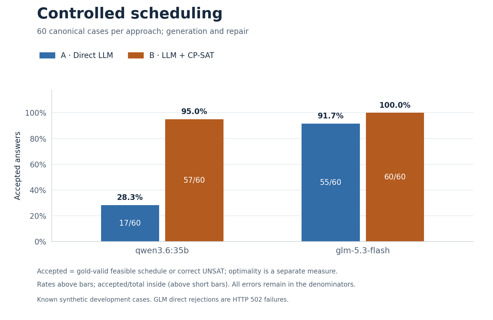
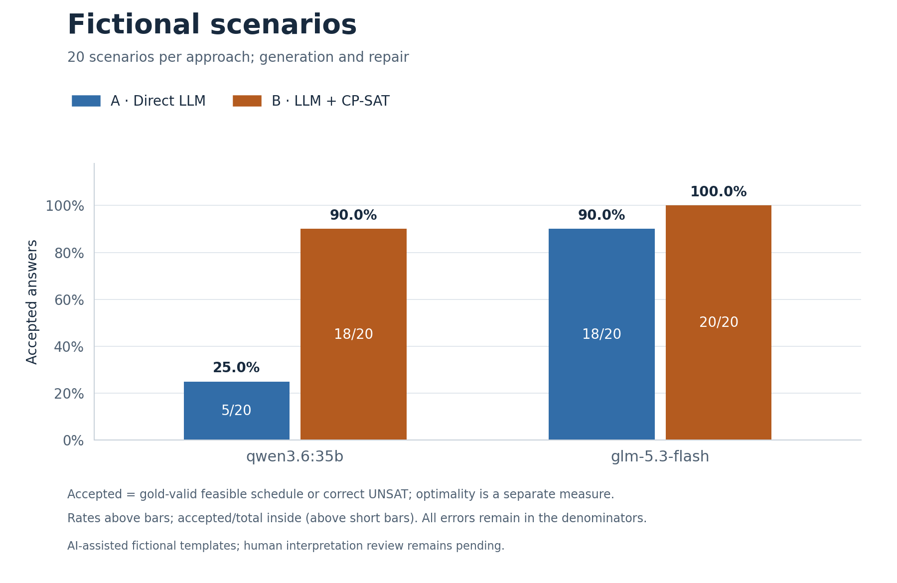
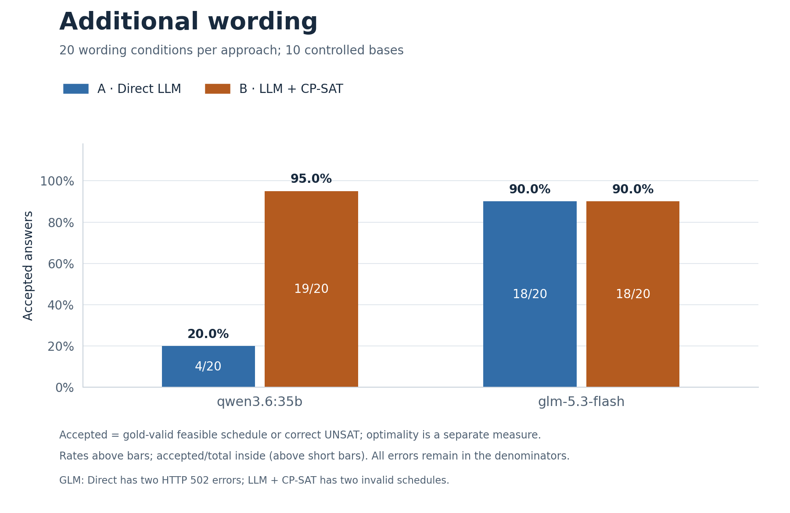
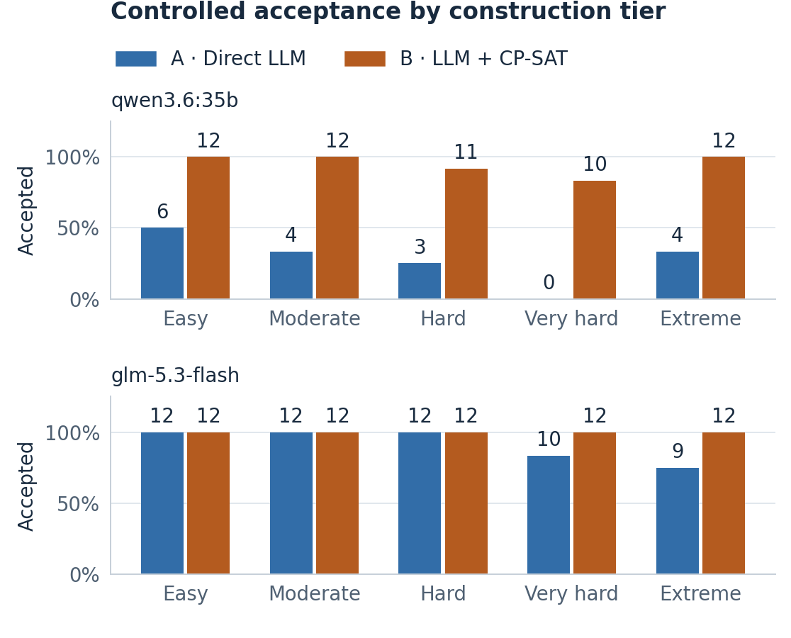
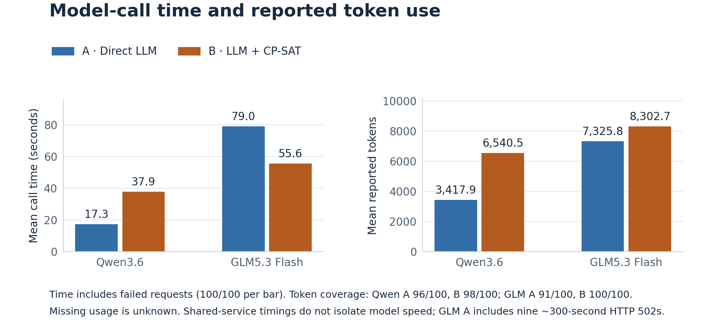

# Qwen3.6 and GLM difficulty-study audit

Both **200-attempt campaigns completed**, with all three blocks exported and every saved analysis field reproduced by fresh offline replay. This is a valid, comparable **shared-service development study**, with the interpretation limits below. Provider failures are completed failed observations, not missing experiments. This audit uses no new inference.

The [report](submission-report.md) presents the scientific narrative. The [summary](../results/summary/difficulty-comparison-20261014.json) contains block/tier/task counts, paired intervals, resources and the failure catalogue. The [execution/replay receipt](../results/summary/difficulty-run-validation-20261014.json) records campaign completion, capabilities, usage coverage and exact replay. The [manifest](../results/difficulty-evidence-manifest.json) binds the two original reproduction archives.

## Integrity and comparison controls

| Check | Verified result |
| --- | --- |
| Completion | 200 scheduling records per model: 120 controlled, 40 fictional, 40 wording; no pending attempts; supervisors exited 0; analysis exported |
| Request accounting | Each campaign reserved 203 requests: 200 scheduling, two capabilities, one metadata; one attempt per completion, no retries |
| Archives | Original bytes copied into `results/archives/`; outer hashes, exact membership and all 364 inner file hashes per archive verified |
| Replay | Each archive's own source produced exactly its saved complete `analysis.json`; all 400 observations retained |
| Inputs | Identical three case bundles, all 200 paired prompt hashes and public task views |
| Implementation | Identical 244-file source snapshot, runtime and non-model settings |
| Identity | Qwen requested/returned `qwen3.6:35b`; GLM requested `x-test-1`, required/returned `glm-5.3-flash`; no mismatch in either completed campaign |
| Capabilities | Both capability completions passed per model; the GLM campaign's 193 successful responses including capabilities all report the expected identity |

Both use 32,768 requested output tokens per completion, 30/1,800-second connect/read limits, no retries, revision-3 prompts, 30-second method-B and 60-second reference solves, one solver worker and seed 0. The only allowed configuration differences are requested/required model identity and observed capability/backend metadata. Qwen reports two fingerprints (`vllm-0.23.0-7cd694fa`, `vllm-0.28.0-f8aad13e`); GLM reports one (`vllm-0.31.0-tp2-64d866e2`). Model weights, hidden sampling/reasoning defaults and hardware are not independently attested.

The earlier GLM campaign stopped after 22 scheduling attempts following a returned-model mismatch. Its records remain preserved and are excluded here. The later successful routing does not establish permanent provider stability. The previous 600-attempt Qwen3.6/Qwen3.8 studies are also preserved, but use a different dataset and are not pooled with these results.

## Dataset and denominators

Each model receives 100 paired conditions: 60 controlled cases, 20 fictional cases and two wording variants for each of ten controlled bases. These represent **80 unique cases**, not 100 independent problems. The 40 generated families normalize to **39 distinct hard-structure groups**, because families `763051de490e2a84f3946b4d` and `00eaf3055a3435619e8c32fc` share a normalized structure. Controlled generation and repair each have 30 pairs but 29 normalized groups. Preserve the original grouping rather than treating the duplicate structure as independent evidence.

Five construction tiers use 4/8/12/20/32 activities. Each controlled tier has twelve cases per method, six per task and three per task/label cell. These small descriptive cells combine size and interaction changes. Tier names do not establish a complexity class, monotone empirical difficulty or a causal size effect. Fictional inputs are AI-assisted templates; natural-language/gold review remains a human task. All inputs are known development data, not a fresh holdout or real calendars.

## Acceptance and feasibility

A = Direct LLM; B = LLM specification extraction + CP-SAT. Acceptance is a gold-valid schedule or correct UNSAT. Every provider, parser and solver failure stays in the denominator; acceptance alone does not require an optimal schedule.

| Model | Block | A accepted | B accepted |
| --- | --- | ---: | ---: |
| Qwen3.6 | Controlled | 28.3% (17/60) | 95.0% (57/60) |
| Qwen3.6 | Fictional | 25.0% (5/20) | 90.0% (18/20) |
| Qwen3.6 | Wording | 20.0% (4/20) | 95.0% (19/20) |
| GLM5.3 Flash | Controlled | 91.7% (55/60) | 100.0% (60/60) |
| GLM5.3 Flash | Fictional | 90.0% (18/20) | 100.0% (20/20) |
| GLM5.3 Flash | Wording | 90.0% (18/20) | 90.0% (18/20) |







| Model | Controlled task | A SAT valid | B SAT valid | A correct UNSAT | B correct UNSAT |
| --- | --- | ---: | ---: | ---: | ---: |
| Qwen3.6 | Generation | 2/15 | 15/15 | 9/15 | 13/15 |
| Qwen3.6 | Repair | 2/15 | 14/15 | 4/15 | 15/15 |
| GLM5.3 Flash | Generation | 11/15 | 15/15 | 14/15 | 15/15 |
| GLM5.3 Flash | Repair | 15/15 | 15/15 | 15/15 | 15/15 |

Controlled paired B-minus-A differences (percentage points; 95% grouped-bootstrap intervals, 10,000 resamples, seed 3263) are Qwen generation **+56.7 [36.7,75.9]**, repair **+76.7 [60.0,90.3]**; GLM generation **+16.7 [3.4,31.0]**, repair **0.0 [0.0,0.0]**. The GLM generation difference is caused by provider failures in A, not demonstrated reasoning superiority. The observed repair ceiling does not prove population equivalence.



Qwen A's tier counts are 6,4,3,0,4 out of twelve; B's are 12,12,11,10,12. The extreme-tier rebound rules out a simple monotone interpretation. GLM B accepts all twelve at every controlled tier; A's counts are 12,12,12,10,9, with all declines attributable to HTTP 502 failures. Its two extraction failures occur in the reordered extreme wording subset instead.

## Failure taxonomy and optimization

These totals describe the 100 attempts per method across blocks; they are not independent-sample pooled accuracy estimates.

| Model/method | Accepted | Invalid schedule | False UNSAT | Invalid output | Provider failure |
| --- | ---: | ---: | ---: | ---: | ---: |
| Qwen A | 26 | 32 | 20 | 18 | 4 |
| Qwen B | 94 | 0 | 1 | 3 | 2 |
| GLM A | 91 | 0 | 0 | 0 | 9 |
| GLM B | 98 | 2 | 0 | 0 | 0 |

Qwen A's invalid schedules comprise fifteen false-SAT answers on gold-UNSAT cases and seventeen invalid schedules on feasible cases. GLM B has one of each. All successfully returned GLM A answers are accepted (91/91), but this conditional observation cannot replace failure-inclusive rates.

Reference-objective matching, conditional on valid gold-SAT outputs with proven reference objectives, is **1/5 Qwen A, 48/48 Qwen B, 41/42 GLM A and 49/49 GLM B**. There are four proven-suboptimal Qwen A outputs and one GLM A output. Earlier lexicographic gaps leave later gaps undefined; those later nulls must not remove a proven-suboptimal output from this denominator. Failures do not receive zero gap.

The following are directly checked output mechanisms, not guesses about hidden reasoning. Paths are **relative to the corresponding verified archive**, and the machine-readable failure catalogue binds record hashes and full observation identities.

1. **Qwen B confuses availability with a blocked interval.** Moderate reordered repair `difficulty-0fd2c91a8d9ebf63959d5309-repair` says P0 is available [0,48) and blocked [0,1). The extraction instead makes availability [0,1), retains the block, and returns UNSAT for a gold-SAT request with reference objective (3,5,74). A witness demonstrates the hard-feasibility mismatch. Trace: `runs/language/language/attempts/ba71aafaedb38c993c860e06f5e478e93a2a6004c46b9f7c29c7bce3be6aa595.json`.
2. **GLM B drops hard precedence in an impossible repair.** Extreme reordered repair `difficulty-0020c5ec0fe4660f50b9020b-repair` loses A21→A11 and A1→A5 plus two preferences. A21 starts at 17 for two slots, but A11 starts at 0, violating 17+2≤0. CP-SAT proves optimality only for the weaker extraction; gold is UNSAT. Trace: `runs/language/language/attempts/c9702e2384c1eb570f6f2ed7c4919e4a3170abc3a339a0621327885627c9c65f.json`.
3. **GLM B drops four precedence edges in feasible generation.** Extreme reordered generation `difficulty-a3c657c260a8d9be7aaf0f9f-generation` loses A28→A10, A21→A14, A16→A15 and A13→A9; the returned schedule violates all four. For example, A21 starts at 26 for one slot while A14 starts at 0. Trace: `runs/language/language/attempts/ab98756664b5b57369a8fff136117c3ecd222d8ff7952683906b40cc70fc8096.json`.
4. **A valid GLM direct schedule is not optimal.** Easy canonical generation `difficulty-0b7187410c3abe24d822d691-generation` has preference penalty 15 versus reference 8; B reaches 8. Trace: `runs/controlled/controlled/attempts/d30ef6153be61d0221f94652f73416fc7e12d5d4ad8224dfc85f1d2031e51e56.json`.
5. **Qwen B emits unsupported schema fields.** Fictional hard repair `difficulty-eca2aa698b8215bc8ffccd74-repair` inserts `blocked_start`/`blocked_end` fields into an availability interval. Strict parsing rejects the specification before CP-SAT, so this is not a solver failure. Trace: `runs/realistic/realistic/attempts/ed384b4fc4835263ce44b46bf7e2aaf249d283ce1930522419807562d8d24ed4.json`.

GLM B accepts the canonical counterparts of its two extraction failures. Reordering is associated with these observations, but one sample per condition cannot establish a causal wording effect. Structural differences occur in 58/95 schema-valid Qwen extractions and 14/100 GLM extractions; witnesses demonstrate hard-feasibility differences in one and two respectively. Ten clock-time paraphrases omit the calendar date. Gold uses 26 October 2026, while each model supplies other dates; only `horizon_start` differs for these incompatible-frame checks. This is underspecified input metadata, not a demonstrated extraction error. Relative-slot validity remains interpretable, but the bounded calendar-frame witness comparison is inapplicable. A future dataset version should explicitly supply the intended date or formally define date-independent input semantics; do not retroactively change these cases or scores. Neither structural differences alone nor matching finite witnesses establish semantic equivalence or inequivalence in general.

## Resources and service effects



| Model/method | Mean model-call seconds | Mean reported tokens | Token coverage |
| --- | ---: | ---: | ---: |
| Qwen A | 17.28 | 3,417.9 | 96/100 |
| Qwen B | 37.87 | 6,540.5 | 98/100 |
| GLM A | 79.00 | 7,325.8 | 91/100 |
| GLM B | 55.59 | 8,302.7 | 100/100 |

Timing covers all attempts, including errors; token means use reported usage only. Missing tokens remain unknown. Executed B solves average 61.8 ms for Qwen (95 solves) and 62.6 ms for GLM (100). Model calls dominate local solving. The Qwen campaign has four HTTP 502 and two remote-protocol errors; GLM has nine HTTP 502 errors, all direct. GLM errors occur near 300 seconds despite the 1,800-second client timeout, suggesting an upstream limit without establishing its cause. Their duration contributes to GLM A's higher mean, so the result is not a controlled model-speed comparison.

Campaign usage including capability calls is 969,165 reported tokens for Qwen (196/202 completions) and 1,497,043 for GLM (193/202). Reserved output ceilings are not consumption or input-inclusive cost. The summary also records medians and solver coverage; archived analyses retain per-tier resource distributions and paired observations.

## Reproduction and interpretation

Follow [evidence.md](evidence.md) for exact-source replay. The derived comparison and charts can be rebuilt offline:

```sh
python3.12 scripts/verify_evidence.py --manifest results/difficulty-evidence-manifest.json
python3.12 scripts/build_difficulty_comparison.py
MPLCONFIGDIR=.cache/matplotlib .venv/bin/python scripts/render_difficulty_results.py
MPLCONFIGDIR=.cache/matplotlib .venv/bin/python scripts/render_difficulty_results.py \
  --report --output docs/figures/difficulty-comparison-20261014
```

The evidence supports strong solver benefit for Qwen and a narrower GLM trade-off: direct answers can reach the feasibility ceiling on returned responses, yet objective quality and extraction robustness still matter. More difficulty does not guarantee a strong model will fail. These results answer the consultation's emphasis on varied cases, efficiency and failure mechanisms without requiring a solver victory. Human interpretation, course-model eligibility and submission work remain in [the checklist](submission-checklist.md).
