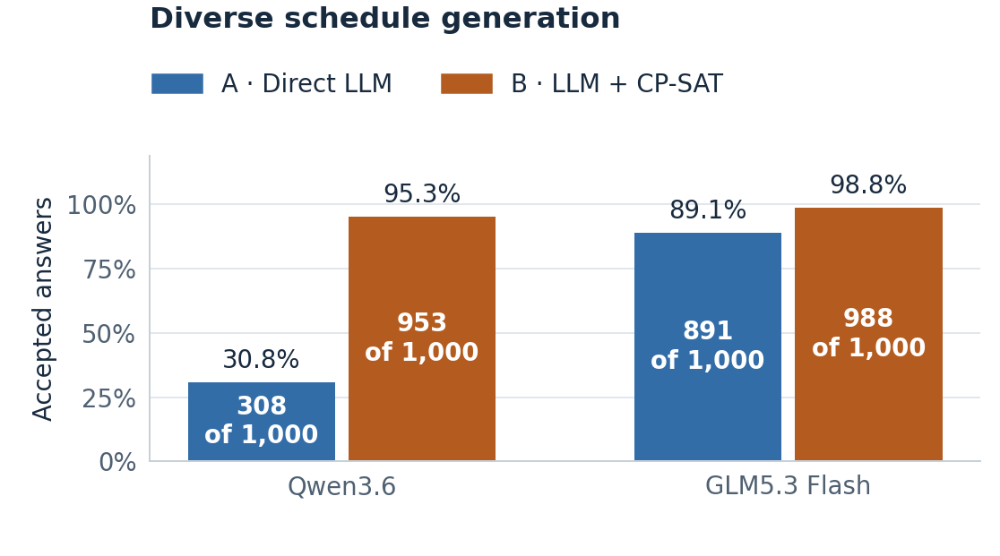
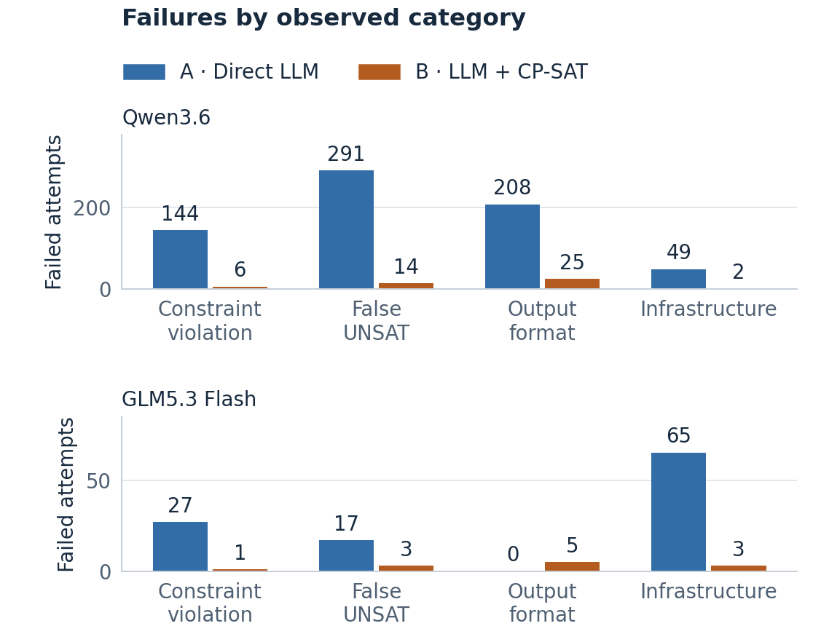
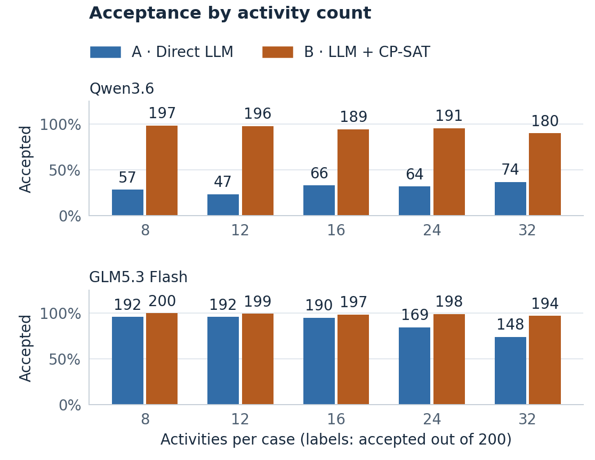

# Diverse generation comparison audit

The completed study contains **2,000 scheduling attempts per model**: the same 1,000 canonical cases attempted once by direct LLM (A) and once by LLM + CP-SAT (B). Both models completed every planned attempt, including failures. This is shared-service, synthetic/AI-assisted development evidence from ten conservative construction families. It is not a held-out or production study, and 1,000 distinct instances are not 1,000 independent families. Earlier studies retain separate denominators and results.

## Evidence integrity and comparison controls

The [portable evidence manifest](../results/diverse-evidence-manifest.json) identifies two explicitly redacted derivatives, each containing **3,077 checksummed files**. The original numerical and operational archives remain unchanged outside the repository. The derivatives remove only absolute local `original_campaign` provenance paths, update the affected manifest/analysis checksums, and add execution-provenance/timing evidence and a transformation receipt. Each preserves **3,054 scientific members byte for byte**, including every attempt, case bundle, reference and archived source file. Historical original hashes remain original hashes. The packaging script is [package_diverse_evidence.py](../scripts/package_diverse_evidence.py).

The offline audit verified both original numerical archives (3,073 checksummed members each), both original operational archive digests, and both portable derivatives. Frozen-runtime replay of the portable archives reproduced **all 4,000 saved evaluation records exactly**, with no pending or unstarted attempt. Each model has exactly 2,000 unique case/method/variant/repeat identities and exactly one recorded provider attempt per identity. No retry or model call was made during this audit. These records establish no repeated client-side call; they cannot establish what a provider did internally after a failed connection.

Both models have byte-identical case bundles, equal public views and matching prompt hashes for every corresponding method/case. Configuration is one canonical rendering, one repeat, rendering seed 3263, 32,768 requested output tokens per completion, 30-second connect/1,800-second read timeout, no retries, and 30/60-second pipeline/reference solver budgets with one worker and seed zero. Temperature, top-p, provider seed, reasoning effort and response format were omitted; effective server defaults and weight revisions are unavailable. Backend variation was recorded rather than silently discarded.

Qwen requested and returned `qwen3.6:35b`; every one of its **1,949 successful scheduling responses** has that identity. GLM requested alias `x-test-1`; all **1,932 successful responses** returned exactly `glm-5.3-flash`. Failed requests without a response have no observed identity. Provider-reported names do not independently attest weights or resolve course eligibility.

Each model consumed 2,000 scheduling reservations, two capability completion reservations and one metadata reservation: **2,003 HTTP reservations**, including **2,002 completions**. The capability requests are excluded from scheduling scores. All allowances are consumed.

## Accepted results and infrastructure separation

| Model / method | Accepted / all attempts | Infrastructure failures | Other rejected attempts | Accepted / returned responses (secondary) |
| --- | ---: | ---: | ---: | ---: |
| Qwen3.6 / A · direct | 308/1,000 (30.8%) | 49 | 643 | 308/951 (32.4%) |
| Qwen3.6 / B · CP-SAT | 953/1,000 (95.3%) | 2 | 45 | 953/998 (95.5%) |
| GLM5.3 Flash / A · direct | 891/1,000 (89.1%) | 65 | 44 | 891/935 (95.3%) |
| GLM5.3 Flash / B · CP-SAT | 988/1,000 (98.8%) | 3 | 9 | 988/997 (99.1%) |

Every infrastructure failure remains in the primary 1,000-attempt denominator. The returned-response column helps separate service availability from answer quality; it does not replace the primary metric or prove that failed requests would have answered correctly. Infrastructure loss is strongly asymmetric between methods, so the raw acceptance gap is not purely a reasoning gap.

| Model / method | HTTP 502 | HTTP 429 | Transport error | Read timeout | Total infrastructure failures |
| --- | ---: | ---: | ---: | ---: | ---: |
| Qwen3.6 / A | 44 | 4 | 1 | 0 | 49 |
| Qwen3.6 / B | 0 | 0 | 2 | 0 | 2 |
| GLM5.3 Flash / A | 61 | 1 | 0 | 3 | 65 |
| GLM5.3 Flash / B | 1 | 1 | 0 | 1 | 3 |

Qwen transport failures comprise two `connect_error` events (one per method) and one B `remote_protocol_error`. HTTP 502 is a gateway/service response, not a locally rejected schedule or evidence of model reasoning failure. GLM's 62 HTTP 502 events have observed durations of 300.03–303.55 seconds (median 300.10); this is consistent with an upstream gateway limit, but the traces do not identify the failing backend component. Qwen's 44 HTTP 502 events range from 120.14 to 196.11 seconds. No error was automatically retried.

## Feasibility, extraction and optimization

| Model / method | Valid SAT / 500 | Correct UNSAT / 500 | Optimum / valid SAT | Format rejection | False UNSAT | Invalid schedule |
| --- | ---: | ---: | ---: | ---: | ---: | ---: |
| Qwen A | 1 | 307 | 1/1 | 208 | 291 | 144 |
| Qwen B | 467 | 486 | 467/467 | 25 | 14 | 6 |
| GLM A | 404 | 487 | 403/404 | 0 | 17 | 27 |
| GLM B | 492 | 496 | 492/492 | 5 | 3 | 1 |

Qwen direct's overall score is mostly correct infeasibility predictions, with only one valid feasible schedule. Its 208 format/schema rejections comprise 190 invalid-JSON results, eight missing-activity results, four duplicate-activity results, three invalid envelopes, two invalid schedule entries and one simultaneous duplicate/missing case. These are strict interface-contract failures; they do not alone prove mathematical inability. No post-hoc answer repair enters the scores.

Qwen B has 873 structurally matching and 100 differing parsed extractions; 80 of the latter still produce accepted answers. GLM has 959 matching and 33 differing; 29 of the latter are accepted. All structurally matching extractions produce accepted outcomes here. Structural difference is not equivalent to harmful semantic error, while an accepted answer does not prove the extracted feasible set is correct. No primary rejection is a local solver timeout/UNKNOWN.

All 500 feasible references are proved optimal, with preference penalties ranging from 0 to 37 (median 12, mean 13.946, only two zero). None has every unary start domain fixed to a singleton. Consequently, conditional optimum matching is not an all-zero-objective artifact, but the constructed tasks and short solve times do not establish difficult global search. GLM's sole valid suboptimal direct schedule has penalty 33 versus 30, gap three.

## Paired outcomes and response sensitivity

| Model | Both accepted | A only | B only | Neither | Primary B minus A |
| --- | ---: | ---: | ---: | ---: | ---: |
| Qwen | 299 | 9 | 654 | 38 | 64.5 percentage points |
| GLM | 884 | 7 | 104 | 5 | 9.7 percentage points |

The ten-family paired bootstrap gives descriptive ranges of 61.1–67.6 points and 6.8–13.1 points (10,000 resamples, seed 3263). These describe reweighting of ten designed mechanisms, not population confidence over real calendars.

On **matched pairs with both responses delivered**, Qwen scores 307/949 versus 907/949, and GLM scores 891/935 versus 927/935. GLM's gap is then 36/935 = 3.85 points. This secondary comparison preserves pairing but still conditions on nonrandom response availability; primary scores retain all failures.

## Size and mechanism coverage

Each size row has 200 cases per method; each mechanism row has 100. These partitions reconcile to 1,000 per model/method. Activity count is confounded with other construction settings and does not establish intrinsic hardness.

| Activities | Qwen A | Qwen B | GLM A | GLM B | GLM A infrastructure |
| --- | ---: | ---: | ---: | ---: | ---: |
| 8 | 57/200 | 197/200 | 192/200 | 200/200 | 0 |
| 12 | 47/200 | 196/200 | 192/200 | 199/200 | 0 |
| 16 | 66/200 | 189/200 | 190/200 | 197/200 | 4 |
| 24 | 64/200 | 191/200 | 169/200 | 198/200 | 21 |
| 32 | 74/200 | 180/200 | 148/200 | 194/200 | 40 |

At 32 activities, 40 of GLM A's 52 failures are infrastructure outcomes: primary acceptance is 148/200, while returned-answer acceptance is 148/160. Do not describe the full decline as lost reasoning ability. Qwen's nonmonotonic counts are dominated by correct UNSAT predictions.

| Mechanism | Qwen A | Qwen B | GLM A | GLM B |
| --- | ---: | ---: | ---: | ---: |
| appointment collision | 38/100 | 93/100 | 96/100 | 100/100 |
| fragmented packing | 32/100 | 96/100 | 76/100 | 97/100 |
| mixed order resource | 31/100 | 98/100 | 91/100 | 99/100 |
| participant contention | 24/100 | 96/100 | 93/100 | 100/100 |
| participant crossing | 36/100 | 92/100 | 93/100 | 99/100 |
| precedence chain | 32/100 | 96/100 | 86/100 | 100/100 |
| precedence fork join | 25/100 | 96/100 | 82/100 | 96/100 |
| release deadline chain | 25/100 | 93/100 | 92/100 | 99/100 |
| resource person crossing | 34/100 | 96/100 | 95/100 | 100/100 |
| room contention | 31/100 | 97/100 | 87/100 | 98/100 |

## Concrete failure traces

All records below are preserved under `runs/controlled/controlled/attempts/` in the indicated model archive. The corresponding `cases.json` supplies gold, and the summary's `failure_catalogue` supplies full diagnostics. These selected examples illustrate mechanisms, not their population frequency.

| Model / case | Observation | Record filename |
| --- | --- | --- |
| GLM A · `dg-07a8a364db88956122484ec6` | A1 starts 5, duration 2, finishes 7; A4 starts 2 despite A1-before-A4 (`C_bg3`) | `5dc57ad195ff394b9e176769b0a0e29dc42f2a8b5b69032eaae37d852fb37cc9.json` |
| Qwen B · `dg-901f5127b3f63880cc499f19` | Eight invented deadlines, including A1 deadline 4 despite duration 2 and availability [4,6), cause false UNSAT | `3d005cfc79ee78cfde0333691438c5eb042f0b4f7fbb9f0f2aeec7c070a82927.json` |
| GLM B · `dg-93645cd68c645d31d613fa2b` | Drops A2 deadline and A29-before-A10; both start 4 while A29 lasts 2, violating omitted precedence | `d4253d4cc1258632f7a50be19c224e354e7c37e5824dd279ef47b234e6e3b69d.json` |
| GLM B · `dg-58ec86e70a9442ee790765cd` | Replaces A6-before-A9 with A5-before-A9; A5 cannot finish before 10, A9 must start by 6, causing false UNSAT | `d1712c708488f9002df00f37b05cad1c3c5eb72f91f439a5062c87bdeed3f8dd.json` |
| GLM A · `dg-a7542bcaf35f7024ab973f3c` | Gold-valid schedule, preference penalty 33 versus proven optimum 30 | `4ffbbe48c36b04daae820c2d14b4bedd54de33e7e6b17caadfbb066f337f8002.json` |

## Execution phases and timing comparability

Completed attempts were reused across explicitly recorded concurrency changes. The first **407 Qwen records** copied into its final continuation and the first **92 GLM records** copied into its final continuation remain byte-identical to their originals. Separate preservation receipts also verify 3,039 files in the completed Qwen tree and 1,105 files in the original GLM phase, with zero changed or missing files.

| Model | Operating system | Concurrent requests | A attempts | B attempts | Infrastructure failures A / B |
| --- | --- | ---: | ---: | ---: | ---: |
| Qwen3.6 | 26.5.2 | 1 | 148 | 147 | 2 / 1 |
| Qwen3.6 | 27.0.1 | 1 | 48 | 48 | 1 / 0 |
| Qwen3.6 | 27.0.1 | 16 | 8 | 8 | 5 / 0 |
| Qwen3.6 | 27.0.1 | 8 | 796 | 797 | 41 / 1 |
| GLM5.3 Flash | 27.0.1 | 8 | 46 | 46 | 1 / 1 |
| GLM5.3 Flash | 27.0.1 | 4 | 954 | 954 | 64 / 2 |

The four Qwen HTTP 429s occurred in the 16-request phase; its subsequent 8-request phase had no new HTTP 429. GLM's two HTTP 429s occurred in its initial 8-request phase; its remaining 1,908 attempts at concurrency four had no new HTTP 429.

There are **zero cases with both methods under the same OS and concurrency in both models**. Consequently, a uniform cross-model speed comparison cannot be made. Phase means below describe different case subsets, shared-service conditions and execution periods; changing concurrency is not a randomized experiment. Qwen reports two serving fingerprints (`vllm-0.23.0-7cd694fa`: 1,280 successful calls; `vllm-0.28.0-f8aad13e`: 669). GLM reports one (`vllm-0.31.0-tp2-64d866e2`: 1,932). Hardware, load and effective omitted controls were not fixed.

| Model / OS / concurrency | Method | Attempts | Mean provider elapsed seconds | Median provider elapsed seconds | Mean reported tokens | Token coverage |
| --- | --- | ---: | ---: | ---: | ---: | ---: |
| Qwen / 26.5.2 / 1 | A | 148 | 23.99 | 1.45 | 4,243.8 | 146/148 |
| Qwen / 26.5.2 / 1 | B | 147 | 15.94 | 14.17 | 4,273.9 | 146/147 |
| Qwen / 27.0.1 / 1 | A | 48 | 24.34 | 0.50 | 4,760.3 | 47/48 |
| Qwen / 27.0.1 / 1 | B | 48 | 21.23 | 21.39 | 5,609.3 | 48/48 |
| Qwen / 27.0.1 / 16 | A | 8 | 43.58 | 13.00 | 6,272.7 | 3/8 |
| Qwen / 27.0.1 / 16 | B | 8 | 49.51 | 44.98 | 5,492.0 | 8/8 |
| Qwen / 27.0.1 / 8 | A | 796 | 39.52 | 23.93 | 2,999.1 | 755/796 |
| Qwen / 27.0.1 / 8 | B | 797 | 47.03 | 43.43 | 5,367.9 | 796/797 |
| GLM / 27.0.1 / 8 | A | 46 | 120.16 | 96.90 | 4,135.8 | 45/46 |
| GLM / 27.0.1 / 8 | B | 46 | 99.85 | 98.59 | 4,245.2 | 45/46 |
| GLM / 27.0.1 / 4 | A | 954 | 108.12 | 69.28 | 7,674.4 | 890/954 |
| GLM / 27.0.1 / 4 | B | 954 | 65.47 | 53.25 | 7,187.4 | 952/954 |

Provider elapsed time includes failed attempts and uses the provider client's monotonic clock. It is not server-only inference time, queue-free latency, campaign wall time, or local solver time. Parallel durations must not be added and called campaign duration. Missing tokens are unknown, not zero. Local B solver timing averages are **0.01619 seconds over 973 Qwen solver invocations** and **0.01397 seconds over 992 GLM invocations**; requests failing before solving are excluded from these conditional solver averages.

### Sleep-affected timeout incident

Four GLM requests timed out after approximately **1,800.01 measured seconds**, while UTC start/finish timestamps span approximately **2,887.91 seconds** each. The difference is about **1,087.91 seconds (18 minutes 8 seconds)**. The macOS power log records clamshell sleep at 20:15:13 and full wake at 20:35:45 Singapore time on 17 October. This local sleep interval contributes to the observed calendar delay; the evidence does not establish that model difficulty or the remote service alone caused the timeouts. These are infrastructure failures with unknown provider-side outcomes, not demonstrated scheduling errors.

The timeout records, under `runs/controlled/controlled/attempts/` in the GLM archive, are:

| Method | Record ID |
| --- | --- |
| A | `9b1dcae46e7a5cf8db6f375d2bc7974207e54a6db95c0bdb7b3af609c988f0c1` |
| A | `cd7d444d1c0f048de59d75c425a5526a2f22b156916dd3efb6073cb9713a9936` |
| A | `959fb405b05579ec52e8fb8d14bbf5ee661243f4749d2e08834e7f448e3ef570` |
| B | `1e76823e34d13c7ceb7fd12a6e8896e43002488220263242dee93ffdc17d6a35` |

The worker proceeded to new identities after its cooldown and completed the campaign. It did not repeat the four requests. The OS power log is local operational evidence, separate from the public replay package; the recorded timestamp gaps can be verified directly from the archived attempts.

## Token accounting

| Model / method | Reported total tokens | Coverage |
| --- | ---: | ---: |
| Qwen3.6 / A | 3,126,444 | 951/1,000 |
| Qwen3.6 / B | 5,209,981 | 998/1,000 |
| GLM5.3 Flash / A | 7,016,325 | 935/1,000 |
| GLM5.3 Flash / B | 7,033,397 | 997/1,000 |

Scheduling-only reported usage totals **8,336,425 tokens for Qwen** and **14,049,722 for GLM**. Including the two qualification completions gives **8,336,509** and **14,049,855** respectively, with coverage **1,951/2,002** and **1,934/2,002**. Unreported consumption from 51 Qwen and 68 GLM failed completions remains unknown. Reserved output budgets are not consumed usage or currency costs. Tokenizers and provider accounting differ, so counts are operational measurements rather than standardized units of reasoning effort.

## Preservation and reproduction

Run `python scripts/verify_evidence.py --manifest results/diverse-evidence-manifest.json` to verify the portable archives; add `--extract-to` with a new directory for offline replay. Each archive includes its frozen scientific source, dependency lock, original attempts/references, numerical analysis, per-phase provenance, and `PORTABLE-DERIVATIVE.json` explaining the narrowly scoped redaction. No hidden reasoning or unavailable HTTP traffic is invented.

Original operational archives remain private, with SHA-256 digests pinned in the public manifest. Those archives retain qualification records, transition histories and operations scripts; original run trees and all earlier campaign generations remain unchanged. A local preservation copy is not off-device backup. The report and plots are derived presentation, not replacements for these originals.

The completed code/evidence checkpoint does not establish human review, honest member contribution statements, course-model eligibility, presentation readiness or successful submission. Those gates remain in planning S1–S7. The comparison should motivate concrete analysis of interface, extraction, feasibility and optimization failures, not additional scope solely to force a model to fail.
