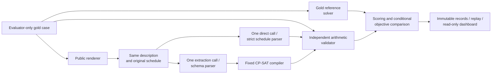

# Direct LLM Reasoning versus Constraint-Solver-Augmented Scheduling

CS3263 Foundations of Artificial Intelligence - Group 23

Tea Li Hao, Tham Yao Xiang, Woo Yong Qing

NUS AY2026/27 Semester 1 - 15 October 2026

Controlled schedule generation, with minimum-disruption repair as an extension.

Public report copy. Matriculation numbers and email addresses belong on the private submission title page. Model eligibility and actual member review/contributions must be confirmed before course submission; see the accompanying submission checklist.

## Abstract

We compare direct language-model schedule generation with extraction followed by a fixed constraint solver. Both methods receive equivalent descriptions and one model call; an independent validator checks answers against evaluator-only requirements. Following TA feedback on feasible scope, controlled generation is the core and repair a bounded extension. From a completed 200-attempt-per-model development study, all 30 controlled generation cases yield acceptance of 11/30 versus 28/30 for Qwen3.6 and 25/30 versus 30/30 for GLM5.3 Flash. GLM's five direct generation failures are service errors; one accepted schedule is suboptimal. Reordered wording exposes two solver-assisted precedence omissions. These findings distinguish interpretation, feasibility, optimization and operational reliability. The reporting hierarchy was chosen after execution; all original outcomes remain preserved. Synthetic development inputs, related cases and shared-service execution limit generalization. No held-out or production claim is made.

## 1. Problem, motivation and research questions

Scheduling shared people and rooms requires satisfying interacting appointments, availability and deadlines. Our core question is whether direct LLM generation or LLM-to-CP-SAT more reliably produces a valid schedule or identifies infeasibility. We analyse why methods fail, whether feasible schedules optimize preferences, and the resources used. Repair from a shared starting schedule and wording robustness are completed extensions, not prerequisites for the core comparison.

The domain is deliberately bounded: mandatory non-preemptive activities, fixed durations and participant/resource assignments, capacity-one resources, and a single day divided into 30-minute slots. Requirements include availability windows, release times, deadlines, fixed appointments and precedence. Preferences penalize starts outside stated preferred windows. The system proposes a schedule or reports infeasibility; it does not edit calendars. Travel inference, multi-day planning and participant assignment are excluded.

The contribution is an inspectable experimental system that separates natural-language interpretation, formal feasibility, optimization quality and operational reliability. CP-SAT and minimum-perturbation repair are established methods; neither is claimed as a new algorithm. The value of the project lies in implementing and analysing a fair comparison and identifying when a correct solver still gives the wrong answer to the original request.

## 2. Related work

NATURAL PLAN supplies task information within natural-language planning inputs, including calendar scheduling [1]. This motivates comparing reasoning with the required information present, rather than measuring retrieval. Our tasks add repair from a common original schedule and explicit optimization objectives. Minimal perturbation research studies retaining a solution when constraints change [2]; our complete schedules, fixed activity set and three-priority objective are a narrower formulation.

Huang and Zhang study language models as PDDL formalizers and find that syntax, semantics and description naturalness affect performance [3]. This motivates our separate extraction and gold-validity measures; their planning scores are not predictions for our scheduling cases. CP-SAT combines constraint, Boolean and linear reasoning [4]. We use the established OR-Tools implementation and preserve its distinct feasible, optimal, infeasible and unknown outcomes [5]. The fixed compiler reduces the amount of generated formal code, but limits which natural-language requirements can be represented.

## 3. Generation model and repair extension

For activity i, let s_i be its integer start, d_i its fixed duration and e_i = s_i + d_i its end. The horizon H is at most 48 slots. Its domain D_i contains starts from 0 to H-d_i satisfying all unary restrictions: release, deadline, fixed start, blocked intervals, and full containment in an availability window for every required activity, participant and resource. Each activity must fit inside one listed window; adjacent windows are not silently merged. Half-open activity intervals allow one activity to begin exactly when another ends.

Precedence i before j requires e_i <= s_j. Every shared participant or resource imposes non-overlap on its activity intervals. Empty start domains encode contradictions, rather than malformed input. These variables, domains and hard constraints form a constraint satisfaction problem. Adding preferences produces a constraint optimization problem. A weighted preference contributes its weight when an activity starts outside its preferred start window. Generation minimizes the sum P(s).

The repair extension validates the previous schedule against the original specification, then solves the updated specification using the same activity identities and previous starts. Let *A* index activities and *K* index preferences. Each preference *k* has a weight, a preferred start window and a target activity *a(k)*. The indicator is 1 when its condition holds and 0 otherwise. The four expressions below define moved count, total shift, preference penalty and the repair objective, respectively:

```math
M(\mathbf{s}) = \sum_{i \in A} \mathbf{1}[s_i \neq s_i^{\mathrm{old}}]
```

```math
T(\mathbf{s}) = \sum_{i \in A} |s_i-s_i^{\mathrm{old}}|
```

```math
P(\mathbf{s}) = \sum_{k \in K} w_k\,\mathbf{1}[s_{a(k)} \notin W_k]
```

```math
\underset{\mathbf{s}\in F}{\mathrm{lexmin}}\;\left(M(\mathbf{s}),\,T(\mathbf{s}),\,P(\mathbf{s})\right)
```

Here, *F* is the set of schedules satisfying all updated hard constraints; T sums absolute start shifts, not changed occupied timetable cells; the superscript "old" denotes the previous start; weights and preferred windows are indexed by preference. A start outside its preferred window contributes that preference's weight once, regardless of distance. Lexicographic minimization gives moved count priority over total shift, and total shift priority over preference penalty.

CP-SAT proves the best moved count M, fixes it, proves the best shift T, and finally minimizes P. Stages share a 30-second solve budget with zero absolute and relative optimality gaps. A valid incumbent may survive a timeout, but unproved later priorities remain unproved. `UNKNOWN` is distinct from `INFEASIBLE`, and `FEASIBLE` from `OPTIMAL`. A secondary objective gap is reported only when earlier priorities equal their proven reference values.

**Small office illustration.** An offline example has eight 1–2-hour activities, Alice and Bob, and one room on Monday 09:00–17:00. It includes a fixed 10:00 meeting, availability, 17:00 deadlines, non-overlap and morning-start preferences. The loose case attains zero penalty. Restricting two joint one-hour meetings to 11:00–13:00 remains feasible with penalty one; restricting both to 11:00–12:00 is impossible because two room-hours must fit into one. Blocking Alice at 15:00–16:00 forces one activity to 16:00, moving one activity by two half-hour slots and leaving seven unchanged. Independent capacity reasoning, candidate enumeration and arithmetic validation agree with CP-SAT. These four cases illustrate the formulation offline; they are not extra model observations. The TA's suggested five-day/hourly calendar is simplified to our existing one-day/30-minute contract. Consecutive-meeting and day-clustering preferences are not implemented; this scope clarification remains open.

## 4. System design and comparison controls



**A: Direct LLM.** One call returns a schedule or an infeasibility prediction. It receives neither a solver nor oracle feedback. **B: LLM-to-CP-SAT.** One call translates the same public information into the canonical specification; a fixed compiler constructs and solves the model. A neutral request identifier avoids exposing label-bearing evaluator IDs. Both repair paths receive the same original schedule and updated requirements. Malformed output, duplicate keys and omitted requirements are not silently repaired.

The independent validator checks hard constraints and recomputes objectives arithmetically, without CP-SAT or its compilation helpers. A gold reference solve uses 60 seconds and supplies proven feasibility/objective information. Tiny exhaustive fixtures help detect shared modelling assumptions. The validator's independence reduces correlated errors but does not replace human review of whether the text and gold describe the intended problem. Solver proof applies to the extracted specification only.

The runner reserves requests durably, saves responses and failures, rejects incompatible resume and supports offline replay. An existing bonus dashboard exposes progress, schedules and evidence-bound explanations. Validator-feedback correction is outside the measured methods and remains deferred. Completed attempts are not retried. Transient timeouts, transport errors and selected service errors remain failed observations while later distinct attempts continue; authentication, model-identity and integrity failures stop dispatch. Long runs use independent process supervision. These controls preserve experimental accounting rather than improve model answers.

## 5. Dataset and experimental protocol

**Motivation and provenance.** The earlier exploratory study evaluated Qwen3.6 and Qwen3.8 on 600 attempts each. Qwen3.8 reached 239/240 direct and 240/240 solver-assisted controlled acceptance; its remaining rejected attempts across blocks were provider failures. That ceiling and the TA's emphasis on varied cases and failure analysis motivated a separate difficulty extension. The original report, results and archives remain preserved. The two studies use different datasets and model pairs; their rates are not pooled or treated as a controlled before/after improvement.

**Executed inputs.** Each model receives 100 paired case/rendering conditions, yielding 200 scheduling attempts. There are 80 unique cases: 60 canonical controlled cases and 20 AI-assisted fictional scenarios. Ten controlled bases each contribute two additional wordings, adding 20 conditions, not independent problems. Generation and repair share updated hard constraints within 40 generated families. Structural normalization merges one identical hard structure, leaving 39 analysis groups: 29 controlled and ten fictional. Human review of natural-language/gold meaning remains pending.

**Reporting scope and stopping point.** The core analysis uses all 30 controlled generation cases, balanced between 15 SAT and 15 UNSAT. A small-case view contains the twelve four/eight-activity cases; all eighteen larger generation cases remain reported. Thirty controlled repair cases are the bounded repair extension. Fictional and wording blocks are supplementary. This hierarchy responds to written TA feedback after execution, not preregistration. It changes no cases, scores or budgets. The existing two-model/200-attempt comparison is the execution cap for this deliverable; additional models, data, weekly semantics and correction loops are deferred.

Five construction tiers contain 4, 8, 12, 20 and 32 activities. Each tier contributes twelve controlled, four fictional and four extra-wording conditions. Three controlled mechanisms stress resource bottlenecks, precedence/deadline interaction and coupled repair, balanced by generation/repair and SAT/UNSAT. SAT schedules have independently validated witnesses; UNSAT cases have checked capacity or critical-path certificates despite nonempty individual start domains. Gold references prove the required objectives. Size and interactions change together: tier names are design targets, not measured complexity classes or isolated causal size effects.

The fictional cases describe equipment, event and studio scheduling using clock-time instructions. Wording tests use a clock-time paraphrase and reordered slot-based facts. These are synthetic/AI-assisted templates, not real calendars or an external benchmark. Public scheduling benchmarks informed methodology but supplied no instances. Known development data remain development data after inspection.

**Comparison controls.** Qwen requests `qwen3.6:35b`; GLM requests the testing alias `x-test-1` and requires response identity `glm-5.3-flash`. Both use the same 244-file source snapshot, Python 3.12.2/macOS runtime, OR-Tools 9.14.6206, case bundles and all 200 paired prompt hashes. Each completion has a 32,768-output-token ceiling, 30/1,800-second connect/read limits and no retries. B/reference solvers use 30/60 seconds, one worker and seed 0. Each campaign adds two capability completions and one metadata request: 203 HTTP requests total.

Qwen reports two backend fingerprints and GLM one. Temperature, sampling, reasoning controls, hardware and exact weight revisions remain service-controlled. A prior GLM run stopped when the alias reported Qwen; it is preserved but excluded. The completed rerun has no identity mismatches. Reported identity is not independent weight attestation, and these observations do not establish permanent routing stability. Course eligibility of the hosted models remains a teaching-team interpretation.

**Metrics and uncertainty.** Acceptance means a gold-valid schedule or correct UNSAT answer; every provider, parser and solver failure stays in the denominator. SAT validity and correct UNSAT retain separate denominators. Reference-objective matching is conditional on valid gold-SAT schedules with proven reference objectives; an earlier lexicographic gap leaves later gaps undefined. Structural extraction differences are diagnostics, not automatically semantic errors. Report controlled, fictional and wording blocks separately. Paired bootstrap intervals use 10,000 resamples of normalized source groups with seed 3263; controlled task strata have 30 pairs but 29 groups. Small tier cells are descriptive, and one sample per wording cannot isolate wording effects from sampling variation.

## 6. Results and analysis

**Core generation.** Figure 1 includes all 30 controlled generation cases per method/model. Qwen3.6 improves from 11/30 (36.7%) to 28/30 (93.3%) with B. GLM reaches 25/30 (83.3%) directly and 30/30 (100%) with B. On gold-SAT cases, Qwen A/B produce valid schedules on 2/15 and 15/15; on gold-UNSAT cases they correctly answer 9/15 and 13/15. GLM's corresponding counts are 11/15 and 15/15 for SAT, and 14/15 and 15/15 for UNSAT. All five GLM direct generation rejections are HTTP 502 errors, not demonstrated constraint-reasoning failures.


**Small cases and difficulty.** Among the twelve four/eight-activity generation cases, Qwen A/B accept 6/12 and 12/12; GLM accepts 12/12 with both methods. Qwen direct generation accepts 4, 2, 3, 0 and 2 out of six across ascending tiers (Figure 2). Its rebounds show that size alone does not determine difficulty. GLM B accepts all six at every tier; GLM A's declines are provider failures. Tier cells contain only three SAT cases and change both size and interactions, so they do not establish a causal size effect or population reliability.


**Completed extensions.** Controlled repair scores 6/30 versus 29/30 for Qwen and 30/30 for both GLM methods. The separate fictional block scores 5/20 versus 18/20 for Qwen and 18/20 versus 20/20 for GLM. Additional wording scores 4/20 versus 19/20 for Qwen and 18/20 for both GLM methods. The equal GLM wording rates conceal different failures: two HTTP 502 errors in A and two precedence-omission extractions in B. Figures 3-4 combine generation and repair only within their stated supplementary blocks; the complete audit retains every outcome.


**Paired comparisons.** Qwen's controlled B-minus-A difference is +56.7 percentage points for generation (95% grouped interval 36.7 to 75.9) and +76.7 for repair (60.0 to 90.3). GLM's differences are +16.7 (3.4 to 31.0) and 0.0 (0.0 to 0.0). GLM's generation gap is operational, not evidence of superior solver-assisted constraint reasoning. Its degenerate observed repair interval does not establish equivalence beyond these cases. Across all blocks every returned GLM direct answer is accepted (91/91), conditional on receiving an answer; failures remain in primary denominators.

**Optimization quality.** For core generation, Qwen A matches the reference on 1/2 valid gold-SAT schedules and B on 15/15; GLM A matches on 10/11 and B on 15/15. Across all blocks, the corresponding fractions are Qwen 1/5 versus 48/48 and GLM 41/42 versus 49/49. These conditional denominators differ and must be read alongside validity. In an easy four-activity generation case (`0b718741...`), GLM A returns a feasible schedule with preference penalty 15 instead of the proven minimum 8; B attains 8. Acceptance alone hides this quality loss. In a Qwen repair (`0fd2c91a...`), a valid output moves eight activities rather than the minimum three: its first-priority gap is +5, while later shift/preference gaps are undefined.

**Failure mechanisms across all blocks.** Qwen A has 32 invalid schedules, 20 false UNSAT predictions, 18 invalid outputs and four provider failures. Fifteen invalid schedules claim SAT for gold-UNSAT problems; seventeen violate a feasible problem's constraints. B reduces these failures to three invalid outputs, one false UNSAT and two provider failures. One rejected extraction inserts unsupported `blocked_start`/`blocked_end` fields into an availability interval, so strict parsing stops before solving. The following concrete examples explain the boundary of solver assistance; full IDs and trace hashes are in the companion audit.

In reordered moderate repair `0fd2c91a...`, the request states P0 is available in [0,48) and separately blocked in [0,1). Qwen B changes the availability to [0,1) while retaining the block. The resulting extracted problem is infeasible, although the gold witness is feasible with objective (3,5,74). CP-SAT correctly solves the wrong specification.

In reordered extreme repair `0020c5ec...`, GLM B omits two precedence edges and two preferences. Its schedule starts A21 at slot 17 for two slots and A11 at slot 0, violating the required A21-before-A11 relation. The gold problem is UNSAT, but the extracted model returns an optimal SAT schedule. In extreme generation `a3c657c2...`, GLM B omits four precedence edges; its schedule violates all four although the gold problem is feasible. Independent validation supplies concrete counterexamples in both cases. The original canonical counterparts are accepted by GLM B, and the failures concern extraction rather than CP-SAT solving.

There are structural differences in 58/95 schema-valid Qwen extractions and 14/100 GLM extractions. Available witnesses demonstrate a hard-feasibility difference in one Qwen and two GLM cases. Ten clock-time paraphrases omit the calendar date; each model supplies dates different from gold, making calendar-frame witness comparison inapplicable. This is underspecified input metadata, not a demonstrated extraction error; relative-slot validity remains interpretable. Neither remaining structural differences nor matching finite witnesses prove general semantic equivalence. The report does not infer a model's hidden reasoning from its outputs.

**Operational failures and resources.** Qwen retains four HTTP 502 and two remote-protocol failures; GLM retains nine HTTP 502 failures, all in A. Missing usage is unknown. The GLM failures occur near 300 seconds despite the 1,800-second client timeout; this suggests an upstream limit but does not establish its internal cause. No failed request is retried or removed. Table 1 covers the 30 core generation attempts per method; timing includes failures and token means include only reported usage. The full audit retains resources for all blocks.

**Table 1. Core generation resources: mean call time and reported tokens.**

| Model | Method | Mean call time<br/>(seconds) | Mean tokens<br/>(coverage) |
| --- | --- | ---: | ---: |
| Qwen3.6 | Direct LLM | 11.34 | 2,287.1<br/>(29/30) |
| Qwen3.6 | LLM + CP-SAT | 35.93 | 5,794.7<br/>(29/30) |
| GLM5.3 Flash | Direct LLM | 91.70 | 6,592.7<br/>(25/30) |
| GLM5.3 Flash | LLM + CP-SAT | 42.52 | 6,906.5<br/>(30/30) |

Mean executed generation CP-SAT time is 68.6 ms for Qwen (28 solves) and 60.2 ms for GLM (30). Model calls dominate local solving. GLM direct's median is 28.78 seconds versus B's 30.88; its higher mean includes five long service errors. These data do not isolate model speed or establish that B always has lower latency. Token ceilings are reservations, not consumption.

## 7. Implications, limitations and responsible AI

**Method choice.** Direct reasoning is attractive when a capable model is already reliable on small, familiar inputs and lower latency matters. Formal augmentation is useful when explicit feasibility/optimization evidence matters or direct reasoning struggles with interactions. It adds extraction cost and inherits extraction errors. A fixed compiler and independent validator provide inspectability, but unsupported or ambiguous requirements require clarification or a revised schema. No operational dialogue feature or universally reliable natural-language interpretation is established.

**Validity threats.** In the live generation core, none of the 15 SAT cases has an explicit deadline or fixed-start constraint; all 15 UNSAT cases have one. The same constructor pattern also affects repair and fictional cases. Constraint-type presence therefore offers a possible feasibility-label shortcut; we have not established that a model used it. Feasible deadline/appointment handling is exercised by offline fixtures, not this live study. A separately versioned 48-case generation confirmation now balances 24 SAT and 24 UNSAT cases, with six of each label in every deadline/fixed-start presence profile. It has independent feasibility certificates and matched rule counts, but only three construction families. Preparation is offline; human wording review and new model evaluation remain pending. Existing outcomes remain unchanged. Artificial label balance influences aggregate acceptance. Synthetic templates, related source families, twenty fictional scenarios and one sample per condition limit external validity and statistical power. Independent arithmetic checks and small exhaustive proofs do not certify every natural-language/gold pairing. The gold solver shares the compiler with B, so remaining compiler errors could affect optimality references even though validity is checked independently. Unknown hosted defaults, differing backend fingerprints and sequential service execution limit causal model comparisons. A fresh reviewed dataset or repeated independent samples could strengthen some claims, but would be a separate study rather than a relabelling of these results.

**Unequal inconvenience.** A preserved historical repair concentrates one move and 30 minutes of shift on participant P7 while P0-P6 incur none. This demonstrates concentration, not that a fairer feasible solution exists. Reporting participant burden makes a trade-off visible; fixed assignments and aggregate disruption do not solve fair allocation. Stakeholder review would be needed before introducing burden caps.

**Objective consequences.** An independently checked tiny case prefers one moved activity shifted four slots over two moved activities shifted two slots in total. This follows the declared moved-count priority, but may conflict with a user's notion of inconvenience. The objective must be explained rather than described as universally best. Changing priorities requires an explicit new specification and evaluation.

**Privacy, control and explanation.** Fictional data avoids exposing private routines. Real calendars could reveal identity even after names are removed, requiring consent and retention controls. A deadline stays hard unless explicitly made negotiable; the system cannot silently relax commitments. Explanations distinguish a proof about the extracted model from validity against the original request, and users retain control over any action. The application does not send invitations or edit calendars.

**Adversarial text.** Prompt-boundary tests keep instruction-like strings in public task data, and the fixed compiler does not execute generated code. This limits one attack surface but is not measured live adversarial robustness. Incorrect extraction remains possible. Responsible deployment would need human oversight and monitoring beyond the present research prototype.

## 8. Reproducibility, contributions and conclusion

Both difficulty-study archives preserve cases, prompts, configurations, responses, failures, references and scoring source, with 364 checksummed files each. Fresh offline replay from each extracted archive reproduces its complete saved analysis exactly. Cross-run validation confirms identical non-model settings, source/runtime, all three case bundles and all 200 paired public prompt hashes. The repository includes the original archives, a verification/extraction script, machine-readable comparison, trace-backed failure catalogue and figure-generation code. Generation-only summaries retain exact observation IDs and archive hashes; the previous combined-scope report and all its figures are also preserved. The earlier 600-attempt studies remain unchanged as historical evidence; the stopped GLM run and operational records remain separately preserved. No new inference was used for this comparison. Exact replay is reproducible; shared-service generation is not deterministic.

Codex assisted implementation, tests, experiment operations, evidence analysis and report drafting under team direction. Repository evidence distinguishes assistance from actual human interpretation and review. The accompanying contribution log records observed work without inferring hours or independent authorship from branch names. Each member must confirm their own contributions and review the complete system before submission; this public report does not fabricate those confirmations.

The findings support solver augmentation as a conditional engineering choice. It substantially improves Qwen3.6 on controlled generation, with repair and robustness evidence as bounded extensions. GLM demonstrates that direct reasoning can approach the observed feasibility ceiling, while objective quality and difficult extraction cases still distinguish the methods. The central boundary remains between correctly solving a formal model and correctly translating the user's request into that model. Human interpretation, reliable service routing and explicit objective priorities remain essential.

## References

1. Zheng, H. S., et al. (2024). *NATURAL PLAN: Benchmarking LLMs on Natural Language Planning*. [arXiv:2406.04520](https://arxiv.org/abs/2406.04520).
2. Bartak, R., Muller, T., and Rudova, H. (2003). *Minimal Perturbation Problem - A Formal View*. ERCIM Working Group on Constraints workshop. [Authors' paper](https://ktiml.mff.cuni.cz/~bartak/downloads/ERCIM2003mpp.pdf).
3. Huang, C., and Zhang, L. (2025). *On the Limit of Language Models as Planning Formalizers*. ACL, pp. 4880-4904. [doi:10.18653/v1/2025.acl-long.242](https://aclanthology.org/2025.acl-long.242/).
4. Perron, L., Didier, F., and Gay, S. (2023). *The CP-SAT-LP Solver (Invited Talk)*. CP 2023, LIPIcs 280, pp. 3:1-3:2. [doi:10.4230/LIPIcs.CP.2023.3](https://drops.dagstuhl.de/entities/document/10.4230/LIPIcs.CP.2023.3).
5. Google OR-Tools. *CP-SAT Solver*. [Solver status documentation](https://developers.google.com/optimization/cp/cp_solver); implementation pinned to 9.14.6206.
6. CS3263 teaching team (2026). *Project*; *CS3263 Project Guidelines AY2026/27*; *Responsible AI*. Supplied course materials. Group 23 (2026), *Project Proposal*. Written TA feedback supplied by the team on 15 October emphasizes generation, achievable scope and failure analysis. These sources define expectations and scope, not measured benchmark results.
