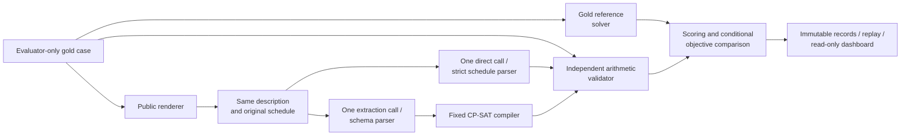
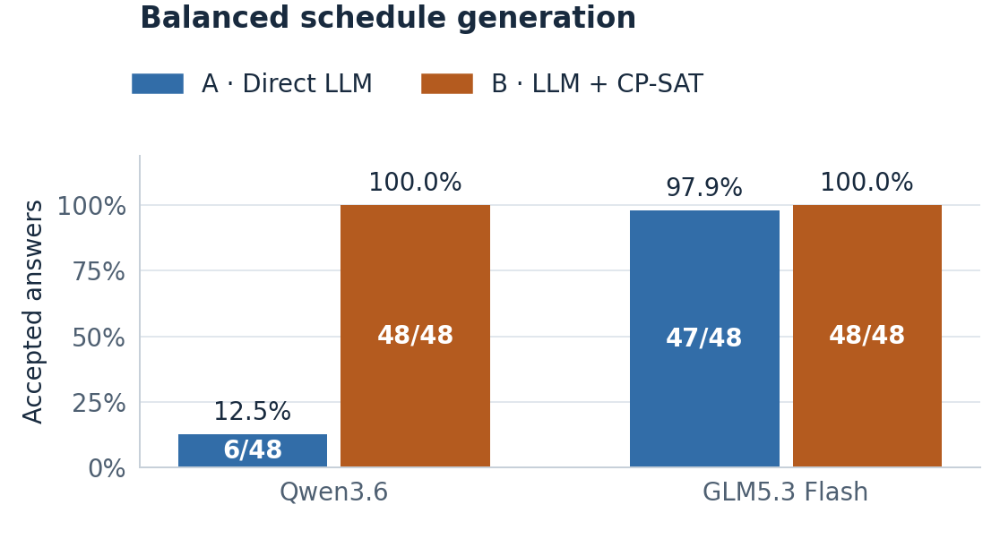
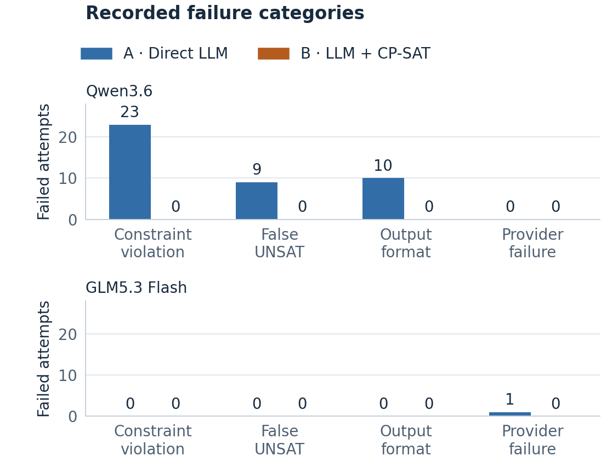

# Direct LLM Reasoning versus Constraint-Solver-Augmented Scheduling

CS3263 Foundations of Artificial Intelligence - Group 23

Tea Li Hao, Tham Yao Xiang, Woo Yong Qing

NUS AY2026/27 Semester 1 - 17 October 2026

Controlled schedule generation, with minimum-disruption repair as an extension.

Public report copy. Matriculation numbers and email addresses belong on the private submission title page. Model eligibility and actual member review/contributions must be confirmed before course submission; see the accompanying submission checklist.

## Abstract

We compare direct language-model schedule generation with extraction followed by a fixed CP-SAT solver. Both receive equivalent descriptions and one model call; an independent validator checks answers against evaluator-only requirements. A focused 48-case generation study balances feasible and infeasible cases within every deadline/fixed-appointment profile. Across 96 scheduling attempts per model, Qwen3.6 achieves 6/48 direct acceptance versus 48/48 with solver augmentation; GLM5.3 Flash achieves 47/48 versus 48/48. Qwen failures separate constraint violations, false infeasibility and output-format noncompliance. GLM's only rejection is a transport failure, not an incorrect returned answer. Earlier repair and wording extensions expose suboptimal schedules and extraction omissions despite successful formal solving. All results and failures remain preserved separately. The findings concern narrow synthetic development cases, not held-out or production reliability; human review and model-eligibility clarification remain open.

## 1. Problem, motivation and research questions

Scheduling shared people and rooms requires satisfying interacting appointments, availability and deadlines. Our core question is whether direct LLM generation or LLM-to-CP-SAT more reliably produces a valid schedule or identifies infeasibility. We analyse why methods fail, whether feasible schedules optimize preferences, and the resources used. Repair from a shared starting schedule and wording robustness are completed extensions, not prerequisites for the core comparison.

The domain is deliberately bounded: mandatory non-preemptive activities, fixed durations and participant/resource assignments, capacity-one resources, and a single day divided into 30-minute slots. Requirements include availability windows, release times, deadlines, fixed appointments and precedence. Preferences penalize starts outside stated preferred windows. The system proposes a schedule or reports infeasibility; it does not edit calendars. Travel inference, multi-day planning and participant assignment are excluded.

The contribution is an inspectable experimental system that separates natural-language interpretation, formal feasibility, optimization quality and operational reliability. CP-SAT and minimum-perturbation repair are established methods; neither is claimed as a new algorithm. The value of the project lies in implementing and analysing a fair comparison and identifying when a correct solver still gives the wrong answer to the original request.

## 2. Related work

NATURAL PLAN supplies task information within natural-language planning inputs, including calendar scheduling [1]. This motivates comparing reasoning with the required information present, rather than measuring retrieval. Our tasks add repair from a common original schedule and explicit optimization objectives. Minimal perturbation research studies retaining a solution when constraints change [2]; our complete schedules, fixed activity set and three-priority objective are a narrower formulation.

Huang and Zhang study language models as PDDL formalizers and find that syntax, semantics and description naturalness affect performance [3]. This motivates our separate extraction and gold-validity measures; their planning scores are not predictions for our scheduling cases. CP-SAT combines constraint, Boolean and linear reasoning [4]. We use the established OR-Tools implementation and preserve its distinct feasible, optimal, infeasible and unknown outcomes [5]. The fixed compiler reduces the amount of generated formal code, but limits which natural-language requirements can be represented.

## 3. Generation model and repair extension

For activity i, let s_i be its integer start, d_i its fixed duration and e_i = s_i + d_i its end. The horizon H is at most 48 slots. Its domain D_i contains starts from 0 to H-d_i satisfying all unary restrictions: release, deadline, fixed start, blocked intervals, and full containment in an availability window for every required activity, participant and resource. Each activity must fit inside one listed window; adjacent windows are not silently merged. Half-open activity intervals allow one activity to begin exactly when another ends.

Precedence i before j requires e_i <= s_j. Every shared participant or resource imposes non-overlap on its activity intervals. Empty start domains encode contradictions, rather than malformed input. These variables, domains and hard constraints form a constraint satisfaction problem. Adding preferences produces a constraint optimization problem. A weighted preference contributes its weight when an activity starts outside its preferred start window. Generation minimizes the sum P(s).

The repair extension validates the previous schedule against the original specification, then solves the updated specification using the same activity identities and previous starts. Let *A* index activities and *K* index preferences. Each preference *k* has a weight, a preferred start window and a target activity *a(k)*. The indicator is 1 when its condition holds and 0 otherwise. The four expressions below define moved count, total shift, preference penalty and the repair objective, respectively:

```math
M(\mathbf{s}) = \sum_{i \in A} \mathbf{1}[s_i \neq s_i^{\mathrm{old}}]
```

```math
T(\mathbf{s}) = \sum_{i \in A} |s_i-s_i^{\mathrm{old}}|
```

```math
P(\mathbf{s}) = \sum_{k \in K} w_k\,\mathbf{1}[s_{a(k)} \notin W_k]
```

```math
\underset{\mathbf{s}\in F}{\mathrm{lexmin}}\;\left(M(\mathbf{s}),\,T(\mathbf{s}),\,P(\mathbf{s})\right)
```

Here, *F* is the set of schedules satisfying all updated hard constraints; T sums absolute start shifts, not changed occupied timetable cells; the superscript "old" denotes the previous start; weights and preferred windows are indexed by preference. A start outside its preferred window contributes that preference's weight once, regardless of distance. Lexicographic minimization gives moved count priority over total shift, and total shift priority over preference penalty.

CP-SAT proves the best moved count M, fixes it, proves the best shift T, and finally minimizes P. Stages share a 30-second solve budget with zero absolute and relative optimality gaps. A valid incumbent may survive a timeout, but unproved later priorities remain unproved. `UNKNOWN` is distinct from `INFEASIBLE`, and `FEASIBLE` from `OPTIMAL`. A secondary objective gap is reported only when earlier priorities equal their proven reference values.

**Small office illustration.** An offline example has eight 1–2-hour activities, Alice and Bob, and one room on Monday 09:00–17:00. It includes a fixed 10:00 meeting, availability, 17:00 deadlines, non-overlap and morning-start preferences. The loose case attains zero penalty. Restricting two joint one-hour meetings to 11:00–13:00 remains feasible with penalty one; restricting both to 11:00–12:00 is impossible because two room-hours must fit into one. Blocking Alice at 15:00–16:00 forces one activity to 16:00, moving one activity by two half-hour slots and leaving seven unchanged. Independent capacity reasoning, candidate enumeration and arithmetic validation agree with CP-SAT. These four cases illustrate the formulation offline; they are not extra model observations. The TA's suggested five-day/hourly calendar is simplified to our existing one-day/30-minute contract. Consecutive-meeting and day-clustering preferences are not implemented; this scope clarification remains open.

## 4. System design and comparison controls



**A: Direct LLM.** One call returns a schedule or an infeasibility prediction. It receives neither a solver nor oracle feedback. **B: LLM-to-CP-SAT.** One call translates the same public information into the canonical specification; a fixed compiler constructs and solves the model. A neutral request identifier avoids exposing label-bearing evaluator IDs. Both repair paths receive the same original schedule and updated requirements. Malformed output, duplicate keys and omitted requirements are not silently repaired.

The independent validator checks hard constraints and recomputes objectives arithmetically, without CP-SAT or its compilation helpers. A gold reference solve uses 60 seconds and supplies proven feasibility/objective information. Tiny exhaustive fixtures help detect shared modelling assumptions. The validator's independence reduces correlated errors but does not replace human review of whether the text and gold describe the intended problem. Solver proof applies to the extracted specification only.

The runner reserves requests durably, saves responses and failures, rejects incompatible resume and supports offline replay. An existing bonus dashboard exposes progress, schedules and evidence-bound explanations. Validator-feedback correction is outside the measured methods and remains deferred. Completed attempts are not retried. Transient timeouts, transport errors and selected service errors remain failed observations while later distinct attempts continue; authentication, model-identity and integrity failures stop dispatch. Long runs use independent process supervision. These controls preserve experimental accounting rather than improve model answers.

## 5. Dataset and experimental protocol

**Study progression.** The historical Qwen3.6/Qwen3.8 study has 600 attempts per model. A separate Qwen3.6/GLM difficulty study has 200 per model: 60 controlled cases, 20 fictional cases and 20 extra wording conditions. Its 30 controlled generation cases became the core reporting view after TA scope feedback; repair is a completed extension. A subsequent audit found all 15 feasible generation cases lacked explicit deadlines/fixed starts, while all 15 infeasible cases included one. This offers a possible label shortcut, although the observations do not prove models used it. Rather than discard those results, we ran a separately versioned balanced confirmation. Different datasets and models are never pooled or treated as a controlled before/after improvement.

**Balanced generation design.** The latest study uses eight mandatory 1–2-hour activities, two participants and one capacity-one room on Monday 26 October 2026, 09:00–17:00 UTC+08:00, with 30-minute slots. Three interaction mechanisms (room capacity, participant capacity and precedence), two availability layouts, four explicit constraint profiles and two feasibility labels produce 48 cases. Each profile—neither deadline nor appointment, deadline only, appointment only, both—contains six SAT and six UNSAT cases. The 24 matched pairs preserve assignments, durations, rule counts/values and prose style; numeric availability determines feasibility. All cases have nonempty individual start domains. The layouts are construction choices, not measured difficulty classes.

SAT witnesses are checked arithmetically. Capacity or precedence-span certificates independently establish UNSAT without calling the compiler. Twelve feasible deadline cases and twelve feasible fixed-start cases have counterexamples showing each rule genuinely restricts the schedule. CP-SAT separately proves reference preference optima; output schedules are independently validated. Gold, labels, proofs and review metadata never enter the measured prompts. Canonical prose includes an explicit calendar frame. All inputs are constructed/AI-assisted; no instances were downloaded from an external benchmark. The course permits constructed instances [6]. Actual member wording/gold review remains pending.

**Controls and execution.** Each model processes 48 cases with both methods: 96 scheduling completions, plus two capability completions and one metadata request, or 99 requests. Qwen requests and returns `qwen3.6:35b`. GLM requests `x-test-1` and requires `glm-5.3-flash`. Both campaigns use identical cases, 96 paired public prompt hashes, package source, runtime and non-model settings. The environment uses Python 3.12.2, macOS and OR-Tools 9.14.6206. Each completion allows 32,768 output tokens with 30-second connect and 1,800-second read/write/pool limits, no retries, and 30/60-second method/reference solve limits. Reserved output tokens are ceilings, not consumed tokens or total-input/currency limits.

Qwen ran first; GLM followed after its evidence export. Both finished all 96 attempts on 15 October 2026. Every returned scheduling answer and both capability responses per model matched the pinned identity. One GLM request produced no response and thus no identity. Hosted weights, hardware and omitted sampling/reasoning controls were not independently verified; two Qwen fingerprints and one GLM fingerprint are recorded. Model-name agreement is not weight attestation. These are shared-service development observations, not an approved frontier-model claim.

**Metrics and dependence.** Primary acceptance is a gold-valid SAT schedule or correct UNSAT answer, with every format, provider and solver failure retained. We also report SAT validity, UNSAT correctness, failure categories, reference-objective matching conditional on valid gold-SAT schedules, and time/token coverage. Solver success concerns its extracted specification, not necessarily the original request. Structural extraction differences are diagnostics rather than automatic semantic errors. There is one sample per condition and only three conservative construction families, not 48 independent samples. Profile and mechanism comparisons are descriptive; we do not infer population-level significance from tiny cells or a degenerate ceiling interval.

## 6. Results and failure analysis

**Balanced primary comparison.** Figure 1 reports all 48 cases per method. Qwen direct accepts 6/48 (12.5%) and solver augmentation 48/48 (100%). GLM direct accepts 47/48 (97.9%) and augmentation 48/48 (100%). Acceptance is not proof of optimality, extraction equivalence or general reliability. On the 24 gold-SAT cases, Qwen A/B return valid schedules on 1/24 and 24/24; on the 24 gold-UNSAT cases they are correct on 5/24 and 24/24. GLM scores 23/24 and 24/24 on SAT and 24/24 for both on UNSAT. Both methods retain all failed attempts in their denominators.



**Why Qwen fails.** Its direct method produces 23 constraint-invalid schedules, nine false UNSAT predictions and ten format-rejected outputs (Figure 2). In case `bg-071dcc04607137c07c53df2a`, activity A7 lasts four slots and starts at slot 2, so it ends at 6. A2 starts at 4 despite the required A7-before-A2 relation. The same answer places A3 outside its availability and overlaps two activities sharing participant P2. These are explicit counterexamples, not guesses about hidden reasoning. False UNSAT answers are contradicted by independently validated gold witnesses.

All ten format failures contain explanatory prose before the final JSON, sometimes enclosed in Markdown fences. The prompt explicitly requests only JSON, and the predeclared parser does not repair outputs. They are legitimate interface failures for end-to-end acceptance, but cannot all be described as failed constraint reasoning. Recovering a JSON fragment or retrying only these cases would be a different analysis/protocol; original scores are retained. Even the mathematical correctness of a recovered fragment would need separate validation.



**Why GLM is near perfect.** Its direct method has one `remote_protocol_error`, after 34.18 seconds without an HTTP response or model identity. This is not the 1,800-second client timeout, a model mismatch or evidence of failed reasoning. The records cannot isolate the underlying network/server cause. Usage and server-side completion are unknown. The runner preserved the attempt, did not retry it and continued with later distinct requests. Primary acceptance stays 47/48; conditional on a returned direct answer it is 47/47. Solver augmentation accepts 48/48. Consequently, its one-case primary gap shows an operational difference in this run, not demonstrated reasoning superiority for B. Strong direct performance is compatible with narrow, structured, eight-activity inputs; the study does not establish that model architecture or parameter count caused the result.

**Optimization.** Both solver arms match the proven reference preference optimum on all 24 valid gold-SAT cases. Qwen's only valid direct SAT answer has penalty 6 rather than 2 (`bg-4820d9a82a894a3384266377`), so its conditional matching rate is 0/1. GLM direct matches on 22/23; in `bg-12b4e9cdefec3402d2b9c0fe`, its feasible answer has penalty 4 instead of 3. These denominators are conditional on valid SAT outputs, not all 48 attempts. Thus near-perfect feasibility can still hide suboptimal scheduling. All 48 extractions per solver arm are structurally equivalent under the comparison rules, which does not prove general semantic reliability beyond these cases.

**Resources.** Table 1 includes all attempts in mean call time and only available usage in token means. Unknown usage is not zero. Mean pipeline times are Qwen A/B 8.816/11.882 seconds and GLM 33.184/23.290. Mean CP-SAT times are 17.6 ms and 22.1 ms, respectively; model calls dominate. Pipeline time excludes study preparation, reference computation and analysis. GLM B is faster on average here despite adding a solver, but this sequential shared-service observation does not isolate model speed, load or a causal benefit of using a tool.

**Table 1. Balanced generation resources, 48 attempts per method.**

| Model | Method | Mean model call<br/>(seconds) | Mean total tokens<br/>(reported coverage) |
| --- | --- | ---: | ---: |
| Qwen3.6 | Direct LLM | 8.81 | 1,947.6<br/>(48/48) |
| Qwen3.6 | LLM + CP-SAT | 11.86 | 3,112.9<br/>(48/48) |
| GLM5.3 Flash | Direct LLM | 33.18 | 3,248.6<br/>(47/48) |
| GLM5.3 Flash | LLM + CP-SAT | 23.26 | 3,582.1<br/>(48/48) |

**Earlier extensions remain informative.** The separate difficulty study spans 4–32 activities. Its generation view scores Qwen 11/30 versus 28/30 and GLM 25/30 versus 30/30. All five GLM direct generation rejections are HTTP 502 failures; a valid direct schedule has preference penalty 15 against a proven minimum 8. The separate controlled repair extension scores Qwen 6/30 versus 29/30 and GLM 30/30 for both. Qwen's valid repair in `0fd2c91a...` moves eight activities when three suffice; later lexicographic gaps are undefined once the first priority differs.

| Earlier difficulty block | Qwen direct | Qwen + CP-SAT | GLM direct | GLM + CP-SAT |
| --- | ---: | ---: | ---: | ---: |
| Controlled generation | 11/30 | 28/30 | 25/30 | 30/30 |
| Controlled repair | 6/30 | 29/30 | 30/30 | 30/30 |
| Fictional scenarios | 5/20 | 18/20 | 18/20 | 20/20 |
| Additional wording | 4/20 | 19/20 | 18/20 | 18/20 |

These rows partition that separate 200-attempt study per model. Fictional and wording blocks mix generation and repair. Wording reuses ten controlled bases; it does not add independent problems. The balanced follow-up is not an additional tier of this study. All prior results, charts and report versions remain available in the evidence package.

**Extraction is still a boundary.** In an earlier reordered repair request, Qwen B narrows P0's availability from [0,48) to [0,1) while also retaining a [0,1) block. CP-SAT correctly finds the extracted problem infeasible, although the gold schedule is feasible. GLM B omits two precedence edges in reordered extreme repair `0020c5ec...`: A21 starts at 17 for two slots while A11 starts at 0, violating A21-before-A11. In reordered generation `a3c657c2...`, it omits four edges and returns a schedule violating all four. Both canonical counterparts were accepted. These saved counterexamples show why a solver cannot correct requirements that extraction dropped. The balanced ceiling therefore does not erase the observed extraction failures in the broader study.

## 7. Implications, limitations and responsible AI

**Method choice and course scope.** A solver offers explicit feasibility/optimization reasoning once the formal specification is correct, and greatly improves Qwen's measured end-to-end acceptance here. Direct solving can be effective for a stronger model on familiar, bounded inputs and avoids extraction/solver integration cost. Neither approach establishes reliable interpretation of arbitrary user requests. A fixed schema sacrifices expressiveness for validation and inspectability. Generation, both required approaches and validation remain the core; repair and the existing dashboard are bounded extensions. Verifier feedback, weekly calendars, extra preference semantics and further models are not necessary additions merely to force failures.

**Validity threats.** Balancing removes the earlier deadline/fixed-start presence shortcut; it does not remove all template bias. The three mechanism families and availability-based contrasts are narrow. Artificial label balance affects aggregate accuracy; one sampled answer per condition gives limited uncertainty evidence. Seeds rename activities rather than generate independent geometries. Synthetic text is not real-user calendar data, and human wording/gold review is still pending. Earlier clock-time paraphrases omit dates; calendar-frame comparison is then inapplicable rather than automatically an extraction error. Known development data never become a fresh holdout after inspection. Independence of the arithmetic validator helps, but the gold reference and B share a compiler, so optimality references retain shared-implementation risk. Uncontrolled service defaults, backend routing and sequential runs limit causal model comparisons. A successful API identity check does not settle the course's frontier-model interpretation.

**Unequal inconvenience and objectives.** A preserved historical repair concentrates one move and 30 minutes of shift on P7 while P0–P6 incur none. This shows concentration, not that a fairer feasible solution exists. Fixed assignments and aggregate disruption do not establish fair workload allocation. An independently checked tiny case chooses one activity shifted four slots over two activities shifted two slots in total because moved count has priority. Users may prefer a different trade-off. Burden reporting, stakeholder input and explicit priority choices are therefore needed; changing objectives requires a new specification and evaluation.

**Privacy, control and explanations.** Fictional data avoids disclosing actual routines. Real calendars can reveal identity even after names are removed and would require consent, retention controls and oversight. Hard requirements cannot silently become preferences. Explanations distinguish proof about the extracted model from validity against the original request. Users retain control: this research system sends no invitations or calendar edits. It does not optimize personal or group welfare comprehensively.

**Adversarial text.** Boundary tests treat instruction-like descriptions as data, and the fixed compiler does not execute generated code. This reduces one attack surface but is not a live adversarial robustness evaluation. Incorrect extraction and ambiguous requirements remain possible. Deployment would require human oversight and monitoring beyond this prototype [6].

## 8. Reproducibility, contributions and conclusion

Both balanced archives retain 96 scheduling records and 211 checksum-covered files each, including recorded outputs, failures, references, public inputs, exact scoring source and analysis. The six portable archives preserve both balanced campaigns, both difficulty campaigns and the historical Qwen pair. Verification checks every member and checksum; exact archived-source replay regenerates the saved analyses without model calls. Summaries and figure receipts bind claims to source/archive hashes and observation IDs. Full capabilities, request accounting and operational/source snapshots remain separately preserved in private evidence backups. These are recorded outputs and available metadata, not hidden reasoning or complete HTTP captures. Shared-service inference is not deterministic even when replay is exact.

Codex assisted implementation, tests, experiment operations, evidence analysis and report drafting under team direction. The contribution log records observed work without inferring independent authorship or hours. Each member must supply a factual account of their own decisions, work and interpretation and review the complete system before submission. This public copy retains that unresolved disclosure rather than inventing member confirmation. The private submission needs required title-page identifiers, a final format check, presentation and actual Canvas submission; the checklist tracks these separately from technical readiness.

The experiments support solver augmentation as a conditional engineering choice. Its advantage is substantial for Qwen's measured generation pipeline; GLM's balanced direct answers reach the observed feasibility ceiling when a response arrives. Output compliance, service reliability, optimization and extraction semantics remain distinct. The strongest conclusion is that correct formal solving is useful but insufficient without faithful translation and independent validation; the narrower balanced design strengthens that assessment without establishing general real-world reliability.

## References

1. Zheng, H. S., et al. (2024). *NATURAL PLAN: Benchmarking LLMs on Natural Language Planning*. [arXiv:2406.04520](https://arxiv.org/abs/2406.04520).
2. Bartak, R., Muller, T., and Rudova, H. (2003). *Minimal Perturbation Problem - A Formal View*. ERCIM Working Group on Constraints workshop. [Authors' paper](https://ktiml.mff.cuni.cz/~bartak/downloads/ERCIM2003mpp.pdf).
3. Huang, C., and Zhang, L. (2025). *On the Limit of Language Models as Planning Formalizers*. ACL, pp. 4880-4904. [doi:10.18653/v1/2025.acl-long.242](https://aclanthology.org/2025.acl-long.242/).
4. Perron, L., Didier, F., and Gay, S. (2023). *The CP-SAT-LP Solver (Invited Talk)*. CP 2023, LIPIcs 280, pp. 3:1-3:2. [doi:10.4230/LIPIcs.CP.2023.3](https://drops.dagstuhl.de/entities/document/10.4230/LIPIcs.CP.2023.3).
5. Google OR-Tools. *CP-SAT Solver*. [Solver status documentation](https://developers.google.com/optimization/cp/cp_solver); implementation pinned to 9.14.6206.
6. CS3263 teaching team (2026). *Project*; *CS3263 Project Guidelines AY2026/27*; *Responsible AI*. Supplied course materials. Group 23 (2026), *Project Proposal*. Written TA feedback supplied by the team on 15 October emphasizes generation, achievable scope and failure analysis. These sources define expectations and scope, not measured benchmark results.
