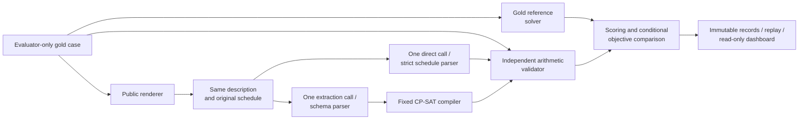

# Direct LLM Reasoning versus Constraint-Solver-Augmented Scheduling

CS3263 Foundations of Artificial Intelligence - Group 23

Tea Li Hao, Tham Yao Xiang, Woo Yong Qing

NUS AY2026/27 Semester 1 - 18 October 2026

Controlled schedule generation, with minimum-disruption repair as an extension.

Public report copy. Matriculation numbers and email addresses belong on the private submission title page. Model eligibility and actual member review/contributions must be confirmed before course submission; see the accompanying submission checklist.

## Abstract

We compare direct language-model scheduling with extraction followed by a fixed CP-SAT solver. Both receive equivalent descriptions and one model call; an independent validator checks answers against evaluator-only requirements. The main study contains 1,000 synthetic generation cases, balanced between feasibility labels across ten interaction families and five activity-count strata. Across 2,000 attempts per model, Qwen3.6 accepts 308/1,000 direct answers versus 953/1,000 with solver augmentation; GLM5.3 Flash accepts 891/1,000 versus 988/1,000. Failures distinguish invalid schedules, false infeasibility, output compliance, extraction errors and 119 infrastructure outcomes. Even GLM's correct formal solves can violate the original request after extraction drops a constraint. Changing concurrency, operating system and service conditions prevents a controlled latency comparison. Results support solver augmentation on these constructed development cases, while exposing translation and operational limits; they do not establish held-out or production reliability. Repair and wording studies remain separately evaluated extensions.

## 1. Problem, motivation and research questions

Scheduling shared people and rooms requires satisfying interacting appointments, availability and deadlines. Our core question is whether direct LLM generation or LLM-to-CP-SAT more reliably produces a valid schedule or identifies infeasibility. We analyse why methods fail, whether feasible schedules optimize preferences, and the resources used. Repair from a shared starting schedule and wording robustness are completed extensions, not prerequisites for the core comparison.

The domain is deliberately bounded: mandatory non-preemptive activities, fixed durations and participant/resource assignments, capacity-one resources, and a single day divided into 30-minute slots. Requirements include availability windows, release times, deadlines, fixed appointments and precedence. Preferences penalize starts outside stated preferred windows. The system proposes a schedule or reports infeasibility; it does not edit calendars. Travel inference, multi-day planning and participant assignment are excluded.

The contribution is an inspectable comparison separating interpretation, formal feasibility, optimization and operational reliability. CP-SAT and minimum-perturbation repair are established methods; neither is claimed as a new algorithm.

## 2. Related work

NATURAL PLAN supplies task information within natural-language planning inputs, including calendar scheduling [1]. This motivates comparing reasoning with the required information present, rather than measuring retrieval. Our tasks add repair from a common original schedule and explicit optimization objectives. Minimal perturbation research studies retaining a solution when constraints change [2]; our complete schedules, fixed activity set and three-priority objective are a narrower formulation.

Huang and Zhang study language models as PDDL formalizers and find that syntax, semantics and description naturalness affect performance [3]. This motivates our separate extraction and gold-validity measures; their planning scores are not predictions for our scheduling cases. CP-SAT combines constraint, Boolean and linear reasoning [4]. We use the established OR-Tools implementation and preserve its distinct feasible, optimal, infeasible and unknown outcomes [5]. The fixed compiler reduces the amount of generated formal code, but limits which natural-language requirements can be represented.

## 3. Generation model and repair extension

For activity i, let s_i be its integer start, d_i its fixed duration and e_i = s_i + d_i its end. The horizon H is at most 48 slots. Its domain D_i contains starts from 0 to H-d_i satisfying all unary restrictions: release, deadline, fixed start, blocked intervals, and full containment in an availability window for every required activity, participant and resource. Each activity must fit inside one listed window; adjacent windows are not silently merged. Half-open activity intervals allow one activity to begin exactly when another ends.

Precedence i before j requires e_i <= s_j. Every shared participant or resource imposes non-overlap on its activity intervals. Empty start domains encode contradictions, rather than malformed input. These variables, domains and hard constraints form a constraint satisfaction problem. Adding preferences produces a constraint optimization problem. A weighted preference contributes its weight when an activity starts outside its preferred start window. Generation minimizes the sum P(s).

The repair extension validates the previous schedule against the original specification, then solves the updated specification using the same activity identities and previous starts. Let *A* index activities and *K* index preferences. Each preference *k* has a weight, a preferred start window and a target activity *a(k)*. The indicator is 1 when its condition holds and 0 otherwise. The four expressions below define moved count, total shift, preference penalty and the repair objective, respectively:

```math
M(\mathbf{s}) = \sum_{i \in A} \mathbf{1}[s_i \neq s_i^{\mathrm{old}}]
```

```math
T(\mathbf{s}) = \sum_{i \in A} |s_i-s_i^{\mathrm{old}}|
```

```math
P(\mathbf{s}) = \sum_{k \in K} w_k\,\mathbf{1}[s_{a(k)} \notin W_k]
```

```math
\underset{\mathbf{s}\in F}{\mathrm{lexmin}}\;\left(M(\mathbf{s}),\,T(\mathbf{s}),\,P(\mathbf{s})\right)
```

Here, *F* is the set of schedules satisfying all updated hard constraints; T sums absolute start shifts, not changed occupied timetable cells; the superscript "old" denotes the previous start; weights and preferred windows are indexed by preference. A start outside its preferred window contributes that preference's weight once, regardless of distance. Lexicographic minimization gives moved count priority over total shift, and total shift priority over preference penalty.

CP-SAT proves the best moved count M, fixes it, proves the best shift T, and finally minimizes P. Stages share a 30-second solve budget with zero absolute and relative optimality gaps. A valid incumbent may survive a timeout, but unproved later priorities remain unproved. `UNKNOWN` is distinct from `INFEASIBLE`, and `FEASIBLE` from `OPTIMAL`. A secondary objective gap is reported only when earlier priorities equal their proven reference values.

**Scope relative to feedback.** The TA recommends achievable generation, both approaches and independent validation as the core, with repair as an extension. Our offline office examples demonstrate eight 1–2-hour activities, two people and one room, including loose/tight feasibility and a one-move repair. The implemented calendar is one day on 30-minute slots, not the suggested five-day/hourly calendar. Morning preferences fit preferred-start windows; consecutive-meeting and day-clustering penalties are absent. These simplifications require explicit scope clarification rather than a claim that every suggestion is implemented.

## 4. System design and comparison controls



**A: Direct LLM.** One call returns a schedule or an infeasibility prediction. It receives neither a solver nor oracle feedback. **B: LLM-to-CP-SAT.** One call translates the same public information into the canonical specification; a fixed compiler constructs and solves the model. A neutral request identifier avoids exposing label-bearing evaluator IDs. Both repair paths receive the same original schedule and updated requirements. Malformed output, duplicate keys and omitted requirements are not silently repaired.

The independent validator checks hard constraints and recomputes objectives arithmetically, without CP-SAT or its compilation helpers. A gold reference solve uses 60 seconds and supplies proven feasibility/objective information. Tiny exhaustive fixtures help detect shared modelling assumptions. The validator's independence reduces correlated errors but does not replace human review of whether the text and gold describe the intended problem. Solver proof applies to the extracted specification only.

The runner reserves requests durably, saves every response/failure, rejects incompatible resume and supports offline replay. The bonus dashboard exposes results and evidence-bound explanations. Measured methods have no validator-feedback correction or retries. Eligible transient failures remain observations while later distinct requests continue; identity, authorization and integrity failures stop dispatch. Sleep can interrupt a supervised local process.

## 5. Dataset and experimental protocol

**Study progression.** Historical Qwen3.6/Qwen3.8 campaigns contain 600 attempts per model. A later Qwen3.6/GLM difficulty study contains 200 per model, including generation, repair, fictional scenarios and wording variants. An audit found deadline/fixed-start presence separated generation feasibility labels in that dataset. A separately versioned 48-case balanced study removed this particular shortcut: each presence profile contains both labels. Its direct/solver acceptance was 6/48 versus 48/48 for Qwen and 47/48 versus 48/48 for GLM; GLM's sole rejection was transport-related. These studies motivated broader generation coverage. They remain separate evidence, not pooled observations or a controlled before/after improvement.

**Main design.** The completed diverse-generation study has ten construction mechanisms: room contention, participant contention, fragmented packing, precedence chain, fork/join, appointment collision, release/deadline chain, participant-calendar crossing, resource/person crossing, and mixed order/resource interaction. Each mechanism has five strata of 8, 12, 16, 24 and 32 activities, with ten matched SAT/UNSAT pairs per stratum. This gives 1,000 cases, 500 of each label, 500 related pairs and ten conservative families. All four deadline/fixed-start presence profiles are label-balanced. Durations, windows, assignments, rules and preferences vary; 1,000 distinct normalized hard fingerprints and 500 topology signatures distinguish this from renaming-only expansion.

The 200 eight-activity cases retain a 09:00–17:00 day, two participants and one room, with 30–90-minute activities. Larger constructions may use a full-day horizon and different resource counts. They are synthetic stress cases, not realistic office calendars or a controlled intervention on size alone. Every interaction graph is connected and every individual activity has a nonempty unary domain. Whole-instance capacity contradictions test aggregate demand; other cases embed a short contradictory subproblem in a larger request. Therefore “extreme” denotes a construction stratum, not demonstrated computational hardness or an absolute capability limit. Twenty-four optional reordered conditions were prepared but not executed in this study.

**Gold and contamination boundaries.** All 500 feasible witnesses pass independent arithmetic validation. One hundred infeasible cases have whole-instance capacity certificates; 400 have independently enumerated contradictory subproblems. Deleting each activity from the 100 capacity-UNSAT cases produces 1,840 independently validated feasible schedules. Full CP-SAT references agree with every label and prove preference optima for all 500 SAT cases. Proofs, labels and review metadata never enter model prompts. The data are deterministic, AI-assisted synthetic inputs, not downloaded examples or an untouched holdout. The course permits constructed instances [6]; actual member review of prose/gold correspondence remains unconfirmed.

**Comparison controls.** Each model attempts every case once with each method: 2,000 scheduling calls plus two capability calls and one metadata request. Qwen requests and returns `qwen3.6:35b`; GLM requests `x-test-1` and must return `glm-5.3-flash`. Every successful response matches its required identity. Both models use identical cases, 2,000 paired prompt hashes/public views and scientific source/dependency versions: Python 3.12.2 and OR-Tools 9.14.6206. Each completion allows 32,768 output tokens, with 30-second connect and 1,800-second read/write/pool limits, no retries, and 30/60-second method/reference solve limits. Temperature, top-p, provider seed and reasoning controls are omitted; effective server defaults and weights are unverified. Backend fingerprints are observed, not fixed.

**Execution deviations.** Qwen ran first across 295 serial attempts on macOS 26.5.2, 96 serial attempts on 27.0.1, 16 attempts at concurrency 16 and 1,593 at concurrency 8. GLM ran 92 at concurrency 8 and 1,908 at concurrency 4, all on 27.0.1. Rate limits prompted authorized, recorded reductions after in-flight requests drained. Original completed attempts were reused byte-for-byte, never called again. Qwen finished on 17 October and GLM on 18 October (Singapore time). All 4,000 reservations resolve to unique completed records, including failures, with one provider attempt each. Different execution conditions qualify both service-reliability and timing interpretations.

**Measures and dependence.** Primary acceptance is a gold-valid SAT schedule or correct UNSAT answer; every provider, format and mathematical failure remains in its denominator. We report SAT validity, UNSAT correctness, extraction diagnostics, conditional preference optimality and time/token coverage. Structural differences do not automatically establish semantic errors. A ten-family paired bootstrap describes sensitivity to reweighting these designed mechanisms, not population uncertainty over independent real calendars. There is one sampled answer per condition; 1,000 distinct fingerprints are not 1,000 independent families.

## 6. Results and failure analysis

**Primary outcomes.** Figure 1 includes all 1,000 attempts per method. Solver augmentation increases measured acceptance by 64.5 percentage points for Qwen and 9.7 points for GLM. Paired outcomes are more informative than aggregate scores alone: Qwen has 654 cases accepted only by B and nine only by A; GLM has 104 only by B and seven only by A. The corresponding ten-family bootstrap ranges are 61.1–67.6 and 6.8–13.1 points (10,000 resamples, seed 3263). They are descriptive design-sensitivity ranges, not proof of general superiority or removal of service confounding.


**Table 1. Feasibility and conditional preference quality. A = direct LLM; B = LLM + CP-SAT. Each feasibility column has 500 gold cases.**

| Model / method | Valid SAT<br/>of 500 | Correct UNSAT<br/>of 500 | Optimum / valid SAT |
| --- | ---: | ---: | ---: |
| Qwen A | 1 | 307 | 1/1 |
| Qwen B | 467 | 486 | 467/467 |
| GLM A | 404 | 487 | 403/404 |
| GLM B | 492 | 496 | 492/492 |

Qwen direct's 30.8% overall score is almost entirely correct UNSAT predictions: it constructs only one valid SAT schedule. This asymmetry would be hidden by success rate alone. GLM solves many more feasible cases directly, but its near-ceiling performance on the earlier small benchmark does not persist unchanged across these new inputs. Neither comparison isolates architecture, parameter count or a change in model capability.

**Failures of returned answers.** Figure 2 separates infrastructure from the mutually exclusive primary rejection categories; its panels use different vertical scales. Qwen A has 291 false UNSAT answers, 144 constraint-invalid schedules, 208 format failures and 49 infrastructure failures. Qwen B has 14 false UNSAT answers, six invalid schedules, 25 format failures and two infrastructure failures. GLM A has 17 false UNSAT answers, 27 invalid schedules and 65 infrastructure failures; B has three false UNSAT answers, one invalid schedule, five format failures and three infrastructure failures. No rejection is attributed to a local solver timeout/UNKNOWN. Format rejection establishes noncompliance with the strict output contract, not necessarily incorrect mathematical reasoning. No answer is silently reparsed or retried.

**Trace-backed mechanisms.** In GLM direct case `dg-07a8a364db88956122484ec6`, A1 starts at slot 5 for two slots, so finishes at 7; A4 starts at 2 despite the A1-before-A4 requirement. This is a concrete precedence violation, independent of service quality. False UNSAT predictions on gold-SAT cases are contradicted by saved, independently validated feasible witnesses; they do not reveal the model's hidden reason for its prediction.

In Qwen B case `dg-901f5127b3f63880cc499f19`, extraction invents eight deadlines. A1 must run for two slots inside [4,6), but the invented deadline requires completion by 4. The resulting empty domain makes the extracted specification infeasible even though the original is feasible. In GLM B case `dg-93645cd68c645d31d613fa2b`, extraction drops an A2 deadline and the A29-before-A10 relation. CP-SAT then places A29 at 4 for two slots and A10 at 4, violating the omitted precedence. These failures demonstrate the distinction between correct solving and faithful formalization.

Qwen has 873 structurally matching extractions and 100 differing ones among 973 parsed specifications. All matching outputs are accepted; 80 differing ones are also accepted. GLM has 959 matching and 33 differing extractions among 992 parsed specifications, with 29 of the differing ones accepted. The remainder account for the mathematical B failures above. A gold-valid output does not prove the extracted problems equivalent, and a structural difference alone is not proof of harmful interpretation. The independent gold validator is therefore essential even after successful solving.


**Returned-response sensitivity.** Restricting to cases with both methods receiving a response gives Qwen 307/949 for A versus 907/949 for B, and GLM 891/935 versus 927/935. GLM's paired gap then becomes 3.85 percentage points, compared with 9.7 points in the primary all-attempt analysis. This secondary view helps separate delivery from answer quality; nonrandom missingness prevents treating it as corrected accuracy.

**Scale and mechanism.** At eight activities, Qwen accepts 57 (A) and 197 (B) of 200 cases; GLM accepts 192 (A) and 200 (B). At 32 activities, Qwen accepts 74 (A) and 180 (B), and GLM 148 (A) and 194 (B), each out of 200. GLM A's 52 largest-stratum failures include 40 infrastructure outcomes; among its 160 returned answers, 148 are accepted. Its all-attempt result is 74.0%, while the secondary returned-answer rate is 92.5%. This distinction prevents misreporting a service-delivery drop as pure reasoning deterioration. Qwen A's nonmonotonic size scores are dominated by UNSAT prediction. Mechanism/stratum tables and grouped charts in the evidence supplement retain every cell; varying horizons, durations and resources prevent attributing differences solely to activity count.

**Optimization.** Every valid B schedule matches its proven gold preference optimum. Qwen A matches on its sole valid SAT answer; this 1/1 denominator provides little evidence about general optimization ability. GLM A matches on 403/404; its remaining valid schedule has preference penalty 33 against optimum 30 (`dg-a7542bcaf35f7024ab973f3c`). The 500 reference optima range from 0 to 37, with median 12 and only two zero optima, so the observed B ceiling is not simply an all-zero objective artifact. This does not establish difficult optimization: the instances are constructed, local solve times are short, and reference/B share the compiler. Historical repair results separately expose movement-versus-shift trade-offs; they are not mixed into these generation scores.

## 7. Infrastructure, time and token usage

**Infrastructure is not reasoning failure.** Qwen has 44 HTTP 502 responses, four HTTP 429 responses and three transport failures. GLM has 62 HTTP 502 responses, two HTTP 429 responses and four read timeouts: 119 infrastructure outcomes across the two models. All remain primary failures. Successful GLM responses consistently identify `glm-5.3-flash`; none is rejected for model mismatch. The 502 records establish a failed HTTP service response, not its underlying backend cause or proof that task difficulty triggered it.

Qwen's four rate limits occurred in the 16-way phase; GLM's two occurred in its initial eight-way phase. Later lower-concurrency phases recorded no new 429s. Their absence is an observation, not a rate-limit guarantee. GLM's four read timeouts overlapped a recorded macOS clamshell-sleep interval. Each records about 1,800 seconds on the monotonic timer but approximately 2,888 seconds between UTC timestamps. Sleep contributed to wall-clock delay; the records cannot establish whether the provider completed those requests. They were retained with unknown usage, not repeated, and subsequent distinct requests completed.

**Table 2. Observed mean model-call time by execution phase, including failures. Counts and times are direct / solver-assisted. These rows are not controlled speed comparisons.**

| Model / OS | Concurrency | Attempts A / B | Mean seconds A / B |
| --- | ---: | ---: | ---: |
| Qwen / 26.5.2 | 1 | 148 / 147 | 23.99 / 15.94 |
| Qwen / 27.0.1 | 1 | 48 / 48 | 24.34 / 21.23 |
| Qwen / 27.0.1 | 16 | 8 / 8 | 43.58 / 49.51 |
| Qwen / 27.0.1 | 8 | 796 / 797 | 39.52 / 47.03 |
| GLM / 27.0.1 | 8 | 46 / 46 | 120.16 / 99.85 |
| GLM / 27.0.1 | 4 | 954 / 954 | 108.12 / 65.47 |

No case has all four model/method observations under matching concurrency and OS, so there is no matched cross-model timing subset. Backend load, execution order, request mix and missing responses further limit causal comparisons. Summing overlapping request times is not campaign wall time. Model-call measurements include network/service waiting; local CP-SAT time is separately recorded. Mean B solve time is 16.19 ms across 973 invoked solves and 13.97 ms across 992; failures before compilation have no solver time. The supplement supplies per-phase medians, coverage and pipeline timings.

**Table 3. Reported scheduling token usage, excluding qualification. Unknown usage is not zero.**

| Model | Method | Mean total tokens | Usage coverage |
| --- | --- | ---: | ---: |
| Qwen3.6 | Direct | 3,287.5 | 951/1,000 |
| Qwen3.6 | CP-SAT | 5,220.4 | 998/1,000 |
| GLM5.3 Flash | Direct | 7,504.1 | 935/1,000 |
| GLM5.3 Flash | CP-SAT | 7,054.6 | 997/1,000 |

These are provider-reported prompt-plus-completion tokens, not known currency cost or an independently measured thinking budget. Missing usage for all 119 infrastructure failures prevents a complete consumption total. Output caps are allowances, not usage. Qwen B uses more reported tokens on average than A, while GLM B uses fewer. These observations combine prompt/output lengths and provider behavior; they do not establish a controlled efficiency ranking.

## 8. Implications, limitations and responsible AI

**Choosing a method.** B substantially improves Qwen's measured feasibility, while GLM handles many tasks directly. A direct method avoids a schema/compiler dependency but can fabricate schedules or claim impossibility without a proof. A fixed compiler supplies formal feasibility and optimization guarantees only for the extracted model. Translation can omit constraints or invent restrictions. A more expressive tool could represent additional scheduling features, but would increase implementation and validation costs. Tool availability, representation limits, reliable input interpretation and operational failures all matter; no universal winner follows from one constructed study.

**Validity threats.** These are known, synthetic, AI-assisted development inputs with ten related generator families and one sample per condition. More cases improve coverage of those constructions, not proof of real-world representativeness. Balanced profiles remove a specific label shortcut, not all template bias. Some infeasibility certificates are simple local conflicts or arithmetic capacity bounds; larger text is not necessarily harder search. Resource count and horizon covary with stratum. The optional wording supplement is unexecuted; historical wording tests do not establish robustness of the new 1,000 cases. Actual human prose/gold review remains pending. The validator is independent of the compiler, but gold optimality and B share CP-SAT; tiny exhaustive tests and construction certificates reduce, not eliminate, shared-implementation risk.

Service failures are uneven across methods and strata. Conditioning on returned answers helps diagnose them but selects a potentially nonrandom subset; it is not corrected accuracy. Concurrency changes, OS changes, laptop sleep, backend routing and unavailable provider defaults prevent fixed-backend or controlled-latency claims. Provider model names are not weight attestation. The exact hosted-model interpretation under the course's frontier-model requirement remains for teaching-team clarification [6]. These limits do not invalidate the recorded outcomes, but bound the conclusions they support.

**Responsible AI.** Real calendars reveal identities, routines and relationships, sometimes even after names are removed. Fictional data avoids disclosing real routines; deployment would need consent, retention limits and oversight. Fixed assignments and aggregate preference penalties do not establish fair workload allocation. A historical repair concentrates one move and 30 minutes of shift on a single participant; another independently checked example prefers one activity shifted four slots over two activities shifted two slots total because moved count has priority. Such trade-offs need stakeholder agreement rather than an assumption that a numerical optimum is fair.

Hard requirements must not silently become preferences. Explanations distinguish a proof about extraction from validity against the original request, and users retain control: the prototype sends no invitations and changes no calendars. Instruction-like input is treated as data; a fixed compiler does not execute generated code. This reduces an attack surface but is not a live adversarial robustness study. Ambiguity, malicious descriptions, incorrect extraction and biased objectives remain practical risks requiring human review and monitoring [6].

## 9. Reproducibility, contributions and conclusion

The evidence package retains all 4,000 completed scheduling records, recorded responses/failures, exact public inputs, gold references, scientific source, model settings and execution-phase provenance. Offline replay reconstructs both original analyses without inference. Derived comparisons and figure receipts bind summaries to source hashes; portable copies explicitly identify any local-path redaction, while original archives and operational traces remain unchanged. Historical studies and the preceding report remain separately preserved. Saved traces are returned outputs and available metadata, not unavailable server logs or hidden reasoning.

Codex assisted implementation, tests, experiment operations, evidence analysis and report drafting under team direction. This does not establish that each member personally performed or reviewed those steps. Each member must provide a factual account of their own decisions, implementation/verification, interpretation and AI support, and demonstrate whole-system understanding. The current public report does not invent those confirmations. The private submission also needs required title-page identifiers, final human review, presentation and Canvas delivery. These are tracked separately from the completed technical experiment.

The expanded evaluation supports a specific conclusion: solver augmentation improves measured end-to-end scheduling for both hosted models on these constructed cases, especially Qwen, but translation fidelity and infrastructure remain failure boundaries. GLM's direct method is strong yet imperfect; service errors explain much of its largest-stratum decline, while concrete returned-answer counterexamples establish genuine scheduling failures. Formal solving, faithful interpretation, operational availability and responsible use must be evaluated separately.

## References

1. Zheng, H. S., et al. (2024). *NATURAL PLAN: Benchmarking LLMs on Natural Language Planning*. [arXiv:2406.04520](https://arxiv.org/abs/2406.04520).
2. Bartak, R., Muller, T., and Rudova, H. (2003). *Minimal Perturbation Problem - A Formal View*. ERCIM Working Group on Constraints workshop. [Authors' paper](https://ktiml.mff.cuni.cz/~bartak/downloads/ERCIM2003mpp.pdf).
3. Huang, C., and Zhang, L. (2025). *On the Limit of Language Models as Planning Formalizers*. ACL, pp. 4880-4904. [doi:10.18653/v1/2025.acl-long.242](https://aclanthology.org/2025.acl-long.242/).
4. Perron, L., Didier, F., and Gay, S. (2023). *The CP-SAT-LP Solver (Invited Talk)*. CP 2023, LIPIcs 280, pp. 3:1-3:2. [doi:10.4230/LIPIcs.CP.2023.3](https://drops.dagstuhl.de/entities/document/10.4230/LIPIcs.CP.2023.3).
5. Google OR-Tools. *CP-SAT Solver*. [Solver status documentation](https://developers.google.com/optimization/cp/cp_solver); implementation pinned to 9.14.6206.
6. CS3263 teaching team (2026). *Project*; *CS3263 Project Guidelines AY2026/27*; *Responsible AI*. Supplied course materials. Group 23 (2026), *Project Proposal*. Written TA feedback supplied by the team on 15 October emphasizes generation, achievable scope and failure analysis. These sources define expectations and scope, not measured benchmark results.
