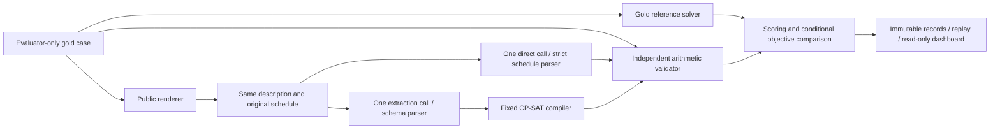

# Direct LLM Reasoning versus Constraint-Solver-Augmented Scheduling

CS3263 Group 23 — Tea Li Hao, Tham Yao Xiang, Woo Yong Qing.

**Working report source, updated 1 October 2026.** AI-assisted draft for human revision;
not a submission, completed review or frozen-study report. Private student
identifiers belong only on the submission title page. Numerical findings below
are development evidence. See [claim index](claim-evidence-20261001.md) and
[contribution record](contributions.md). The [submission checklist](submission-checklist.md)
separates executable evidence from the remaining study and human delivery tasks.

## Abstract draft

We study schedule generation and repair on a single-day grid with fixed activity
durations and participant/resource assignments. We compare one language-model
call that proposes a schedule with one call that extracts a specification for a
fixed CP-SAT compiler. An independent validator checks both against gold
requirements. Repair minimizes moved activities, total time shift and preference
violations in that order. The implemented system preserves parsing failures,
extraction discrepancies, proof status and usage. Development results reveal
that a solver may correctly solve a mistranslated problem. Final model selection,
reviewed fresh data and the frozen comparison remain outstanding; no final
effect size or superiority claim is made here.

## 1. Motivation and questions — target 0.75 pages

A shared room becoming unavailable can require moving activities whose own
requirements did not change. Rebuilding a feasible timetable from scratch may
also disrupt more commitments than necessary. We ask when direct model reasoning
is sufficient, when formal solving helps, what causes failures, and how repair
and equivalent wording affect outcomes. Our prototype proposes schedules; it
does not contact participants or edit calendars.

We deliberately restrict the domain to mandatory, non-preemptive activities,
fixed participants, capacity-one resources and 30-minute slots on one day.
This supports explicit mathematical checks while excluding task assignment,
travel inference and multi-day planning. These restrictions limit realism.

## 2. Related work and contribution — target 0.75 pages

NATURAL PLAN evaluates planning with task information supplied in the input,
including calendar scheduling [1]. We likewise separate scheduling from external
information retrieval, but add a common-start repair comparison. Minimal
perturbation research formalizes limiting changes when a constraint problem
changes [2]; our complete schedules and particular three-component objective
are a narrower design choice. Neither repair nor CP-SAT is a new algorithm here.

Huang and Zhang examine language models as planning formalizers and observe
degradation with more natural descriptions in their PDDL study [3]. This
motivates measuring extraction fidelity separately from the solver result; it
does not predict our scheduling scores. CP-SAT integrates constraint, SAT and
linear techniques [4]. We use its established implementation with a fixed
compiler. Our intended contribution is a bounded, reproducible comparison of
generation, repair, interpretation failures and wording sensitivity. The
wording component is planned, not measured by the existing canonical-only run.

## 3. Formalization and repair — target 1.50 pages

For every mandatory activity i, let its integer start be s_i, fixed duration d_i,
and end e_i = s_i + d_i. The horizon is H <= 48 slots. D_i contains starts in
0,...,H-d_i satisfying every unary requirement: release, deadline, fixed start,
blocked intervals, and full containment within one available window for each
required activity, participant and resource. Activities use half-open intervals
[s_i,e_i), so one activity may start when another ends. Each activity must fit
inside a single listed availability window; even adjacent windows are not silently
merged to admit a longer activity.

The CSP consists of variables s_i, domains D_i and hard constraints. Precedence
i → j requires e_i <= s_j. Each shared entity induces non-overlapping intervals.
An empty domain is a valid contradiction, not malformed input. The product of
domain sizes bounds naive combinations; it is not an observed CP-SAT search count.

Generation minimizes P(s), the sum of weights for preferred start windows missed
by the schedule. Repair minimizes the lexicographic tuple

```text
M(s) = sum_i [s_i != old_i]
T(s) = sum_i abs(s_i - old_i)
P(s) = sum_k weight_k * [s_activity(k) outside preferred_start_window_k]
minimize (M(s), T(s), P(s)) lexicographically
```

CP-SAT first proves the optimum of M, fixes it, then does the same for T before
minimizing P. All stages share one time budget and use zero absolute/relative
optimality gaps. A timeout retains a valid incumbent but does not establish
unproved later priorities. `UNKNOWN` is not `INFEASIBLE`; `FEASIBLE` is not
`OPTIMAL`. Secondary objective gaps are interpretable only when preceding
components equal their proven reference optima.

**Worked example.** A, B and C each last one slot and share resource R over
[0,3). Their original legal starts are A={0,1}, B={1,2}, C={0,1,2}; the original
schedule is (0,1,2). A participant block removes A's start 0. A must start 1,
forcing B to 2 and C to 0. This is the only feasible repair, with (M,T,P)=(3,4,0).
B and C move although their unary requirements were unchanged. The displacement
is |1-0| + |2-1| + |0-2| = 4 slots: two hours summed over activities, not two hours
of elapsed calendar time. Fixing B or C at its old position would incorrectly
report infeasibility. Independent tiny enumeration, the arithmetic validator and
CP-SAT check this example (C2).

## 4. System and evidence boundaries — target 1.00 page



Both paths receive equivalent public information; the direct arm receives no
solver, oracle or repair feedback. B uses a neutral request ID rather than a
label-bearing evaluator ID. Its extracted specification must pass the canonical
schema before compilation. Duplicate keys, wrappers and unsupported fields
remain failures; the parser does not insert omitted requirements.

The validator recomputes hard feasibility and objectives without calling CP-SAT
or using its constraint-building helpers. The reference solver supplies gold
feasibility and proven optima, while tiny independent enumeration checks the
compiler. Solver success concerns the extracted specification, which may omit
source requirements. Explanations keep that proof separate from gold acceptance
and bind new standalone proof claims to their exact input/context (C1).

The serial runner durably reserves requests before sending, records failures and
usage, refuses incompatible resume, and replays stored outputs without inference.
Missing usage is unavailable, not zero. Output reservations do not cap aggregate
input-plus-output tokens or currency. Historical SoCLaaS sampling and reasoning
controls were server defaults; a solver seed does not make model calls deterministic.
A bounded follow-up observed two serving fingerprints across three reference-model
calls (C10). This does not prove different weights, but prevents claiming a stable
backend. The original paired qualification stopped under the retained strict backend
requirement; no scheduling-quality conclusion follows from tiny JSON checks.
The next development target is `qwen3.8:27b`, as recorded in planning Section 9.
That choice supplies neither measured improvement nor final-model eligibility;
all numerical comparisons in this draft still concern `qwen3.6:35b`.

## 5. Dataset and protocol — target 1.50 pages

The expanded development packet has 100 known synthetic cases: 64 from v2 and
36 from v3, grouped into 41 conservative source families. Each task has 25 SAT
and 25 UNSAT cases; related cases are not independent observations. Fourteen IDs
occurred in earlier live pilots. All text was canonical. Twelve separate
AI-assisted fictional drafts exercise authored-text consumers; they are not
independently human-written scenarios (C3).

The planned final study uses fresh instances from a reviewed construction policy,
not a claim of unseen generators or freedom from pretraining contamination.
Both original and updated repair structures must avoid all recorded development
structures, including calendar/ID renamings. A second member reviews gold and
language. Realistic provenance must reflect actual authorship.

Candidate construction, synthetic frozen rehearsal and compatible-block analysis
are implemented and offline-verified (C11). Canned rehearsal outputs verify controls
and bookkeeping; they supply no model-performance evidence or human sign-off.
The separate 48-case construction pilot also has independent arithmetic support
for all SAT witnesses and three UNSAT mechanisms. Bounded enumeration confirms
six objective optima across three source families; 18 larger SAT cases retain only
the recorded solver optimality proofs (C12). These checks do not establish wording
fidelity, independent human review or held-out performance.

**Final decisions pending:** eligible model/backend, verified effective settings,
selected prompt, construction policy, actual reviews, study size, compatible
frozen blocks and explicit execution cap. The proposed 600-call target and
312-call compact alternative are planning envelopes. Canonical controlled,
realistic and selected language blocks have separate estimands. Additional
wordings cannot give selected cases extra primary weight.

The observed development estimands are defined as follows; the final protocol
must freeze its corresponding definitions before outcomes:

| Quantity | Numerator and denominator / interpretation |
| --- | --- |
| SAT validity | Gold-valid schedules / all gold-SAT attempts, including malformed and failed attempts |
| UNSAT accuracy | Correct UNSAT answers / all gold-UNSAT attempts; A predicts infeasibility, B proves it only for its extracted model |
| Accepted answer | Gold-valid schedule or correct UNSAT answer / all labelled attempts; depends on the artificial label balance |
| Objective gap | Candidate minus proven reference component, on gold-valid SAT schedules; evaluate a later repair component only when earlier components match |
| Extraction fidelity | Structural comparison against gold, with separately labelled bounded semantic certificates; neither parsing nor structural agreement proves general language understanding |

Pair A and B on the same case, rendering and repeat. For the expanded development
study, intervals resample source families with replacement 10,000 times using
seed 3263 and preserve their A/B pairs; they do not treat 100 cases as independent.
These intervals describe the selected generator distribution, not population
representativeness or new-generator transfer (C13). Report task/label results
separately, since a single accepted-answer percentage conceals distinct failure
modes. Keep realistic inputs, language variants and inference repeats out of the
canonical primary denominator. The final analysis must declare achieved families,
missing pairs, interval settings and selection/exclusion rules before outcomes.
Tiny constructed strata cannot establish population difficulty thresholds.

## 6. Development findings and final-results slots — target 2.50 pages

The following are **development findings only**, reproduced from saved aggregates
for `expanded-development-100-20260930-01` (C4–C6). Both arms used `qwen3.6:35b`,
unchanged prompts, 16,384 output tokens per request, no retries, 30-second B solves
and 60-second reference budgets. No new experiment generated this table.

| Task | A accepted | B accepted | A valid on SAT | B valid on SAT | A correct UNSAT | B correct UNSAT |
| --- | ---: | ---: | ---: | ---: | ---: | ---: |
| Generation | 23/50 | 48/50 | 17/25 | 24/25 | 6/25 | 24/25 |
| Repair | 12/50 | 49/50 | 8/25 | 25/25 | 4/25 | 24/25 |
| Total | 35/100 | 97/100 | 25/50 | 49/50 | 10/50 | 48/50 |

On generation, B alone was accepted on 25 pairs, A alone on none, both on 23,
and neither on two. The accepted-answer difference was 50 percentage points
with a family-bootstrap 95% interval of 36.54–63.27 points. For repair, the
corresponding counts were 37, zero, 12 and one: a 74-point difference with
interval 59.18–88.89 points. Each task has 50 paired cases in 41 families (C13).
This paired evidence supports a development advantage on the selected inputs;
it is not a confirmatory held-out result.

All failed attempts remain in denominators. B's three failures were two omitted
fixed appointments and one malformed JSON response. A schema-valid extraction
therefore does not establish correct interpretation. Ten structural mismatches
include eight independently certified equivalent encodings; the structural
metric and separate bounded semantic certificate must not be conflated (C5).

For example, the failed fixed-appointment repair requires A0 and A1 to start
at slot 1 while sharing capacity-one Rpair for one slot each. Both requirements
cannot hold. Omitting A0’s appointment instead lets the unchanged original
schedule appear optimal with zero disruption, although A0 remains at slot 3.
The validator rejects it. Independent enumeration of the conflicting pair and
restoring only the missing field in a diagnostic copy establish this failure’s
mechanism; no correction enters primary scores (C5).

Solution quality has a different denominator from validity. B's 25 valid repairs
all attained the gold lexicographic tuple; A had eight valid repairs, six matching
the full tuple. The mean moved-count excess was 0.375 for those eight A repairs;
shift/preference gaps were evaluated only for the six matching earlier priorities.
All 24 valid B generation schedules had zero preference gap (C14). These
conditional results do not imply that invalid attempts have zero disruption,
or compare two equally selected groups of successful schedules.

| Resource, 100 calls per arm | A | B |
| --- | ---: | ---: |
| Reported tokens | 124,696 | 340,555 |
| Mean model latency | 1.895 s | 10.115 s |
| Median model latency | 1.278 s | 9.413 s |
| p95 model latency, nearest rank | 2.074 s | 14.954 s |
| Maximum model latency | 48.195 s | 20.321 s |

Usage was present for all 200 calls: 465,251 tokens and 1,204.72 seconds of batch
wall time. B used 2.73 times the reported tokens and 5.34 times the mean model
latency. CP-SAT averaged 4.69 ms over 99 executed B solves; malformed extraction
never reached the solver and is excluded from this conditional timing. On these
small instances, extraction rather than CP-SAT dominated the added time. The slow
A outlier remains in the table. There was no measured currency cost (C6).

The data support a development comparison under this particular construction and
configuration. They do not establish production reliability, final held-out
performance, a causal improvement over older settings, or robustness to wording.

Final results must replace or clearly separate this development section with:
(i) canonical task/label outcomes and paired difficulty plots, (ii) repair quality
with validity/proof denominators, (iii) extraction failures, (iv) matched language
transitions and (v) resource tails and missing counts. These slots are intentionally
unfilled until F4/F5 supplies reviewed evidence; no expected scores are inserted.

## 7. Responsible AI and limitations — target 1.00 page

**Unequal inconvenience.** In the preserved development case
`dev-3263-interaction_density-1-repair`, participant P7 bears one moved activity
and 30 minutes of shift while P0–P6 bear none. This shows concentration, not proof
that a feasible fairer solution exists. Shared events count for each participant;
fixed assignments do not solve fair workload allocation (C7). Displaying each
participant's burden makes the trade-off visible, but does not itself mitigate
inequity. Deciding whether a burden cap is appropriate requires stakeholder input;
adding one would change the formal problem and is outside the current comparison.

**Objective side effect.** A tiny independently enumerated repair admits a
two-move/two-slot solution but chooses one move/four slots under the stated
priority. Avoiding an extra moved commitment can therefore require greater total
shift. The one-move option shifts A from 0 to 4 while B stays at 1; the two-move option
places A at 1 and B at 2. The choice should be disclosed rather than called
universally best (C8). A user who values total time displacement more would need
an explicitly different objective, followed by a new evaluation; the current
system must not silently change priorities.

**Negotiability and privacy.** A supplied deadline is hard unless explicitly
modelled otherwise. The system cannot decide which unstated commitment may be
relaxed. Only fictional data are used; real routines could reveal identity even
after renaming. Future real calendars would require consent and a retention plan.
The interface presents proposals without sending invitations or editing calendars.
If a request says a meeting is “preferably” before lunch without stating whether
that is negotiable, the appropriate limitation is to require clarification, not
claim the prototype inferred the intended hardness. This is a design scenario,
not an evaluated interaction or implemented dialogue feature.

**Instruction-like text.** A synthetic prompt-boundary regression keeps an
embedded “ignore all rules” string in the user-data message, outside system
instructions. This checks construction, not empirical adversarial robustness of
a model. A fixed compiler prevents executing generated code but cannot prevent
all extraction mistakes (C9).

Members must supply their own interpretation of these cases. Other limits include
generator bias, small dependent samples, single-day/fixed-assignment assumptions,
unknown hosted weight revisions, default inference settings and pending realistic
and language-condition evidence.

## 8. Synthesis, contributions and AI disclosure — target 1.00 page

The implementation makes feasibility, optimality and interpretation independently
inspectable. The coupled example explains why local changes can require global
repair; the saved failures explain why a correct solver does not guarantee a
correct answer to natural language. Final conclusions await the frozen study and
should remain informative even if direct reasoning proves competitive.

Codex assisted code, tests, this draft and evidence linkage under member direction.
Branch names and assigned tasks do not establish independent human authorship,
review or hours. The [contribution log](contributions.md) records observed actions
and leaves human interpretation/review explicitly pending. No submission receipt,
teaching-team approval or rehearsal is claimed.

## References — outside the planned body

1. Zheng, H. S., et al. (2024). *NATURAL PLAN: Benchmarking LLMs on Natural Language Planning*. [arXiv:2406.04520](https://arxiv.org/abs/2406.04520).
2. Barták, R., Müller, T., and Rudová, H. *Minimal Perturbation Problem — A Formal View*. [Authors' paper](https://www.unitime.org/papers/ercimprelimin03.pdf).
3. Huang, C., and Zhang, L. (2025). *On the Limit of Language Models as Planning Formalizers*. ACL, pp. 4880–4904. [doi:10.18653/v1/2025.acl-long.242](https://aclanthology.org/2025.acl-long.242/).
4. Perron, L., Didier, F., and Gay, S. (2023). *The CP-SAT-LP Solver*. CP 2023, LIPIcs 280, pp. 3:1–3:2. [doi:10.4230/LIPIcs.CP.2023.3](https://drops.dagstuhl.de/entities/document/10.4230/LIPIcs.CP.2023.3).

These four source records were checked for this draft; related scheduling and
language-robustness literature listed in planning Section 16 still needs final
selection and human synthesis. Markdown is the single working report source.
A derived development PDF has been checked at seven body pages, plus separate
title and references pages, with single-column text, at least 11-point type and
one-inch margins. See the submission checklist for rebuild and audit details.
This checks the current draft only: final results, human revisions and any added
figures require a new format audit before submission.
