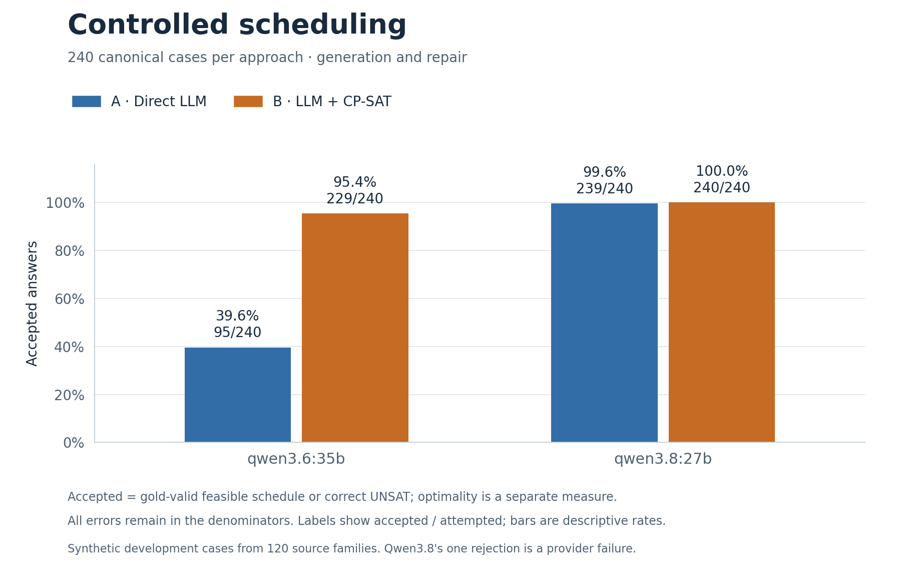
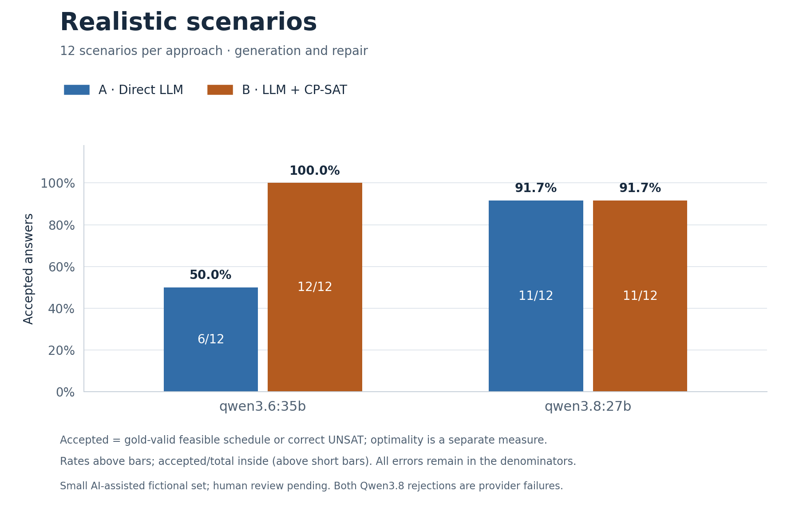
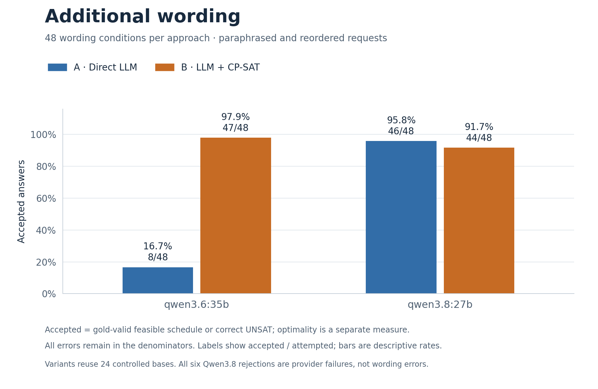

# Two-model benchmark results and submission readiness

**Historical checkpoint: Qwen3.6/Qwen3.8, 600 attempts per model.** The findings and unfinished-work statements below describe the 2 October checkpoint. For the latest Qwen3.6/GLM results and remaining tasks, use the [diverse audit](diverse-comparison-audit.md) and [submission checklist](../process/submission-checklist.md).

Audited 2 October 2026. Both full development campaigns completed and their saved
results reproduced through fresh scoring and independent archive replay. These
results are suitable for the README and an exploratory empirical report. The
project is not yet a completed course submission: the report/presentation and
human review remain unfinished, and interpretation of the course's frontier-model
requirement remains unresolved.

The [machine-readable summary](../../results/summary/two-model-development-20261002.json)
contains counts, conditional objective results, paired intervals, resource
distributions, execution settings, failures, pause intervals and archive hashes.
No inference was performed for this audit. Earlier runs and all original failures
were preserved.

## Design and comparability

| Block, per model | Cases and conditions | A + B attempts |
| --- | --- | ---: |
| Controlled | 240 canonical cases from 120 source families; 120 generation and 120 repair cases, each with 60 SAT/60 UNSAT | 480 |
| Realistic | 12 AI-assisted fictional scenarios; canonical wording | 24 |
| Additional wording | 24 selected controlled bases, with paraphrase and reordered renderings | 96 |
| Total | 300 case/rendering conditions evaluated with both approaches | 600 |

These are **1,200 recorded scheduling attempts across two models**, not 1,200
independent scheduling problems. The wording conditions reuse controlled bases;
generation/repair within a family are related. Each campaign also used two
capability completions and one metadata request: 602 completions / 603 HTTP
requests per model. Every scheduling reservation has a completed record,
including operational failures; there were no retries or automatic restarts.

The audited runs are `benchmark-qwen36-20261001-02` (`qwen3.6:35b`) and
`benchmark-qwen38-20261001-04` (`qwen3.8:27b`). All 230 source-snapshot files,
runtime versions, case bytes and 600 request-prompt hashes match. Prepared block
configurations differ only in `model.model`. Both use revision-3 prompts, one
call per approach, a 32,768-token output ceiling, 30/1,800-second connect/read
timeouts, no retries, 30-second B solves, 60-second gold references and
`strict_model_observe_backend_v1` with `continue_transient_v1`.

This controls the configured experiment, not every aspect of service execution.
Qwen3.6 reported three serving fingerprints; Qwen3.8 reported one. Weight revisions,
sampling/reasoning defaults and hosted output-budget semantics are not independently
known. The models ran sequentially on a shared service. Do not interpret their
latency difference as pure hardware-independent inference speed or assign every
performance difference solely to model weights.

Inputs are project-generated development data; none imports public benchmark
instances or real calendars. The twelve realistic scenarios remain AI-assisted
drafts with human review pending. These inspected inputs cannot retrospectively
become untouched held-out cases.

## Accepted outcomes

Accepted means a gold-valid feasible schedule or a correct UNSAT prediction. It
does not require an optimal objective. All failures remain in the denominators.

| Model | Block | Direct A | LLM-to-CP-SAT B |
| --- | --- | ---: | ---: |
| Qwen3.6 | Controlled | 95/240 (39.6%) | 229/240 (95.4%) |
| Qwen3.6 | Realistic | 6/12 (50.0%) | 12/12 (100%) |
| Qwen3.6 | Additional wording | 8/48 (16.7%) | 47/48 (97.9%) |
| Qwen3.8 | Controlled | 239/240 (99.6%) | 240/240 (100%) |
| Qwen3.8 | Realistic | 11/12 (91.7%) | 11/12 (91.7%) |
| Qwen3.8 | Additional wording | 46/48 (95.8%) | 44/48 (91.7%) |







The nine Qwen3.8 rejections are operational: one timeout, five transport errors,
one HTTP 502 and two HTTP 503s. They are distributed across A/B as 1/0 controlled,
1/1 realistic and 2/4 wording failures. They are not reasoning errors, and the
receipts alone do not establish whether the client network, service or another
operational condition caused each one. Every non-error returned scheduling answer
was accepted (591/591), a conditional diagnostic that does not replace the primary
failure-inclusive rates.

Qwen3.6's controlled B failures are ten invalid outputs and one gold-invalid
schedule. In `family-1b6a21e9eaa5121c07e7b362-generation`, extraction changes A1's
deadline from slot 3 to slot 7; the resulting schedule violates the gold deadline.
This is a concrete example of a solver correctly operating on the wrong problem.
Across all blocks, 228/289 recorded B extractions are structurally equal to gold;
structural differences alone are not proof of semantic errors. Qwen3.8's 295/295
recorded B extractions are structurally equal under the implemented comparison.

## Quality, paired effects and wording

| Model / approach | Controlled generation accepted | Controlled repair accepted | Gold-optimal generation / valid SAT | Gold-optimal repair / valid SAT |
| --- | ---: | ---: | ---: | ---: |
| Qwen3.6 A | 53/120 | 42/120 | 1/27 | 5/22 |
| Qwen3.6 B | 115/120 | 114/120 | 59/59 | 59/59 |
| Qwen3.8 A | 119/120 | 120/120 | 59/59 | 59/60 |
| Qwen3.8 B | 120/120 | 120/120 | 60/60 | 60/60 |

Each task has 60 gold-SAT cases per approach. Optimality fractions are conditional
on a valid SAT schedule and agreement with proven reference objectives; invalid
schedules and UNSAT cases are not silently added to that denominator. Direct
Qwen3.8's accepted repair `family-178d62b21632eb32c9dcb923-repair` moves two
activities when the proven minimum is one. Its first objective gap is +1;
secondary gaps are intentionally undefined once that higher priority differs.

The existing paired family bootstrap (10,000 resamples, seed 3263) estimates B−A
accepted-rate differences within controlled task strata:

| Model | Generation, percentage points (95% interval) | Repair, percentage points (95% interval) |
| --- | ---: | ---: |
| Qwen3.6 | +51.7 [41.7, 61.7] | +60.0 [50.0, 70.0] |
| Qwen3.8 | +0.8 [0.0, 2.5] | 0.0 [0.0, 0.0] |

Ceiling scores and a degenerate empirical bootstrap interval do not prove
population perfection or method equivalence. Do not pool the two model strata.

Wording comparisons must use the selected bases' canonical partners, not all
240 controlled cases. Of 48 variant-versus-canonical transitions per approach,
Qwen3.6 A has 16 accepted→rejected and 2 rejected→accepted transitions; B has
1 and 2 respectively. Qwen3.8 has 2 accepted→rejected transitions for A and 4
for B, all corresponding to operational failures. Thus the strong-model results
do not demonstrate semantic degradation under paraphrasing. Human equivalence
review and a broader language distribution remain limitations.

## Resources and operational interruptions

| Controlled requests | Mean observed model-call time | Median | p95 | Mean reported total tokens |
| --- | ---: | ---: | ---: | ---: |
| Qwen3.6 A | 3.57 s | 1.40 s | 9.16 s | 1,778.8 (240/240) |
| Qwen3.6 B | 14.08 s | 12.91 s | 19.35 s | 4,254.1 (240/240) |
| Qwen3.8 A | 42.42 s | 32.43 s | 114.30 s | 4,420.5 (239/240) |
| Qwen3.8 B | 90.46 s | 84.12 s | 146.94 s | 9,045.5 (240/240) |

Times include observed request overhead/failures; p95 uses nearest rank. Token
means cover only reported observations, with coverage shown. B solver time
averages 13.15 ms over 230 executed controlled solves for Qwen3.6 and 17.60 ms
over 240 for Qwen3.8. In this implementation, observed model calls dominate
solver runtime. This is a service-level measurement, not a causal model-speed
comparison or a monetary-cost estimate.

Across scheduling and capability calls, Qwen3.6 reports **1,773,823 tokens** with
602/602 coverage. Qwen3.8 reports **3,994,657 tokens** with 593/602 coverage;
usage for its nine failed calls is unknown. Output reservation was 19,726,336
tokens per campaign, not actual consumption or an input-inclusive spending cap.

Qwen3.6's runner elapsed time is 5,184.87 seconds. Qwen3.8 records 45,989.33
seconds on the runner's monotonic clock and 51,208.24 seconds on the supervisor's
wall clock. The latter includes two deliberate same-worker pauses totalling
9,379.52 wall-clock seconds (4,184.01 monotonic seconds), plus normal overhead
and operational delays. macOS sleep affects these clocks differently. Do not
subtract the wall pause from the monotonic total or label either total pure
inference time. The response was saved before each pause; its original pipeline
result was preserved unchanged on continuation, and no model call was reissued.
The portable summary retains both intervals; original local operational receipts
and checkpoint backups remain outside the immutable run archive.

## Verification and reproducibility

For each model the audit confirmed: clean supervisor exit; all 480/24/96 records
completed; no duplicate provider retries; exact configured model on successful
responses; recomputed usage/failure accounting; unchanged input bundles; fresh
analysis equal to the exported analysis; exact archive membership and checksums;
and analysis reproduced after extracting that archive. All 910 original campaign
files per model were unchanged. Each archive contains 941 checksummed files plus
the checksum manifest. Automated independent replay is not a claim that a human
teammate has reviewed or reproduced the study.

| Archive | SHA-256 |
| --- | --- |
| Qwen3.6 `reproduction.tar.gz` | `1aa196817f7c78f55e59a68e73650df4da6f6748d55e532d2f456411b08ffb5b` |
| Qwen3.8 `reproduction.tar.gz` | `a1a70ac7566781fc6360048e5c0a10eeb9cd764d7d7fd0cd1186851284d1aa12` |

Both matching original synthetic replay archives are now included in
[results/archives](../../results/archives/). See [evidence.md](../evidence.md) for verification
and extraction from a clone. Verify its hash and internal `CHECKSUMS.json`, extract
it into a new directory, and install its own `source/` with Python 3.12 and the
hashed lockfile as documented in the README. From that extracted `source/`:

```sh
.venv/bin/python evaluation/analyze_study.py ../blocks.json ../replayed-analysis \
  --development --no-archive
```

This recomputes `analysis.json` without credentials or new model calls. Compare
canonical JSON content with the archived analysis, not incidental whitespace.
Both audit invocations used the preserved, noneditable runtime; its 785 Python
and 9 frontend test passes are prior verification of the unchanged implementation.
The current audit reverified source identity and replay, rather than presenting
those historical tests as a new test run.

The source snapshot is based on Git `2f0562b` **with uncommitted implementation
changes**. GitHub `main` was still exactly `2f0562b` when checked on 2 October.
The archives retain the executed scoring source. The subsequent repository
finalization publishes the resilience/backend implementation, documentation and
original replay packages; [publication verification](../process/publication-verification.md)
records its checks. This does not change the experiment's original source identity.

### Regenerate the charts

The three grouped bar charts display accepted-answer rates separately for
controlled, realistic and additional-wording conditions. Both models share the
same scale; each bar includes the exact accepted/attempted count. They are
descriptive rates, not confidence intervals or optimality scores. The small
realistic set and reused wording bases must remain visible in interpretation.

From the repository root, after the locked installation (which includes
`matplotlib==3.10.8`):

```sh
MPLCONFIGDIR=.cache/matplotlib .venv/bin/python scripts/render_benchmark_results.py
```

The script reads only the [portable audited summary](../../results/summary/two-model-development-20261002.json),
validates the outcome totals and writes PNG plus vector PDF versions to
`results/figures/two-model-development-20261002/`. It needs no credentials, raw
response archive or new model calls. The [figure receipt](../../results/figures/two-model-development-20261002/figure-data.json)
records every plotted count/rate, source and renderer hashes, Matplotlib version,
and output checksums. The [controlled PDF](../../results/figures/two-model-development-20261002/controlled-accepted.pdf),
[realistic PDF](../../results/figures/two-model-development-20261002/realistic-accepted.pdf)
and [wording PDF](../../results/figures/two-model-development-20261002/language-accepted.pdf)
can be placed into the report or presentation without raster enlargement.

## Course and proposal context

The supplied *Project.pdf*, *CS3263 Project Guidelines AY2026/27*, *ResponsibleAI.pptx* and Group 23 proposal motivate the CSP/COP formulation, direct-versus-tool comparison, constructed instances, failure analysis and responsible-AI discussion. This historical Qwen study includes generation, minimum-disruption repair and wording tests. Its results remain separate from the current generation study.

The course requires analysis of assumptions, representation, practical limitations and observed outcomes; it does not prescribe a particular sample count or a solver advantage. The current report and remaining scope clarifications are documented in the [TA-feedback alignment](../ta-feedback-alignment.md) and [submission checklist](../process/submission-checklist.md). These replace the earlier fresh-study planning while preserving this study’s development provenance and scores.
