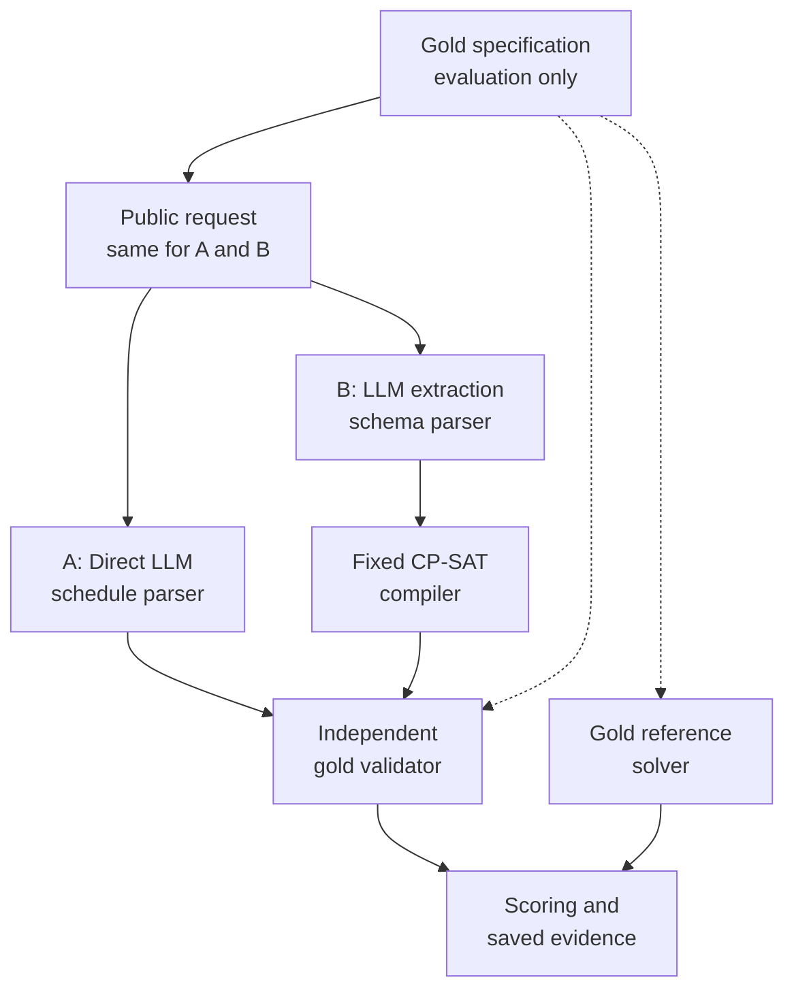

# AI Assistant for Dynamic Constraint-Aware Scheduling

School of Computing

CS3263 Foundations of Artificial Intelligence<br/>Semester 1, AY2026/27

PROJECT REPORT

*Direct LLM Reasoning versus Constraint-Solver-Augmented Scheduling*

**Group 23**

**Team Members**

Tham Yao Xiang | Team Leader<br/>Tea Li Hao<br/>Woo Yong Qing

## Abstract

We compare direct LLM scheduling with LLM extraction followed by a fixed CP-SAT solver. Both receive equivalent task descriptions and one model call; an independent validator checks answers against the original requirements. The main study evaluates 1,000 synthetic generation cases across ten interaction families. Qwen3.6 35B A3B produces accepted answers on 308/1,000 direct attempts versus 953/1,000 with solver augmentation; GLM5.3 Flash achieves 891/1,000 versus 988/1,000. Qwen3.6's direct score hides a strong asymmetry: it constructs only one valid schedule among 500 feasible cases. GLM5.3 Flash performs well directly, but concrete overlap and extraction errors remain. Service failures explain part of the observed differences and prevent a controlled timing comparison. The results support solver augmentation for these constructed cases while showing that formal correctness cannot compensate for an incorrectly extracted problem.

## 1. Problem, motivation and research questions

Shared schedules must respect appointments, availability, deadlines and limited resources while accommodating preferences. We study a scheduling assistant through three questions: does solver augmentation improve valid schedule construction and infeasibility detection; which interpretation or solving failures remain; and what resources and practical trade-offs accompany each method? Generation is the core study, with minimum-disruption repair and wording robustness retained as separately evaluated extensions.

The domain contains mandatory, non-preemptive activities with fixed durations and participant/resource assignments. A single day is divided into 30-minute slots; shared people and rooms have capacity one. Hard requirements include availability, release times, deadlines, fixed appointments and precedence. Soft preferences concern activity start times. The assistant proposes schedules; it does not modify real calendars.

The contribution is an inspectable comparison separating interpretation, formal feasibility, optimization and operational reliability. CP-SAT and minimum-perturbation repair are established methods; neither is claimed as a new algorithm.

## 2. Related work

NATURAL PLAN supplies task information within natural-language planning inputs, including calendar scheduling [1]. This motivates comparing reasoning with the required information present, rather than measuring retrieval. Our tasks add repair from a common original schedule and explicit optimization objectives. Minimal perturbation research studies retaining a solution when constraints change [2]; our complete schedules, fixed activity set and three-priority objective are a narrower formulation.

Huang and Zhang study language models as PDDL formalizers and find that syntax, semantics and description naturalness affect performance [3]. This motivates our separate extraction and gold-validity measures; their planning scores are not predictions for our scheduling cases. CP-SAT combines constraint, Boolean and linear reasoning [4]. We use the established OR-Tools implementation and preserve its distinct feasible, optimal, infeasible and unknown outcomes [5]. The fixed compiler reduces the amount of generated formal code, but limits which natural-language requirements can be represented.

## 3. Formal scheduling model

For activity i, s_i is its integer start slot, d_i its fixed duration in slots, and e_i = s_i + d_i its end. Each slot represents 30 minutes. The finite domain D_i contains starts within the horizon satisfying release times, deadlines, fixed starts, blocked intervals and full containment in an availability window for the activity and every required participant or resource. Intervals are half-open: one activity may begin exactly when another ends.

Precedence i before j requires e_i <= s_j. Activities sharing a person or room require e_i <= s_j or e_j <= s_i: one must finish before the other starts. These variables, finite domains and hard constraints form a constraint satisfaction problem (CSP). Let F be its feasible schedules. A nonempty F is feasible (SAT); an empty F is infeasible (UNSAT). Adding weighted preferences gives a constraint optimization problem: choose a schedule in F minimizing

```math
P(\mathbf{s}) = \sum_{k \in K} w_k\,\mathbf{1}[s_{a(k)} \notin W_k].
```

Here, K indexes the preferences; preference k concerns activity a(k), preferred start window W_k and nonnegative weight w_k. This window includes its lower bound and excludes its upper bound; it constrains the start, not the whole activity. The indicator charges w_k once for a start outside it. An unmet preference adds its weight without making the schedule infeasible.

**Why a solver may help.** Before considering interactions, n activities have up to the product of their domain sizes possible start assignments. Non-overlap and precedence couple these choices: a locally plausible placement can block several later activities. The compiler encodes interval/non-overlap, precedence and unary restrictions for CP-SAT, which searches the formal model and can prove infeasibility or optimality [4,5]. This motivates the tool comparison; it does not establish that every large generated instance is difficult.

**Repair extension.** The benchmark validates the original schedule against its original requirements. Repair then uses F for the updated feasible set, minimizing first the number of changed starts M, then total absolute start shift T (in slots), then preference penalty P:

```math
\underset{\mathbf{s}\in F}{\mathrm{lexmin}}\;\left(M(\mathbf{s}),\,T(\mathbf{s}),\,P(\mathbf{s})\right).
```

This is lexicographic priority, not a weighted sum: later goals cannot worsen an earlier optimum. Each priority is fixed only after optimality is proved; the experiments configure a shared 30-second budget. A timeout does not establish infeasibility, and a feasible incumbent need not be optimal. Detailed repair equations and scope choices are retained in the supplement; the main results below evaluate generation only.

## 4. System design and comparison controls



**Direct method (A).** One call returns a JSON schedule or an infeasibility prediction. It receives neither a solver nor oracle feedback. **Solver-assisted method (B).** One call translates the same public information into the canonical JSON specification; a fixed compiler constructs and solves the model. A neutral request identifier avoids exposing label-bearing evaluator IDs. Both repair paths receive the same original schedule and updated requirements. Malformed output, duplicate keys and omitted requirements are not silently repaired.

The independent validator checks every hard constraint and recomputes objectives arithmetically, without CP-SAT or its compiler helpers. A separate gold reference solve establishes feasibility and preference optima; independent certificates and tiny exhaustive tests provide additional checks. The reference solver and the solver-assisted method share CP-SAT, so objective verification is not fully independent. A solver proof applies to the extracted specification, whereas acceptance is checked against the original gold requirements.

Each method makes one attempt without retries or validator-feedback correction. All returned answers and failures are retained and can be replayed offline. The experiment compares complete pipelines: the solver-assisted method changes the model's output task as well as adding a solver, so it is not an ablation isolating the solver algorithm alone.

**Worked example: can eight activities share one room?** This selected case illustrates the comparison, not success frequency. Each model received the same requirements once for direct solving and once for solver-assisted scheduling. All four calls returned answers.

**The request.** Schedule eight 30- or 60-minute activities for two people, P1 and P2, available 09:00-17:00 on 26 October. Their shared room R1 is available 09:00-14:00. Each activity must fit within its own availability window and occupy both its assigned person and the room. Even activities involving different people cannot overlap in R1. A8 starts at 09:00; A4 must finish by 11:00 and A1 by 13:30. Required ordering is A8 before A3, A3 before A6, A5 before A7, and A7 before A2. Preferred start times are soft: missing them incurs a penalty but does not invalidate a schedule. Full windows, weights and original inputs remain in the supplement.

**Table 1. What each method returned for the same request.**

| Model | Method | Recorded outcome |
| --- | --- | --- |
| Qwen3.6 | Direct LLM | Incorrectly reports no solution |
| Qwen3.6 | LLM + CP-SAT | Valid; optimal preference penalty 6 |
| GLM5.3 Flash | Direct LLM | Invalid: room overlap and activity-window violation |
| GLM5.3 Flash | LLM + CP-SAT | Valid; optimal preference penalty 6 |


**Why the direct answers fail.** Read the room row from left to right: all eight activities fit without overlap from 09:00 to 14:00. This valid schedule disproves Qwen3.6's UNSAT prediction. GLM5.3 Flash instead places A4 and A5 together at 11:00-11:30, double-booking R1; A4 also finishes after its 11:00 availability boundary. These are returned-answer errors, not service failures.

**Why the solver-assisted answers pass.** Both models extract the gold constraints correctly, and CP-SAT produces the timetable above. The independent validator confirms every hard constraint. A penalty of 6 is still optimal: A8 and A4 prefer starts from 14:00, and A1 from 14:30, which their hard restrictions rule out. Their unavoidable penalties sum to 3 + 1 + 2 = 6. A7 starts at 12:00, satisfying its 12:00-14:00 preference with no additional penalty. Thus the schedule is both feasible and as preference-satisfying as this request permits.

The example separates two questions: can a valid schedule be found, and how well can it satisfy preferences? It illustrates the value of correct extraction plus formal solving; Section 6 also examines failures where incorrect extraction makes the solver-assisted method solve the wrong problem.

## 5. Dataset and experimental protocol

**Design rationale.** A preliminary 48-case generation study gave GLM5.3 Flash 47/48 accepted direct answers and 48/48 solver-assisted answers; its only direct rejection was a service error. To examine more than this small-case ceiling, the present study varies interaction mechanisms and problem size. Earlier repair/wording studies remain separate and their scores are not pooled with this experiment.

**Main design.** Ten mechanisms cover room/participant contention, fragmented packing, precedence chain/fork-join, appointment collision, release/deadline chains, participant calendars, resource/person crossing and mixed order/resource interactions. Each has five activity counts (8, 12, 16, 24, 32) and ten matched SAT/UNSAT pairs per size: 1,000 cases, 500 of each label, in ten conservative families. All four deadline/fixed-start presence profiles are label-balanced. Varying durations, windows, assignments, rules and preferences yields 1,000 normalized hard fingerprints and 500 topology signatures, beyond name-only changes.

The 200 eight-activity cases use a 09:00-17:00 day, two participants, one room and 30-90-minute durations. Larger cases may use a full-day horizon and more resources, so size is not isolated experimentally. Interaction graphs are connected and unary activity domains nonempty, but some UNSAT cases contain short contradictory subproblems. Stratum labels do not establish computational hardness or absolute capability limits. Twenty-four optional reordered conditions were not executed.

**Gold construction.** All 500 feasible cases have witnesses checked by independent arithmetic validation. The 500 infeasible cases have independent certificates: 100 whole-instance capacity contradictions and 400 enumerated contradictory subproblems. CP-SAT reference solves agree with every label and prove preference optima for all feasible cases. Controlled natural-language descriptions are rendered from the versioned formal cases. Gold labels, witnesses and reference answers are excluded from model prompts. These are deterministic, AI-assisted synthetic development inputs designed to exercise specific constraints, not an untouched holdout or a sample of real calendars. The course explicitly permits constructed instances [6].

**Models and comparison controls.** We evaluate Qwen3.6 35B A3B (abbreviated Qwen3.6) and GLM5.3 Flash through SoCLaaS. Each makes 2,000 scheduling calls: one per case/method, 4,000 total. Qwen3.6 uses request/response ID `qwen3.6:35b`; GLM5.3 Flash uses request alias `x-test-1`, returning `glm-5.3-flash`. Cases, method-specific prompts, scientific source and dependencies match (Python 3.12.2; OR-Tools 9.14.6206). Limits are 32,768 output tokens, a 1,800-second read timeout and 30/60-second method/reference solve budgets. Sampling/reasoning controls use unverified server defaults. The evidence package records exact settings and qualification calls.

**Execution conditions.** All 4,000 attempts have one recorded provider call, including failures. OS, concurrency and hosted-backend conditions changed during execution; Section 7 therefore treats timing as descriptive rather than a controlled speed comparison.

**Measures and dependence.** Primary acceptance is a gold-valid SAT schedule or correct UNSAT answer; every provider, format and mathematical failure remains in its denominator. We report SAT validity, UNSAT correctness, extraction diagnostics, conditional preference optimality and time/token coverage. Structural differences do not automatically establish semantic errors. A ten-family paired bootstrap describes sensitivity to reweighting these designed mechanisms, not population uncertainty over independent real calendars. There is one sampled answer per condition; 1,000 distinct fingerprints are not 1,000 independent families.

## 6. Results and failure analysis

**Primary outcomes.** Figure 1 includes all 1,000 attempts per method. Solver assistance improves acceptance by 64.5 percentage points for Qwen3.6 and 9.7 for GLM5.3 Flash. Qwen3.6 has 654 cases accepted only by the solver-assisted method and nine only by the direct method; GLM5.3 Flash has 104 and seven, respectively. Central 95% ten-family bootstrap ranges are 61.1–67.6 and 6.8–13.1 points (10,000 resamples, seed 3263). These describe sensitivity to the constructed families, not general superiority or removal of service confounding.


**Table 2. Can each method produce a correct schedule or recognise that none exists?**

Of the 1,000 problems, 500 have at least one schedule satisfying every hard constraint; the other 500 have no such schedule. The table measures success on these two groups separately.

| Model | Method | Correct schedules<br/>(500 possible cases) | Correctly reports<br/>no solution<br/>(500 impossible cases) |
| --- | --- | ---: | ---: |
| Qwen3.6 | Direct LLM | 1/500 (0.2%) | 307/500 (61.4%) |
| Qwen3.6 | LLM + CP-SAT | 467/500 (93.4%) | 486/500 (97.2%) |
| GLM5.3 Flash | Direct LLM | 404/500 (80.8%) | 487/500 (97.4%) |
| GLM5.3 Flash | LLM + CP-SAT | 492/500 (98.4%) | 496/500 (99.2%) |

All attempts remain in these denominators, including service and output-format failures.

**Main finding.** Solver assistance increases correct schedules from 1 to 467 for Qwen3.6 and from 404 to 492 for GLM5.3 Flash. Qwen3.6's 30.8% direct acceptance mainly reflects recognising impossible cases. Overall acceptance therefore overstates its usefulness for constructing schedules. These pipeline outcomes include format and service reliability, not reasoning alone.

**Preference quality.** A correct schedule satisfies every hard constraint; an optimal one also minimizes preference penalty. All valid solver-assisted schedules are optimal: 467 for Qwen3.6 and 492 for GLM5.3 Flash. Direct GLM5.3 Flash reaches the optimum on 403 of 404 valid schedules; the remaining penalty is 33 versus optimum 30. Qwen3.6's sole valid direct schedule is optimal, providing little evidence of general optimization ability.

**Failure categories.** Figure 2 separates constraint violations, false UNSAT, output-format rejection and infrastructure failures. Direct Qwen3.6 has 208 format rejections; these do not necessarily indicate mathematical failure. Strict parsing measures usable answers under the output contract, without silent repair. No local solver timeout/UNKNOWN occurs.

**Trace-backed mechanisms.** Section 4 shows direct-answer errors without service confounding. The following solver-assisted failures arise from changed specifications.

**Invented deadlines (Qwen3.6).** The extraction adds deadlines that were absent from the request. One requires an activity to finish by the start of its availability window, making a feasible request appear impossible. **Dropped constraints (GLM5.3 Flash).** The extraction omits a deadline and a precedence requirement. The solver then schedules two activities together even though one must finish before the other starts. Both examples show that correct solving cannot compensate for an incorrect specification. Exact inputs and trace references are retained in the [report supplement](report-details.md#example-trace-index).

Qwen3.6 has 873 structurally matching and 100 differing extractions among 973 parsed specifications. All matching outputs and 80 differing outputs are accepted. GLM5.3 Flash has 959 matching and 33 differing extractions among 992 parsed specifications; all matching outputs and 29 differing outputs are accepted. The remainder account for the solver-assisted mathematical failures. Gold-valid outputs need not imply equivalent specifications, and structural differences need not be harmful. Independent gold validation remains essential.


**Returned-response sensitivity.** Restricting to cases with both methods receiving a response gives direct versus solver-assisted acceptance of 307/949 versus 907/949 for Qwen3.6, and 891/935 versus 927/935 for GLM5.3 Flash. GLM5.3 Flash's paired gap then becomes 3.85 percentage points, compared with 9.7 points in the primary all-attempt analysis. This secondary view helps separate delivery from answer quality; nonrandom missingness prevents treating it as corrected accuracy.

**Scale and mechanism.** On the 200 eight-activity cases, direct versus solver-assisted acceptance is 57 versus 197 for Qwen3.6, and 192 versus 200 for GLM5.3 Flash. On the 200 largest cases (32 activities), Qwen3.6 accepts 74 and 180, and GLM5.3 Flash 148 and 194. However, 40 of the 52 largest-case failures for direct GLM5.3 Flash are infrastructural: its score is 148/200 overall but 148/160 among returned answers. Its apparent decline therefore cannot be attributed entirely to reasoning difficulty. Qwen3.6's nonmonotonic size scores mainly reflect UNSAT prediction. Larger cases also change horizons and resources, so neither model's trend isolates the effect of activity count.

**Optimization difficulty.** The 500 reference optima range from 0 to 37, with median 12 and only two zero optima, so optimal solver-assisted outputs are not simply an all-zero objective artifact. This does not establish difficult optimization: the instances are constructed, local solve times are short, and the reference solver and solver-assisted method share the compiler. Historical repair results separately expose movement-versus-shift trade-offs; they are not mixed into these generation scores.

## 7. Resource use and operational limitations

**Token usage.** Table 3 reports provider-supplied prompt-plus-completion tokens. Missing usage on 119 infrastructure failures is unknown, not zero; statistics use reported observations only. The p95 is the nearest-rank 95th percentile, describing the observed upper tail rather than a worst-case bound. Full definitions and execution-phase distributions are in the supplement.

**Table 3. Total tokens per scheduling call. Statistics use calls with reported usage.**

| Model | Method | Mean | Median | p95 |
| --- | --- | ---: | ---: | ---: |
| Qwen3.6 | Direct LLM | 3,287.5 | 1,977 | 12,751 |
| Qwen3.6 | LLM + CP-SAT | 5,220.4 | 4,737.5 | 8,490 |
| GLM5.3 Flash | Direct LLM | 7,504.1 | 5,592 | 19,191 |
| GLM5.3 Flash | LLM + CP-SAT | 7,054.6 | 6,159 | 12,750 |

Usage reported for direct / solver-assisted calls: Qwen3.6 951 / 998; GLM5.3 Flash 935 / 997 (out of 1,000 per method).

For Qwen3.6, the solver-assisted method has higher mean token usage but a lower p95 than the direct method. For GLM5.3 Flash, it has a lower mean and p95 but a higher median. These differences show why the mean alone is insufficient. Qwen3.6's low direct-method median also accompanies many short UNSAT answers, including incorrect ones; low usage does not establish successful efficiency. Provider tokenization and hidden serving behavior differ, so token counts are neither a common currency cost nor an independently measured reasoning budget.

**Table 4. Pipeline duration per attempt (seconds; 1,000 attempts per row, including failures). Pooled deployment timings, not a controlled model-speed comparison.**

| Model | Method | Mean | Median | p95 |
| --- | --- | ---: | ---: | ---: |
| Qwen3.6 | Direct LLM | 36.53 | 21.55 | 132.49 |
| Qwen3.6 | LLM + CP-SAT | 41.26 | 37.38 | 87.42 |
| GLM5.3 Flash | Direct LLM | 108.68 | 71.46 | 300.05 |
| GLM5.3 Flash | LLM + CP-SAT | 67.07 | 55.24 | 141.91 |

Pipeline time includes the model request and local parsing/solving within an attempt, excluding pre-dispatch waiting and campaign downtime. The model-request stage dominates measured pipeline time. Local solver mean/median/p95 is **16.19/10.25/36.52 ms** for Qwen3.6 (973 invocations) and **13.97/11.39/33.01 ms** for GLM5.3 Flash (992). Thus local solving adds little time in these bounded cases; generation of the formal specification remains part of the solver-assisted method's model-call cost. The timers cannot separate provider inference from queueing or networking.

**Timing limitation.** Qwen3.6 has 51 infrastructure failures and GLM5.3 Flash 68, predominantly HTTP 502 responses. They remain in primary denominators but are not scheduling mistakes. The direct method's p95 for GLM5.3 Flash, near 300 seconds, includes gateway failures; four GLM5.3 Flash timeouts also overlapped laptop sleep. No case has all four observations under matching OS and concurrency, and provider load is uncontrolled. Table 4 therefore cannot establish intrinsic model speed. Detailed operational history and model-call distributions are preserved in the [supplement](report-details.md) and [execution audit](diverse-comparison-audit.md).

## 8. Implications, limitations and responsible AI

**When to use each approach.** Solver augmentation improves feasible schedule construction for the tested explicit, bounded constraints. It returns independently checkable schedules with solver-backed feasibility or optimality statuses. When a compatible solver or schema is unavailable, direct generation can still propose schedules. The direct results for GLM5.3 Flash show that this can work, but proposed schedules need validation and an UNSAT assertion cannot prove impossibility. The solver-assisted method shifts part of the challenge from constructing a schedule to accurately representing the request. An extractor that omits or invents a requirement can make a correct solver answer the wrong question, as the counterexamples demonstrate.

**Representation and practical limits.** The fixed schema makes compilation reliable for supported constraints but cannot express arbitrary requests. Real scheduling may require travel, uncertain durations, multi-day choices or fairness across people. Preferred-start penalties do not implement consecutive-meeting or day-clustering preferences. Such requests require clarification or a richer model before solver guarantees are meaningful. Dynamic tool use, feedback correction and alternative solvers were not tested; adding them would be a separate comparison.

**Validity threats.** The 1,000 cases come from ten related generator families, with one answer per condition. They broaden constraint coverage but do not establish real-world representativeness. Balanced deadline/fixed-start profiles remove one known label shortcut, not all template bias. Some infeasible cases contain simple contradictions, and more activities need not imply harder search. The optional reordered conditions were not run; historical wording results do not establish robustness on the new dataset. Validation of the prose-to-gold mapping is automated; independent human semantic assessment is not part of the reported evidence. The shared reference compiler also limits independence of optimality checks.

Missing responses are uneven across methods and case sizes, so returned-response analysis is diagnostic rather than corrected accuracy. Uncontrolled serving conditions limit causal comparisons of timing and model capability.

**Responsible AI.** Real calendars reveal identities, routines and relationships, sometimes even after names are removed. Fictional data avoids disclosing real routines; deployment would need consent, retention limits and oversight. Fixed assignments and aggregate preference penalties do not establish fair workload allocation. A historical repair concentrates one move and 30 minutes of shift on a single participant; another independently checked example prefers one activity shifted four slots over two activities shifted two slots total because moved count has priority. Such trade-offs need stakeholder agreement rather than an assumption that a numerical optimum is fair.

Hard requirements must not silently become preferences. Explanations distinguish solver conclusions about the extracted specification from validity against the original request, and users retain control: the prototype sends no invitations and changes no calendars. Instruction-like input is treated as data; a fixed compiler does not execute generated code. This reduces an attack surface but is not a live adversarial robustness study. Ambiguity, malicious descriptions, incorrect extraction and biased objectives remain practical risks requiring human review and monitoring [6].

## 9. Reproducibility, contributions and conclusion

Code, prompts, case specifications, locked dependencies and replay archives are available in the project repository [7]. The evidence preserves all 4,000 attempt records, public inputs, gold references, outputs/failures and exact source/settings. Offline replay reproduces the analyses; checksums connect tables and figures to those records. The supplement retains complete examples and operational details.

**Author contributions.** Tham Yao Xiang: mathematical formulation, constraint extraction semantics, CP-SAT compilation and repair objectives. Woo Yong Qing: benchmark and evaluation design, independent validation, metrics, failure analysis and result interpretation. Tea Li Hao: LLM/provider integration, end-to-end system wiring, experiment operations, reproducibility and quality assurance. Report review, responsible-AI discussion, whole-system understanding and presentation preparation are shared responsibilities.

**AI assistance.** Codex supported implementation, testing, experiment operations, analysis and report drafting under team direction.

Solver augmentation improves measured acceptance on these constructed cases, especially for Qwen3.6. Direct scheduling with GLM5.3 Flash remains strong but imperfect; service errors explain much of its largest-stratum decline, while returned-answer counterexamples establish scheduling failures. Formal correctness, faithful interpretation, operational availability and responsible use must be evaluated separately.

## References

1. Zheng, H. S., et al. (2024). *NATURAL PLAN: Benchmarking LLMs on Natural Language Planning*. [arXiv:2406.04520](https://arxiv.org/abs/2406.04520).
2. Bartak, R., Muller, T., and Rudova, H. (2003). *Minimal Perturbation Problem - A Formal View*. ERCIM Working Group on Constraints workshop. [Authors' paper](https://ktiml.mff.cuni.cz/~bartak/downloads/ERCIM2003mpp.pdf).
3. Huang, C., and Zhang, L. (2025). *On the Limit of Language Models as Planning Formalizers*. ACL, pp. 4880-4904. [doi:10.18653/v1/2025.acl-long.242](https://aclanthology.org/2025.acl-long.242/).
4. Perron, L., Didier, F., and Gay, S. (2023). *The CP-SAT-LP Solver (Invited Talk)*. CP 2023, LIPIcs 280, pp. 3:1-3:2. [doi:10.4230/LIPIcs.CP.2023.3](https://drops.dagstuhl.de/entities/document/10.4230/LIPIcs.CP.2023.3).
5. Google OR-Tools. *CP-SAT Solver*. [Solver status documentation](https://developers.google.com/optimization/cp/cp_solver); implementation pinned to 9.14.6206.
6. CS3263 teaching team (2026). *Project*; *CS3263 Project Guidelines AY2026/27*; *Responsible AI*. Supplied course materials. Group 23 (2026), *Project Proposal*. Project consultation and written TA feedback.
7. CS3263 Group 23 (2026). *Scheduling study: code and evaluation evidence*. [Versioned repository and replay archives](https://github.com/JellyPenguinnn/cs3263_group23/tree/91ad71bffd85f0ced5ea7bcd2bdd844fe77daa06). Individual run manifests retain their original scientific source identities.
