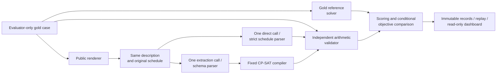
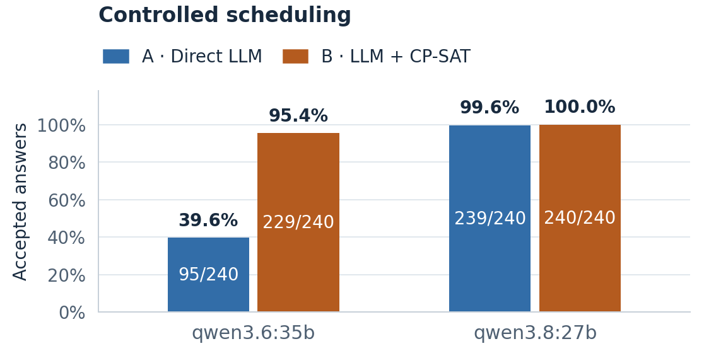
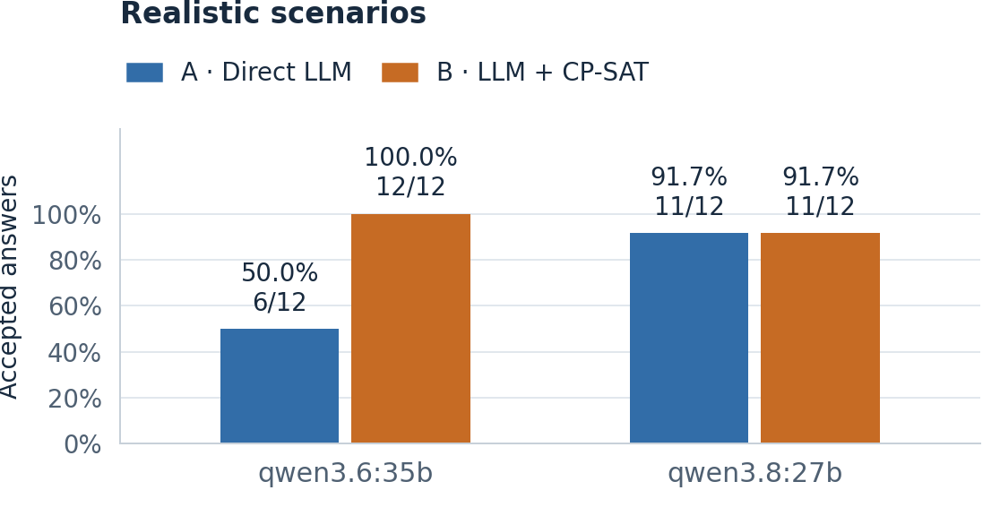
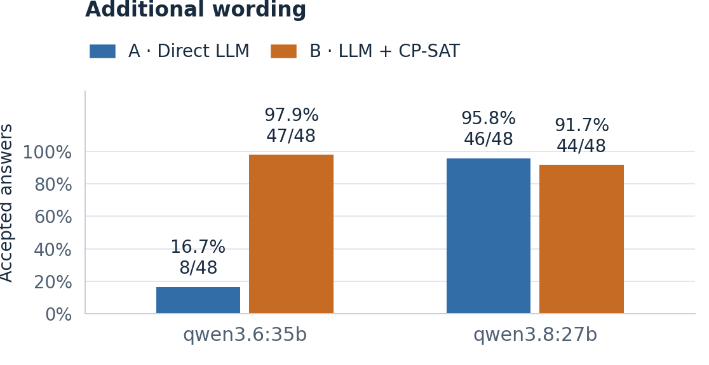

# Direct LLM Reasoning versus Constraint-Solver-Augmented Scheduling

CS3263 Foundations of Artificial Intelligence - Group 23

Tea Li Hao, Tham Yao Xiang, Woo Yong Qing

NUS AY2026/27 Semester 1 - 2 October 2026

Exploratory empirical study of schedule generation and minimum-disruption repair.

Public report copy. Matriculation numbers and email addresses belong on the private submission title page. Model eligibility and actual member review/contributions must be confirmed before course submission; see the accompanying submission checklist.

## Abstract

We compare direct language-model scheduling with language-model extraction followed by a fixed constraint solver. The task includes generating a feasible schedule and repairing a previous schedule after a requirement changes, minimizing disruption lexicographically. Both approaches receive equivalent descriptions and one model call; an independent validator checks the returned schedule against evaluator-only gold constraints. Two hosted Qwen models each complete 600 scheduling attempts across controlled synthetic cases, fictional realistic scenarios and equivalent wording variants. On controlled cases, solver augmentation raises Qwen3.6 acceptance from 95/240 to 229/240. Qwen3.8 reaches 239/240 directly and 240/240 with the solver, but its direct repair is suboptimal in one otherwise valid case. All nine Qwen3.8 rejections across the three blocks are provider failures. Model calls dominate solver runtime. The results demonstrate a model-dependent trade-off between direct reasoning, formal optimization and extraction overhead. Known development inputs, limited language diversity and shared-service execution restrict generalization; no held-out or production-reliability claim is made.

## 1. Problem, motivation and research questions

A room becoming unavailable can force several activities to move even when only one activity's requirements change. Finding any feasible replacement may unnecessarily disrupt existing commitments. We study when a language model can handle this reasoning directly, when a formal solver helps, and what limits the combined system. Our questions concern hard-constraint validity, minimal-disruption repair, sensitivity to structural difficulty and wording, and resource cost.

The domain is deliberately bounded: mandatory non-preemptive activities, fixed durations and participant/resource assignments, capacity-one resources, and a single day divided into 30-minute slots. Requirements include availability windows, release times, deadlines, fixed appointments and precedence. Preferences penalize starts outside stated preferred windows. The system proposes a schedule or reports infeasibility; it does not edit calendars. Travel inference, multi-day planning and participant assignment are excluded.

The contribution is an inspectable experimental system that separates natural-language interpretation, formal feasibility, optimization quality and operational reliability. CP-SAT and minimum-perturbation repair are established methods; neither is claimed as a new algorithm. The value of the project lies in implementing and analysing a fair comparison and identifying when a correct solver still gives the wrong answer to the original request.

## 2. Related work

NATURAL PLAN supplies task information within natural-language planning inputs, including calendar scheduling [1]. This motivates comparing reasoning with the required information present, rather than measuring retrieval. Our tasks add repair from a common original schedule and explicit optimization objectives. Minimal perturbation research studies retaining a solution when constraints change [2]; our complete schedules, fixed activity set and three-priority objective are a narrower formulation.

Huang and Zhang study language models as PDDL formalizers and find that syntax, semantics and description naturalness affect performance [3]. This motivates our separate extraction and gold-validity measures; their planning scores are not predictions for our scheduling cases. CP-SAT combines constraint, Boolean and linear reasoning [4]. We use the established OR-Tools implementation and preserve its distinct feasible, optimal, infeasible and unknown outcomes [5]. The fixed compiler reduces the amount of generated formal code, but limits which natural-language requirements can be represented.

## 3. Formal model and repair objective

For activity i, let s_i be its integer start, d_i its fixed duration and e_i = s_i + d_i its end. The horizon H is at most 48 slots. Its domain D_i contains starts from 0 to H-d_i satisfying all unary restrictions: release, deadline, fixed start, blocked intervals, and full containment in an availability window for every required activity, participant and resource. Each activity must fit inside one listed window; adjacent windows are not silently merged. Half-open activity intervals allow one activity to begin exactly when another ends.

Precedence i before j requires e_i <= s_j. Every shared participant or resource imposes non-overlap on its activity intervals. Empty start domains encode contradictions, rather than malformed input. These variables, domains and hard constraints form a constraint satisfaction problem. Adding preferences produces a constraint optimization problem. A weighted preference contributes its weight when an activity starts outside its preferred start window. Generation minimizes the sum P(s).

Repair validates the previous schedule against the original specification, then solves the updated specification using the same activity identities and previous starts. Let *A* index activities and *K* index preferences. Each preference *k* has a weight, a preferred start window and a target activity *a(k)*. The indicator is 1 when its condition holds and 0 otherwise. The four expressions below define moved count, total shift, preference penalty and the repair objective, respectively:

```math
M(\mathbf{s}) = \sum_{i \in A} \mathbf{1}[s_i \neq s_i^{\mathrm{old}}]
```

```math
T(\mathbf{s}) = \sum_{i \in A} |s_i-s_i^{\mathrm{old}}|
```

```math
P(\mathbf{s}) = \sum_{k \in K} w_k\,\mathbf{1}[s_{a(k)} \notin W_k]
```

```math
\underset{\mathbf{s}\in F}{\mathrm{lexmin}}\;\left(M(\mathbf{s}),\,T(\mathbf{s}),\,P(\mathbf{s})\right)
```

Here, *F* is the set of schedules satisfying all updated hard constraints; the superscript "old" denotes the previous start; weights and preferred windows are indexed by preference. A start outside its preferred window contributes that preference's weight once, regardless of distance. Lexicographic minimization gives moved count priority over total shift, and total shift priority over preference penalty.

CP-SAT proves the best moved count M, fixes it, proves the best shift T, and finally minimizes P. Stages share a 30-second solve budget with zero absolute and relative optimality gaps. A valid incumbent may survive a timeout, but unproved later priorities remain unproved. `UNKNOWN` is distinct from `INFEASIBLE`, and `FEASIBLE` from `OPTIMAL`. A secondary objective gap is reported only when earlier priorities equal their proven reference values.

**Worked repair.** A, B and C each last one slot and share a resource over slots 0 to 3. Their original legal starts are A={0,1}, B={1,2}, C={0,1,2}, with original schedule (0,1,2). A new block removes A's start 0. The unique feasible repair is (1,2,0): moving A forces B and C to move. Its objective is (3,4,0), since the total shift is 1+1+2 slots. Fixing unaffected activities at their previous starts would incorrectly report infeasibility. Independent enumeration, arithmetic validation and CP-SAT agree on this small example.

## 4. System design and comparison controls



**A: Direct LLM.** One call returns a schedule or an infeasibility prediction. It receives neither a solver nor oracle feedback. **B: LLM-to-CP-SAT.** One call translates the same public information into the canonical specification; a fixed compiler constructs and solves the model. A neutral request identifier avoids exposing label-bearing evaluator IDs. Both repair paths receive the same original schedule and updated requirements. Malformed output, duplicate keys and omitted requirements are not silently repaired.

The independent validator checks hard constraints and recomputes objectives arithmetically, without CP-SAT or its compilation helpers. A gold reference solve uses 60 seconds and supplies proven feasibility/objective information. Tiny exhaustive fixtures help detect shared modelling assumptions. The validator's independence reduces correlated errors but does not replace human review of whether the text and gold describe the intended problem. Solver proof applies to the extracted specification only.

The runner reserves requests durably, saves responses and failures, rejects incompatible resume and supports offline replay. A read-only dashboard exposes progress, before/after schedules and evidence-bound explanations. Completed attempts are not retried. Transient timeouts, transport errors and selected service errors remain failed observations while later distinct attempts continue; authentication, model-identity and integrity failures stop dispatch. Long runs use independent process supervision. These controls preserve experimental accounting rather than improve model answers.

## 5. Dataset and experimental protocol

Each model was evaluated on the same 300 case/rendering conditions with both approaches, for 600 scheduling attempts. The controlled set contains 240 canonical cases from 120 source families: 120 generation and 120 repair cases, each balanced across 60 SAT and 60 UNSAT labels. Four construction sweeps vary activity count, unary slack, resource contention and constraint interaction, with three levels and 60 cases per sweep. Related generation/repair cases are not independent samples.

The realistic block contains twelve AI-assisted fictional scenarios, balanced across task and feasibility label. Human prose/gold review remains pending; these are not real calendars or independently human-authored cases. The wording block selects 24 controlled bases from distinct families, six per task/label stratum, and evaluates paraphrased and reordered descriptions. It adds 48 conditions per approach, reusing the selected canonical partners for matched analysis. It does not add 48 independent scheduling problems.

All inputs are known project-generated development data. Public benchmarks informed methodology but supplied no instances. Controlled construction makes contradictions, objectives and difficulty parameters inspectable, while small templates and artificial SAT/UNSAT balance limit representativeness. These comparisons are exploratory; inspecting them cannot turn them into a held-out test. Earlier pilots and the separate 200-call study remain historical evidence and are not pooled here.

The requested SoCLaaS identifiers were `qwen3.6:35b` and `qwen3.8:27b`. Both used the same 230-file source snapshot, Python 3.12.2/macOS ARM64 runtime, OR-Tools 9.14.6206, revision-3 prompts, cases and 600 request-prompt hashes. Configurations differ only in model ID. Each completion requested at most 32,768 output tokens; connect/read limits were 30/1,800 seconds, with no retries. Solver/reference runs used one worker and seed 0. Each campaign additionally made two capability completions and one metadata request.

Temperature, sampling and reasoning controls remained unexposed server defaults. Qwen3.6 reported three backend fingerprints and Qwen3.8 one. Hosted weight revisions, hardware and load were not controlled. Thus configuration comparability does not isolate model weights as a causal factor. Course eligibility of these exact hosted aliases remains a teaching-team interpretation, separate from their measured performance.

**Metrics.** Accepted-answer rate counts a gold-valid schedule or correct UNSAT response over all labelled attempts. SAT validity and UNSAT accuracy retain their own denominators. Objective matching is conditional on a gold-valid SAT schedule and proven reference objectives; failures do not receive zero gap. Structural extraction agreement is a diagnostic, not a complete semantic equivalence test. Time and token statistics retain missing coverage. Primary controlled, realistic and wording results stay separate.

Within each controlled task, paired family bootstrap intervals resample source groups with replacement 10,000 times using seed 3263, retaining the A/B pairs. There are 120 pairs/families per task. These intervals quantify variability within the observed construction, not transfer to a real scheduling population. Only one model sample was taken per condition, so wording effects are not fully separated from sampling variation.

## 6. Results and analysis

**Acceptance.** Figures 1-3 compare the approaches on a common scale. With Qwen3.6, B accepts 229/240 controlled attempts (95.4%) versus A's 95/240 (39.6%). The corresponding realistic scores are 12/12 versus 6/12, and wording scores 47/48 versus 8/48. Qwen3.8 reaches 240/240 versus 239/240 controlled, 11/12 for both realistic arms, and 44/48 versus 46/48 wording. All nine rejected Qwen3.8 attempts are provider errors; every non-error returned scheduling answer is accepted (591/591). This conditional diagnostic does not replace failure-inclusive rates or prove perfect reasoning.







**Feasibility by task and label.** Table 1 separates finding a valid schedule when one exists (SAT) from correctly reporting that none exists (UNSAT). Each cell gives the number correct out of 60 attempts and its percentage; operational failures remain in the denominator. A direct UNSAT response is a prediction. The solver-assisted certificate concerns the extracted problem and must still agree with gold.

**Table 1. Controlled feasibility results by model, task and method.**

| Model / task | Method | Valid schedules<br/>(SAT) | Correct infeasibility<br/>(UNSAT) |
| --- | --- | ---: | ---: |
| Qwen3.6<br/>Generation | Direct LLM | 27/60 (45.0%) | 26/60 (43.3%) |
| Qwen3.6<br/>Generation | LLM + CP-SAT | 59/60 (98.3%) | 56/60 (93.3%) |
| Qwen3.6<br/>Repair | Direct LLM | 22/60 (36.7%) | 20/60 (33.3%) |
| Qwen3.6<br/>Repair | LLM + CP-SAT | 59/60 (98.3%) | 55/60 (91.7%) |
| Qwen3.8<br/>Generation | Direct LLM | 59/60 (98.3%) | 60/60 (100.0%) |
| Qwen3.8<br/>Generation | LLM + CP-SAT | 60/60 (100.0%) | 60/60 (100.0%) |
| Qwen3.8<br/>Repair | Direct LLM | 60/60 (100.0%) | 60/60 (100.0%) |
| Qwen3.8<br/>Repair | LLM + CP-SAT | 60/60 (100.0%) | 60/60 (100.0%) |

For Qwen3.6, B minus A acceptance is +51.7 percentage points for generation (95% paired interval 41.7 to 61.7) and +60.0 for repair (50.0 to 70.0). For Qwen3.8 the differences are +0.8 (0.0 to 2.5) and 0.0 (0.0 to 0.0). The latter ceiling and degenerate empirical interval do not establish equivalence or population perfection. The practical improvement from augmentation depends on model and task; it is not uniformly positive across observed blocks.

**Difficulty.** On Qwen3.6's SAT generation activity-count sweep, A is valid on 3/5, 2/5 and 1/5 instances with 4, 8 and 12 activities; B is valid on 5/5 at each level. Unary-domain-product ranges rise from 140-1,470 to 60,480-967,680 and 162,570,240-231,525,000. This product bounds naive assignments, not CP-SAT's visited states. A's SAT generation validity across resource-contention levels is 5/5, 3/5 and 1/5, while B remains 5/5. Each cell contains only five cases. Other sweeps and repair are not uniformly monotonic, so these are descriptive patterns rather than causal difficulty thresholds. Qwen3.8's ceiling makes this set insufficient to distinguish its reasoning limits.

**Optimization quality.** Among Qwen3.6's valid controlled SAT schedules, A matches the reference objective on 1/27 generation and 5/22 repair cases; B matches on 59/59 for both. Qwen3.8 matches on all valid generation outputs (A 59/59, B 60/60), but A repair matches on 59/60 against B's 60/60. In one accepted direct repair, two activities move although the proven minimum is one. Its first-priority gap is +1; later gaps are undefined once that priority differs. Acceptance alone would conceal this error. Conditional optimum fractions must be interpreted alongside validity because the successful subsets differ.

**Failure mechanisms.** Across all blocks, Qwen3.6 A has 140 gold-invalid schedules, 24 false UNSAT answers and 27 invalid outputs; B has one gold-invalid schedule and eleven invalid outputs. In the controlled B failure ending `1b6a21e9eaa5121c07e7b362-generation`, extraction changes A1's deadline from slot 3 to slot 7. Solving that relaxed problem produces a schedule violating the original deadline. The compiler cannot recover an omitted or altered requirement. Of 289 recorded Qwen3.6 B extractions, 228 are structurally equal to gold; remaining differences are not automatically semantic errors. Qwen3.8 has structural equality for all 295 recorded B extractions. Its errors comprise one timeout, five transport errors, one HTTP 502 and two HTTP 503s; client receipts do not identify every underlying service/network cause.

**Matched wording.** In 48 variant/canonical comparisons per approach, Qwen3.6 A changes from accepted to rejected 16 times and rejected to accepted twice. B has one and two such transitions. Qwen3.8 has two accepted-to-rejected transitions for A and four for B, all operational failures. The latter does not demonstrate semantic degradation from paraphrasing. Canonical comparisons use only the selected bases; comparing wording scores with all 240 canonical cases would confound selection and wording.

**Resources.** Table 2 separates the two methods and reports mean resources per controlled scheduling attempt. Call time covers all 240 attempts in each row, including failures; it excludes the subsequent local solver. Token means use available provider-reported usage: Qwen3.8 Direct LLM has 239/240 observations, and the other rows have 240/240. Missing usage is unknown, not zero.

**Table 2. Mean model-call resources per controlled attempt.**

| Model | Method | Mean call time<br/>(seconds) | Mean total tokens<br/>(tokens/call) |
| --- | --- | ---: | ---: |
| Qwen3.6 | Direct LLM | 3.57 | 1,778.8 |
| Qwen3.6 | LLM + CP-SAT | 14.08 | 4,254.1 |
| Qwen3.8 | Direct LLM | 42.42 | 4,420.5 |
| Qwen3.8 | LLM + CP-SAT | 90.46 | 9,045.5 |

Conditional CP-SAT time averages 13.15 ms over 230 executed Qwen3.6 controlled solves and 17.60 ms over 240 Qwen3.8 solves. Extraction/model calls dominate the added time on these instances. These are shared-service timings, including request overhead and failures, not hardware-independent speed or monetary cost. Complete campaigns including capability calls report 1,773,823 tokens with 602/602 coverage and 3,994,657 with 593/602 coverage. Qwen3.8 was safely paused twice without reissuing saved responses. Total elapsed campaign clocks therefore cannot be presented as uninterrupted inference time.

## 7. Implications, limitations and responsible AI

**Method choice.** Direct reasoning is attractive when a capable model is already reliable on small, familiar inputs and lower latency matters. Formal augmentation is useful when explicit feasibility/optimization evidence matters or direct reasoning struggles with interactions. It adds extraction cost and inherits extraction errors. A fixed compiler and independent validator provide inspectability, but unsupported or ambiguous requirements require clarification or a revised schema. No operational dialogue feature or universally reliable natural-language interpretation is established.

**Validity threats.** Artificial label balance influences aggregate acceptance. Synthetic templates, related source families, twelve fictional scenarios and one sample per condition limit external validity and statistical power. Independent arithmetic checks and small exhaustive proofs do not certify every natural-language/gold pairing. The gold solver shares the compiler with B, so remaining compiler errors could affect optimality references even though validity is checked independently. Unknown hosted defaults, differing backend fingerprints and sequential service execution limit causal model comparisons. A fresh reviewed dataset or another model would strengthen some claims but would be a separate study, not a relabelling of these results.

**Unequal inconvenience.** A preserved historical repair concentrates one move and 30 minutes of shift on participant P7 while P0-P6 incur none. This demonstrates concentration, not that a fairer feasible solution exists. Reporting participant burden makes a trade-off visible; fixed assignments and aggregate disruption do not solve fair allocation. Stakeholder review would be needed before introducing burden caps.

**Objective consequences.** An independently checked tiny case prefers one moved activity shifted four slots over two moved activities shifted two slots in total. This follows the declared moved-count priority, but may conflict with a user's notion of inconvenience. The objective must be explained rather than described as universally best. Changing priorities requires an explicit new specification and evaluation.

**Privacy, control and explanation.** Fictional data avoids exposing private routines. Real calendars could reveal identity even after names are removed, requiring consent and retention controls. A deadline stays hard unless explicitly made negotiable; the system cannot silently relax commitments. Explanations distinguish a proof about the extracted model from validity against the original request, and users retain control over any action. The application does not send invitations or edit calendars.

**Adversarial text.** Prompt-boundary tests keep instruction-like strings in public task data, and the fixed compiler does not execute generated code. This limits one attack surface but is not measured live adversarial robustness. Incorrect extraction remains possible. Responsible deployment would need human oversight and monitoring beyond the present research prototype.

## 8. Reproducibility, contributions and conclusion

Both complete archives preserve cases, prompts, configurations, model outputs, failures, references and scoring source. Each archive has 941 checksummed files; fresh scoring and extraction/replay reproduce the saved analysis. The repository includes both original archives, a verification/extraction script, portable result summaries and figure-generation code. The fuller source snapshots and operational records, including interrupted attempts and pauses, are preserved separately with checksums. Earlier runs are retained without altering or pooling their outcomes. Exact replay is reproducible; nondeterministic shared-service generation is not promised.

Codex assisted implementation, tests, experiment operations, evidence analysis and report drafting under team direction. Repository evidence distinguishes assistance from actual human interpretation and review. The accompanying contribution log records observed work without inferring hours or independent authorship from branch names. Each member must confirm their own contributions and review the complete system before submission; this public report does not fabricate those confirmations.

The findings support solver augmentation as a conditional engineering choice. It substantially improves Qwen3.6's performance on the constructed study, while Qwen3.8 demonstrates that direct reasoning can already approach the validity ceiling. Formal optimization still exposes a meaningful repair-quality difference. The most important boundary is between solving a formal model correctly and interpreting the user's problem correctly. The system makes that boundary measurable, while the evidence supports bounded conclusions rather than universal superiority.

## References

1. Zheng, H. S., et al. (2024). *NATURAL PLAN: Benchmarking LLMs on Natural Language Planning*. [arXiv:2406.04520](https://arxiv.org/abs/2406.04520).
2. Bartak, R., Muller, T., and Rudova, H. (2003). *Minimal Perturbation Problem - A Formal View*. ERCIM Working Group on Constraints workshop. [Authors' paper](https://ktiml.mff.cuni.cz/~bartak/downloads/ERCIM2003mpp.pdf).
3. Huang, C., and Zhang, L. (2025). *On the Limit of Language Models as Planning Formalizers*. ACL, pp. 4880-4904. [doi:10.18653/v1/2025.acl-long.242](https://aclanthology.org/2025.acl-long.242/).
4. Perron, L., Didier, F., and Gay, S. (2023). *The CP-SAT-LP Solver (Invited Talk)*. CP 2023, LIPIcs 280, pp. 3:1-3:2. [doi:10.4230/LIPIcs.CP.2023.3](https://drops.dagstuhl.de/entities/document/10.4230/LIPIcs.CP.2023.3).
5. Google OR-Tools. *CP-SAT Solver*. [Solver status documentation](https://developers.google.com/optimization/cp/cp_solver); implementation pinned to 9.14.6206.
6. CS3263 teaching team (2026). *Project*; *CS3263 Project Guidelines AY2026/27*; *Responsible AI*. Supplied course materials. Group 23 (2026), *Project Proposal*. These define course expectations and project scope, not measured benchmark results.
