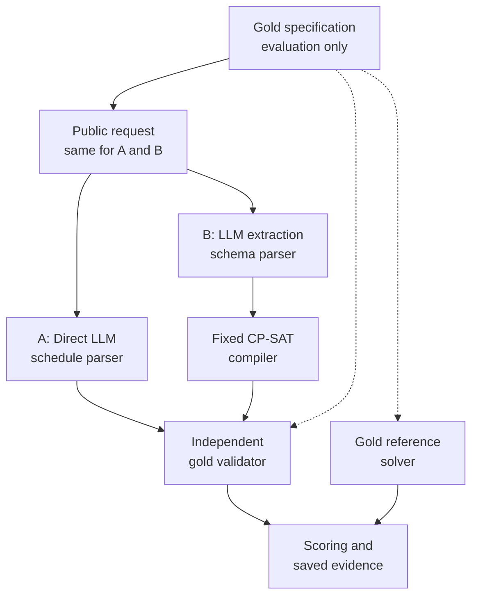

# AI Assistant for Dynamic Constraint-Aware Scheduling

School of Computing

CS3263 Foundations of Artificial Intelligence<br/>Semester 1, AY2026/27

PROJECT REPORT

*Direct LLM Reasoning versus Constraint-Solver-Augmented Scheduling*

**Group 23**

**Team Members**

Tham Yao Xiang | Team Leader<br/>Tea Li Hao<br/>Woo Yong Qing

## Abstract

Scheduling requires activities to satisfy interacting constraints while accommodating preferences. We compare direct LLM scheduling with LLM extraction followed by a fixed CP-SAT solver, using Qwen3.6 35B A3B and GLM5.3 Flash on the same 1,000 synthetic generation cases. Each method receives equivalent task information and makes one model call per case; an independent validator checks answers against the original requirements. Qwen3.6 produces accepted answers in 308/1,000 direct attempts (30.8%) and 953 solver-assisted attempts (95.3%). GLM5.3 Flash achieves 891 (89.1%) and 988 (98.8%), respectively. Solver assistance particularly improves valid schedule construction: Qwen3.6 constructs only one valid schedule directly among 500 feasible cases, versus 467 with assistance. However, invented or omitted requirements remain sources of assisted failures, and service failures contribute to the observed gaps. The evidence supports solver assistance for these constructed cases while showing that accurate interpretation and reliable delivery remain necessary for dependable scheduling.

## 1. Problem, motivation and research questions

Personal and shared schedules must respect availability, deadlines and limited resources while accommodating preferences. An LLM can interpret requests and propose schedules, but may overlook requirements. A constraint solver searches a formal model systematically, but its answers depend on the requirements supplied. This study examines whether combining them improves scheduling reliability and what limitations remain.

We address three questions: does solver augmentation improve valid schedule construction and infeasibility detection; which interpretation and solving errors persist; and what resource demands and practical trade-offs accompany each approach? Generation is the core study. Minimum-disruption repair and wording robustness were evaluated in earlier, separate experiments; their scores are not pooled with the main results.

The domain contains mandatory, non-preemptive activities with fixed durations and assigned participants or resources. Each problem spans one day in 30-minute slots; shared people and rooms have capacity one. Availability, release times, deadlines, fixed appointments and precedence are hard constraints. Preferred start times are soft constraints. The contribution is an inspectable comparison separating interpretation, feasibility, preference optimization and operational reliability, rather than a new solver algorithm.

## 2. Related work

NATURAL PLAN supplies task information within natural-language planning inputs, including calendar scheduling [1]. This motivates comparing reasoning with the required information present, rather than retrieval. Minimal perturbation research studies retaining solutions when constraints change [2], motivating our separate repair extension. The present experiment concentrates on generation and explicit preference optimization.

Huang and Zhang show that syntax, semantics and description naturalness affect LLM planning formalization [3]. This motivates separate extraction and gold-validity measures; their planning scores are not predictions for our scheduling cases. CP-SAT combines constraint, Boolean and linear reasoning [4]. We use OR-Tools and distinguish feasible, optimal, infeasible and unknown outcomes [5]. A fixed compiler limits generated formal code but also restricts representable requirements.

## 3. Formal scheduling model

For activity i, s_i is its integer start slot, d_i its fixed duration in slots, and e_i = s_i + d_i its end slot. The finite domain D_i contains starts satisfying the horizon, releases, deadlines, fixed starts, blocked intervals and full containment in an availability window for the activity and every required participant or resource. Intervals are half-open, so one activity may begin exactly when another ends.

Precedence from i to j requires e_i <= s_j. Activities sharing a person or room require e_i <= s_j or e_j <= s_i: one finishes at or before the other begins. These variables, finite domains and hard constraints form a constraint satisfaction problem (CSP). Let F contain all schedules satisfying the hard constraints. Nonempty F means feasible (SAT); empty F means infeasible (UNSAT). Adding preferences gives a constraint optimization problem: choose a schedule in F minimizing

```math
P(\mathbf{s}) = \sum_{k \in K} w_k\,\mathbf{1}[s_{a(k)} \notin W_k].
```

Here, K indexes preferences. Preference k concerns activity a(k), preferred start window W_k and nonnegative weight w_k. The window includes its lower bound and excludes its upper bound; it applies to the start, not the whole duration. The indicator charges w_k once when the start lies outside the window. Missing a preference adds its weight without making the schedule infeasible.

**Why a solver may help.** Before interactions are considered, n activities have up to the product of their domain sizes possible start assignments. Non-overlap and precedence couple these choices: a locally valid placement can block later activities. The compiler encodes interval/non-overlap, precedence and unary restrictions for CP-SAT, which searches the model and can prove infeasibility or optimality [4,5]. A feasible incumbent is not necessarily optimal, and a timeout does not prove infeasibility. This motivates the comparison without implying that every large constructed instance is computationally difficult.

## 4. System design and comparison controls



Figure 1. Both methods receive the same public facts. Gold requirements and reference answers are reserved for evaluation.

**Direct method (A).** One call returns a JSON schedule or an infeasibility prediction, without solver assistance or validator feedback. **Solver-assisted method (B).** One call translates the same public information into a canonical JSON specification. A fixed compiler builds the CP-SAT model, which returns a schedule, proves the extracted problem infeasible, or leaves it unresolved within the time limit. A neutral request identifier hides label-bearing evaluator IDs. Malformed output, duplicate keys and omitted requirements are not silently corrected.

An independent validator checks hard constraints and recalculates penalties arithmetically, without CP-SAT or compiler helpers. A gold reference solve establishes feasibility and preference optima; independent certificates and exhaustive checks on small cases provide additional verification. The reference solve and assisted method share the compiler, so optimality verification is not fully independent. A solver proof concerns the extracted specification; acceptance concerns the original requirements.

There are no retries or feedback corrections; all outputs are replayable offline. This compares complete pipelines, changing both the LLM's task and solver access rather than isolating CP-SAT's effect.

**Worked example: can eight activities share one room?** This recorded case illustrates behaviour, not overall success frequency. Each model receives the same requirements once per method, and all four calls return answers.

**The request.** Schedule eight 30- or 60-minute activities for P1 and P2, available 09:00-17:00 on 26 October. Each activity requires its assigned person and room R1, available 09:00-14:00, and must fit within its own availability window. Since all use R1, none may overlap. A8 starts at 09:00, A4 finishes by 11:00 and A1 by 13:30. Required orderings are A8 before A3, A3 before A6, A5 before A7 and A7 before A2. Preferred starts are soft constraints. Full windows, weights and inputs are retained in the supplement.

**Table 1. What each method returned for the same request.**

| Model | Method | Recorded outcome |
| --- | --- | --- |
| Qwen3.6 | Direct LLM | Incorrectly reports no solution |
| Qwen3.6 | LLM + CP-SAT | Valid; optimal preference penalty 6 |
| GLM5.3 Flash | Direct LLM | Invalid: room overlap and activity-window violation |
| GLM5.3 Flash | LLM + CP-SAT | Valid; optimal preference penalty 6 |


**Why the direct answers fail.** The timetable fits all activities without overlap from 09:00 to 14:00, disproving Qwen3.6's UNSAT prediction. GLM5.3 Flash instead overlaps A4 and A5 in R1 at 11:00-11:30 and places A4 beyond its 11:00 availability boundary. These are returned-answer errors, not service failures.

**Why the assisted answers pass.** Both extractions preserve the gold constraints, and independent validation confirms every hard requirement. Penalty 6 is optimal: hard restrictions exclude A8 and A4 from preferred starts beginning at 14:00 and A1 from starts beginning at 14:30. Their unavoidable penalties total 3 + 1 + 2 = 6. A7 starts within its 12:00-14:00 preferred window, adding no penalty. Thus feasibility and preference satisfaction are distinct, and a positive penalty can still be optimal.

## 5. Dataset and experimental protocol

**Design rationale.** A preliminary 48-case generation study gave GLM5.3 Flash 47/48 accepted direct answers and 48/48 assisted answers; the only direct rejection was a service error. The main benchmark therefore broadens constraint interactions and problem sizes beyond this near-ceiling setting.

**Main design.** Ten mechanisms cover room/participant contention, fragmented packing, precedence chains and fork-join structures, appointment collisions, release/deadline chains, participant calendars, resource-person conflicts and mixed ordering/resource constraints. Each has five activity counts (8, 12, 16, 24, 32) and ten matched SAT/UNSAT pairs per size: 1,000 cases in ten families, with 500 cases per label. All four deadline/fixed-start presence profiles are label-balanced. Varying durations, windows, assignments, constraints and preferences produces 1,000 normalized hard-constraint fingerprints and 500 topology signatures, beyond changes to names.

The 200 eight-activity cases use a 09:00-17:00 horizon, two participants, one room and 30-90-minute durations. Larger cases may use full-day horizons and additional resources, so size comparisons do not isolate activity count. Interaction graphs are connected and individual activity domains nonempty, although some UNSAT cases contain small contradictory subproblems. These properties do not establish computational difficulty or absolute capability limits.

**Gold construction.** Independent arithmetic validation checks witness schedules for all 500 feasible cases. All 500 infeasible cases have independent certificates: 100 whole-instance capacity contradictions and 400 exhaustively enumerated contradictory subproblems. CP-SAT reference solves agree with every label and prove preference optima for feasible cases. Controlled prose is rendered from versioned formal cases; labels, witnesses and reference answers are withheld from prompts. These deterministic, AI-assisted development inputs exercise selected constraints; they are neither an untouched holdout nor sampled real calendars. Constructed instances are permitted by the course [6].

**Models and controls.** Qwen3.6 35B A3B (abbreviated Qwen3.6) and GLM5.3 Flash run through SoCLaaS, making 2,000 calls each and 4,000 overall. Qwen3.6 uses request/response ID qwen3.6:35b; GLM5.3 Flash uses request alias x-test-1 and returns glm-5.3-flash. Cases, method-specific prompts, scientific source and dependencies match. The environment is Python 3.12.2 and OR-Tools 9.14.6206. Limits are 32,768 output tokens, a 1,800-second read timeout, and 30-second assisted/60-second reference solve budgets. Sampling and reasoning use unverified server defaults.

**Measures and dependence.** Acceptance requires a gold-valid schedule or correct infeasibility answer, retaining provider, format and mathematical failures in the denominator. Additional measures include SAT validity, UNSAT correctness, extraction diagnostics, conditional preference optimality and time/token coverage. Structural differences do not automatically imply semantic errors. The ten-family paired bootstrap measures sensitivity to resampling constructed families, not population uncertainty over real calendars. One answer per condition does not establish repeated-call consistency; 1,000 fingerprints are not 1,000 independent families. OS, concurrency and backend conditions varied, so timing is descriptive.

## 6. Results and failure analysis

**Primary outcomes.** Acceptance rises from 30.8% to 95.3% for Qwen3.6 and from 89.1% to 98.8% for GLM5.3 Flash. Qwen3.6 has 654 cases accepted exclusively by the assisted method and nine exclusively by the direct method; GLM5.3 Flash has 104 and seven. These paired outcomes yield net gains of 64.5 and 9.7 percentage points.


Resampling the ten families 10,000 times (seed 3263) gives central 95% gain ranges of 61.1-67.6 points for Qwen3.6 and 6.8-13.1 for GLM5.3 Flash. Both central ranges lie above zero. This supports stability to the mix of constructed mechanisms, not general superiority on real calendars or removal of service confounding.

Overall acceptance combines constructing a valid schedule with recognizing that none exists. Table 2 separates these abilities.

**Table 2. Correct schedules and infeasibility answers. The dataset has 500 feasible and 500 infeasible cases.**

| Model | Method | Correct schedules<br/>(500 possible cases) | Correctly reports<br/>no solution<br/>(500 impossible cases) |
| --- | --- | ---: | ---: |
| Qwen3.6 | Direct LLM | 1/500 (0.2%) | 307/500 (61.4%) |
| Qwen3.6 | LLM + CP-SAT | 467/500 (93.4%) | 486/500 (97.2%) |
| GLM5.3 Flash | Direct LLM | 404/500 (80.8%) | 487/500 (97.4%) |
| GLM5.3 Flash | LLM + CP-SAT | 492/500 (98.4%) | 496/500 (99.2%) |

Each rate includes all 500 cases in its category, including service and output-format failures.

**Construction versus classification.** Qwen3.6's net gain of 645 accepted answers comprises 466 additional valid schedules and 179 additional correct infeasibility predictions. Of its 308 accepted direct answers, only one is a valid schedule. Its 30.8% overall score therefore gives an incomplete account of its usefulness for constructing schedules. GLM5.3 Flash gains 88 valid schedules and nine correct infeasibility predictions; its improvement is concentrated in construction because direct infeasibility detection is already strong. These observations support reporting the two abilities separately. They describe pipeline outcomes, not hidden model reasoning.

**Preference quality.** Valid schedules satisfy hard constraints; optimal schedules also minimize preference penalty. All valid assisted schedules are optimal: 467 for Qwen3.6 and 492 for GLM5.3 Flash. Direct GLM5.3 Flash reaches the optimum on 403 of 404 valid schedules; the remaining penalty is 33 versus optimum 30. Qwen3.6's sole valid direct schedule is optimal, but one example gives little evidence of general optimization ability.

Reference optima across the 500 feasible cases range from 0 to 37, with median 12. Only two are zero: the other 498 require some positive-weight preference to be missed. The result is therefore not simply an all-zero objective artifact. It does not establish difficult optimization: local solves are short and both optimizers share compiler code.


**Failure categories.** Qwen3.6 direct returns 144 invalid schedules and 291 false UNSAT answers, compared with six and 14 with assistance. These are distinct mathematical errors: violating requirements and rejecting feasible requests. Its 208 format rejections establish failure to supply a usable answer, but do not alone prove mathematical inability. Strict parsing evaluates the output contract without silent correction.

For GLM5.3 Flash, infrastructure accounts for 65 of 109 direct rejections, versus three of 12 assisted rejections. No local solver timeout or UNKNOWN outcome occurs. The remaining assisted mathematical failures arise from differences between extracted and original requirements, as the following saved examples illustrate.

**Invented deadlines (Qwen3.6).** Extraction introduces deadlines absent from the request, including one requiring an activity to finish by the beginning of its availability window. A positive-duration activity cannot satisfy this restriction. CP-SAT correctly declares the extracted specification infeasible even though the original request is feasible. An interpretation error has created a false UNSAT answer.

**Dropped constraints (GLM5.3 Flash).** Extraction omits a deadline and a precedence requirement. The solver then schedules two activities together even though the original request requires one to finish before the other begins. Invented constraints can exclude valid solutions; omitted constraints can admit invalid ones. Independent validation against the original requirements detects the resulting errors. Full inputs and traces are retained in the supplement.

**Extraction diagnostics.** Among Qwen3.6's 973 parsed specifications, 873 structurally match gold and 100 differ. All matching outputs and 80 differing outputs are accepted. For GLM5.3 Flash, 959 of 992 match and 33 differ; all matching outputs and 29 differing outputs are accepted. The remaining 20 and four account for assisted mathematical failures. A changed constraint may still be satisfied by the returned schedule, so structural differences need not cause rejection. Conversely, one accepted schedule does not establish faithful extraction. Structural inspection and answer validation provide complementary evidence.

**Response availability.** Restricting to cases where both methods receive responses gives direct/assisted acceptance of 307/949 versus 907/949 for Qwen3.6 and 891/935 versus 927/935 for GLM5.3 Flash. The latter gap decreases from 9.7 to 3.85 percentage points. Assistance retains an advantage, but part of the all-attempt gap is associated with response availability. Missing responses may be systematic, making this diagnostic context rather than corrected accuracy.

**Task size and difficulty.** On the 200 eight-activity cases, direct versus assisted acceptance is 57 versus 197 for Qwen3.6 and 192 versus 200 for GLM5.3 Flash. On the 200 cases with 32 activities, the respective counts are 74 versus 180 and 148 versus 194. However, 40 of GLM5.3 Flash direct's 52 largest-case failures are infrastructural: acceptance is 148/200 overall but 148/160 among returned answers. Its decline cannot be attributed entirely to reasoning difficulty. Qwen3.6's nonmonotonic scores mainly reflect infeasibility prediction. Larger cases also vary horizons and resources, so these trends do not isolate activity count.

## 7. Resource use and operational limitations

**Token usage.** Table 3 reports provider-supplied prompt-plus-completion tokens. Unknown usage on 119 infrastructure failures is excluded rather than counted as zero. The nearest-rank p95 describes the observed upper tail, not a worst-case bound.

**Table 3. Total tokens per scheduling call, using calls with reported usage.**

| Model | Method | Mean | Median | p95 |
| --- | --- | ---: | ---: | ---: |
| Qwen3.6 | Direct LLM | 3,287.5 | 1,977 | 12,751 |
| Qwen3.6 | LLM + CP-SAT | 5,220.4 | 4,737.5 | 8,490 |
| GLM5.3 Flash | Direct LLM | 7,504.1 | 5,592 | 19,191 |
| GLM5.3 Flash | LLM + CP-SAT | 7,054.6 | 6,159 | 12,750 |

Usage is reported for 951 direct and 998 assisted Qwen3.6 calls, and 935 direct and 997 assisted GLM5.3 Flash calls, out of 1,000 per method.

For Qwen3.6, assistance increases mean and median usage but reduces p95. For GLM5.3 Flash, it reduces the mean and p95 while increasing the median. The trade-off depends on both model and statistic. Qwen3.6's low direct median accompanies many short UNSAT predictions, including incorrect ones; low usage is not necessarily successful efficiency. Tokenization and hidden serving behaviour prevent treating counts as comparable monetary costs or independently measured reasoning budgets.

**Pipeline duration.** Table 4 includes requests and local parsing/solving for all attempts, including failures, but excludes pre-dispatch waiting and campaign downtime.

**Table 4. Pipeline duration per attempt in seconds; 1,000 attempts per row, including failures.**

| Model | Method | Mean | Median | p95 |
| --- | --- | ---: | ---: | ---: |
| Qwen3.6 | Direct LLM | 36.53 | 21.55 | 132.49 |
| Qwen3.6 | LLM + CP-SAT | 41.26 | 37.38 | 87.42 |
| GLM5.3 Flash | Direct LLM | 108.68 | 71.46 | 300.05 |
| GLM5.3 Flash | LLM + CP-SAT | 67.07 | 55.24 | 141.91 |

Assistance has higher mean and median duration but lower p95 for Qwen3.6, and lower values throughout for GLM5.3 Flash. These describe observed deployment conditions, not controlled model-speed differences. No case has all four observations under matching OS and concurrency, and provider load is uncontrolled.

**Local solving and service failures.** Solver mean/median/p95 is 16.19/10.25/36.52 ms for Qwen3.6 (973 invocations) and 13.97/11.39/33.01 ms for GLM5.3 Flash (992). Model requests dominate duration; local solving adds little time for these bounded cases, although generating the specification remains part of the model-call cost. Qwen3.6 and GLM5.3 Flash have 51 and 68 infrastructure failures, predominantly HTTP 502 responses. GLM5.3 Flash direct's p95 near 300 seconds includes gateway failures; four timeouts overlapped laptop sleep. Timers cannot separate inference from queueing or networking. Execution-phase details remain in the supplement.

## 8. Implications, limitations and responsible AI

**When to use each approach.** Solver augmentation suits requirements that fit the supported schema. It provides checkable schedules and statuses for the extracted specification. Conclusions about the original request require faithful extraction or independent verification. GLM5.3 Flash demonstrates schedule construction without a dedicated solver. Direct generation may therefore be useful when a compatible solver is unavailable, although performance on unsupported requirements was not tested. Its proposals still need validation, and an unsupported UNSAT prediction does not prove impossibility. Reliable use combines interpretation, formal solving and validation against the original requirements.

**Representation limits.** Travel time, uncertain durations, multi-day choices and participant fairness may require richer models. Preferred-start penalties do not express consecutive-meeting or day-clustering preferences. Unsupported requirements need clarification or an extended representation; silently omitting them yields an answer to an incomplete problem. Dynamic tool use, validator-feedback correction and alternative solvers were not evaluated. Assessing them requires separate comparisons.

**Validity threats.** Cases come from ten related generators with one answer per condition. Coverage does not establish real-world representativeness or repeated-call consistency. Balanced deadline/fixed-start profiles address one label shortcut, not all template biases. Some infeasible cases contain simple contradictions. Twenty-four optional reordered conditions were not run; earlier wording results do not establish robustness on this dataset. Prose-to-gold consistency checks are automated, without independent human semantic assessment, so undetected mismatches remain possible. Shared compiler code may conceal common optimality-verification errors. Uneven missing responses and differing service conditions limit causal conclusions about model capability and speed.

**Responsible AI.** Calendars reveal identities, routines and relationships even after names are removed. Fictional inputs avoid exposing real routines; deployment requires consent, retention limits and oversight. Fixed assignments and aggregate preference penalties do not guarantee fair workload allocation. For example, an optimum can repeatedly inconvenience the same person. In the separate repair extension, prioritizing moved count can prefer one activity shifted four slots over two activities shifted two slots in total. Stakeholders must agree on such objectives rather than equate optimality with fairness.

Hard requirements must not silently become preferences. Explanations should distinguish conclusions about the extracted model from validation against the request. Users retain control: the prototype sends no invitations and makes no calendar changes. Instruction-like input is treated as data, and the compiler does not execute generated code; adversarial robustness was not tested. Ambiguity, malicious descriptions, extraction errors and biased objectives require clarification, human review and monitoring [6].

## 9. Reproducibility, contributions and conclusion

Code, prompts, case specifications, locked dependencies and replay archives are available in the project repository [7]. All 4,000 attempts retain public inputs, gold references, outputs or failures, and source/settings. Offline replay reproduces the analyses; checksums connect reported results to records. Complete examples and operational details are retained in the supplement.

**Author contributions.** Tham Yao Xiang: mathematical formulation, constraint extraction semantics, CP-SAT compilation and repair objectives. Woo Yong Qing: benchmark and evaluation design, independent validation, metrics, failure analysis and interpretation. Tea Li Hao: LLM/provider integration, system wiring, experiment operations, reproducibility and quality assurance. Report review, responsible AI, whole-system understanding and presentation preparation are shared responsibilities.

**AI assistance.** Codex supported implementation, testing, experiment operations, analysis and drafting under team direction.

Solver assistance improves schedule construction on this benchmark, particularly for Qwen3.6. The remaining failures show why a correct solver is insufficient when extraction changes the problem. Response availability also explains part of the observed advantage, particularly for GLM5.3 Flash. The contribution is therefore both a working comparison and an account of its failure mechanisms: formal correctness, faithful interpretation and reliable delivery must be assessed separately. Natural requests, repeated samples and matched serving conditions would strengthen future evidence.

## References


1. Zheng, H. S., et al. (2024). *NATURAL PLAN: Benchmarking LLMs on Natural Language Planning*. [arXiv:2406.04520](https://arxiv.org/abs/2406.04520).
2. Bartak, R., Muller, T., and Rudova, H. (2003). *Minimal Perturbation Problem - A Formal View*. ERCIM Working Group on Constraints workshop. [Authors' paper](https://ktiml.mff.cuni.cz/~bartak/downloads/ERCIM2003mpp.pdf).
3. Huang, C., and Zhang, L. (2025). *On the Limit of Language Models as Planning Formalizers*. ACL, pp. 4880-4904. [doi:10.18653/v1/2025.acl-long.242](https://aclanthology.org/2025.acl-long.242/).
4. Perron, L., Didier, F., and Gay, S. (2023). *The CP-SAT-LP Solver (Invited Talk)*. CP 2023, LIPIcs 280, pp. 3:1-3:2. [doi:10.4230/LIPIcs.CP.2023.3](https://drops.dagstuhl.de/entities/document/10.4230/LIPIcs.CP.2023.3).
5. Google OR-Tools. *CP-SAT Solver*. [Solver status documentation](https://developers.google.com/optimization/cp/cp_solver); implementation pinned to 9.14.6206.
6. CS3263 teaching team (2026). *Project*; *CS3263 Project Guidelines AY2026/27*; *Responsible AI*. Supplied course materials. Group 23 (2026), *Project Proposal*. Project consultation and written TA feedback.
7. CS3263 Group 23 (2026). *Scheduling study: code and evaluation evidence*. [Versioned repository and replay archives](https://github.com/JellyPenguinnn/cs3263_group23/tree/91ad71bffd85f0ced5ea7bcd2bdd844fe77daa06). Individual run manifests retain their original scientific source identities.
