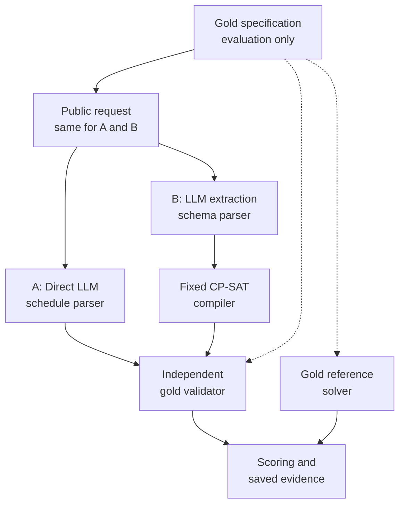
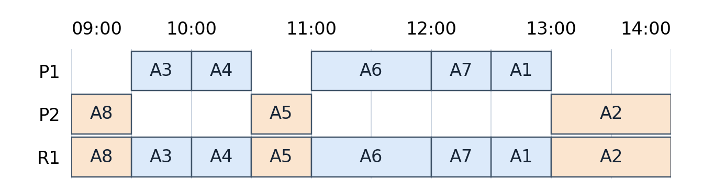
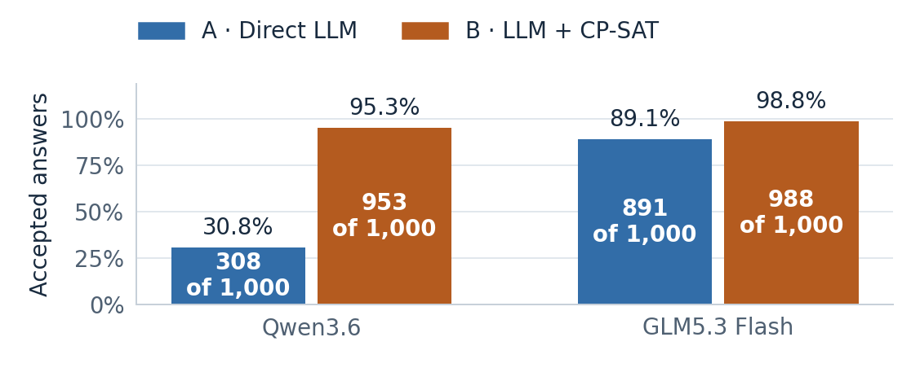
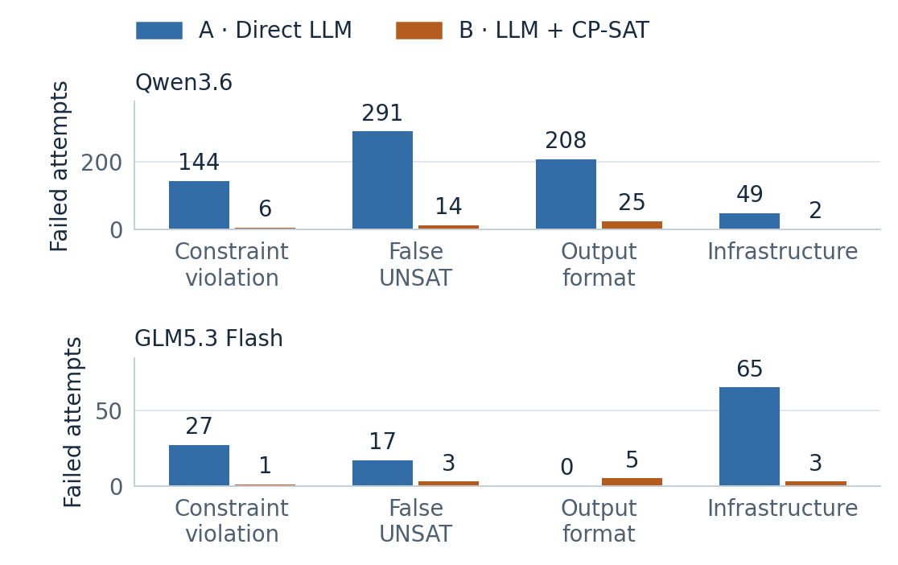

# Direct LLM Reasoning versus Constraint-Solver-Augmented Scheduling

CS3263 Foundations of Artificial Intelligence - Group 23

Tea Li Hao, Tham Yao Xiang, Woo Yong Qing

NUS AY2026/27 Semester 1 - 18 October 2026

Controlled schedule generation, with minimum-disruption repair as an extension.

Public report copy. Matriculation numbers and email addresses belong on the private submission title page. Model eligibility and actual member review/contributions must be confirmed before course submission; see the accompanying submission checklist.

## Abstract

We compare direct LLM scheduling with LLM extraction followed by a fixed CP-SAT solver. Both receive equivalent task descriptions and one model call; an independent validator checks answers against the original requirements. The main study evaluates 1,000 synthetic generation cases across ten interaction families. Qwen3.6 produces accepted answers on 308/1,000 direct attempts versus 953/1,000 with solver augmentation; GLM5.3 Flash achieves 891/1,000 versus 988/1,000. Qwen's direct score hides a strong asymmetry: it constructs only one valid schedule among 500 feasible cases. GLM performs well directly, but concrete overlap and extraction errors remain. Service failures explain part of the observed differences and prevent a controlled timing comparison. The results support solver augmentation for these constructed cases while showing that formal correctness cannot compensate for an incorrectly extracted problem.

## 1. Problem, motivation and research questions

Shared schedules must respect appointments, availability, deadlines and limited resources while accommodating preferences. We study a scheduling assistant through three questions: does solver augmentation improve valid schedule construction and infeasibility detection; which interpretation or solving failures remain; and what resources and practical trade-offs accompany each method? Following the TA's scope advice, generation is the core study, with minimum-disruption repair and wording robustness retained as separately evaluated extensions.

The domain contains mandatory, non-preemptive activities with fixed durations and participant/resource assignments. A single day is divided into 30-minute slots; shared people and rooms have capacity one. Hard requirements include availability, release times, deadlines, fixed appointments and precedence. Soft preferences concern activity start times. The assistant proposes schedules; it does not modify real calendars.

The contribution is an inspectable comparison separating interpretation, formal feasibility, optimization and operational reliability. CP-SAT and minimum-perturbation repair are established methods; neither is claimed as a new algorithm.

## 2. Related work

NATURAL PLAN supplies task information within natural-language planning inputs, including calendar scheduling [1]. This motivates comparing reasoning with the required information present, rather than measuring retrieval. Our tasks add repair from a common original schedule and explicit optimization objectives. Minimal perturbation research studies retaining a solution when constraints change [2]; our complete schedules, fixed activity set and three-priority objective are a narrower formulation.

Huang and Zhang study language models as PDDL formalizers and find that syntax, semantics and description naturalness affect performance [3]. This motivates our separate extraction and gold-validity measures; their planning scores are not predictions for our scheduling cases. CP-SAT combines constraint, Boolean and linear reasoning [4]. We use the established OR-Tools implementation and preserve its distinct feasible, optimal, infeasible and unknown outcomes [5]. The fixed compiler reduces the amount of generated formal code, but limits which natural-language requirements can be represented.

## 3. Formal scheduling model

For activity i, the decision variable s_i is its integer start; d_i is its fixed duration and e_i = s_i + d_i its end. The finite domain D_i contains starts within the horizon satisfying release times, deadlines, fixed starts, blocked intervals and full containment in an availability window for the activity and every required participant or resource. Intervals are half-open: one activity may begin exactly when another ends.

Precedence i before j requires e_i <= s_j. Activities sharing a person or room must not overlap. These variables, finite domains and hard constraints form a constraint satisfaction problem (CSP). Let F be its feasible schedules. A nonempty F is feasible (SAT); an empty F is infeasible (UNSAT). Adding weighted preferences gives a constraint optimization problem: choose a schedule in F minimizing

```math
P(\mathbf{s}) = \sum_{k \in K} w_k\,\mathbf{1}[s_{a(k)} \notin W_k].
```

Here, K indexes the preferences; preference k concerns activity a(k), preferred start window W_k and weight w_k. The indicator contributes that weight once when the start lies outside the window. An unmet preference increases cost without making the schedule infeasible.

**Why a solver may help.** Before considering interactions, n activities have up to the product of their domain sizes possible start assignments. Non-overlap and precedence couple these choices: a locally plausible placement can block several later activities. The compiler encodes interval/non-overlap, precedence and unary restrictions for CP-SAT, which searches the formal model and can prove infeasibility or optimality [4,5]. This motivates the tool comparison; it does not establish that every large generated instance is difficult.

**Repair extension.** After validating the original schedule, repair solves the updated requirements while prioritizing the number of activities moved M, then the sum of absolute start shifts T, then preference penalty P:

```math
\underset{\mathbf{s}\in F}{\mathrm{lexmin}}\;\left(M(\mathbf{s}),\,T(\mathbf{s}),\,P(\mathbf{s})\right).
```

Each priority is fixed only after optimality is proved; the stages share a 30-second budget. A timeout does not establish infeasibility, and a feasible incumbent need not be optimal. Detailed repair equations and scope choices are retained in the supplement; the main results below evaluate generation only.

## 4. System design and comparison controls



**A: Direct LLM.** One call returns a JSON schedule or an infeasibility prediction. It receives neither a solver nor oracle feedback. **B: LLM-to-CP-SAT.** One call translates the same public information into the canonical JSON specification; a fixed compiler constructs and solves the model. A neutral request identifier avoids exposing label-bearing evaluator IDs. Both repair paths receive the same original schedule and updated requirements. Malformed output, duplicate keys and omitted requirements are not silently repaired.

The independent validator checks every hard constraint and recomputes objectives arithmetically, without CP-SAT or its compiler helpers. A separate gold reference solve establishes feasibility and preference optima; independent certificates and tiny exhaustive tests provide additional checks. The reference solver and method B still share CP-SAT, so objective verification is not fully independent. A solver proof applies to the extracted specification, whereas acceptance is checked against the original gold requirements.

Each method makes one attempt without retries or validator-feedback correction. All returned answers and failures are retained and can be replayed offline. The experiment compares complete pipelines: method B changes the model's output task as well as adding a solver, so it is not an ablation isolating the solver algorithm alone.

**Worked example: a shared-room schedule.** This selected eight-activity example illustrates the measured methods; it does not estimate how often each outcome occurs. The following is a human-readable summary of the saved canonical request; the original prompt and all four outputs remain in the evidence package. On 26 October, P1 and P2 are available 09:00-17:00; room R1 is available 09:00-14:00. Every activity requires R1 and the named person, must fit entirely inside its availability window, and must not overlap another activity using either entity. Slots last 30 minutes. The complete activity windows and durations are retained in the report supplement.



A8 is fixed at 09:00. Precedence requires A8 before A3, A3 before A6, A5 before A7, and A7 before A2. Preferred start windows are 14:00-17:00 for A8 and A4 (weights 3 and 1), 14:30-16:30 for A1 (weight 2), and 12:00-14:00 for A7 (weight 1). Violating a preference adds its weight but never makes a schedule infeasible. A8 is fixed at 09:00, A4 must finish by 11:00 and A1 by 13:30. Their preferred starts are therefore impossible, giving every feasible solution a penalty of at least 6.

**Table 1. Four measured outcomes on the same input; all four calls returned answers. A is direct; B is extraction plus CP-SAT.**

| Model | Direct LLM (A) | LLM + CP-SAT (B) |
| --- | --- | --- |
| Qwen3.6 | Incorrect UNSAT prediction | Valid schedule; penalty 6 |
| GLM5.3 Flash | Availability violation and room overlap | Valid schedule; penalty 6 |

GLM A places both A4 and A5 at 11:00-11:30. This double-books R1, and A4 finishes after its 11:00 availability boundary. Both B extractions match the gold specification and return the illustrated schedule: A8, A3, A4, A5, A6, A7, A1, A2 occupy the room consecutively from 09:00 to 14:00. It satisfies every hard constraint and A7's preference, attaining the lower bound of 6. This witness also refutes Qwen A's UNSAT prediction. The example shows different direct-answer failures and successful formal solving; Section 6 retains contrasting cases where incorrect extraction makes B fail.

## 5. Dataset and experimental protocol

**Design rationale.** A preliminary 48-case generation study gave GLM 47/48 accepted direct answers and 48/48 solver-assisted answers; its only direct rejection was a service error. To examine more than this small-case ceiling, the present study varies interaction mechanisms and problem size. Earlier repair/wording studies remain separate and their scores are not pooled with this experiment.

**Main design.** Ten mechanisms cover room/participant contention, fragmented packing, precedence chain/fork-join, appointment collision, release/deadline chains, participant calendars, resource/person crossing and mixed order/resource interactions. Each has five activity counts (8, 12, 16, 24, 32) and ten matched SAT/UNSAT pairs per size: 1,000 cases, 500 of each label, in ten conservative families. All four deadline/fixed-start presence profiles are label-balanced. Varying durations, windows, assignments, rules and preferences yields 1,000 normalized hard fingerprints and 500 topology signatures, beyond name-only changes.

The 200 eight-activity cases use a 09:00-17:00 day, two participants, one room and 30-90-minute durations. Larger cases may use a full-day horizon and more resources, so size is not isolated experimentally. Interaction graphs are connected and unary activity domains nonempty, but some UNSAT cases contain short contradictory subproblems. Stratum labels do not establish computational hardness or absolute capability limits. Twenty-four optional reordered conditions were not executed.

**Gold construction.** All 500 feasible cases have witnesses checked by independent arithmetic validation. The 500 infeasible cases have independent certificates: 100 whole-instance capacity contradictions and 400 enumerated contradictory subproblems. CP-SAT reference solves agree with every label and prove preference optima for all feasible cases. Controlled natural-language descriptions are rendered from the versioned formal cases. Gold labels, witnesses and reference answers are excluded from model prompts. These are deterministic, AI-assisted synthetic development inputs designed to exercise specific constraints, not an untouched holdout or a sample of real calendars. The course explicitly permits constructed instances [6].

**Comparison controls.** Each model attempts every case once with each method: 2,000 scheduling calls per model and 4,000 in total. Qwen requests and returns `qwen3.6:35b`; GLM requests `x-test-1` and returns `glm-5.3-flash`. Both use the same cases, method-specific prompts, scientific source and dependency versions (Python 3.12.2; OR-Tools 9.14.6206). Limits are 32,768 output tokens per completion, a 1,800-second read timeout and 30/60-second method/reference solve budgets. Sampling and reasoning controls use unverified server defaults. Exact request settings and qualification calls are recorded separately in the evidence package.

**Execution conditions.** All 4,000 attempts have one recorded provider call, including failures. OS, concurrency and hosted-backend conditions changed during execution; Section 7 therefore treats timing as descriptive rather than a controlled speed comparison.

**Measures and dependence.** Primary acceptance is a gold-valid SAT schedule or correct UNSAT answer; every provider, format and mathematical failure remains in its denominator. We report SAT validity, UNSAT correctness, extraction diagnostics, conditional preference optimality and time/token coverage. Structural differences do not automatically establish semantic errors. A ten-family paired bootstrap describes sensitivity to reweighting these designed mechanisms, not population uncertainty over independent real calendars. There is one sampled answer per condition; 1,000 distinct fingerprints are not 1,000 independent families.

## 6. Results and failure analysis

**Primary outcomes.** Figure 1 includes all 1,000 attempts per method. Solver augmentation increases measured acceptance by 64.5 percentage points for Qwen and 9.7 points for GLM. Paired outcomes are more informative than aggregate scores alone: Qwen has 654 cases accepted only by B and nine only by A; GLM has 104 only by B and seven only by A. The corresponding ten-family bootstrap ranges are 61.1–67.6 and 6.8–13.1 points (10,000 resamples, seed 3263). They are descriptive design-sensitivity ranges, not proof of general superiority or removal of service confounding.



**Table 2. Feasibility and conditional preference quality. A = direct LLM; B = LLM + CP-SAT. Each feasibility column has 500 gold cases.**

| Model / method | Valid SAT<br/>of 500 | Correct UNSAT<br/>of 500 | Optimum / valid SAT |
| --- | ---: | ---: | ---: |
| Qwen A | 1 | 307 | 1/1 |
| Qwen B | 467 | 486 | 467/467 |
| GLM A | 404 | 487 | 403/404 |
| GLM B | 492 | 496 | 492/492 |

**Construction versus classification.** Qwen direct's 30.8% overall score is almost entirely correct UNSAT predictions: it constructs only one valid schedule among 500 feasible cases, compared with 467 for B. Thus overall accuracy alone would overstate its usefulness as a scheduler. GLM constructs 404 valid schedules directly and 492 with B. This difference supports separating constructive feasibility from infeasibility detection; the observed outputs do not reveal the models' internal reasoning or isolate model architecture as the cause.

**Failure categories.** Figure 2 separates constraint violations, false UNSAT predictions, output-format rejection and infrastructure failures. Qwen direct has 208 format rejections, so not every rejected answer demonstrates mathematical failure. The strict parser measures whether a method delivers a usable answer under the stated contract. Outputs are not silently repaired; no local solver timeout/UNKNOWN occurs in these runs.

**Trace-backed mechanisms.** Section 4 demonstrates direct-answer failures without service confounding. The following B counterexamples show why successful formal solving is insufficient when extraction changes the problem.

**Invented deadlines (Qwen).** The extraction adds deadlines that were absent from the request. One requires an activity to finish by the start of its availability window, making a feasible request appear impossible. **Dropped constraints (GLM).** The extraction omits a deadline and a precedence requirement. The solver then schedules two activities together even though one must finish before the other starts. Both examples show that correct solving cannot compensate for an incorrect specification. Exact inputs and trace references are retained in the [report supplement](report-details.md#example-trace-index).

Qwen has 873 structurally matching extractions and 100 differing ones among 973 parsed specifications. All matching outputs are accepted; 80 differing ones are also accepted. GLM has 959 matching and 33 differing extractions among 992 parsed specifications, with 29 of the differing ones accepted. The remainder account for the mathematical B failures above. A gold-valid output does not prove the extracted problems equivalent, and a structural difference alone is not proof of harmful interpretation. The independent gold validator is therefore essential even after successful solving.



**Returned-response sensitivity.** Restricting to cases with both methods receiving a response gives Qwen 307/949 for A versus 907/949 for B, and GLM 891/935 versus 927/935. GLM's paired gap then becomes 3.85 percentage points, compared with 9.7 points in the primary all-attempt analysis. This secondary view helps separate delivery from answer quality; nonrandom missingness prevents treating it as corrected accuracy.

**Scale and mechanism.** On the 200 eight-activity cases, Qwen A/B accept 57 and 197 answers; GLM accepts 192 and 200. On the 200 largest cases (32 activities), Qwen accepts 74 and 180, and GLM 148 and 194. However, 40 of GLM A's 52 largest-case failures are infrastructural: its score is 148/200 overall but 148/160 among returned answers. Its apparent decline therefore cannot be attributed entirely to reasoning difficulty. Qwen's nonmonotonic size scores mainly reflect UNSAT prediction. Larger cases also change horizons and resources, so neither model's trend isolates the effect of activity count.

**Optimization.** Every valid B schedule matches its proven gold preference optimum. Qwen A matches on its sole valid SAT answer; this 1/1 denominator provides little evidence about general optimization ability. GLM A matches on 403/404; its remaining valid schedule has preference penalty 33 against optimum 30. The 500 reference optima range from 0 to 37, with median 12 and only two zero optima, so the observed B ceiling is not simply an all-zero objective artifact. This does not establish difficult optimization: the instances are constructed, local solve times are short, and reference/B share the compiler. Historical repair results separately expose movement-versus-shift trade-offs; they are not mixed into these generation scores.

## 7. Resource use and operational limitations

**Token usage.** Table 3 reports provider-supplied prompt-plus-completion tokens. Missing usage on 119 infrastructure failures is unknown, not zero; statistics use reported observations only. The p95 is the nearest-rank 95th percentile, describing the observed upper tail rather than a worst-case bound. Full definitions and execution-phase distributions are in the supplement.

**Table 3. Total tokens per scheduling call. A = direct LLM; B = LLM + CP-SAT. Coverage is reported / attempted.**

| Model / method | Mean | Median | p95 | Coverage |
| --- | ---: | ---: | ---: | ---: |
| Qwen A | 3,287.5 | 1,977 | 12,751 | 951/1,000 |
| Qwen B | 5,220.4 | 4,737.5 | 8,490 | 998/1,000 |
| GLM A | 7,504.1 | 5,592 | 19,191 | 935/1,000 |
| GLM B | 7,054.6 | 6,159 | 12,750 | 997/1,000 |

Qwen B has a higher mean token count but a lower p95 than A; GLM B has a lower mean and p95 but a higher median than A. Thus a mean alone hides the shape of these distributions. Qwen A's low median also accompanies many short UNSAT answers, including incorrect ones; low usage is not evidence of successful efficiency. Provider tokenization and hidden serving behavior differ, so token counts are neither a common currency cost nor an independently measured reasoning budget.

**Table 4. Recorded per-attempt pipeline duration in seconds, including failures. These pooled values describe the observed deployment, not a controlled comparison of model speed.**

| Model / method | Mean | Median | p95 | Timed attempts |
| --- | ---: | ---: | ---: | ---: |
| Qwen A | 36.53 | 21.55 | 132.49 | 1,000/1,000 |
| Qwen B | 41.26 | 37.38 | 87.42 | 1,000/1,000 |
| GLM A | 108.68 | 71.46 | 300.05 | 1,000/1,000 |
| GLM B | 67.07 | 55.24 | 141.91 | 1,000/1,000 |

Pipeline time includes the model request and local parsing/solving within an attempt, excluding pre-dispatch waiting and campaign downtime. The model-request stage dominates measured pipeline time. Local B solver mean/median/p95 is **16.19/10.25/36.52 ms** for Qwen (973 invocations) and **13.97/11.39/33.01 ms** for GLM (992). Thus local solving adds little time in these bounded cases; generation of the formal specification remains part of B's model-call cost. The timers cannot separate provider inference from queueing or networking.

**Timing limitation.** Qwen has 51 infrastructure failures and GLM 68, predominantly HTTP 502 responses. They remain in primary denominators but are not scheduling mistakes. GLM A's p95 near 300 seconds includes gateway failures; four GLM timeouts also overlapped laptop sleep. No case has all four observations under matching OS and concurrency, and provider load is uncontrolled. Table 4 therefore cannot establish intrinsic model speed. Detailed operational history and model-call distributions are preserved in the [supplement](report-details.md) and [execution audit](diverse-comparison-audit.md).

## 8. Implications, limitations and responsible AI

**When to use each approach.** Solver augmentation is the stronger choice for the tested explicit, bounded constraints: it improves feasible schedule construction and returns schedules that can be independently checked and solver-backed feasibility or optimality statuses. Direct generation needs less modelling infrastructure and GLM often succeeds, but a plausible schedule still needs validation; an unsupported UNSAT answer cannot prove impossibility. Method B shifts part of the challenge from constructing a schedule to accurately representing the request. An extractor that omits or invents a requirement can make a correct solver answer the wrong question, as the counterexamples demonstrate.

**Representation and practical limits.** The fixed schema makes compilation reliable for supported constraints but cannot express arbitrary requests. Real scheduling may require travel, uncertain durations, multi-day choices or fairness across people. Preferred-start penalties do not implement consecutive-meeting or day-clustering preferences. Such requests require clarification or a richer model before solver guarantees are meaningful. The single-day/30-minute simplification differs from the TA's suggested weekly/hourly scenario and remains an explicit scope choice. Dynamic tool use, feedback correction and alternative solvers were not tested; adding them would be a separate comparison.

**Validity threats.** The 1,000 cases come from ten related generator families, with one answer per condition. They broaden constraint coverage but do not establish real-world representativeness. Balanced deadline/fixed-start profiles remove one known label shortcut, not all template bias. Some infeasible cases contain simple contradictions, and more activities need not imply harder search. The optional reordered conditions were not run; historical wording results do not establish robustness on the new dataset. Actual human review of the natural-language/gold correspondence remains pending. The shared reference compiler also limits independence of optimality checks.

Missing responses are uneven across methods and case sizes, so returned-response analysis is diagnostic rather than corrected accuracy. Uncontrolled serving conditions limit causal comparisons of timing and model capability. The course's exact frontier-model interpretation for the hosted models remains for teaching-team clarification [6].

**Responsible AI.** Real calendars reveal identities, routines and relationships, sometimes even after names are removed. Fictional data avoids disclosing real routines; deployment would need consent, retention limits and oversight. Fixed assignments and aggregate preference penalties do not establish fair workload allocation. A historical repair concentrates one move and 30 minutes of shift on a single participant; another independently checked example prefers one activity shifted four slots over two activities shifted two slots total because moved count has priority. Such trade-offs need stakeholder agreement rather than an assumption that a numerical optimum is fair.

Hard requirements must not silently become preferences. Explanations distinguish a proof about extraction from validity against the original request, and users retain control: the prototype sends no invitations and changes no calendars. Instruction-like input is treated as data; a fixed compiler does not execute generated code. This reduces an attack surface but is not a live adversarial robustness study. Ambiguity, malicious descriptions, incorrect extraction and biased objectives remain practical risks requiring human review and monitoring [6].

## 9. Reproducibility, contributions and conclusion

The evidence package preserves all 4,000 attempt records, public inputs, gold references, returned outputs/failures and exact source/settings. Offline replay reproduces the analyses; checksums connect tables and figures to those records. The supplement retains example identifiers, complete inputs and operational details.

Codex assisted implementation, testing, experiment operations, analysis and report drafting under team direction. Factual per-member contributions, independent interpretation and the division between human work and AI support still need member confirmation before submission. The accompanying checklist records remaining human review, scope/model clarification and private submission requirements.

Solver augmentation improves measured acceptance on these constructed cases, especially for Qwen. GLM direct remains strong but imperfect; service errors explain much of its largest-stratum decline, while returned-answer counterexamples establish scheduling failures. Formal correctness, faithful interpretation, operational availability and responsible use must be evaluated separately.

## References

1. Zheng, H. S., et al. (2024). *NATURAL PLAN: Benchmarking LLMs on Natural Language Planning*. [arXiv:2406.04520](https://arxiv.org/abs/2406.04520).
2. Bartak, R., Muller, T., and Rudova, H. (2003). *Minimal Perturbation Problem - A Formal View*. ERCIM Working Group on Constraints workshop. [Authors' paper](https://ktiml.mff.cuni.cz/~bartak/downloads/ERCIM2003mpp.pdf).
3. Huang, C., and Zhang, L. (2025). *On the Limit of Language Models as Planning Formalizers*. ACL, pp. 4880-4904. [doi:10.18653/v1/2025.acl-long.242](https://aclanthology.org/2025.acl-long.242/).
4. Perron, L., Didier, F., and Gay, S. (2023). *The CP-SAT-LP Solver (Invited Talk)*. CP 2023, LIPIcs 280, pp. 3:1-3:2. [doi:10.4230/LIPIcs.CP.2023.3](https://drops.dagstuhl.de/entities/document/10.4230/LIPIcs.CP.2023.3).
5. Google OR-Tools. *CP-SAT Solver*. [Solver status documentation](https://developers.google.com/optimization/cp/cp_solver); implementation pinned to 9.14.6206.
6. CS3263 teaching team (2026). *Project*; *CS3263 Project Guidelines AY2026/27*; *Responsible AI*. Supplied course materials. Group 23 (2026), *Project Proposal*. Written TA feedback supplied by the team on 15 October emphasizes generation, achievable scope and failure analysis. These sources define expectations and scope, not measured benchmark results.
