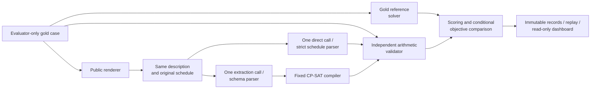

# Direct LLM Reasoning versus Constraint-Solver-Augmented Scheduling

CS3263 Foundations of Artificial Intelligence - Group 23

Tea Li Hao, Tham Yao Xiang, Woo Yong Qing

NUS AY2026/27 Semester 1 - 2 October 2026

Exploratory empirical study of schedule generation and minimum-disruption repair.

Public report copy. Matriculation numbers and email addresses belong on the private submission title page. Model eligibility and actual member review/contributions must be confirmed before course submission; see the accompanying submission checklist.

## Abstract

This project investigates an AI assistant for generating schedules and repairing them when requirements change. Activities must satisfy hard constraints, while repairs should preserve existing commitments. We compare a language model that produces a schedule directly with a language model that translates the request into a specification for OR-Tools CP-SAT. An independent validator checks both against the original requirements. Two hosted Qwen models are evaluated on controlled synthetic problems, fictional realistic scenarios and equivalent wording variants. Evaluation covers feasibility, repair quality, extraction accuracy, time and token use. The report presents the formulation, implementation and experimental design, followed by comparative analysis, responsible-AI considerations and project limitations. Known development inputs support an exploratory study within a bounded scheduling domain.

## 1. Motivation and problem context

People balance work, education, family responsibilities and personal commitments. Organizing these activities requires coordinating individual availability, shared facilities and deadlines. Even arranging a meeting can become difficult when participants have conflicting schedules and suitable spaces are limited.

These arrangements must also adapt when circumstances change. An unavailable room or a revised deadline can affect several connected activities, creating clashes beyond the original disruption. An effective scheduling assistant should therefore produce a feasible replacement while preserving existing commitments wherever possible.

Large language models offer a convenient way to express scheduling requirements in everyday language. However, a plausible response may overlook a constraint or introduce unnecessary changes. Formal solvers provide explicit feasibility checks and optimization, but their answers depend on an accurate translation of the original request into a structured specification.

This project examines that trade-off by comparing direct LLM scheduling with an approach that combines LLM interpretation and constraint solving. We study both initial schedule generation and repair, evaluating whether improvements in validity and solution quality justify the additional time and computational resources. By assessing interpretation accuracy, feasibility and optimization separately, we identify the strengths and failure points of each approach.

## 2. Related work

NATURAL PLAN supplies task information within natural-language planning inputs, including calendar scheduling [1]. This motivates comparing reasoning with the required information present, rather than measuring retrieval. Our tasks add repair from a common original schedule and explicit optimization objectives. Minimal perturbation research studies retaining a solution when constraints change [2]; our complete schedules, fixed activity set and three-priority objective are a narrower formulation.

Huang and Zhang study language models as PDDL formalizers and find that syntax, semantics and description naturalness affect performance [3]. This motivates our separate extraction and gold-validity measures; their planning scores are not predictions for our scheduling cases. CP-SAT combines constraint, Boolean and linear reasoning [4]. We use the established OR-Tools implementation and preserve its distinct feasible, optimal, infeasible and unknown outcomes [5]. The fixed compiler reduces the amount of generated formal code, but limits which natural-language requirements can be represented.

## 3. Formal model and repair objective

We model scheduling as a constraint satisfaction problem (CSP); adding preference and disruption objectives yields a constraint optimization problem (COP) [7].

Let *A* be mandatory, non-preemptive activities over H <= 48 half-hour slots, with fixed participant/resource assignments. Activity i has fixed positive duration d_i, integer start s_i and end e_i = s_i + d_i. Its domain D_i contains starts from 0 to H-d_i satisfying release times, deadlines, fixed starts and blocks. The interval [s_i,e_i) must fit within one listed window for the activity and every required participant/resource; adjacent windows remain separate. An empty domain encodes infeasibility, not malformed input.

Precedence i before j requires e_i <= s_j. For every pair sharing a required participant or capacity-one resource, we require:

```math
e_i \leq s_j \;\vee\; e_j \leq s_i
```

Half-open intervals permit back-to-back activities. The compiler uses interval variables and `NoOverlap` [8]. Let *F* contain complete assignments satisfying every domain and hard constraint: the instance is satisfiable (SAT) when *F* is nonempty, otherwise unsatisfiable (UNSAT).

Preference k in *K* assigns nonnegative integer weight w_k to activity a(k) starting outside its preferred half-open start window W_k. Generation minimizes P over *F*, without relaxing hard constraints. Each violation costs its weight once, regardless of distance. The indicator is 1 for a true condition and 0 otherwise:

```math
P(\mathbf{s}) = \sum_{k \in K} w_k\,\mathbf{1}[s_{a(k)} \notin W_k]
```

We validate the supplied schedule against its original specification, then solve the updated one, preserving identities and fixed assignments. Superscript "old" denotes previous starts. M counts moved activities; T measures absolute shift in slots:

```math
M(\mathbf{s}) = \sum_{i \in A} \mathbf{1}[s_i \neq s_i^{\mathrm{old}}]
```

```math
T(\mathbf{s}) = \sum_{i \in A} |s_i-s_i^{\mathrm{old}}|
```

```math
\underset{\mathbf{s}\in F}{\mathrm{lexmin}}\;\left(M(\mathbf{s}),\,T(\mathbf{s}),\,P(\mathbf{s})\right)
```

Here, *F* uses updated requirements. We minimize M first, then T among tied solutions, then P among solutions tied on both. This specializes minimum-perturbation repair [2].

Sequential stages fix only proven optima, sharing 30 seconds with zero absolute/relative gaps. An unproved stage stops optimization while preserving any feasible incumbent. `FEASIBLE` differs from `OPTIMAL`, and `UNKNOWN` from `INFEASIBLE` [5]. Secondary gaps require earlier objectives to match proven references. Solver claims concern the compiled specification.

For example, three one-slot activities share a resource over [0,3), with legal starts A={0,1}, B={1,2}, C={0,1,2} and original schedule (0,1,2). Blocking A's start 0 forces the unique repair (1,2,0): all three move, with shift 1+1+2=4 and objective (3,4,0). Freezing activities unaffected by the new block would incorrectly imply infeasibility. Independent enumeration, arithmetic validation and CP-SAT agree.

## 4. Software architecture

The system separates request interpretation, schedule construction and evaluation. Both approaches enter the same independent validation and scoring process. Gold constraints and reference answers remain evaluator-only.



The shared types in `schema.py` connect the two pipeline modules to solving and evaluation. The direct pipeline parses a returned schedule or infeasibility prediction; the solver-assisted pipeline parses a specification before invoking `solver.py`. Domain analysis builds legal starts, and the compiler creates interval constraints and objective stages. A neutral request identifier keeps label-bearing evaluator IDs out of extraction prompts. Both repair paths receive the same original schedule and updated requirements, with one model call and no corrective feedback. Malformed output, duplicate keys and omitted requirements are not silently repaired.

The separate `validation.py` module checks hard constraints and recomputes objectives arithmetically, without CP-SAT or its compilation helpers. Evaluation modules compare these checks with the gold references and aggregate the metrics. A gold reference solve uses 60 seconds and supplies proven feasibility/objective information. Tiny exhaustive fixtures help detect shared modelling assumptions. Independent validation reduces correlated errors but does not replace human review of text/gold correspondence. Solver proof applies to the extracted specification only.

The runner saves responses and failures without retrying completed attempts. A read-only dashboard shows before/after schedules and evidence-bound explanations. Transient service failures remain failed observations while later distinct requests continue; authentication, model-identity and integrity failures stop dispatch. Independent process supervision and durable request accounting prevent accidental reissuance.

## 5. Dataset construction and selection

Constructed cases make requirements and labels inspectable. Controlled cases vary scheduling structure, fictional scenarios add practical context, and wording variants change expression while retaining the underlying problem.

Each model was evaluated on the same 300 case/rendering conditions with both approaches, for 600 scheduling attempts. The controlled set contains 240 canonical cases from 120 source families: 120 generation and 120 repair cases, each balanced across 60 SAT and 60 UNSAT labels. Four construction sweeps vary activity count, unary slack, resource contention and constraint interaction, with three levels and 60 cases per sweep. Related generation/repair cases are not independent samples.

The realistic block contains twelve AI-assisted fictional scenarios, balanced across task and feasibility label. Human prose/gold review remains pending; these are not real calendars or independently human-authored cases. The wording block selects 24 controlled bases from distinct families, six per task/label stratum, and evaluates paraphrased and reordered descriptions. It adds 48 conditions per approach, reusing the selected canonical partners for matched analysis. It does not add 48 independent scheduling problems.

All inputs are known project-generated development data. Public benchmarks informed methodology but supplied no instances. Controlled construction makes contradictions, objectives and difficulty parameters inspectable, while small templates and artificial SAT/UNSAT balance limit representativeness. These comparisons are exploratory; inspecting them cannot turn them into a held-out test. Earlier pilots and the separate 200-call study remain historical evidence and are not pooled here.

## 6. Comparison protocol and evaluation metrics

Each approach processes 300 conditions per model: 240 controlled, twelve fictional realistic and 48 additional-wording conditions. This gives 600 attempts per model and 1,200 overall. Both receive equivalent information and one model call. Repair uses the same supplied original schedule, with no feedback-driven correction or retries.

The SoCLaaS identifiers were `qwen3.6:35b` and `qwen3.8:27b`. Both used the same source, Python 3.12.2/macOS ARM64 runtime, OR-Tools 9.14.6206, revision-3 prompts and inputs. All 600 request-prompt hashes match across models; configurations differ only in model ID. Each completion requested at most 32,768 output tokens with connect/read limits of 30/1,800 seconds. Solver/reference runs used one worker and seed 0. Each campaign also made two capability completions and one metadata request.

Temperature, sampling and reasoning controls remained unexposed server defaults. Qwen3.6 reported three backend fingerprints and Qwen3.8 one. Hosted weight revisions, hardware and load were not controlled. Thus configuration comparability does not isolate model weights as a causal factor. Course eligibility of these hosted aliases remains unconfirmed.

Accepted-answer rate counts a gold-valid schedule or correct UNSAT response over all labelled attempts. SAT validity and UNSAT accuracy retain their own denominators. Objective matching is conditional on a gold-valid SAT schedule and proven reference objectives; failures do not receive zero gap. Structural extraction agreement is a diagnostic, not a complete semantic equivalence test. Time and token statistics retain missing coverage. Primary controlled, realistic and wording results stay separate.

Within each controlled task, paired family bootstrap intervals resample source groups with replacement 10,000 times using seed 3263, retaining the A/B pairs. There are 120 pairs/families per task. These intervals quantify variability within the observed construction, not transfer to a real scheduling population. Only one model sample was taken per condition, so wording effects are not fully separated from sampling variation.

## 7. Results and analysis

We report the three evaluation blocks separately, examining answer acceptance, objective quality and resource use alongside the observed failures.

Figures 1-3 compare the approaches on a common scale. With Qwen3.6, B accepts 229/240 controlled attempts (95.4%) versus A's 95/240 (39.6%). The corresponding realistic scores are 12/12 versus 6/12, and wording scores 47/48 versus 8/48. Qwen3.8 reaches 240/240 versus 239/240 controlled, 11/12 for both realistic arms, and 44/48 versus 46/48 wording. All nine rejected Qwen3.8 attempts are provider errors; every non-error returned scheduling answer is accepted (591/591). This conditional diagnostic does not replace failure-inclusive rates or prove perfect reasoning.


Table 1 separates finding a valid schedule when one exists (SAT) from correctly reporting that none exists (UNSAT). Each cell gives the number correct out of 60 attempts and its percentage; operational failures remain in the denominator. A direct UNSAT response is a prediction. The solver-assisted certificate concerns the extracted problem and must still agree with gold.

**Table 1. Controlled feasibility results by model, task and method.**

| Model / task | Method | Valid schedules<br/>(SAT) | Correct infeasibility<br/>(UNSAT) |
| --- | --- | ---: | ---: |
| Qwen3.6<br/>Generation | Direct LLM | 27/60 (45.0%) | 26/60 (43.3%) |
| Qwen3.6<br/>Generation | LLM + CP-SAT | 59/60 (98.3%) | 56/60 (93.3%) |
| Qwen3.6<br/>Repair | Direct LLM | 22/60 (36.7%) | 20/60 (33.3%) |
| Qwen3.6<br/>Repair | LLM + CP-SAT | 59/60 (98.3%) | 55/60 (91.7%) |
| Qwen3.8<br/>Generation | Direct LLM | 59/60 (98.3%) | 60/60 (100.0%) |
| Qwen3.8<br/>Generation | LLM + CP-SAT | 60/60 (100.0%) | 60/60 (100.0%) |
| Qwen3.8<br/>Repair | Direct LLM | 60/60 (100.0%) | 60/60 (100.0%) |
| Qwen3.8<br/>Repair | LLM + CP-SAT | 60/60 (100.0%) | 60/60 (100.0%) |

For Qwen3.6, B minus A acceptance is +51.7 percentage points for generation (95% paired interval 41.7 to 61.7) and +60.0 for repair (50.0 to 70.0). For Qwen3.8 the differences are +0.8 (0.0 to 2.5) and 0.0 (0.0 to 0.0). The latter ceiling and degenerate empirical interval do not establish equivalence or population perfection. The practical improvement from augmentation depends on model and task; it is not uniformly positive across observed blocks.

On Qwen3.6's SAT generation activity-count sweep, A is valid on 3/5, 2/5 and 1/5 instances with 4, 8 and 12 activities; B is valid on 5/5 at each level. Unary-domain-product ranges rise from 140-1,470 to 60,480-967,680 and 162,570,240-231,525,000. This product bounds naive assignments, not CP-SAT's visited states. A's SAT generation validity across resource-contention levels is 5/5, 3/5 and 1/5, while B remains 5/5. Each cell contains only five cases. Other sweeps and repair are not uniformly monotonic, so these are descriptive patterns rather than causal difficulty thresholds. Qwen3.8's ceiling makes this set insufficient to distinguish its reasoning limits.

Among Qwen3.6's valid controlled SAT schedules, A matches the reference objective on 1/27 generation and 5/22 repair cases; B matches on 59/59 for both. Qwen3.8 matches on all valid generation outputs (A 59/59, B 60/60), but A repair matches on 59/60 against B's 60/60. In one accepted direct repair, two activities move although the proven minimum is one. Its first-priority gap is +1; later gaps are undefined once that priority differs. Acceptance alone would conceal this error. Conditional optimum fractions must be interpreted alongside validity because the successful subsets differ.

Across all blocks, Qwen3.6 A has 140 gold-invalid schedules, 24 false UNSAT answers and 27 invalid outputs; B has one gold-invalid schedule and eleven invalid outputs. In one controlled Qwen3.6 solver-assisted generation case, extraction changes activity A1's deadline from slot 3 to slot 7. This relaxes the latest permitted completion time. CP-SAT solves the extracted problem, but the resulting schedule violates the original deadline and is rejected by independent validation. This is a formalization error: the compiler cannot recover an omitted or altered requirement. Of 289 recorded Qwen3.6 B extractions, 228 are structurally equal to gold; remaining differences are not automatically semantic errors. Qwen3.8 has structural equality for all 295 recorded B extractions. Its errors comprise one timeout, five transport errors, one HTTP 502 and two HTTP 503s; client receipts do not identify every underlying service/network cause.

In 48 variant/canonical comparisons per approach, Qwen3.6 A changes from accepted to rejected 16 times and rejected to accepted twice. B has one and two such transitions. Qwen3.8 has two accepted-to-rejected transitions for A and four for B, all operational failures. The latter does not demonstrate semantic degradation from paraphrasing. Canonical comparisons use only the selected bases; comparing wording scores with all 240 canonical cases would confound selection and wording.

Table 2 separates the two methods and reports mean resources per controlled scheduling attempt. Call time covers all 240 attempts in each row, including failures; it excludes the subsequent local solver. Token means use available provider-reported usage: Qwen3.8 Direct LLM has 239/240 observations, and the other rows have 240/240. Missing usage is unknown, not zero.

**Table 2. Mean model-call resources per controlled attempt.**

| Model | Method | Mean call time<br/>(seconds) | Mean total tokens<br/>(tokens/call) |
| --- | --- | ---: | ---: |
| Qwen3.6 | Direct LLM | 3.57 | 1,778.8 |
| Qwen3.6 | LLM + CP-SAT | 14.08 | 4,254.1 |
| Qwen3.8 | Direct LLM | 42.42 | 4,420.5 |
| Qwen3.8 | LLM + CP-SAT | 90.46 | 9,045.5 |

Conditional CP-SAT time averages 13.15 ms over 230 executed Qwen3.6 controlled solves and 17.60 ms over 240 Qwen3.8 solves. Extraction/model calls dominate the added time on these instances. These are shared-service timings, including request overhead and failures, not hardware-independent speed or monetary cost. Complete campaigns including capability calls report 1,773,823 tokens with 602/602 coverage and 3,994,657 with 593/602 coverage. Qwen3.8 was safely paused twice without reissuing saved responses. Total elapsed campaign clocks therefore cannot be presented as uninterrupted inference time.

Direct reasoning is attractive when a capable model is already reliable on small, familiar inputs and lower latency matters. Formal augmentation is useful when explicit feasibility/optimization evidence matters or direct reasoning struggles with interactions. It adds extraction cost and inherits extraction errors. A fixed compiler and independent validator provide inspectability, but unsupported or ambiguous requirements require clarification or a revised schema. No operational dialogue feature or universally reliable natural-language interpretation is established.

## 8. Responsible AI

Our architecture supports responsible use through explicit validation, inspectable decisions and human control [6]. We apply these principles to the data sent to the models, the evidence attached to each schedule and the authority to change real commitments.

We evaluate fictional activities and participants, keeping actual personal routines out of requests sent to the hosted models. This reduces privacy exposure during experimentation. For real calendars, simply removing names would be insufficient because patterns of availability can reveal identity. Consent, access controls and retention policies would be needed before collecting such data.

We retain extracted constraints, solver status, validation outcomes and repair objectives so that decisions can be inspected. The architecture separates a solver's proof from independent checks against the original requirements. This exposes mistakes such as the altered deadline instead of presenting every solver-produced schedule as correct. Before/after schedules also show which activities move and by how much.

We report participant disruption because minimizing total changes can concentrate inconvenience. A preserved historical repair places all 30 minutes of shift on one participant while seven incur none; a fairer feasible alternative is not established. An independently checked tiny example also shows that our objective prefers one activity shifted four slots over two shifted two slots in total. Reporting these consequences makes the priorities open to scrutiny. Our objective does not guarantee fairness; adding burden limits would require stakeholder agreement and separate evaluation.

The application recommends schedules without sending invitations or editing calendars. Users retain authority over actual commitments, and hard requirements are not silently relaxed to obtain a solution. The stated repair priorities allow users to assess whether fewer moved activities or less total time shift better reflects their needs.

We use strict parsers and a fixed compiler so that model outputs are processed as data without executing generated code. Independent validation checks returned schedules, while prompt-boundary tests exercise instruction-like task strings. These safeguards limit specific failure paths without establishing live adversarial robustness. Provider failures and unproved solver outcomes remain visible rather than becoming successful answers or infeasibility proofs.

## 9. Current limitations

The following limitations explain how the chosen scope, data and execution conditions restrict interpretation of the results.

To make the two approaches comparable under an explicit formal model, we use one day, 30-minute slots, fixed durations and fixed assignments. This excludes travel, setup times, uncertain durations and changes in who performs an activity. Success on these tasks therefore does not establish performance on unrestricted personal or organizational scheduling. The current schema would need extension before such requirements could be evaluated.

Synthetic cases permit known contradictions and controlled structural changes, but their templates and balanced SAT/UNSAT labels differ from naturally occurring requests. The realistic block contains only twelve AI-assisted fictional scenarios, with human prose/gold review still pending. Related source families and wording variants also reduce the number of independent problems. The results characterize this development dataset rather than an unseen population of real schedules.

One model sample per condition does not fully separate wording effects from sampling variation. Five cases per difficulty cell support descriptive comparisons, rather than precise thresholds. Qwen3.8's near-ceiling validity further limits what this benchmark reveals about its reasoning boundaries. A fresh reviewed dataset, additional repeats or harder cases could investigate these questions in a separately designed study; the present inputs cannot be relabelled as held out.

We control the submitted cases, prompts and configured limits, but not hosted weight revisions, sampling defaults, hardware or load. Backend fingerprints also vary in the Qwen3.6 run. Sequential service execution and operational failures affect observed timing and acceptance, so the model comparison cannot isolate model weights as the cause of each difference. Missing token usage remains unknown, and token counts do not establish monetary cost.

CP-SAT can optimize only the extracted specification. A missed deadline or unsupported requirement may therefore yield an internally correct answer to the wrong problem. The independent validator detects violations against gold, but it cannot establish that every natural-language description matches its gold specification. The gold reference solver also shares the compiler with the solver-assisted approach. Independent arithmetic checks and tiny exhaustive examples reduce, without eliminating, the risk of shared modelling errors. Solver proofs additionally depend on completing the relevant optimization stages within the stated budget.

## 10. Team contributions

The proposal's planned division of work assigns CSP/COP formulation, solver implementation and validation to Tea Li Hao; the direct-LLM and natural-language-to-formal pipelines to Tham Yao Xiang; and benchmark construction, experiment automation and evaluation to Woo Yong Qing. Analysis, report preparation and presentation are shared planned responsibilities. AI tools supported implementation, testing, experiment operations, evidence analysis and drafting. Actual individual contributions remain subject to member confirmation.

## 11. Conclusion

This project implements and evaluates direct LLM scheduling and LLM-to-CP-SAT scheduling for both generation and minimum-disruption repair. Solver assistance substantially improves Qwen3.6's validity and objective quality on the constructed study. Qwen3.8 shows that direct reasoning can already approach the validity ceiling, although formal optimization still exposes a repair-quality difference. The combined approach also requires more model-call time and tokens and remains vulnerable to extraction errors. The appropriate method therefore depends on the model, the scheduling requirements and the need for optimization evidence. Within the stated experimental limits, the study demonstrates the value of evaluating request interpretation, schedule validity and objective quality separately.

## References

1. Zheng, H. S., et al. (2024). *NATURAL PLAN: Benchmarking LLMs on Natural Language Planning*. [arXiv:2406.04520](https://arxiv.org/abs/2406.04520).
2. Bartak, R., Muller, T., and Rudova, H. (2003). *Minimal Perturbation Problem - A Formal View*. ERCIM Working Group on Constraints workshop. [Authors' paper](https://ktiml.mff.cuni.cz/~bartak/downloads/ERCIM2003mpp.pdf).
3. Huang, C., and Zhang, L. (2025). *On the Limit of Language Models as Planning Formalizers*. ACL, pp. 4880-4904. [doi:10.18653/v1/2025.acl-long.242](https://aclanthology.org/2025.acl-long.242/).
4. Perron, L., Didier, F., and Gay, S. (2023). *The CP-SAT-LP Solver (Invited Talk)*. CP 2023, LIPIcs 280, pp. 3:1-3:2. [doi:10.4230/LIPIcs.CP.2023.3](https://drops.dagstuhl.de/entities/document/10.4230/LIPIcs.CP.2023.3).
5. Google OR-Tools. *CP-SAT Solver*. [Solver status documentation](https://developers.google.com/optimization/cp/cp_solver); implementation pinned to 9.14.6206.
6. CS3263 teaching team (2026). *Project*; *CS3263 Project Guidelines AY2026/27*; *Responsible AI*. Supplied course materials. Group 23 (2026), *Project Proposal*. These define course expectations and project scope, not measured benchmark results.
7. Poole, D. L., and Mackworth, A. K. (2023). *Artificial Intelligence: Foundations of Computational Agents*, 3rd ed. Cambridge University Press. [Variables and constraints](https://artint.info/3e/html/ArtInt3e.Ch4.S1.html).
8. Google OR-Tools. *The Job Shop Problem*. [Interval variables, precedence and non-overlap](https://developers.google.com/optimization/scheduling/job_shop). Used for modelling guidance; our objective is preference/disruption minimization rather than makespan.
