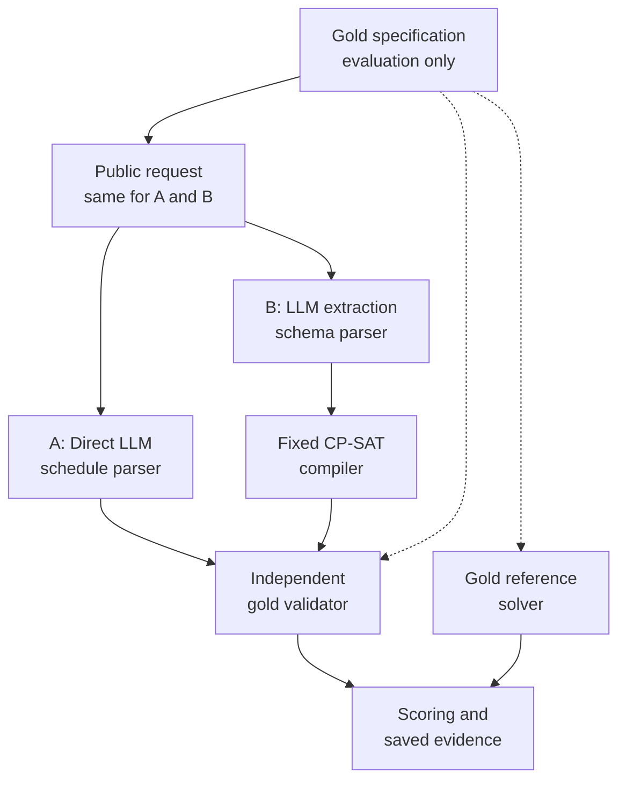
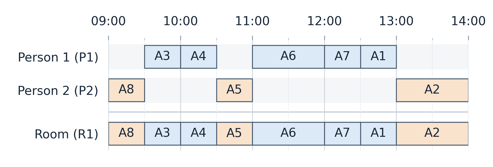
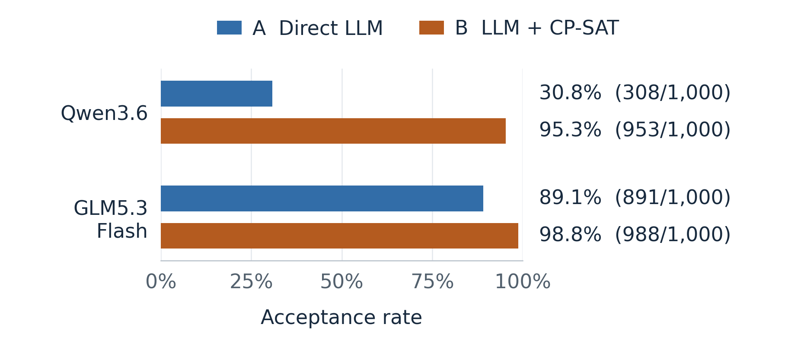
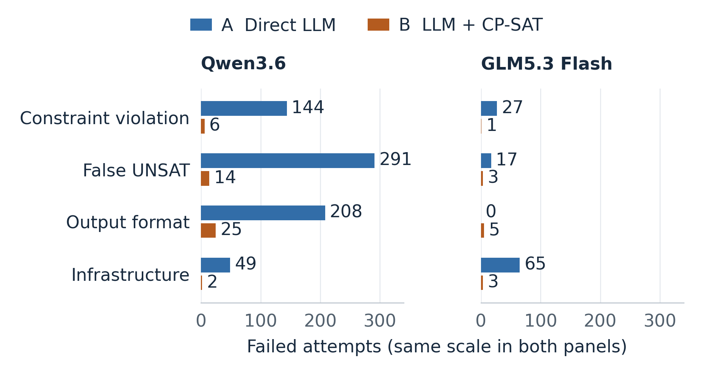

# AI Assistant for Dynamic Constraint-Aware Scheduling

School of Computing

CS3263 Foundations of Artificial Intelligence<br/>Semester 1, AY2026/27

PROJECT REPORT

*Direct LLM Reasoning versus Solver-Assisted Scheduling*

**Group 23**

**Team Members**

Tham Yao Xiang | Team Leader<br/>Tea Li Hao<br/>Woo Yong Qing

## Abstract

Scheduling requires activities to satisfy interacting constraints while accommodating preferences. We compare direct LLM scheduling with LLM extraction followed by a fixed CP-SAT solver, using Qwen3.6 35B A3B and GLM5.3 Flash on the same 1,000 synthetic generation cases. Each method receives equivalent task information and makes one model call per case; an independent validator checks answers against the original requirements. Qwen3.6 produces accepted answers in 308/1,000 direct attempts (30.8%) and 953 solver-assisted attempts (95.3%). GLM5.3 Flash achieves 891 (89.1%) and 988 (98.8%), respectively. Solver assistance particularly improves valid schedule construction: Qwen3.6 constructs only one valid schedule directly among 500 feasible cases, versus 467 with assistance. Wrong assisted answers come from requirements invented, omitted or altered during extraction, never from solving, and infrastructure failures (no answer received) widen the observed gaps. Smaller office, repair and rewording studies point the same way. Stronger models may close the gap in building schedules, but direct answers prove neither infeasibility nor optimality, so faithful extraction is the main bottleneck.

## 1. Problem, motivation and research questions

Personal and shared schedules must respect availability, deadlines and limited resources while accommodating preferences. An LLM can interpret requests and propose schedules, but may overlook requirements. A constraint solver searches a formal model systematically, but its answers depend on the requirements supplied. A double-booked room or a wrong "impossible" answer misleads users, so we examine whether combining them makes answers more reliable and checkable, and what limitations remain.

We address three questions: does solver assistance improve valid schedule construction and infeasibility detection; which extraction and solving errors persist; and what resource demands and practical trade-offs accompany each approach? Generation is the core study. Minimum-disruption repair, a small office scenario and wording robustness were evaluated in earlier, separate studies summarized in Table 3; their scores are not pooled with the main results.

The domain contains mandatory, non-preemptive activities with fixed durations and assigned participants or resources. Each problem spans one day in 30-minute slots; shared people and rooms have capacity one. Availability, release times, deadlines, fixed appointments and precedence are hard constraints. Preferred start times are soft constraints. Our contribution is an evaluation with certified infeasible cases that separates extraction, solving, preference and infrastructure failures, rather than a new solver.

## 2. Related work

NATURAL PLAN studies natural-language planning with supplied task information [1]. SCHEDBench examines whether scheduling requirements survive translation and changes in wording [2]. These motivate providing equivalent facts to both methods and checking constraint faithfulness separately from answer validity. Our cases are generated locally; neither benchmark's instances or scores are used in this comparison.

Hao et al. combine language models with formal verification tools for constrained planning [3]. Huang and Zhang identify sensitivity to syntax, semantics and description naturalness in planning formalization [4]. These motivate our extraction-then-solve comparison and separate extraction diagnostics. Our bounded design uses one extraction call and a fixed scheduling compiler, without iterative feedback or generated domain code. CP-SAT integrates constraint, Boolean and linear reasoning [5]; OR-Tools distinguishes feasible, optimal, infeasible and unknown outcomes [6]. Minimal perturbation research grounds the separate repair extension [9].

## 3. Formal scheduling model

For activity i, s_i is its integer start slot, d_i its fixed duration in slots, and e_i = s_i + d_i its end slot. The finite domain D_i contains starts satisfying the horizon, releases, deadlines, fixed starts, blocked intervals and full containment in an availability window for the activity and every required participant or resource. Intervals are half-open, so one activity may begin exactly when another ends.

Precedence from i to j requires e_i <= s_j. Activities sharing a person or room require e_i <= s_j or e_j <= s_i: one finishes at or before the other begins. These variables, finite domains and hard constraints form a constraint satisfaction problem (CSP). Let F contain all schedules satisfying the hard constraints. Nonempty F means feasible (SAT); empty F means infeasible (UNSAT). Adding preferences gives a constraint optimization problem: choose a schedule in F minimizing

```math
P(\mathbf{s}) = \sum_{k \in K} w_k\,\mathbf{1}[s_{a(k)} \notin W_k].
```

Here, K indexes preferences. Preference k concerns activity a(k), preferred start window W_k and nonnegative weight w_k. The window includes its lower bound and excludes its upper bound; it applies to the start, not the whole duration. The indicator charges w_k once when the start lies outside the window. Missing a preference adds its weight without making the schedule infeasible. A morning preference is a window ending at 12:00. Avoiding back-to-back meetings would add weighted indicators b_ij = 1 when e_i = s_j for activities sharing a person; same-day clustering also needs a multi-day horizon. Neither is implemented, nor is the five-day hourly calendar suggested in our proposal feedback.

**Why a solver may help.** Before interactions are considered, n activities have up to the product of their domain sizes possible start assignments. Across our 1,000 cases, the base-10 logarithm of this product has median 4.6 for eight activities (about 40,000 combinations), 25.4 for 32 activities and maximum 38.1, so enumeration quickly becomes impractical. Non-overlap and precedence couple these choices: a locally valid placement can block later activities. Even deciding feasibility for one shared resource with release times and deadlines is NP-complete [10]. The compiler encodes interval/non-overlap, precedence and unary restrictions for CP-SAT, which combines propagation with search and can prove infeasibility or optimality [5,6,7]. A feasible incumbent is not necessarily optimal, and a timeout does not prove infeasibility. Our bounded instances still solve in a median of about 10 ms, at most about 1 s (Section 7), so the difficult step here is extraction rather than search.

## 4. System design and comparison controls

**Direct method (A).** One call returns a JSON schedule or an infeasibility prediction, without solver assistance or validator feedback. **Solver-assisted method (B).** One call extracts the same public information into a canonical JSON specification. A fixed compiler builds the CP-SAT model, which returns a schedule, proves the extracted problem infeasible, or leaves it unresolved within the time limit. Neutral request IDs replace evaluator IDs that would reveal the label. Malformed output, duplicate keys and omitted requirements are not silently corrected.

An independent validator checks hard constraints and recalculates penalties arithmetically, without CP-SAT or compiler helpers. A gold reference solve establishes feasibility and preference optima; independent certificates and exhaustive checks on small cases provide additional verification. The reference solve and assisted method share the compiler, so optimality verification is not fully independent. A solver proof concerns the extracted specification; acceptance concerns the original requirements.

There are no retries or feedback corrections; all outputs are replayable offline and viewable in a read-only local dashboard. This compares complete pipelines, changing both the LLM's task and solver access rather than isolating CP-SAT's effect.



Figure 1. Both methods receive the same public facts. The gold specification and reference answers are reserved for evaluation.

**Worked example: can eight activities share one room?** This recorded case illustrates behaviour, not overall success frequency. Each model receives the same requirements once per method, and all four calls return answers.

**The request.** Schedule eight 30- or 60-minute activities for P1 and P2, available 09:00-17:00 on 26 October. Each activity requires its assigned person and room R1, available 09:00-14:00, and must fit within its own availability window. Since all use R1, none may overlap. A8 starts at 09:00, A4 finishes by 11:00 and A1 by 13:30. Required orderings are A8 before A3, A3 before A6, A5 before A7 and A7 before A2. Preferred starts are soft constraints. Full windows, weights and inputs are in the online supplement (Section 9).

**Table 1. What each method returned for the same request.**

| Model | Method | Recorded outcome |
| --- | --- | --- |
| Qwen3.6 | Direct LLM | Incorrectly reports no solution |
| Qwen3.6 | LLM + CP-SAT | Valid; optimal preference penalty 6 |
| GLM5.3 Flash | Direct LLM | Invalid: room overlap and activity-window violation |
| GLM5.3 Flash | LLM + CP-SAT | Valid; optimal preference penalty 6 |



**Why the direct answers fail.** The activities exactly fill R1's five available hours, yet the timetable (Figure 2) fits them without overlap, disproving Qwen3.6's "no solution" answer. GLM5.3 Flash instead overlaps A4 and A5 in R1 at 11:00-11:30 and places A4 beyond its 11:00 availability boundary. These are returned-answer errors, not infrastructure failures.

**Why the assisted answers pass.** Both extractions preserve the gold constraints, and independent validation confirms every hard requirement. Penalty 6 is optimal: hard restrictions exclude A8 and A4 from preferred starts beginning at 14:00 and A1 from starts beginning at 14:30. Their unavoidable penalties total 3 + 1 + 2 = 6. A7 starts within its 12:00-14:00 preferred window, adding no penalty. Thus feasibility and preference satisfaction are distinct, and a positive penalty can still be optimal.

## 5. Dataset and experimental protocol

**Design rationale.** An earlier 48-case study of the small office scenario suggested in our proposal feedback, with loose and tight availability layouts, was near ceiling for GLM5.3 Flash (Table 3). The main benchmark therefore broadens constraint interactions and problem sizes.

**Main design.** Ten case families cover room/participant contention, fragmented packing, precedence chains and fork-join structures, appointment collisions, release/deadline chains, participant crossings, resource-person crossings and mixed ordering/resource constraints. Each has five activity counts (8, 12, 16, 24, 32) and ten matched SAT/UNSAT pairs per size: 1,000 cases in ten families, with 500 cases per label. All four deadline/fixed-start presence profiles are label-balanced. Durations, windows, assignments, constraints and preferences vary: after normalizing names, all 1,000 hard-constraint sets differ, and each of 500 interaction structures is shared by one SAT/UNSAT pair.

The 200 eight-activity cases use a 09:00-17:00 horizon, two participants, one room and 30-90-minute durations. Larger cases may use full-day horizons and additional resources, so size comparisons do not isolate activity count. Interaction graphs are connected and individual activity domains nonempty, although some UNSAT cases contain small contradictory subproblems.

**Gold construction.** Independent arithmetic validation checks witness schedules for all 500 feasible cases. All 500 infeasible cases have independent certificates: 100 whole-instance capacity contradictions and 400 exhaustively enumerated contradictory subproblems. CP-SAT reference solves agree with every label and prove preference optima for feasible cases. Controlled prose is rendered from versioned formal cases; labels, witnesses and reference answers are withheld from prompts. These deterministic, AI-assisted development inputs exercise selected constraints; they are neither an untouched holdout nor sampled real calendars.

**Models and controls.** Qwen3.6 35B A3B (Qwen3.6; ID qwen3.6:35b) and GLM5.3 Flash (alias x-test-1, returning glm-5.3-flash) are hosted on SoC's SoCLaaS service and approved by our TA for this project; stronger frontier models may do better directly (Section 8). Each makes 2,000 scheduling calls. Cases, method-specific prompts, scientific source and dependencies match. The environment is Python 3.12.2 and OR-Tools 9.14.6206. Limits are 32,768 output tokens, a 1,800-second read timeout, and 30-second assisted/60-second reference solve budgets. Sampling and reasoning use unverified server defaults.

**Measures and dependence.** Acceptance requires a gold-valid schedule or correct infeasibility answer; infrastructure failures (service errors or timeouts, so no answer arrives), format and mathematical failures stay in the denominator. We also report SAT validity, UNSAT correctness, extraction diagnostics, conditional preference optimality and time/token coverage. Following paired/clustered evaluation principles [8], a ten-family paired bootstrap measures sensitivity to resampling constructed families, not population uncertainty over real calendars.

## 6. Results and failure analysis

**Primary outcomes.** Acceptance rises from 30.8% to 95.3% for Qwen3.6 and from 89.1% to 98.8% for GLM5.3 Flash (Figure 3). Qwen3.6 has 654 cases accepted exclusively by the assisted method and nine exclusively by the direct method; GLM5.3 Flash has 104 and seven. These paired outcomes yield net gains of 64.5 and 9.7 percentage points.



Resampling the ten families 10,000 times (seed 3263) gives central 95% gain ranges of 61.1-67.6 points for Qwen3.6 and 6.8-13.1 for GLM5.3 Flash. Both central ranges lie above zero. This shows stability across the constructed families, not superiority on real calendars.

Overall acceptance combines constructing a valid schedule with recognizing that none exists. Table 2 separates these abilities.

**Table 2. Correct schedules and infeasibility answers. The dataset has 500 feasible and 500 infeasible cases.**

| Model | Method | Correct schedules<br/>(500 feasible cases) | Correctly reports<br/>no solution<br/>(500 infeasible cases) |
| --- | --- | ---: | ---: |
| Qwen3.6 | Direct LLM | 1/500 (0.2%) | 307/500 (61.4%) |
| Qwen3.6 | LLM + CP-SAT | 467/500 (93.4%) | 486/500 (97.2%) |
| GLM5.3 Flash | Direct LLM | 404/500 (80.8%) | 487/500 (97.4%) |
| GLM5.3 Flash | LLM + CP-SAT | 492/500 (98.4%) | 496/500 (99.2%) |

Each rate includes all 500 cases in its category, including infrastructure and output-format failures.

**Construction versus classification.** Qwen3.6's net gain of 645 accepted answers comprises 466 additional valid schedules and 179 additional correct infeasibility predictions. Of its 308 accepted direct answers, only one is a valid schedule. Its "no solution" answers barely discriminate: it gives them for 58% of feasible and 61% of infeasible cases, so only 307 of 598 (51%) are correct, and always answering "no solution" would score 50%, above its 30.8%. GLM5.3 Flash's direct "no solution" answers are correct 487 of 504 times (97%); it gains 88 valid schedules and nine correct infeasibility predictions, so its improvement is concentrated in construction.

**Preference quality.** Valid schedules satisfy hard constraints; optimal schedules also minimize preference penalty. All valid assisted schedules are optimal: 467 for Qwen3.6 and 492 for GLM5.3 Flash. Direct GLM5.3 Flash reaches the optimum on 403 of 404 valid schedules (the exception scores 33 versus 30); Qwen3.6's sole valid direct schedule is optimal, which says little about general optimization ability. Reference optima range from 0 to 37 (median 12; only two are zero), so optimality is not a trivial zero-penalty artifact.

**Failure categories.** Qwen3.6 direct returns 144 invalid schedules and 291 false UNSAT answers, compared with six and 14 with assistance (Figure 4). Its 208 format rejections show failure to supply a usable answer, not necessarily mathematical inability.

For GLM5.3 Flash, infrastructure accounts for 65 of 109 direct rejections, versus three of 12 assisted rejections. No local solver timeout or UNKNOWN outcome occurs, and given gold specifications the same compiler labels all 1,000 cases correctly (Section 5). Solving therefore causes no assisted failure: all 20 Qwen3.6 and four GLM5.3 Flash wrong assisted answers come from extraction changes, as these saved examples illustrate; the rest are format (25 and five) and infrastructure (two and three) failures.

**Invented deadlines (Qwen3.6).** Extraction introduces deadlines absent from the request, including one requiring an activity to finish by the beginning of its availability window. A positive-duration activity cannot satisfy this restriction. CP-SAT correctly declares the extracted specification infeasible even though the original request is feasible. An extraction error has created a false UNSAT answer.

**Dropped constraints (GLM5.3 Flash).** Extraction omits a deadline and a precedence requirement. The solver then schedules two activities together even though the original request requires one to finish before the other begins. Invented constraints can exclude valid solutions; omitted constraints can admit invalid ones. Independent validation against the original requirements detects the resulting errors.

**Extraction diagnostics.** Among Qwen3.6's 973 parsed specifications, 873 structurally match gold and 100 differ. All matching outputs and 80 differing outputs are accepted. For GLM5.3 Flash, 959 of 992 match and 33 differ; all matching outputs and 29 differing outputs are accepted. A changed constraint may still be satisfied by the returned schedule, so structural differences need not cause rejection.



**Excluding infrastructure failures.** Restricting to cases where both methods receive responses gives direct/assisted acceptance of 307/949 versus 907/949 for Qwen3.6 and 891/935 versus 927/935 for GLM5.3 Flash. The latter gap decreases from 9.7 to 3.85 percentage points. Assistance retains an advantage, but part of the all-attempt gap is associated with infrastructure failures. Missing responses may be systematic, making this diagnostic context rather than corrected accuracy.

**Task size and difficulty.** On the 200 eight-activity cases, direct versus assisted acceptance is 57 versus 197 for Qwen3.6 and 192 versus 200 for GLM5.3 Flash. On the 200 cases with 32 activities, the respective counts are 74 versus 180 and 148 versus 194. However, 40 of GLM5.3 Flash's 52 direct failures at 32 activities are infrastructure failures: acceptance is 148/200 overall but 148/160 among returned answers. These failures rise from zero at 8 and 12 activities to 4, 21 and 40, and 43 of 65 fall in the fragmented-packing, fork-join and precedence-chain families, so missing responses are not spread evenly. Qwen3.6's nonmonotonic direct scores consist almost entirely of correct "no solution" answers; it gives such answers more often as size grows (103 to 142), about half of them correct. Larger cases also vary horizons and resources, so these trends do not isolate activity count.

**Scenarios suggested in the proposal feedback.** Earlier, separately reported studies with the same two methods and models cover the suggested small office scenario, schedule repair and rewording robustness, plus fictional clock-time requests. They use their own cases and denominators and are not pooled with the main results.

**Table 3. Accepted answers in earlier studies (direct → solver-assisted).**

| Earlier study (cases) | Qwen3.6 | GLM5.3 Flash |
| --- | ---: | ---: |
| Office scenario: eight 1-2-hour activities, two people, one room; 24 feasible and 24 infeasible (48) | 6 → 48 | 47 → 48 |
| Repair after an added block, deadline or appointment; 15 feasible and 15 infeasible (30) | 6 → 29 | 30 → 30 |
| Clock-time paraphrases and reordered facts of ten cases (20) | 4 → 19 | 18 → 18 |
| Fictional clock-time requests (equipment, events, studios); 10 feasible and 10 infeasible (20) | 5 → 18 | 18 → 20 |

In the office scenario, Qwen3.6's 42 direct rejections are 23 constraint violations, nine false UNSAT answers and ten format rejections; GLM5.3 Flash's only rejection is an infrastructure failure. Repair minimizes moved activities, then total start shift in slots, then preference penalty; this covers the suggested moved-activity measure, uses total shift in place of altered slots, and does not measure whether unrelated activities stay unchanged. All valid assisted repairs (14 Qwen3.6, 15 GLM5.3 Flash) and GLM5.3 Flash's 15 valid direct repairs reach this lexicographic optimum; Qwen3.6's two valid direct repairs do not. GLM5.3 Flash's two assisted rewording failures dropped precedence constraints from reordered text whose canonical versions were accepted. The repair, fictional and rewording cases came from an earlier generator in which only infeasible cases contained deadlines or fixed starts, a label shortcut that the balanced main design removes. The five-day calendar and consecutive-meeting or clustering preferences were not implemented (Section 3).

## 7. Resource use and operational limitations

**Tokens and duration.** Table 4 reports provider-supplied prompt-plus-completion tokens, excluding unknown usage on infrastructure failures rather than counting it as zero, and pipeline duration (requests plus local parsing and solving) for all 1,000 attempts per row, including failures. The p95 is the observed nearest-rank upper tail, not a worst-case bound.

**Table 4. Median and p95 tokens and pipeline seconds per scheduling attempt.**

| Model | Method | Tokens: median / p95 | Seconds: median / p95 |
| --- | --- | ---: | ---: |
| Qwen3.6 | Direct LLM | 1,977 / 12,751 | 21.55 / 132.49 |
| Qwen3.6 | LLM + CP-SAT | 4,737.5 / 8,490 | 37.38 / 87.42 |
| GLM5.3 Flash | Direct LLM | 5,592 / 19,191 | 71.46 / 300.05 |
| GLM5.3 Flash | LLM + CP-SAT | 6,159 / 12,750 | 55.24 / 141.91 |

Token usage is reported for 951 and 998 Qwen3.6 calls and 935 and 997 GLM5.3 Flash calls (direct and assisted), out of 1,000 each. Assistance raises median tokens for both models but lowers the p95 tail. It raises Qwen3.6's median duration while lowering its p95, and lowers both for GLM5.3 Flash. Qwen3.6's low direct median accompanies many short "no solution" answers, including incorrect ones, so low usage is not efficiency. Tokenization and hidden serving behaviour prevent treating counts as monetary costs or reasoning budgets, and no case has all four observations under matching OS and concurrency, so durations describe deployment conditions rather than model speed.

**Local solving and infrastructure failures.** Solver mean/median/p95 is 16.19/10.25/36.52 ms for Qwen3.6 (973 invocations) and 13.97/11.39/33.01 ms for GLM5.3 Flash (992); the slowest solve took 1.06 s. Model requests dominate duration; local solving adds little time for these bounded cases, although generating the specification remains part of the model-call cost. Qwen3.6 and GLM5.3 Flash have 51 and 68 infrastructure failures, predominantly HTTP 502 responses. GLM5.3 Flash direct's p95 near 300 seconds includes gateway failures; four timeouts overlapped laptop sleep.

## 8. Implications, limitations and responsible AI

**When to use each approach.** Solver assistance suits requirements that fit the supported schema: its "no solution" answers were correct 97-99% of the time, and its statuses are proofs about the extracted specification, so conclusions about the original request still need faithful extraction or validation. A strong direct model can serve when no compatible solver exists (GLM5.3 Flash accepted 192 of 200 eight-activity cases), but its schedules need validation, and a weaker model's "no solution" answers can be near chance (Qwen3.6). Unsupported requirements were not tested.

**Will the trade-off change?** Direct reliability is strongly model-dependent: GLM5.3 Flash constructs 404 valid schedules where Qwen3.6 constructs one, and in an earlier development study with different cases a Qwen3.8 27B model accepted 239 of 240 controlled generation and repair cases directly. As models improve, direct answers may suffice for small, well-specified requests, but they still provide no proof of infeasibility or optimality, and coupled constraints grow combinatorially (Section 3). We therefore expect the solver's advantage to narrow for schedule construction but remain for verification, with faithful extraction as the main bottleneck, consistent with [4].

**Representation limits and alternatives.** Travel time, uncertain durations, multi-day choices and participant fairness may require richer models. Unsupported requirements need clarification or an extended representation; silently omitting them yields an answer to an incomplete problem. The same model is a time-indexed integer program: binary x_it = 1 if activity i starts at slot t; each activity starts once; for each person or room and slot, at most one started activity covers it; precedence and penalties are linear in x. LP-based branch and bound would also prove optimality or infeasibility; we chose CP-SAT because intervals and no-overlap are native rather than one binary per activity and slot, while greedy list scheduling is fast but cannot prove infeasibility. Alternative solvers, dynamic tool use and validator-feedback correction were not evaluated.

**Validity threats.** Cases come from ten related case families with one answer per condition. Coverage does not establish real-world representativeness or repeated-call consistency. Requests are rendered from templates that state every window in explicit slots and omit nothing; real requests are vaguer ("sometime Tuesday afternoon"), leave priorities unstated and change over time, so extraction errors are probably understated here, and deployment would need clarification questions and user confirmation of extracted constraints. Balanced deadline/fixed-start profiles address one label shortcut, not all template biases. Some infeasible cases contain simple contradictions. Automated checks compare every rendered request with its gold specification; team members also manually reviewed 24 cases (both labels in every family, plus the four report examples) and found no mismatches, while unreviewed cases rely on the automated checks. Uneven infrastructure failures and differing service conditions limit causal conclusions about model capability and speed.

**Responsible AI.** Calendars reveal identities, routines and relationships even after names are removed, because times and places can be linked to other data. Fictional inputs avoid exposing real routines; deployment requires consent, retention limits and oversight. Minimizing total penalty is not fairness: an optimum can repeatedly inconvenience the same person, whereas minimizing the largest per-person penalty trades total penalty for equity. In the repair extension, prioritizing moved count prefers moving one activity two hours over moving two activities 30 minutes each. Stakeholders must agree on such objectives rather than equate optimality with fairness.

Hard requirements must not silently become preferences. Explanations should distinguish conclusions about the extracted model from validation against the request, and a "no solution" answer should name a small conflicting set of constraints, as our UNSAT certificates do, so users know what to relax. Users retain control: the prototype sends no invitations and makes no calendar changes. Instruction-like input (prompt injection) is treated as data, and the compiler does not execute generated code; adversarial robustness was not tested. Ambiguity, malicious descriptions, extraction errors and biased objectives require clarification, human review and monitoring.

## 9. Reproducibility, contributions and conclusion

**Code and data availability.** Code, prompts, case specifications, locked dependencies and replay archives are public in our [project repository](https://github.com/JellyPenguinnn/cs3263_group23/tree/final-submission) (tag final-submission). All 4,000 attempts retain public inputs, gold references, outputs or failures, and source/settings. Offline replay reproduces the analyses; checksums connect reported results to records. The online supplement (docs/report-details.md) gives complete examples and resource distributions.

**Author contributions.** The division of work changed from the proposal. Tham Yao Xiang (team leader) led the formulation, and Woo Yong Qing led the evaluation. Tea Li Hao handled the remaining parts: wiring the components together and validating the whole system. All three of us developed the ideas through discussion, attended the TA consultation, manually reviewed eight of the 24 review cases each, and present the video.

**Use of AI tools.** We used Codex and Claude Code. Tea Li Hao operated Codex and committed the work for the team, so commit authorship does not reflect individual contributions. Most of the code was written by these tools. The ideas and content came from discussions among the three of us; we then improved, fixed and validated the code, report and slides iteratively with the tools.

**Conclusion.** (RQ1) Solver assistance raised acceptance from 30.8% to 95.3% for Qwen3.6 and from 89.1% to 98.8% for GLM5.3 Flash, mostly by constructing valid schedules, and never scored lower in the earlier studies (Table 3). (RQ2) Wrong assisted answers came from requirements invented, omitted or altered during extraction, never from solving; excluding infrastructure failures shrinks GLM5.3 Flash's gain from 9.7 to 3.85 points. (RQ3) Assistance used more median tokens but fewer at p95, and solving took milliseconds. Stronger models may close the construction gap, but direct answers prove neither infeasibility nor optimality, so faithful extraction from natural, vaguer requests is the main bottleneck; repeated samples and matched serving conditions would strengthen the evidence.

## References

1. Zheng, H. S., et al. (2024). *NATURAL PLAN: Benchmarking LLMs on Natural Language Planning*. [arXiv:2406.04520](https://arxiv.org/abs/2406.04520).
2. Sharma, S. S., and Sharma, A. (2026). *SCHEDBench: A Benchmark for Evaluating LLM Constraint Faithfulness in Natural-Language Combinatorial Scheduling*. [arXiv:2608.00991v1](https://arxiv.org/abs/2608.00991v1).
3. Hao, Y., Chen, Y., Zhang, Y., and Fan, C. (2025). *Large Language Models Can Solve Real-World Planning Rigorously with Formal Verification Tools*. NAACL, pp. 3434-3483. [doi:10.18653/v1/2025.naacl-long.176](https://aclanthology.org/2025.naacl-long.176/).
4. Huang, C., and Zhang, L. (2025). *On the Limit of Language Models as Planning Formalizers*. ACL, pp. 4880-4904. [doi:10.18653/v1/2025.acl-long.242](https://aclanthology.org/2025.acl-long.242/).
5. Perron, L., Didier, F., and Gay, S. (2023). *The CP-SAT-LP Solver (Invited Talk)*. CP 2023, LIPIcs 280, pp. 3:1-3:2. [doi:10.4230/LIPIcs.CP.2023.3](https://drops.dagstuhl.de/entities/document/10.4230/LIPIcs.CP.2023.3).
6. Google OR-Tools. *CP-SAT Solver* and *The Job Shop Problem*. [Solver status documentation](https://developers.google.com/optimization/cp/cp_solver) and [interval/non-overlap scheduling example](https://developers.google.com/optimization/scheduling/job_shop). Implementation pinned to 9.14.6206.
7. Google OR-Tools (v9.14). *CP-SAT model, response and parameter definitions*. [cp_model.proto](https://github.com/google/or-tools/blob/v9.14/ortools/sat/cp_model.proto) and [sat_parameters.proto](https://github.com/google/or-tools/blob/v9.14/ortools/sat/sat_parameters.proto).
8. Miller, E. (2024). *Adding Error Bars to Evals: A Statistical Approach to Language Model Evaluations*. [arXiv:2411.00640](https://arxiv.org/abs/2411.00640).
9. Bartak, R., Muller, T., and Rudova, H. (2003). *Minimal Perturbation Problem - A Formal View*. ERCIM Working Group on Constraints workshop. [Authors' paper](https://ktiml.mff.cuni.cz/~bartak/downloads/ERCIM2003mpp.pdf).
10. Garey, M. R., and Johnson, D. S. (1979). *Computers and Intractability: A Guide to the Theory of NP-Completeness*. W. H. Freeman. Problem SS1, sequencing with release times and deadlines.
