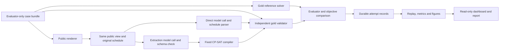

# Development and evaluation plan

## 1. Authority, status, and completion target

This is the active plan for Group 23's **AI Assistant for Dynamic Constraint-Aware Scheduling: Direct LLM Reasoning vs Constraint-Solver-Augmented Reasoning**. The next stage turns the integrated development checkpoint into a defensible final study, report and presentation. Section 5 is the execution queue; Sections 6–7 are the architecture and mathematical contract; Sections 8–9 define data and model decisions; Sections 10–11 define delivery gates; Section 17 maps evidence to the rubric.

| Milestone | Date and meaning |
| --- | --- |
| Mandatory proposal | Course deadline: 28 September 2026. Confirm the actual Canvas receipt and feedback; a local PDF is not a receipt |
| Preparation | 30 September–4 October: preserve the checkpoint, establish review tasks, plan model qualification and pilot final-data construction offline |
| Final-study freeze | Internal target: 18 October, after model eligibility, development qualification and dataset/protocol review |
| Submission-ready draft | Internal target: Friday 30 October, Week 11. Complete evaluated results, report draft, reproduction package and rehearsable presentation |
| Presentation | Course: week of 9 November; 15 minutes plus 5 minutes of questions, or a recording if requested |
| Final report | Course: 13 November; target an audited upload by 12 November and retain receipt |

The project contributes 25% of the course grade. The proposal is ungraded but mandatory to receive a project grade. Its body is at most one single-spaced, single-column page with 1-inch margins, excluding title/references. The final report is at most **10 single-spaced, single-column body pages**, with 1-inch margins and font at least 11 point. Figures, tables and substantive discussion count; title and references are excluded. Keep member names, matriculation numbers and emails on the private submission title page. Write for classmates with general AI knowledge. Verify Canvas updates, exact cutoff times and proposal feedback before freeze and submission.

### Baseline assessment and next goal

**The integrated development checkpoint works end to end.** It includes both approaches and task types, independent gold validation, exact lexicographic repair, extraction diagnostics, bounded explanations, v2/v3 and authored-case consumers, frozen controls, replay and a read-only dashboard. The [readiness audit](report/checkpoint-readiness.md) verified 521 Python tests, 7 frontend tests, a fresh 200-attempt canned workflow, exact replay of 332 saved live attempts and all 100 expanded dashboard cases. Earlier [macOS/Linux qualification](report/version-2-validation.md) identifies the unchanged tested source.

The [expanded development study](report/expanded-development-100.md) used `qwen3.6:35b`: A accepted 35/100 and B 97/100. Generation was 23/50 versus 48/50; repair 12/50 versus 49/50. Usage was 465,251 tokens and about 20 minutes 5 seconds. B's three failures were two omitted fixed appointments and malformed JSON. This is known synthetic, canonical-only development evidence, not a final held-out finding. Preserve the original failures, scores and budgets.

The next work is concrete: **F1 extraction regressions; F2 selected-model/backend qualification; F3 fresh final-case preparation; F4 frozen rehearsal and study; F5 analysis/reproduction; F6 report and delivery**. F2/F3 include bounded implementation still required; the existing frozen runner does not create fresh final data or connect an arbitrary provider automatically. No solver rewrite or larger product is needed.

This checkpoint integrates the audited fixes, expanded results and final-study documentation on top of `63d68d8`. Historical receipts retain their pre-publication snapshot and status; verify the current commit and remote branch on every handoff. Source, tests, manifests and reviewed summaries belong in Git; exact live replay also requires a separately supplied, reviewed raw-record archive. A package version of `0.1.0` and wire contract v1 are compatible with calling this the project's version 2 checkpoint; no public release is implied.

### Requirements and implementation discretion

| Authority | What it requires | How to act |
| --- | --- | --- |
| Course | Course-related formal subproblem, frontier-model direct/tool comparison, evidence and analysis, responsible AI, honest contributions/AI disclosure, prescribed report/presentation | Preserve these obligations. Obtain actual teaching-team clarification for a material deviation |
| Proposal | Generation and minimum-disruption repair, CP-SAT, gold specifications/validator, difficulty analysis, realistic scenarios and equivalent wording; feedback/UI are optional | Retain the scientific direction and explain supported simplifications |
| Team scientific decisions | Single day, 30-minute slots, fixed assignments, lexicographic objective, pairing, independent gold checking and development exclusions | Keep semantics consistent. Review/version changes that alter the comparison |
| Provisional study choices | Candidate model, sample counts, budgets, selection policy, confidence intervals and optional analyses | Finalize using development evidence before final outcomes. They are not additional course rules or current spending permission |
| Routine engineering | Helper structure, filenames, data structures, bounded tests, internal refactoring | Choose the simplest compatible solution and verify it without repeated approval requests |

The course allows constructed or downloaded instances; a public benchmark is optional. The independently human-written realistic condition is a team provenance policy, not a separate course mandate. Human review and honest academic contribution remain real responsibilities. Success is sound, explainable evidence; neither a predetermined B win nor a particular accuracy guarantees a grade.

### Recommended implementation defaults

Maintain one Python package, canonical schema, shared completion interface, fixed compiler, independent validator and evidence format. Use existing helpers and paths. Keep a single direct call versus a single extraction call plus CP-SAT as the core comparison. Version prompts and effective inference settings. A malformed answer remains a failure; gold-assisted diagnostic corrections never enter primary scores.

Proceed independently on reversible implementation, offline tests, review materials and report drafts. Ask focused questions only when missing information changes the scientific contract, member/path/branch identity, approved endpoint/model, live-call cap, publication authorization or final-study decision. Continue unrelated work while a decision is pending. Do not ask the team to choose routine code organization, and do not invent a decision to bypass a genuine dependency.

## 2. Research questions and contribution

1. How do problem size, slack, constraint interactions, and shared resources affect direct versus solver-assisted scheduling?
2. How often do formalization, schedule construction/optimization, and operational failures occur, and which causes can diagnostic checks substantiate?
3. How well does each approach repair a common starting schedule while preserving unaffected activities?
4. How stable is performance under semantically equivalent paraphrases and constraint reorderings?

Hypotheses: solver assistance may improve hard-constraint satisfaction as interactions increase, but extraction mistakes may dominate end-to-end failures; direct models may be adequate on simpler cases; equivalent wording may affect both paths. These hypotheses can be rejected by the results. Do not claim superiority or novelty in advance.

The intended contribution is a reproducible, bounded comparison combining generation, repair, language robustness, and failure attribution. The report should explain conditions under which each approach is useful and the limits of the constructed instances.

## 3. Scope and explicit exclusions

### Core

- Both schedule generation and minimum-disruption repair.
- One-day horizon, integer 30-minute slots, explicit date/timezone context when rendered as clock times.
- Mandatory fixed-duration, non-preemptive activities; fixed participants and required capacity-one resources.
- Hard constraints: full-activity availability, release times, deadlines, fixed appointments, precedence, participant non-overlap, resource non-overlap.
- Soft constraints: weighted penalties for a task starting outside a preferred start window; preferences and weights explicitly described to both approaches.
- Initial repair events: a new blocked interval, a tightened deadline, or a changed fixed appointment. Events supply an authoritative updated problem; no ambiguous conversational state.
- Direct LLM, LLM-to-CP-SAT, a gold reference solver, and an independent validator.
- Controlled synthetic instances, a small human-written realistic set, and selected paired language variants.

### Supporting tooling and remaining stretch

The authorized read-only dashboard is implemented as development/demo tooling: it monitors saved runs and inspects results, with no run control or calendar actions. It supports presentation and diagnosis but is not additional scientific evidence. Prioritize the open research gates over further UI expansion.

Remaining stretch, after the core gates pass:

- One verifier-feedback correction round, reported separately with its exact information and budget.
- A second research model beyond the required primary comparison, or a second initial-schedule policy sensitivity check.

Participant assignment, multi-capacity resources, new/cancelled tasks, longer horizons, and repeated disruption sequences are future extensions, outside the four-week delivery.

Live calendars, account integrations, RAG, autonomous calendar edits, mobile applications, model training, and production deployment are outside the four-week delivery. Do not add them as implicit dependencies.

Generation-only is the proposal's fallback. Taking it requires an explicit team decision and a documented scope reduction; it does not satisfy the original generation-and-repair completion claim.

## 4. Team responsibilities and workload

Component ownership coordinates edits; it is not a reason to rebuild completed work or prevent another member from identifying a defect. Each member reviews and understands the whole system. Use one editor per shared file and preserve existing changes.

| Member | Branch | Current coordination |
| --- | --- | --- |
| Tea Li Hao | `lihao-llm-baseline` | F2 provider/packaging, consumer integration, report assembly and demo |
| Tham Yao Xiang, leader | `yaoxiang-formal-core` | F1 extraction/formal review, final-model eligibility coordination, formulation and repair explanation |
| Woo Yong Qing | `yongqing-evaluation` | F3–F5 data, frozen execution, independent evaluation and analysis |

All jointly review final inputs, interpret results, write responsible-AI/limitations discussion and rehearse questions. Actual contributions may differ from initial ownership; record work performed, review decisions and AI assistance rather than copying planned hour allocations into the report. Rebalance support at two brief weekly checkpoints while avoiding overlapping edits.

### Current file ownership

| Area | Lead | Review/coordination |
| --- | --- | --- |
| `src/scheduling/schema.py`, `src/scheduling/solver.py`, `src/scheduling/objectives.py` | Yao Xiang | Other two approve contract changes |
| `src/scheduling/providers/`, `src/scheduling/pipelines/direct.py`, `prompts/direct/` | Li Hao | Yao Xiang reviews scientific assumptions |
| `src/scheduling/pipelines/solver_augmented.py`, `src/scheduling/extraction_diagnostics.py`, `prompts/extraction/` | Yao Xiang | Yong Qing reviews extraction/validation boundaries and owns scoring consumers |
| `src/scheduling/validation.py`, `src/scheduling/evaluation/`, `benchmarks/`, `evaluation/` | Yong Qing | Yao Xiang cross-checks validity rules |
| Implemented deterministic result-explanation formatter (Section 7 R4) | Li Hao | Yao Xiang reviews proof/objective semantics; Yong Qing reviews gold/evaluation labels; keep one shared formatter |
| Corresponding component tests | Component owner | Rotating reviewer |
| `pyproject.toml`, lockfile, CI, shared CLI, `src/scheduling/dashboard/`, README | Li Hao implements/integrates | Routine owned edits proceed; coordinate interface changes and avoid overlapping edits |
| `planning.md`, `AGENTS.md` | One editor at a time | Team agrees material scope/contract changes; factual corrections and status updates need normal review |

The baseline modules, R1–R4, v2/v3 benchmarks, authored-case consumers, frozen controls and neutral B request boundary are integrated. Preserve the single canonical schema and component boundaries. Sections 5 and 11 define current review and study-preparation work; historical component handoffs do not imply those modules must be rebuilt. New work normally enters `main` through small reviewed changes.

### Directory backbone and artifact placement

| Directory | Intended contents | Owner |
| --- | --- | --- |
| `src/scheduling/`, `src/scheduling/providers/`, `src/scheduling/pipelines/` | Shared schema, solver/objectives, validator, provider adapter, and two pipelines; exact module ownership above | Component owners |
| `prompts/direct/`, `prompts/extraction/` | Versioned prompt templates; no hidden gold answers | Li Hao / Yao Xiang |
| `configs/development/` | SoCLaaS development model/settings, solver limits, small pilot caps; no credentials | Li Hao, reviewed by all |
| `configs/experiments/` | Frozen model, prompt, solver, sampling, and budget references for main runs | Yong Qing, approved by all |
| `benchmarks/fixtures/`, `benchmarks/manifests/` | Small synthetic development cases and versioned split/seed/hash manifests; declare split explicitly and keep gold evaluator-only | Yong Qing |
| `src/scheduling/evaluation/`, `evaluation/` | Implemented benchmark/rendering, orchestration, scoring, metrics/replay and figures in the package; root `evaluation/` contains the canned demo | Yong Qing |
| `src/scheduling/dashboard/`, `tests/frontend/` | Read-only local run monitor/case explorer and frontend regression tests | Li Hao |
| `tests/unit/`, `tests/integration/` | Offline component tests and shared-contract/end-to-end checks | Component owners; Li Hao integrates |
| `.github/workflows/` | Installed-package offline macOS/Linux CI and reference preflight; hosted run status must be checked separately | Li Hao |
| `results/summary/` | Reviewed aggregate tables and claim-to-run references | Yong Qing |
| `report/`, `report/figures/`, `presentation/` | Report/presentation sources, selected figures, and demo materials; no private submission identifiers in Git | Section owners; Li Hao assembles |

Keep real implementation, verified commands and evidence; do not add placeholder modules, pretend CI jobs or fabricated sample results. Generated large/raw outputs go to ignored local `runs/`, `artifacts/`, or `results/raw/`; private inputs go to ignored `data/private/`. These runtime directories need not exist until used. Preserve reproducibility through the reviewed archive and checksums described in Section 14, rather than committing raw outputs.

## 5. Current work and dependency management

Read current Git status, this queue and the relevant contract before implementing. Verify that the checkout contains the audited fixes and current queue; a member branch or older clone may lag the integrated checkpoint. Follow `AGENTS.md` for consequential onboarding details. Delivered R1–R4 remain maintenance contracts in Section 7, not a new task list.

### Current priorities after the first baseline

| Work package | Lead / reviewer | Status and dependency | Completion evidence |
| --- | --- | --- | --- |
| F1: extraction fidelity | Yao Xiang / Yong Qing; Li Hao checks prompt packaging | Ready offline; any inference needs its own cap | Saved failure regressions, reviewed candidate prompt if warranted, separate development qualification |
| F2: model and execution contract | Li Hao / Yao Xiang; Yong Qing checks frozen identity | Offline packet/metadata qualified; six live completions, paired qualification stopped on serving-fingerprint drift; model decision/eligibility pending | Chosen model/endpoint decision, tested payload/accounting, measured qualification and recorded effective settings |
| F3: final dataset preparation | Yong Qing / Yao Xiang and Li Hao | Small builder/selector still needed; can start offline alongside F1/F2 | Versioned policy, development pilot, fresh reviewed packet, achieved quotas/families, exclusion and gold/text audit |
| F4: freeze rehearsal and final study | Yong Qing / all | Rehearsal development fixtures can start now; final inference depends on F1–F3 and actual decisions | Successful offline frozen rehearsal, approved protocol/cap, complete final records with no silent exclusions |
| F5: analysis and reproduction | Yong Qing / independent teammate | Build report tables from development now; final claims wait for F4 | Matched analysis, claim-to-run index, failure review, checksummed archive and independent replay |
| F6: report and course delivery | Li Hao assembles / all | Report source, claim index, contribution log and rehearsal draft prepared; human/final-result/format work pending | Audited ten-page body, responsible-AI cases, presentation/Q&A rehearsal and actual submission receipts |

Current Li Hao checkpoint (30 September): [F2/F6 handoff](report/lihao-f2-followup.md),
[qualification selection](benchmarks/manifests/lihao-f2-qualification-20260930.json),
[verification](configs/development/lihao-f2-verification-20260930.json),
[report source](report/study-draft.md) and [claim index](report/claim-evidence.md).
The branch incorporates main `8f3ff1b`. Installed macOS/Linux each pass 552 Python
tests and 48 selected canned attempts; 332 historical live attempts replay exactly.
New per-attempt execution metadata records known versus omitted/defaulted settings;
frozen execution stops on fingerprint drift. The approved qualification used one
metadata request and six completions (4,007 reported tokens) before two reference
calls returned different serving fingerprints. The backend-policy decision and
remaining live/model gate stay open. No prompt, score, final data or historical
record changed. Member-branch publication is now user-authorized; main integration
and human approval remain separate. The verification receipt retains its original
pre-publication status.

### F1 — focused extraction improvements

Preserve all three failures in `expanded-development-100-20260930-01`. Inspect existing coverage and add only missing synthetic development regressions for the updated A0 fixed appointment in `dev-v2-3264-slack-0-fixed_start-unsat-0-repair`, the A1 anchor in `dev-v2-3264-interaction_density-2-fixed_start-unsat-0-generation`, and malformed JSON in `dev-v3-1cb82271f05a61f8e4b44569-generation`. Regressions should assert the observed parser/semantic failure and gold rejection, not claim that a mocked response tests model quality.

Work in `prompts/extraction/specification.txt`, the existing extraction pipeline/diagnostics and relevant tests. Review a bounded prompt amendment that explicitly accounts for each stated fixed appointment and the authoritative updated repair event before producing the same schema. Keep contradictory but complete requirements; do not invite the model to drop them to manufacture feasibility. Preserve strict duplicate-key/unknown-field rejection and neutral public IDs. Examples must parse and cover current semantics without copying final cases or gold answers.

First preserve revision 3 as the reference configuration. Qualify model choice with unchanged prompts, then evaluate at most one justified prompt candidate on the selected development model; use a separate run/configuration and cap for the prompt comparison. Do not attribute a joint model-plus-prompt change to either factor alone. Provider-supported JSON constraints are conditional format assistance, not proof of semantic fidelity; use equivalent format assistance for both arms if adopted and disclose it. No silent JSON repair, constraint insertion or extra model call.

B's 10 structural mismatches include eight independently certified equivalent encodings and two true omissions. Retain the original structural metric and separate bounded equivalence diagnostics. The 4.69 ms mean solver time over 99 solves does not justify a solver speed project. After a focused qualification, freeze the best justified configuration, retain remaining failures and proceed; do not chase 100% on known development cases.

### F2 — selected model, backend and settings

Section 9 records the catalogue and recommended qualification. The implemented `SoCLaaSProvider` rejects other base URLs; `evaluate-batch` currently routes both live modes to it. `ModelConfig` contains model/output limits/timeouts/retry fields, while the request body sends only model, messages, `max_tokens` and `stream=False`. Historical sampling and reasoning controls were **server defaults, not explicitly configured**. Do not claim deterministic inference from a solver seed or assume a model-name/base-URL change supports an arbitrary final provider.

If the chosen eligible model works through the current endpoint, retain the adapter. Otherwise implement one specific final-provider adapter and explicit final-mode routing through the existing completion interface; keep development routing on SoCLaaS. Coordinate that endpoint/scope decision before dependent implementation. No generic plugin framework is needed. Add only verified request options to typed configuration, include them in serialization/freeze identity, and reject unsupported options rather than silently ignoring them. Keep legacy run readers compatible.

Record requested/returned model, provider/API, available revision/fingerprint, configured settings and deliberately omitted/defaulted settings. Unknown backend details remain marked unavailable; do not invent a pinned weight revision. Qualify content versus reasoning-field handling, output-limit semantics, usage coverage, errors/timeouts and model aliases. Extract final JSON only from the documented final-answer field; do not regex-strip mixed reasoning to turn an invalid answer into success. Do not request or publish private reasoning traces as research evidence.

Acceptance: exact mock payload/response tests; no gold or secret leakage; complete/error/truncation/uncertain-request accounting; configuration changes rejected on resume; matching settings for A/B; installed package check; a separately authorized development qualification. F2 ends with an evidence-based model decision, not selection for the largest B-minus-A gap.

### F3 — fresh final-data preparation

Current `generate_development_v2/v3` functions create development matrices. Frozen mode can consume reviewed test bundles but does not create them. Add a small preparation entry point under `evaluation/`, with reusable construction/selection logic beside the existing benchmark/case/manifest modules. Reuse schema, registry, validator and reference helpers; do not create a second runner or redefine the domain.

Define a versioned candidate policy: independently sampled source problems; supported durations/windows/assignments; nonredundant interactions; exact label/mechanism targets; feasible original repair schedules; event allocation; bounds on proposals/solver time; and explicit rejection reasons. Pilot this policy only on development candidates, including all inspected original and updated structures in development exclusions. Then freeze the policy and make the fresh final draw before any final model response. A held-out claim means new instances under this developed policy, not unseen generators or guaranteed absence from model pretraining.

Audit both original and updated repair structures against the complete versioned registry, group all descendants of a common source, and keep normalized duplicates in one family. A new seed, name, date, preference weight or split label is insufficient. Conservative audits may merge proposed groups; report the achieved count rather than overriding grouping to hit a quota. Retain all candidate/exclusion counts, provenance, gold bounds and selection reasons. If quotas cannot be met, emit an incomplete packet and revise policy/size before final inference.

Use the supported authored bundle format for realistic prose and selected equivalent renderings. Record actual human authorship/review separately from AI assistance. Review every selected text against gold, including objective order and clock conversions. A second member checks ambiguity, hidden hints and preserved meaning. Final prose/gold correction before inference is quality review; adjusting cases or prompts after seeing final responses changes the experiment.

Tests: deterministic selection; no silent quota replacement; known and calendar/ID-renamed structures excluded; original-problem overlap caught; whole-family allocation; unresolved reference rejected or separately classified; deliberately invalid schedules caught; preserved authorship/text; successful offline frozen packet. Use tiny synthetic test packets, not invented human approval records.

### F4 — one integrated freeze and execution workflow

Use existing `freeze-draft`, `evaluate-plan`, `evaluate-batch` and `evaluate-replay`; inspect each command's current `--help`. A draft deliberately remains non-runnable until real eligibility/review/budget references exist. First rehearse with clearly labelled development/synthetic approval fixtures. After F1–F3, assemble the actual source/prompt/config hashes, reviewed final bundles, development registry, model decision, analysis definitions and authorized cap.

The runner applies one `variants` and `repeats` setting per configuration. Use **separate frozen blocks** for controlled canonical, realistic canonical, and selected paraphrase/reordered conditions. Only the selected controlled cases appear in the language block; do not request variants for every case or repeat the canonical baseline unintentionally. Preserve case/family IDs and exact model, prompt, solver and request settings across blocks. In F5 verify cross-block pairing before accepting a robustness table.

If the optional repeat study is selected, its 12 bases must be a subset of the 24 language bases. The current runner numbers repeats from zero in every run; it has no global repeat offset. Use a new block with all three renderings and `repeats=2`, and record in the frozen analysis manifest that its local repeats 0/1 map to study repeats 1/2. Existing canonical/language records supply study repeat 0. F5 must verify this mapping while retaining each raw run/repeat identity; do not rewrite archived records. Acceptance is exactly 144 new attempts, three total observations per base/rendering/arm, each original observation used once, and tested rejection of duplicate or inconsistent mappings. This analysis support is planned work if that option is taken.

Rehearse preflight rejection, failure stop, interrupted/uncertain accounting, completed zero-call resume, replay and explanation consumers. The reviewer reads actual artifacts; machine-readable decision references are records, not a substitute for review. Run the final blocks only after the freeze gate, with no tuning from outcomes. Record operational interruptions and backend changes; do not replace failures or silently switch providers.

### F5 — analysis and portable evidence

Reuse the existing scoring, metrics, figure and dashboard paths. Add a thin analysis/reproduction entry point only where needed to join **verified compatible frozen blocks**, with an explicit block list and checks for duplicated attempts, missing canonical partners, incompatible inference settings and mismatched case/gold hashes. Source, prompts, model/backend and effective request/solver settings must agree; block IDs, selected cases, renderings, repeat ranges and corresponding budgets may differ intentionally. Compare these fields explicitly rather than requiring identical whole-configuration hashes. Keep the primary controlled denominator separate from realistic and language subsets. Do not concatenate unrelated CSVs or treat an aggregate alone as the raw evidence.

Produce the Section 8 figures and Section 17 claim index. Validate a hand-checked small analysis table, totals, pairing, missing usage, conditional objective denominators and grouped intervals. Preserve each run's own manifest; cross-block analysis does not rewrite records. Export per-attempt time/token usage, mean/median/tails and missing counts. Archive synthetic inputs, prompts, configs, raw attempts, failures, references, package/lock identity and reproduction instructions with checksums. A teammate replays in a fresh supported environment without credentials.

### F6 — report, review and delivery

Create the report outline, methods, bibliography and genuine contribution log immediately. Draft the formal worked example and two-path diagram from current implementation. Result sections use clearly labelled development placeholders until the frozen study supplies measured findings. Follow Section 17's evidence/page budget and review queue. Each member must explain the whole pipeline and personally contribute interpretation, review and writing. Update this queue with concrete artifact links and check results as work finishes; never mark a human or scientific gate done from a passing test alone.

## 6. Version-1 shared contract

This section describes the implemented version-1 contract. Human team review/sign-off is still pending; schema v1 is distinct from the project checkpoint number. Source types in `schema.py` and the shipped prompts concretize the wire fields. Reconcile this description, callers, tests and prompts together if review changes the contract.

### System architecture and data flow

Keep one installable Python package, one CLI and one shared provider interface. The current implementation has one SoCLaaS adapter; F2 may add a specific final-provider adapter if required. Local computation is CPU-only; only the provider sends model requests. The dashboard reads saved records and adds no alternate execution path. Gold access is an explicit evaluation boundary, not a distinction inferred from file names.



| Boundary | Existing implementation | Design rule / next extension |
| --- | --- | --- |
| Formal data | `schema.py`, `objectives.py` | One typed schema and deterministic wire serialization; shared semantics are reviewed/versioned, not copied into each pipeline |
| Provider | `providers/types.py`, `soclaas.py`, `tls.py` | Credentials stay local; explicit timeouts/caps and per-attempt usage/errors; both paths inject the same adapter |
| Direct path | `pipelines/direct.py`, `prompts/direct/` | One call, strict public schedule parsing, no solver or gold repair of A's answer |
| Solver path | `pipelines/solver_augmented.py`, `solver.py`, `prompts/extraction/` | One extraction, validated schema, fixed compiler and bounded lexicographic solving; preserve extracted input and native solver outcomes |
| Independent correctness | `validation.py`, `extraction_diagnostics.py`, `evaluation/scoring.py` | Recompute gold feasibility/objectives independently; compare extraction separately and retain conditional objective denominators |
| Data and experiment control | `evaluation/benchmark.py`, `cases.py`, `manifests.py`, `runner.py` | Render equal public information, protect source-family splits, preflight references, reserve calls durably; maintain frozen controls and add only the explicit F2/F3/F5 extensions |
| Analysis and presentation | `evaluation/metrics.py`, `figures.py`, `dashboard/` | Consume saved evidence; no model calls from dashboard/replay and no second metric definition in the UI |

Paths in this table are relative to `src/scheduling/` except `prompts/`. The gold validator can check final outputs regardless of whether B's extracted specification is faithful; these are separate measurements. Gold reference solver success is infrastructure evidence, not a third natural-language competitor. For UNSAT, compare the prediction with the independently established gold label; a timeout remains unresolved.

### Run lifecycle and stored evidence

The implemented development path is: load/validate cases and config → check references and estimate requests → establish immutable run contract → reserve each attempt → call A or B → save output → independently score → persist completion → export/replay. Reservation precedes the external request so a crash cannot silently erase possible spending. A saved failure is a completed observation; a pending/uncertain reservation needs explicit reconciliation, not automatic reissue. Authentication, TLS, rate-limit and transport stops retain completed work. An exclusive lock prevents overlapping writes; a stale lock alone does not prove an active process.

A run stores `manifest.json`, `cases.json`, `references/` and `attempts/` under an ignored run directory. The manifest identifies cases, prompts, model/solver configuration, source and runtime; reference and attempt records carry their checksums and statuses. Offline replay verifies stored records and recomputes validation/metrics from saved pipeline outputs and references without calling the provider or rerunning CP-SAT. It demonstrates reproducibility of recorded evidence, not identical future live answers. Raw records must remain preserved locally and be supplied through a reviewed team archive when omitted from Git; sharing that archive is still a Gate C deliverable.

The implemented frozen mode adds protocol and eligibility/cap decision references to this lifecycle. Section 5 specifies remaining preparation and analysis work; it does not require a database, web service, generic agent framework or new scheduler. Keep the current serial execution until measured runtime/rate-limit evidence justifies bounded parallelism.

### Gold problem and natural-language view

`ProblemSpec`: `schema_version`, `instance_id`, `task_type` (`generation` or `repair`), `horizon_slots`, `slot_minutes` (30), participant records, resource records, activities, and constraints. Each participant/resource has a unique ID and explicit availability windows; capacity is one in v1. Activity records contain unique stable IDs, positive integer `duration_slots`, participant/resource IDs, and an explicit list of zero or more availability windows. Constraints/preferences have stable IDs and typed operands; unknown types and dangling IDs are errors.

- Store `horizon_start` and `timezone` explicitly; slot zero is that start, with `0 <= start < end <= horizon_slots`. No implicit current date/timezone. Initial scenarios use a single fixed-offset day.
- Activity, participant, and resource IDs are visible labels in every language rendering. Extracted constraints use their own IDs; hidden gold constraint IDs are never required for a correct extraction. Match constraints by normalized type, operands, and values.
- Intervals are half-open `[start,end)`. Adjacent activities are permitted.
- An activity must fit completely within one allowed window for the activity and for each required participant/resource, not span gaps. Explicit full-horizon availability means unrestricted; an empty list means unavailable.
- A blocked interval identifies its target kind (`participant` or `resource`), target ID, and half-open endpoints. Its effect applies to every activity using that entity. No unstated availability defaults.
- Mandatory activity IDs must occur exactly once in a schedule. Missing, duplicate, and invented activities are invalid.
- Release times, deadlines, fixed starts, precedence, and blocked intervals have explicit semantics. No inferred travel/rest constraints unless stated.
- Resources and participants cannot be double-booked. Multiple required participants must all be available for the full interval.
- A preferred start window uses explicit inclusive lower/exclusive upper start bounds and an integer penalty weight. Generation minimizes the sum of violated-preference weights.
- A repair benchmark case retains `original_problem`, `original_schedule`, `event`, and `updated_problem` separately. The original schedule must pass validation against the original problem; it may violate the updated problem. Evaluate all repaired schedules against the updated problem. Both systems receive the same original schedule and the complete updated natural-language description; the evaluator keeps both gold specifications private.
- Reject malformed types, endpoints, and references as schema errors. Preserve well-formed contradictions (such as a deadline earlier than the release time, or insufficient available time) as scheduling instances whose feasibility must be solved, not filtered away as invalid data.

`NaturalLanguageView` contains the user-visible text, variant ID, base-instance ID, and, for repair, the common original schedule. Evaluated pipelines receive this view and the public output/schema instructions. They do not receive gold constraints, oracle solutions, hidden labels, or expected objective values.

Authored prose is an opt-in case-bundle **2.0** extension (`AuthoredBenchmarkCase`), separate from canonical `ProblemSpec` schema 1.0. It carries exact variant text plus evaluator-only provenance/review records. Bundle 1.0 remains supported with unchanged legacy hashes. Runner, replay, dashboard and explanation consumers use the same version-aware loader. Missing requested authored variants fail preflight; no template fallback or fabricated review is permitted.

### Output and outcomes

`Schedule`: a list of activity IDs and integer start slots. End times are computed from fixed durations. Claimed textual times must be normalized without guessing or rounding invalid inputs.

`PipelineResult`: `instance_id`, `variant_id`, `approach`, `status`, optional schedule, optional extracted specification, diagnostics, timings, and usage. Pipeline status is one of `SAT`, `UNSAT`, `UNKNOWN`, `INVALID_OUTPUT`, or `ERROR`. A SAT claim requires a complete schedule; an UNSAT claim from a direct LLM is a prediction, not a proof.

Record the model's declared status separately from parsing/execution status and final gold validation; a parseable SAT claim is not an accepted solution. Preserve the underlying solver status separately: `OPTIMAL`, `FEASIBLE`, `INFEASIBLE`, `UNKNOWN`, or `MODEL_INVALID`. Also store objective value, best bound where available, time limit, elapsed time, and whether each lexicographic stage was proven optimal. Never report a feasible incumbent as a proven optimum, or a timeout as UNSAT.

`ValidationResult`: structural validity, hard-feasible flag, violations with constraint IDs, objective components recomputed from gold, and repair distance. The validator consumes a schedule and gold specification; it must not call CP-SAT or reuse the solver's constraint-building implementation.

### Implemented Python interfaces

```python
solve(spec, limits, repair_context=None) -> SolveResult
validate_schedule(gold_spec, schedule, repair_context=None) -> ValidationResult
run_direct(nl_view, model_config, *, provider_complete=None) -> PipelineResult
run_solver_augmented(nl_view, model_config, solver_limits, *, provider_complete=complete) -> PipelineResult
evaluate(case, pipeline_result, gold_reference, *, repeat=0) -> dict
```

These entry points live in `solver.py`, `validation.py`, `pipelines/` and `evaluation/scoring.py` under `src/scheduling/`. The evaluator currently returns a JSON-serializable mapping; there is no separate `EvaluationRecord` class. Inject the shared provider or canned callable through the pipeline keyword argument.

`RepairContext` contains the common original schedule, including stable activity IDs and start slots. It is required for a repair task and absent for generation; missing repair context is an explicit error. Both the solver and validator use it to compute moved count and total shift. The evaluator first checks the original schedule against `original_problem`, then checks repairs against `updated_problem` with this context. The solver-augmented path builds the same context from the public original schedule; it must not receive the original or updated gold specification.

Li Hao provides the implemented typed `complete(messages, model_config) -> ModelResponse` interface with content, returned model, timing, usage, and sanitized error fields. Both pipelines use this adapter. Review it alongside the shared schema; injected canned responses support offline development without live access.

Use explicit typed models and deterministic serialization. Validate generated JSON before compilation. Do not execute model-generated code. Schema-valid JSON is not proof of semantic correctness.

## 7. Formalization, solver design and reasoning-core improvements

### Course fit and implemented technical contribution

The teaching team's *Project Topic* and *Project Evaluation Guidelines* ask for an explicit course-related mathematical formulation, correct implementation, technical depth, and analysis of why direct reasoning or tool use succeeds or fails. They do not require inventing a new general-purpose solver. The proposal selects a scheduling CSP/COP and minimum-disruption repair. The technical contribution is a **faithful, inspectable and mathematically justified translation-and-solving system**, with evidence explaining where its guarantees begin and end.

Retain the two core paths and fixed v1 domain. R1–R4 are implemented; the specification below defines their behavior and ongoing acceptance criteria. These are team engineering/research choices, not extra grading requirements. Human review remains distinct from technical verification. The optional preprocessing/search refinements below are conditional alternatives, not unfinished core work.

### Explicit CSP/COP formulation

Let `I` be the mandatory activities, `H <= 48` the number of 30-minute slots, `d_i > 0` the fixed duration, and `s_i` the integer start variable. End time is `e_i = s_i + d_i`. Let `D_i` contain every start in `{0,...,H-d_i}` satisfying all unary requirements: full containment in an allowed activity window and in an allowed window for every assigned participant/resource; release, deadline and fixed-start conditions; and avoidance of applicable blocked intervals. Empty `D_i` is a well-formed contradiction, not malformed JSON.

The finite-domain **CSP** is `(variables {s_i}, domains {D_i}, hard constraints C)`. Feasibility asks whether a complete assignment exists. The **COP** adds the preference or repair objective below. A schedule cannot omit an activity to make an infeasible problem appear feasible.

| Requirement | Mathematical meaning | Existing CP-SAT representation |
| --- | --- | --- |
| Unary availability/time bounds | `s_i in D_i`; each full interval `[s_i,e_i)` fits one window in each applicable window list | `legal_starts` and `new_int_var_from_domain` |
| Precedence `i -> j` | `s_i + d_i <= s_j` | Linear inequality |
| Shared participant/resource | For each conflicting pair, `e_i <= s_j OR e_j <= s_i` | One fixed-duration interval per activity and a `NoOverlap` constraint for each entity |
| Release / deadline / fixed start | `s_i >= r_i`, `e_i <= deadline_i`, `s_i = f_i` | Incorporated into legal domains |
| Preferred start `k` | Penalty `w_k` if `s_activity(k)` is outside `[lower_k,upper_k)` | Boolean violation linked to the start by an allowed-assignment table |
| Repair change indicators | `m_i = 1` exactly when `s_i != old_s_i`; `t_i = abs(s_i-old_s_i)` | Reified equalities/inequalities and `add_abs_equality` |

Define `P(s) = sum_k w_k * 1[s_activity(k) outside preferred_window_k]`. Generation minimizes `P(s)` subject to all hard constraints. This is a weighted **violation count**, not distance from a preferred time. Each preference contributes separately, including intentional repeated preferences/weights; normalization must not silently change this objective.

For repair, use the common original schedule `old_s` and minimize the tuple lexicographically:

```text
M(s) = sum_i 1[s_i != old_s_i]          # number of moved activities
T(s) = sum_i abs(s_i - old_s_i)         # total shift in slots; minutes = 30*T
objective(s) = (M(s), T(s), P(s))
```

Thus `(1,10,5)` is better than `(2,2,0)`: avoiding a second moved activity has priority over smaller total shift or better preferences. This priority is a declared user-impact choice. It is not an intrinsic definition of the best schedule. Never turn hard constraints into penalties, use unspecified large weights, or switch to makespan minimization just because a job-shop example does so.

**Exact sequential algorithm, already implemented:** minimize `M`; only after proof of its optimum `M*`, add `M=M*` and minimize `T`; only after proof of `T*`, add `T=T*` and minimize `P`. Generation needs only the preference stage. Give the entire repair solve one wall-time budget and pass the remaining time to each stage. If proof is incomplete, retain a feasible incumbent, stop claiming full lexicographic optimality, and preserve the stage objective, bound and native status. A later timeout must not erase an earlier valid solution. Prior-stage solution hints are already implemented.

For exact stages/references use integer coefficients, `absolute_gap_limit=0` and `relative_gap_limit=0`, as the current solver does. The [pinned v9.14 parameter definitions](https://github.com/google/or-tools/blob/v9.14/ortools/sat/sat_parameters.proto) explain stopping limits; a nonzero gap setting changes what a reported `OPTIMAL` status establishes. Retain the existing numeric-range checks and never round a floating bound into an unsupported exact proof. Compare secondary gaps only when all preceding objective components match their proven optima. Raw component values remain reportable without such a match.

The unpruned assignment space is `product_i |D_i|`; it is an upper bound on combinations, not CP-SAT's observed search count. Explain how precedence and shared entities couple those choices. CP-SAT combines SAT/constraint reasoning and linear techniques, as described by its [developers](https://drops.dagstuhl.de/entities/document/10.4230/LIPIcs.CP.2023.3). Keep interval/global constraints and the pinned default search as the starting point. Implementing another general backtracking, SAT or MILP solver is unnecessary; independent tiny enumeration supplies a comprehensible correctness check.

### Implemented core and acceptance criteria

The integrated `solver.py` compiles finite legal domains, global non-overlap, precedence, preferences and the three repair stages. `objectives.py` computes the tuple, while `validation.py` checks schedules independently. Existing tests exercise tiny exhaustive optima, boundaries and timeout/incumbent handling. These features are delivered and should be preserved.

The [expanded study](report/expanded-development-100.md) reports **4.69 ms mean solver time over 99 B solves**, compared with **10.12 s mean model-response time over 100 B calls**. The malformed response never reached CP-SAT. These conditional measurements cover 3–12 activities and 48 slots; they are not a large-instance scaling benchmark. A faster CP-SAT run cannot repair an omitted constraint or malformed specification. Prioritize formal correctness and extraction reliability; claim a runtime improvement only after measuring it.

| Component | Owner / integration partner | Implemented capability | Acceptance evidence |
| --- | --- | --- | --- |
| **R1 — repair correctness** | Yao Xiang; Yong Qing independently reviews | Enforce stable repair time frame, activity durations and assignments at the shared boundary; broaden mathematical checks | Reject unsupported changes; accepted v1 events preserve meaning; tiny solver/validator/enumerator agreement |
| **R2 — reliable formalization** | Yao Xiang for schema/prompt/diffs; Li Hao for prompt packaging; Yong Qing for scoring consumers | Executable extraction examples, precise schema errors, and typed semantic-review differences | Extra-field errors remain failures with exact paths; examples parse; altered/omitted requirements are inspectable without gold feedback |
| **R3 — constraint reasoning** | Yao Xiang; Yong Qing checks reasoning independently | Small domain-analysis record with actual rule provenance and supported contradiction explanations | No feasible schedules lost; empty-domain reasons are checkable; compiled-model UNSAT remains distinct from source-request correctness |
| **R4 — evidence-based output** | Li Hao for shared formatting/CLI; Yao Xiang for proof semantics; Yong Qing for evaluation labels | Deterministic before/after, objective and proof-status explanations from saved records | No extra LLM call; timeout/extraction/gold distinctions survive; works on existing recorded outputs |

R1–R4 are integrated through shared records and consumers. Maintain their regressions and coordinate serialization changes, preserving old archives. R3 intentionally covers named unary exclusions and simple proven contradictions; a general minimal-conflict service remains optional.

### R1 — repair invariants and mathematical qualification

The integrated baseline audit found that `RepairCase.__post_init__` checked types and activity-ID coverage but permitted changes to time origin, horizon length, duration and assignments. R1 now rejects those changes and is included in main at `bc165bc`; human review remains pending. The shared boundary and evaluator both protect the time frame. This closes the earlier v1 contract gap without changing the research task. The reviewed development cases keep the intended time frame, durations and assignments; this finding does not invalidate their recorded acceptance counts.

Compare original/updated `horizon_start`, timezone, slot length and horizon length, and compare each retained activity's duration, participant IDs and resource IDs by stable ID. Order alone is irrelevant. Keep activity presence fixed. Accept the supported availability/deadline/fixed-commitment disruptions; reject changing an activity's meaning under the same ID. A future task-duration, assignment, new/cancelled-activity or time-resolution feature requires a new explicit repair contract. Original-schedule feasibility remains independently checked against the original specification.

Do not give B an evaluator-only original specification to enforce this boundary. Its solver receives the extracted updated specification and the public original schedule. Shared-case validation protects supplied benchmark/application pairs; extraction fidelity against the public request is still a separate issue. The common public description must state the time frame and immutable activity facts clearly, and both approaches receive the same information.

Extend the existing tiny enumerator cases to three/four activities with unequal durations, multiple participants, asymmetric resource sharing, gapped domains and competing preferences. Compare the feasible set or proven objective tuple, not the exact schedule when ties exist. Include movement-versus-shift disagreement, preference tie-breaking, no-op repair, contradictory complete requests, and existing timeout/incumbent regressions. Keep the enumerator/validator independent of compiler helpers.

**Worked repair counterexample:** three one-slot activities share resource R over slots `[0,3)`. Original starts are A0/B1/C2; legal starts before disruption are A `{0,1}`, B `{1,2}`, C `{0,1,2}`. A new participant block removes A's start 0. The only repaired schedule is A1/B2/C0, with `(M,T,P)=(3,4,0)` when there are no preferences. B and C must move although their own unary windows did not change. Freezing an apparently unaffected activity can wrongly make a feasible repair appear impossible. This independently enumerable example is covered by the formal qualification regressions; preserve it when changing repair or search behavior.

Document the original-schedule policy: initially a saved feasible schedule from the pinned gold-solver configuration, supplied identically to both approaches. Discuss its influence on repair patterns. [Minimal-perturbation research](https://www.unitime.org/papers/ercimprelimin03.pdf) grounds the idea of minimizing departure from a prior assignment; our fixed activity set and three-component objective are a narrower team choice, not a new general repair theory.

### R2 — make extraction an explicit, inspectable contract

In `schema.py`, `prompts/extraction/specification.txt` and `pipelines/solver_augmented.py`, maintain one canonical accepted format. Maintain the complete minimal valid `ProblemSpec` example and compact exact-field reference checked against the parser. Keep it separate from few-shot benchmark solutions and verify that examples do not accidentally add activities or constraints to a request. State explicitly that unit capacity is implicit and there is **no `capacity` field**. The five saved extra-field failures motivate this change; they do not prove a prompt revision will improve accuracy.

Give schema failures safe structured detail: error code, JSON path, missing/unsupported field names, and a concise message, while retaining the raw response in its existing protected record. An extra `participants[0].capacity` should remain `INVALID_OUTPUT`, with an actionable location; do not drop it silently. Keep duplicate-key, invalid-number, unknown-type and dangling-reference rejection. If a formal JSON Schema artifact is introduced, derive/check it against the canonical parser and distinguish structural checks from semantic constraints. Do not depend on provider-enforced structured decoding unless SoCLaaS support is verified; adding that feature would need a recorded new inference configuration.

Maintain the implemented `compare_specifications` typed details beyond top-level labels and omitted/invented totals. Report changes by entity/activity ID and field, with unmatched typed constraint records and multiplicity. Examples: duration A `2 -> 1`, a missing participant P, reversed precedence, or deadline A `4 -> 5`. Pair an alteration only when correspondence is unambiguous; otherwise retain unmatched records. Rename/order differences that do not change meaning may normalize away. Availability windows must not be merged blindly: under whole-window containment, two adjacent windows `[0,2)` and `[2,4)` do not admit a three-slot activity, while the merged window `[0,4)` does.

Keep structural comparison separate from semantic equivalence. For tiny cases with the same time frame and immutable activity facts, an evaluator-only exhaustive comparison may establish equality of feasible start assignments and objective values over that finite horizon. This is an instance-specific mathematical equivalence, not proof of general natural-language understanding. A counterexample demonstrates a difference; failure to find one within a limited search does not prove equivalence. Larger/alternative encodings remain subject to human semantic review. Gold differences never feed corrections into the core extraction call. This addresses the formalization boundary highlighted by [ACL 2025 research](https://aclanthology.org/2025.acl-long.242/) without assuming syntactically valid JSON captures the user's meaning.

### R3 — explainable domains and sound preprocessing

The implemented `domain_analysis.py` provides legal domains and bounded reason records. Maintain this shared analysis with the compiler; extend it only for a demonstrated diagnostic need. Each rejected start can cite an explicit constraint ID or a stable specification path for activity/entity availability. Group identical reasons for display. Index entities and relevant constraints once per solve if useful; with at most 48 slots, straightforward enumeration remains appropriate. Keep this helper out of the independent validator.

Unary domain wipeout can then explain, for example, that a task needs two slots but no start survives its deadline and participant availability. A directed precedence cycle with positive durations is another checkable contradiction: summing the inequalities would require a start time to be strictly later than itself. Report the actual rule chain. These are **sufficient contradictions**, not necessarily smallest explanations. Do not convert failure to derive a simple explanation into a claim that the problem is feasible.

Optional precedence-domain filtering may use this sound rule for `i -> j`, while both domains are nonempty:

```text
D_i <- {s in D_i : s + d_i <= max(D_j)}
if D_i is empty: stop with a contradiction
D_j <- {t in D_j : t >= min(D_i) + d_i}
if D_j is empty: stop with a contradiction
repeat affected arcs until no domain changes
```

Each removed value lacks support on that precedence relation. Preserve holes in domains and retain all original precedence/NoOverlap constraints in CP-SAT. The prepass need not solve resource conflicts; nonempty domains are not a SAT proof. Verify that preprocessing preserves every feasible tiny schedule and therefore the exact objective optimum. If this optional helper is implemented, independently enumerate tiny chain/domain/duration combinations, including empty support and boundary cases. Such checks support the argument but do not establish correctness on every possible instance; retain the support argument and consumer regressions in implementation review.

CP-SAT already propagates constraints internally. The main reason for an explicit prepass is interpretable reasoning and inspectable domains; keep pruning optional until its extra complexity and runtime are justified. If analysis finds a contradiction, either compile an explicit false condition and obtain the actual backend outcome as today, or introduce a distinctly labelled analytical proof record. Never fabricate a native CP-SAT status for a solve that did not occur.

**Optional general conflict diagnostic, after R1–R4:** if simple reasons are insufficient and a report example warrants it, a small offline deletion-based check may rebuild a feasibility-only model while removing named requirement groups. Begin only after the complete feasibility model is proven INFEASIBLE; an initial UNKNOWN cannot establish a conflicting set. Keep immutable background facts explicit. Removing a requirement must relax it: removing an availability requirement means allowing the full horizon, not deleting an allowed window and accidentally narrowing availability. Remove a group permanently only when the remaining model is proven infeasible; preserve it on UNKNOWN. Bound checks and total time, and label an interrupted result merely a sufficient conflicting set. A deletion-minimal set is not necessarily minimum-cardinality. This analysis is separate from ordinary replay, which does not rerun CP-SAT, and from primary measured inference.

Do not obtain misleading explanations by blindly attaching assumptions to every compiled constraint. Unary requirements are currently baked into domains, and installed OR-Tools 9.14 rejects direct enforcement of `NoOverlap`. Its [assumption-core contract](https://github.com/google/or-tools/blob/v9.14/ortools/sat/cp_model.proto) also does not guarantee a minimum conflict and limits core reduction for optimization/multi-worker runs. An assumption-based diagnostic would require a separately validated encoding that exposes all relevant requirements; it is unnecessary for the small initial explanation scope.

### R4 — explanations tied to actual evidence

Implemented by Li Hao and merged through PR #4 (`61d9fbb`, 29 September): shared `explanations.py` and the read-only `scheduling explain` CLI consume current and saved results. The original formatter made no schema, prompt or solver changes. Formal semantic/evaluation sign-off remains pending; the integrated Yao Xiang extension adds compatible recorded R3 reasons. See [Li Hao follow-up](report/lihao-development-followup.md) for tests, measured failures and the participant-burden example. The behavior requirements below remain the review criteria.

The shared formatter consumes `ProblemSpec`, `SolveResult`, `OptimizationStage`, repair context and validation records through the CLI and read-only case view. A formatter does not solve, call a model, change the schedule or invent a proof. Keep gold/extraction comparisons evaluator-only and visibly separate from what B itself knows.

For a feasible repair, show before/after clock times, moved activity IDs, `(M,T,P)`, and the proof status/bound of each attempted stage. For a timeout after proving movement only, say that minimum moved count is established but minimum shift is not. Explain preference penalties using the actual windows/weights. For infeasibility, distinguish a proven contradiction in the **extracted specification** from a correct infeasibility judgment about the original request; show a supported reason if available and otherwise state that a detailed conflict was not derived. Parsing failure, solver UNKNOWN and gold-invalid output each retain their own explanation.

Connect this to the responsible-AI objective-choice discussion: for each participant p, compute moved-event count and `30 * sum(abs(s_i-old_s_i))` over that participant's activities. These describe participant inconvenience under fixed assignments, not fair workload allocation. Shared events contribute to each affected participant, so participant totals need not equal the activity-level objective. Use one existing realistic/development case to show how minimizing moved activities can distribute inconvenience unevenly. Changing the primary objective to participant weights, minimax burden or soft hard-constraint relaxation would be a separate agreed experiment, not an implementation fix.

New `SolveResult` records carry a versioned exact specification/repair-context binding. Verify it before attributing optimality, infeasibility or domain reasons to supplied standalone files. A matching hash establishes input correspondence, not authenticity of arbitrary evidence. Legacy unbound standalone results may validate a candidate but must withhold proof correspondence; historical run explanations use their checked case/record context. Never replace raw records to manufacture a binding.

### Conditional solver optimizations and boundaries

The following are optional candidates after F1–F4; existing evidence does not make them a current priority. Make one change at a time, use the same difficult development specifications and total budget, and retain it only when the evidence or explanatory value justifies the maintenance cost.

| Candidate | Implementation direction | Correctness/performance boundary |
| --- | --- | --- |
| Initial repair hints | Before the first stage, suggest public original starts still in their legal domains. Keep existing later-stage hints | [v9.14 hints](https://github.com/google/or-tools/blob/v9.14/ortools/sat/docs/model.md#solution-hinting) guide search and do not constrain it. Never hard-fix unaffected tasks or import gold starts. Bounded-run incumbents may change even though exact optima do not |
| Compact preference encoding | Keep the present allowed-assignment tables initially. If model construction becomes significant, compare a correctly reified inside/outside-window encoding | Both directions of each Boolean equivalence must hold. Check every legal start and preference penalty; reducing variables alone is not evidence of faster solving |
| Skip a provably constant stage | Reuse a feasible incumbent when the remaining objective is demonstrably constant, e.g. absent preferences | Record analytical constancy separately from solver `OPTIMAL`; update proof consumers/versioning. Do not skip feasibility search when no incumbent exists. Retain three stages if the bookkeeping costs more than it saves |
| Component solving | Only consider it if profiling finds useful disconnected groups in the full precedence/shared-entity interaction graph, with separable objectives | A disruption's local neighborhood is not necessarily an independent component. Prove decomposition and maintain one total budget and global proof accounting before implementation; unnecessary for current tiny solves |

Instrument only what resolves a performance question: compilation time, per-stage elapsed time/status/bounds and, where available, branches/conflicts and time to first incumbent. Compare medians/tails and proof completion on offline cases, retaining all failures. Keep the primary CPU/worker/seed configuration stable; additional workers, hand-chosen branching or large-neighborhood search are not automatic upgrades. Do not promise deterministic elapsed time or identical tied schedules across machines. A change after the evaluation freeze needs a new configuration and assessment of affected results.

Source-grounding spans and explicit ambiguity abstention may be useful later interface variants: a single response could cite public text for extracted fields, or return unresolved required facts without solving. A quotation's presence is not proof of its interpretation. Such output changes need their own schema/prompt version, compatible parsing and token-budget qualification. Complete contradictions must still be formalized and solved; incomplete information must not be invented. Keep these variants in the bounded responsible-AI/diagnostic work unless the team deliberately adds a separate research arm. Multi-call correction, different objectives, new constraint families and new solvers are separate scope decisions.

### Core completion and ongoing verification

R1–R4 have reviewable implementation and evidence. Qualification requires the worked boundary/repair cases and broader tiny enumeration to pass, with explanations accurately distinguishing syntax, interpretation, feasibility and optimality. Human sign-off remains open. No-op and coupled repair work; UNKNOWN remains distinct from UNSAT; malformed extraction cannot become a silently corrected success. Optional optimizations may be declined with a measured or complexity-based reason.

The report should then explain three technical insights using this implementation: **how domains/global constraints reduce the scheduling search; why minimum-disruption repair can propagate beyond the changed activity; and why solver proof does not guarantee faithful language interpretation.** These connect the project's core to the course's formulation, technical-depth, analysis and responsible-AI criteria without requiring a broader product or a new optimization algorithm.

## 8. Benchmark and evaluation design

### Current dataset provenance

All current inputs are synthetic. No public benchmark instances or real calendars have been imported. Citing SCHEDBench or NATURAL PLAN describes methodological influence, not dataset use.

| Dataset/evidence | Origin and size | Use and limitation |
| --- | --- | --- |
| Legacy v1 | Six fixed fixtures plus 24 procedural cases; 30 canonical cases / 60 live calls | Historical development reference; 28 SAT/2 UNSAT and limited structural/event diversity |
| Structural v2 | 144 procedural cases per repetition; four sweeps and three repair events | Development; independent review found repeated contradiction mechanisms and simple repair optima |
| Challenge v3 | 108 procedural cases in nine conservative source families | Development mechanisms for coupled repairs, contradictions and preference trade-offs; variants are related |
| Authored drafts | Twelve AI-assisted fictional scenarios, six generation/six repair, six SAT/six UNSAT | Implemented consumers and offline checks; not independently human-written or untouched final data |
| Expanded study | 100 preselected v2/v3 cases, 41 families, 200 live calls | A 35/100; B 97/100; known development structures and canonical wording only; 14 IDs appeared in earlier pilots |
| Canned qualification | Gold-derived responses through real pipelines/solver/validator | Integration evidence, not model performance or additional independent problems |
| Final controlled/realistic/language blocks | Not yet constructed, reviewed or run | F3/F4 deliverables; never relabel the above datasets as final held-out evidence |

See the [expanded selection manifest](benchmarks/manifests/expanded-development-100-20260930.json), [development report](report/expanded-development-100.md) and [readiness audit](report/checkpoint-readiness.md). `tiny_fixtures`, development generators and renderers are deterministic Python; their code was AI-assisted. Saved repair starts are reference-solver outputs. Dataset authorship, language authorship, human review and model-generated responses are separate provenance facts.

The independently human-written realistic condition remains the team's chosen final policy. Existing AI-assisted drafts are useful development material; a human edit does not erase their origin. If the team changes that provenance policy, record it before final construction and describe the final condition honestly. Synthetic versus real and public versus private are different distinctions.

### Dataset strategy and external resources

The teaching handout's *Project Topic* permits constructing instances or downloading available ones. Its *Information Resources* recommends trying public datasets/APIs. The proposal explicitly selects controlled construction plus a small realistic set. Thus a purpose-built primary benchmark is compliant; an external dataset is a useful possible supplement, not a missing mandatory requirement. The scientific rationale is control over difficulty, known constraints, SAT/UNSAT labels and common repair starting schedules. The cost is limited realism and possible generator bias, which the report must analyze.

| Public resource checked | Fit and limitation | Project decision |
| --- | --- | --- |
| [NATURAL PLAN data/repository](https://github.com/google-deepmind/natural-plan) and [Calendar Scheduling construction](https://arxiv.org/html/2406.04520v1) | Its calendar task uses synthetically constructed calendars to place one meeting. Single-day cases are close to our representation; they do not test our multi-activity repair. Repository software is Apache-2.0; other materials are CC-BY-4.0 | Preferred candidate for a small, separately reported external transfer check. Preserve attribution and record adaptations; do not pool it with the controlled matrix |
| [SCHEDBench release/card](https://huggingface.co/datasets/SCHEDBench/SCHEDBench/blob/main/README.md) | Public natural-language renderings span six operations-research families. The card includes source IDs and best-known objectives; canonical source matrices are not redistributed. Renderings are CC-BY-4.0; original source terms still apply | Keep as the primary wording/constraint-faithfulness reference. A faithful import needs compatible constraints, source formal data and checked scoring. Do not expand v1 into industrial rostering/multimode scheduling or label best-known values proven optima |
| [TCP, EMNLP 2025](https://aclanthology.org/2025.emnlp-main.1142/) and [released dataset](https://huggingface.co/datasets/Beanbagdzf/TCP) | Combines generated temporal problems with scenario/dialogue descriptions and sampled human quality checks. Break rules, time zones and longer horizons exceed parts of v1 | Use its separation of abstract correctness and language review to improve our construction process. Retain the current schema; importing TCP is not a core deliverable |

**Recommended optional external check:** Yong Qing screens NATURAL PLAN with Yao Xiang checking semantics and Li Hao checking wording. Limit initial adapter/feasibility work to roughly half a working day; decide by the evaluation freeze whether the added evidence merits the remaining effort. If feasible and budgeted, select 8–12 previously unused single-day generation cases using a declared eligibility rule and seed, adding 16–24 calls for one paired pass. These calls are outside either provisional core estimate (600 or 312 calls) and require inclusion in the authorized cap. No external cases are imported or evaluated by this planning update.

Implementation guidance for that optional check:

1. Pin the source revision/file hash and original IDs. Use one movable meeting, all attendees as participants, and existing commitments as blocked intervals. Accept only exact 30-minute-grid mappings within one day and unambiguous supported constraints/objectives; never round times, drop a preference, or manufacture a repair history to force compatibility. Record eligibility and exclusion counts before model inference.
2. Give both paths the same task text from `prompt_0shot`, with documented common wrapper/output-format changes. Keep `golden_plan`, upstream predictions and demonstration answers evaluator-only. Independently review the adapted gold specification; do not reconstruct it solely from the supplied answer or the model being evaluated.
3. Score constraint validity with our independent validator. The [upstream calendar evaluator](https://github.com/google-deepmind/natural-plan/blob/main/evaluate_calendar_scheduling.py) compares parsed day/start/end against its stored answer; that differs from accepting every valid schedule. Label our result an **adapted subset**, not an official NATURAL PLAN score or a comparison against published leaderboard numbers. Keep any separately computed upstream metric clearly named.
4. Keep this all-feasible, single-meeting sample separate from repair, UNSAT and controlled-difficulty conclusions. Public release does not establish absence from model pretraining. The source examples `calendar_scheduling_example_0` and `calendar_scheduling_example_1` were inspected during this feasibility review; reserve them for development, not a new untouched evaluation subset. Any further prompt/adapter debugging cases follow the same rule.

If a faithful bounded adapter is not practical, record the incompatibility and finish the stronger controlled/realistic study. Public data is valuable when it probes a new limitation; dataset prestige or additional rows alone do not improve the evidence.

### Provenance and quality checks for the next dataset version

Extend the existing benchmark manifest rather than adding another data system. Record dataset/schema/generator versions and code revision, creation method (`fixed_fixture`, `procedural`, `human_written`, or `external_adaptation`), generation/rendering seeds, source-family ID, split, realized difficulty/event counts, selection/exclusion reasons, gold proof status and review status. For external material, also record source URL/revision, original ID/hash, applicable attribution/terms and each transformation. For any future LLM-assisted rendering, record model/prompt/settings and human review; do not describe it as independently human-written. Current v2/v3 and authored formats implement the corresponding provenance paths; legacy v1 manifests remain historical and do not contain every newer field. Review completeness for the selected final dataset.

Use two complementary review directions. Controlled cases start from formal specifications, checked witnesses/contradictions and reviewed renderings. For each of the 12 realistic cases, a member independently writes a fictional personal/shared situation with a brief rationale; a second member derives/checks its gold specification from the prose and resolves ambiguities. Record authorship, review and simplifications needed for the single-day/fixed-duration setting. This prevents template fidelity from being mistaken for realistic language coverage and avoids collecting private calendars.

For each supported constraint/event, keep a tiny valid witness and a deliberate violation checked by the independent validator. Retain exhaustive cross-checks on tiny problems; using the same CP-SAT implementation for reference generation and B does not independently validate its compiler. Audit rendered objective priorities as well as hard constraints. Group related source problems before splitting, then freeze sampling and semantics before held-out model responses. Review may inspect gold to ensure correctness; prompt tuning and case selection must not use held-out model performance.

### Versioned development exclusions

Use `benchmarks/manifests/development-hard-fingerprints-v2-20260930.json` and the `slot-graph-v2` algorithm for new frozen configurations. The registry covers 300 known structures from 22 named bundles. Frozen protocol format 2.0 and its benchmark manifest must both declare the current fingerprint contract. Use `evaluation/development_registry.py` to rebuild from explicit source bundles; archived raw-list registries are historical only. The scheduling-structure fingerprint excludes absolute date/origin and timezone notation under the supported slot-based model, while exact case/provenance hashes preserve them. Activity/constraint renaming and calendar-only changes must not turn developed problems into fresh held-out cases. Regenerate obsolete registries from preserved source case bundles, including original and updated repair problems; never relabel old hashes. Keep registry version, algorithm, source-bundle hashes and coverage statement explicit. Technical checks cannot discover private unregistered development work, so the team must review registry completeness before freeze.

### Construction and splits

F3 delivers the final builder/selector; current development generators are reusable construction references, not a final-study command. Preserve legacy/v2/v3/authored data and all expanded failures as development. Test only the construction policy on development candidates, then freeze that policy before drawing fresh final families. Record all inspected structures, not merely those sent to a model.

A source family contains all task/event/label/rendering descendants of one sampled scheduling problem. Distinct IDs are not independent samples. Apply conservative structure/group audits and disclose any merged families. Mechanisms and shared templates remain limitations even when instances differ; holdout here concerns instances from a known construction process.

### Final experiment matrix and size decision

Retain the existing **600-call working target** only if F3 produces enough reviewed, distinct families and F2 supports the actual resource budget. The target is not a course minimum or a statistical power calculation. Decide by October 11 using development-only construction/qualification evidence, before final model outcomes. A smaller sound study is preferable to duplicated structures or unreviewed text.

| Block | Working target | Predeclared compact alternative | Calls, target / compact |
| --- | --- | --- | ---: |
| Controlled canonical | 120 source families, one generation + one repair per family: 240 cases | 48 families, one pair each: 96 cases | 480 / 192 |
| Realistic canonical | 12 reviewed independently written cases: 6 generation/6 repair, target 6 SAT/6 UNSAT | Same | 24 / 24 |
| Selected language variants | 24 preselected controlled cases, 2 additional renderings each; canonical already in first block | Same | 96 / 96 |
| **Total, one model and one attempt per arm** | **300 renderings** | **156 renderings** | **600 / 312** |

Counts assume all quotas are achieved. Inspect the achieved family/overlap audit before committing to either allocation. If even the compact design cannot produce the required fresh families, revise the construction policy and design before inference; do not silently manufacture independence. Keep the model decision and packet size independent of which method looks better.

| Controlled sweep | Levels | Target families per level | Compact families per level |
| --- | --- | ---: | ---: |
| Activity count | 4 / 8 / 12 | 10 | 4 |
| Unary slack | Low / medium / high at fixed nominal task count | 10 | 4 |
| Meaningful interaction density | Low / medium / high | 10 | 4 |
| Resource contention | Low / medium / high | 10 | 4 |

Each cell targets equal SAT/UNSAT pairs: 5+5 families for the target, 2+2 for the compact design. This yields 60 SAT/60 UNSAT cases per task in the target or 24/24 in the compact design. Only use same-label generation/repair pairs when both checked constructions satisfy the policy; never relabel a case to fill a quota. Retain the common original schedule and updated event for repair. Balance blocked/deadline/fixed-start events marginally: 40 each target, 16 each compact. Within a level, exact thirds are impossible for 10 or 4 families; rotate the extra events across levels and disclose realized counts.

Use independently checked witnesses/contradictions and optima. Include multiple supported infeasibility mechanisms, both simple and coupled repairs, and some unavoidable preference costs. Avoid reproducing v2's single A0/A1 conflict mechanism for every UNSAT case or `(1,1)` for every SAT repair. V3 supplies useful constructions but its nine related families are not enough to establish broad generalization. Mechanism diversity is an audited marginal property, not another full Cartesian study.

Define unary slack from legal-start counts before binary interactions; keep interaction density separate from resource contention and record realized values. Measure meaningful precedence effects rather than counting redundant edges. Factors are coupled: record unmatched covariates and selection rates; call these controlled construction sweeps, not perfect causal interventions. No invented optimum for UNKNOWN or unfinished reference search. Retain candidate rejection reasons and a predeclared policy for unresolved references.

Select the 24 language bases before inference, ideally one per source family, balanced 12 generation/12 repair and within each task 6 SAT/6 UNSAT. Spread over sweeps/levels and keep family grouping. Review all 48 extra renderings for identical constraints, objectives and old schedules. Review all 12 realistic texts independently against gold and record plausible use cases/simplifications. Do not generate final prose using the model being evaluated or tune prompts against these final outcomes.

The controlled study's primary comparison uses **canonical only**, separately by task and SAT/UNSAT. Realistic and wording blocks are separate estimands. Label-balanced synthetic demand is not a population sample. Small cells, even ten families, support cautious descriptive trends rather than precise difficulty thresholds. With only one response per rendering, observed wording sensitivity also includes model sampling variability.

### Metrics

- Valid-schedule rate on gold-SAT instances, including all failed attempts in the denominator.
- Hard violations by type and instance, plus missing/duplicate/extra activity counts.
- SAT/UNSAT confusion matrix; UNKNOWN, invalid output, transport errors, and timeouts shown separately. Also report overall coverage and correctness across all labelled cases.
- Preference objective gap on gold-feasible, validated outputs with proven reference optima. For other cases, report bounds or unknown gaps; do not invent an optimum. Show denominators to expose survivorship bias.
- Repair moved count, total shift, and excess disruption relative to a proven optimum; preserve component-wise reporting.
- Formalization errors: omitted, invented, or altered constraints; wrong IDs, durations, endpoints, preference weights, and objectives. Canonical structural comparison is a diagnostic, supplemented by semantic review where equivalent encodings differ.
- Paired changes in validity/objective across renderings, with repeated identical prompts on a small subset if resources permit to estimate model variability.
- End-to-end latency plus extraction/solver components; token usage; request count; retries; rate-limit events; cost where known. Missing prices/usage are marked unavailable, never zero.

Within each explicitly named evaluation subset, define accepted-answer rate as `(gold-valid SAT schedules + correct UNSAT answers) / all gold-labelled attempts`, with errors/unknowns contributing no successes. Report SAT validity and UNSAT accuracy separately so a high score on one class cannot hide failure on the other. A gold-UNSAT instance with an independently validated schedule signals a reference/validator defect: investigate before publishing any affected scores.

### Aggregation and uncertainty

Use one canonical rendering per controlled base for the primary A/B comparison, reporting generation and repair separately, with SAT/UNSAT strata and sweep-level results. Report the 12 realistic scenarios separately. F5 must verify common source/model/prompt/settings and unique attempt identities when joining the separate frozen blocks. Additional renderings and repeats belong to robustness/variability analyses; do not pool all 300 renderings into a primary score that gives selected bases three times the weight. For paired binary outcomes, show both succeed / only A / only B / neither, plus the B-minus-A percentage-point difference. These are project estimand choices, to freeze before test access.

Following [Miller's evaluation guidance, Sections 2.2 and 4.2](https://arxiv.org/html/2411.00640v1), preserve A/B pairing and dependence. Record a common source-problem group ID for related generation/repair cases, variants, and repeats. Recommended default for paired differences is a 95% paired cluster-bootstrap interval (10,000 resamples, frozen seed), resampling these groups within the reported subset. For a binary rate with independent canonical units, use a predeclared [Wilson interval](https://www.itl.nist.gov/div898/handbook/prc/section2/prc241.htm); use clustered estimates when units are related. These estimator settings are team choices, not course rules. Always show numerator/denominator and group count. Tiny cells or too few independent groups support descriptive counts, not strong significance claims; avoid ranking methods from unstable intervals. Uncertainty does not establish real-world representativeness. Keep changed model/backend configurations separate.

### Priorities and analysis outputs

The two approaches, both task types, gold validation, and failure accounting are mandatory. The 300-rendering target and 156-rendering compact alternative are provisional designs, not course minima. If the pilot exceeds time/quota, reduce the predeclared matrix proportionally while retaining every primary comparison; freeze the revised counts before test access. Do not select easy cases from main-run outcomes.

| Question | Controlled comparison | Required report evidence |
| --- | --- | --- |
| Difficulty and feasibility | A versus B within SAT/UNSAT strata and each sweep | Validity curves with uncertainty; status/coverage table; explanation of interactions |
| Formalization failure | Gold solver versus extracted-spec solver, with independent gold validation | Error-category table; one omitted/altered constraint case; semantic review notes |
| Repair quality | Common old schedule and disruption, A versus B versus gold optimum | Movement/shift results with valid-solution denominators; an annotated repair example |
| Language robustness | Matched canonical/paraphrased/reordered descriptions | Paired validity transitions and objective changes, grouped by base |

Use the same evidence to discuss privacy, participant inconvenience, and objective trade-offs. Bound responsible-AI case analysis to four synthetic cases, drawn from development/realistic examples where possible: unequal inconvenience, an objective trade-off, ambiguous negotiability, and instruction-like task text. Do not build a separate large adversarial benchmark.

For language-effect claims, obtain three total attempts for all three renderings of a preselected 12-base subset of the 24 language bases per approach if the pilot budget permits. The core pass already supplies the first attempt; two additional attempts require 144 additional calls beyond the chosen core pass (600 or 312 calls), with the explicit repeat mapping in F4. Otherwise report observed one-attempt variation and the inability to separate it fully from model sampling variability. Extra final-study models, feedback and further UI remain optional after the required analysis; the bounded development model selection in Section 9 is a separate qualification task.

Track benchmark-generation seed, rendering seed, and model-call repeat separately. SCHEDBench Section 4.3 varies rendering seeds; our identical-prompt repeats estimate inference variability and are not a replication of that test. One paraphrase and one reordering per base support claims about the selected renderings, not all possible wording. Keep canonical success alongside paired transitions: consistently invalid schedules are not evidence of useful robustness. Review all additional renderings (48 under the provisional matrix) for preserved semantics before main inference; correct renderer defects without consulting model performance, version the fixtures, and keep prompt tuning separate from that audit.


Explain technical depth through the start-domain search space `product_i |D_i|`, the constraints that couple choices, and the distinction between finding a witness, proving infeasibility, and proving optimality. Do not use constraint count alone as a complexity proof. Discuss when ambiguous/missing information, solver availability, translation cost, or time limits make tool use less helpful. Relate any forecast about improved models to observed failures and label it as a hypothesis.

### Fair comparison and error attribution

Use the same verified model ID, problem information, reasoning settings where supported, and predeclared per-call output budget for A and B. Pilot that budget on the longest supported outputs of both paths so one format is not artificially truncated. Freeze each approach's task-appropriate prompt and record both; do not give either path private hints or unreported tools; CP-SAT is the declared tool for B. Direct inference has no external solver/code execution or hidden agent tools. Record prompt lengths and token usage because output tasks differ. One model attempt per approach is the core condition; transport retries are bounded, recorded, and distinct from semantic corrections. Neither path gets hidden gold feedback.

Record an evaluation funnel: all attempts → parsed/schema-valid outputs → schedule or infeasibility prediction (and solver status for B) → independent gold outcome. Show both all-attempt and stage-conditional denominators where used. Separately assess extracted-spec semantics; successful parsing or finding a solution to an extracted model does not establish that it represents the request. Keep deterministic parsing/normalization rules fixed before main runs, retain the raw response, and never let normalization change constraints or repair an answer using gold.

Gold-to-Solver isolates the reference/modeling layer. Compare B's extracted specification to gold and validate B's final schedule against gold. A correct output despite an extraction mistake remains an end-to-end success but an extraction failure. If the gold solver or independent validator fails cross-checks, fix the infrastructure before interpreting model results.

Assign deterministic operational categories first: provider/transport error, malformed output, unsupported specification, solver model error, solver limit, or gold-invalid schedule. Track extraction mismatches separately; an associated mismatch does not alone prove the cause of a failure. On a preselected diagnostic sample of up to 20 B failures (or all if fewer), review normalized constraints and, where useful, replace one erroneous extraction component with gold in an explicitly labelled diagnostic rerun. Keep these reruns outside primary scores. A second member reviews ambiguous equivalences and disagreements. If sampling failures, state the sampling rule and denominator rather than extrapolating unsupported causal percentages.

Preserve malformed outputs and failures with appropriate redaction. Never hand-repair a test response or keep only successful retries. An optional feedback experiment must state whether feedback uses gold constraints or only the model's extracted specification; those are different information settings.

## 9. NUS SoCLaaS, model choice and execution budget

### Current availability and recommendation

An authenticated `GET https://soclaas-api.comp.nus.edu.sg/v1/models` on **30 September 2026, 17:22 SGT** returned the following IDs. This check used one metadata request and **zero completion calls**. Availability is account/time-specific and is not proof of quality, model revision, parameter support or course eligibility. The institutional [SoCLaaS guide](https://dochub.comp.nus.edu.sg/cf/guides/soclaas/start) was inaccessible to the research tool; no undocumented quota, pricing or capability is inferred.

```text
bge-m3, gemma4:26b, llama3.1:8b, ornith1.5:35b,
qwen3.5:9b, qwen3.6:35b, qwen3.8:27b, qwen3-coder-next,
qwen3-vl:32b, whisper-large-v3, coder, coding, default,
ornith1.0:35b, qwen3.6:27b
```

| Option | Evidence and role | Next decision |
| --- | --- | --- |
| `qwen3.6:35b` | Current qualified development reference with the preserved 200-call study | Retain as reference; no claim that all other IDs are weaker |
| **`qwen3.8:27b`** | First qualification candidate. The [Qwen-authored card](https://huggingface.co/Qwen/Qwen3.8-27B) describes a newer open model with reasoning controls and broad capability gains | Plausible upgrade, not a measured scheduling improvement. Confirm the hosted alias/backend and compare on a fixed development packet |
| `gemma4:26b` | Optional cross-family candidate; [Google's card](https://ai.google.dev/gemma/docs/core/model_card_4) describes a 26B mixture-of-experts reasoning model | Consider if the first candidate is unsuitable or a cross-family check has clear value; no extra final model by default |
| `ornith1.5:35b` | Optional candidate; [the authors' card](https://huggingface.co/ornith-ai/Ornith-1.5-35B-A3B) emphasizes coding/agentic capability and separate reasoning/final-answer serving | Scheduling superiority is unmeasured; qualify final-content parsing and hosted identity before considering it |
| Other IDs and aliases | Different sizes/modalities/specializations; generic aliases may change targets | Do not select by parameter count, newer-looking name or alias alone. Embedding/audio services are not the scheduling comparison |

This is a **qualification order**, not a leaderboard. Upstream model cards do not verify NUS quantization, serving defaults or exact weight revision. Published coding/agent benchmarks do not predict this scheduling study. No candidate was benchmarked or selected by this documentation update, and current run configurations remain unchanged.

### Course eligibility and provider boundary

The teaching documents require a frontier model used directly and for translation; the SoCLaaS/open-weight paragraph permits considering those models but does not explicitly waive that comparison. An open model can be a credible candidate; neither its size nor vendor wording proves course acceptance. Yao Xiang should resolve eligibility early with the actual teaching-team feedback, ideally before October 11 and no later than the October 18 freeze.

Prepare this precise clarification for the team to send if the handout/feedback does not resolve it: “Can our primary direct-versus-CP-SAT comparison use the currently hosted SoCLaaS `qwen3.8:27b` model, with documented capability qualification, or is an additional frontier-provider comparison expected?” Attach the verified model identity and describe both arms. Do not manufacture an approval or send the message without human authorization.

Continue scheduling-model development on SoCLaaS as agreed. A non-SoCLaaS frontier model belongs to the later evaluation phase, with explicit access/endpoint/budget authorization and F2 integration if needed. The existing adapter is intentionally endpoint-restricted; changing an environment base URL does not enable another service. A stronger SoCLaaS candidate may improve development while final eligibility is still unresolved.

### Bounded qualification and selection

Recommend a **fixed 24-case development packet**, six cases in each generation/repair × SAT/UNSAT stratum, including the expanded study's three B failures and representative longest/most coupled cases. Select IDs before calls. With two models and both approaches, one attempt each uses **96 completions**. Up to two capability completions per model add four, giving a proposed **100-completion qualification envelope**, plus separately counted metadata requests. This is a proposal requiring a new cap, not reuse of the consumed 200-call allowance.

Use the same revision-3 task prompts, public data, solver settings and verified output/reasoning regime for the two model configurations. Re-run the reference in that qualification block; do not substitute historical responses generated under different settings. Compare parsing, semantic omissions, gold-SAT validity, gold-UNSAT accuracy, conditional repair quality and model/pipeline latency/tokens. Compare each model's A and B separately. A small development packet supports selection, not a superiority claim or final hypothesis test.

Decide on eligibility/access first, then supported and reproducible operation, balanced task performance and failure severity, then time/token cost. Do not choose the model that makes B's advantage largest or discard a model because A becomes competitive. If evidence is tied or mixed, prefer the already qualified simpler configuration and report uncertainty, or propose one additional preselected qualification; avoid repeated model shopping.

Only after this model qualification should F1's prompt candidate be compared with revision 3 under otherwise identical settings and its own cap. Freeze the selected model/prompt combination before the final draw. If the eventual eligible final model differs again, qualify its exact backend/configuration on development inputs before final inference.

### Effective settings, generous limits and measured usage

The existing expanded profile is 16,384 requested output tokens per call, 30/600-second connect/read timeouts, no retries, 30 seconds per B solve and 60 seconds per reference. It completed without timeout/truncation; largest reported completion was 6,703 tokens. It remains an available configuration and historical evidence, not an open allowance.

For the new reasoning-model qualification, start with a **proposed** 32,768 output-token ceiling and 30/900-second connect/read timeouts, if supported by the selected endpoint, with the same limit for A and B. Preserve the 30/60-second solver/reference limits, one worker, seed 0 and no retries. These comfortable limits are provisional: verify context/output semantics, whether reasoning tokens share the limit, timeout behavior and actual quota in the capability checks. If unsupported, choose and document a supported regime before paired qualification. Record actual wall time; read timeout is not a guaranteed overall request deadline.

Current `ModelConfig` does not expose temperature, reasoning or JSON-decoding controls. F2 must explicitly record provider defaults or implement verified settings before making reproducibility claims. Do not copy upstream serving parameters into the NUS request and assume they work. The same configured options need not produce identical text or latency, even with temperature zero.

| Planned envelope | Completions | Requested output reservation at 32,768/call |
| --- | ---: | ---: |
| Two-model development qualification including four capability checks | 100 | 3,276,800 |
| Target final study, one model | 600 | 19,660,800 |
| Compact final study, one model | 312 | 10,223,616 |
| Optional repeat block: 12 bases × 3 renderings × 2 extra repeats × 2 arms | 144 | 4,718,592 |

Input tokens are additional; requested reservation is not actual use or a currency estimate. At the *old measured* mean, 600 calls would be roughly 1.40 million reported tokens and 60 minutes, while 312 would be roughly 0.73 million and 31 minutes. These are workload illustrations only: a new model, thinking behavior, harder cases or different serving load can materially change them. Re-estimate from F2 before authorizing final execution. Reserve a reasonable operational window, but never count a timeout as UNSAT or silently exceed a cap to finish.

Store per-attempt prompt/completion/total tokens and usage coverage, model-response and full-pipeline time, solver time on the subset that reached it, total batch wall time, request/metadata counts, finish reason and error category. Report mean, median, p95 and maximum with explicit denominators; missing is not zero. Store prices only if verified, with currency/date/source; the course reimbursement limit of $100 is not an automatic spending authorization or evidence SoCLaaS is free.

Before each run/session, agree its identity, blocks, completion and metadata allowance, output reservation, stop conditions and any verified total/currency limit. The implemented runner caps requests and requested output, **not aggregate input+output tokens or money**. If the chosen budget requires a hard total/currency ceiling, add a conservative validated guard or choose a provider-enforced limit before execution; do not claim the current counter enforces it. Execute within an agreed cap without asking before each request. New scope or exceeded caps require a new decision.

### Credentials and execution records

Keep `SOCLAAS_BASE_URL`, `SOCLAAS_API_KEY` and `SOCLAAS_MODEL` in the ignored local environment; never print or commit credentials. Retain TLS verification and safe error categories. Recheck availability once when needed; avoid repeated metadata polling. Begin serially; concurrency requires measured need and verified rate limits.

Keep model/provider decisions and `configs/development/` distinct from reviewed `configs/experiments/`. Every run records source/prompt/input/settings hashes, solver seed/worker/limits, environment, requested/returned model and available backend metadata. Changed settings or endpoints get a new run identity. Never pool different model configurations or silently substitute a backend. Preserve earlier bootstrap and pilot evidence in their reports rather than treating old connectivity as current capability qualification.

## 10. Delivery schedule

These are internal milestones except the course dates in Section 1. Work on report methods, reviews and offline dataset preparation in parallel; no need to wait for model access to begin them.

| Target | Work and dependency | Reviewable output |
| --- | --- | --- |
| By Oct 4 | F1 failure regressions; F2 endpoint/model checklist; F3 development construction prototype; F6 outline; verify proposal receipt/feedback | Small verified changes, selected qualification packet, draft figures/table shells and actual open questions |
| Oct 5–11 | Qualify model within new cap; review any one prompt candidate; pilot and fix construction policy; resolve realistic authorship and final size | Model decision evidence, stable source policy, achieved family audit, reviewed formal examples and methods draft |
| Oct 12–15 | Fresh draw after policy freeze; full text/gold review; selected equivalent wording; offline frozen rehearsal and portable reproduction | Final candidate manifests, separate compatible experiment blocks, checksummed rehearsal and review records |
| By Oct 18 | Resolve model eligibility/access, provider integration, final prompts/inputs/analysis and actual budget; complete Section 11 freeze | Reviewed executable protocol; no unresolved prerequisite hidden as a TODO |
| Oct 19–23 | Run the authorized frozen blocks; validate accounting; independent rescoring and initial figures | Complete records, failures retained, no tuning from final outcomes |
| Oct 24–27 | F5 independent teammate replay; mechanism/error/robustness analysis; responsible-AI cases; draft results/discussion | Claim-to-run/figure index, reproducible tables and near-final report |
| Oct 28–30 | Cross-review, page/claim audit, complete presentation and recorded fallback demo | Submission-ready draft, contribution/AI disclosure, core freeze |
| Nov 2–6 | Edit/rehearse and verify current Canvas arrangements | Timed talk and substantive Q&A review |
| Week of Nov 9 / by Nov 13 | Course presentation and report submission; aim report upload Nov 12 | Actual submission/recording receipts |

If a model/human/access decision slips, continue independent offline/report work and explicitly revise the schedule or predeclared sample allocation before final outcomes. Do not convert developed data into final evidence, omit proposal conditions silently, or add features to compensate for missing analysis.

## 11. Verification and acceptance gates

The [checkpoint audit](report/checkpoint-readiness.md) confirms a working development system. It does not approve the future study. Use these gates to identify remaining evidence rather than repeatedly retesting unchanged delivered components.

| Gate | Current state | Evidence still required |
| --- | --- | --- |
| A: trustworthy formulation/reference | R1, independent tiny enumeration, repair and validator checks implemented | Human mathematical/fixture review of the declared contract, representative optima and text/gold mappings |
| B: integrated development checkpoint | R1–R4 and both paths qualified; 200-call development run complete | Focused F1 changes if adopted; human proof/consumer review; normal review and verification of subsequent integrated changes |
| Final execution readiness | Frozen controls exist; catalogue checked | F2 selected endpoint/settings and eligibility; F3 fresh packet; F4 integrated rehearsal; actual protocol and new cap |
| C: defensible results | Descriptive development evidence available | Frozen canonical/realistic/language study, declared analyses, failure review and independent teammate replay |
| D: course delivery | Notes, diagrams and dashboard available | Complete audited report, responsible-AI cases, genuine contribution/disclosure records, presentation/Q&A and submission receipts |

### Gate A — contract and trustworthy reference

- Schema and formal semantics agree; unsupported fields/time rounding/repair mutations are rejected.
- Independent arithmetic/enumeration checks support tiny feasibility and exact objective claims; deliberately invalid schedules are rejected.
- Members review no-op and coupled repair, objective order, full-window containment and proof scope. Record actual review and unresolved assumptions.
- Reference UNKNOWN, feasible incumbents and unproven bounds never become invented SAT/UNSAT labels or optima.

### Gate B — maintained integration

- Both task types run through A/B and gold validation with accurate provider/parser/extraction/solver/validation statuses.
- R2–R4 diagnostics, proof bindings and deterministic explanations retain their regression coverage. Remaining model failures are reported, not hidden by parser repair.
- Any F1/F2 code or prompt change passes targeted tests, installed checks and the relevant broader suite. Requalify macOS/Linux where changes affect the supported runtime; a previous receipt applies only to its exact source.
- Preserve development evidence and source identity, and complete normal code/human review. Hosted CI is verified separately from local runs.

### Final-study freeze — target October 18

Do not run final inference until all items are recorded:

1. Eligible primary model or genuine teaching-team acceptance; authorized endpoint/access; F2 capability and development qualification; known versus unavailable backend/settings metadata.
2. Chosen prompt/parser/provider configuration; exact solver/reference limits, proof policy and worker/seed; no unsupported request controls.
3. F3 candidate-policy version, full development exclusions including inspected/rejected development candidates, fresh original/updated structures, actual family counts, label/event/mechanism allocation and rejection ledger.
4. Human gold/wording review; realistic provenance; all selected equivalent variants checked; no hidden label-bearing public metadata.
5. Explicit frozen blocks and compatible cross-block analysis; canonical primary estimand, strata, conditional denominators, grouped uncertainty, failure/exclusion rules and optional-repeat decision.
6. Successful offline frozen rehearsal, stop/resume/accounting checks and usable reproduction instructions. Test approval fixtures never masquerade as real approvals.
7. Actual approved request/token/resource budget and stop conditions for every block; no reuse of consumed allowances.

Before freeze, development findings may change provisional settings. After final outcomes are available, any behavior-changing fix must be recorded with its affected results and a revised experiment decision. Preserve the original run and do not tune against its outcomes while still calling the replacement an untouched confirmatory study.

### Gate C — defensible results

- Every planned attempt is present or its missing/uncertain status is disclosed; failures remain in denominators.
- Saved outputs rescore exactly; reference proofs/bounds, pairing, strata and actual family counts are checked.
- Report controlled, realistic and wording results separately. Include repair quality, semantic failures, uncertainty, time/token use, construction assumptions and limits.
- A teammate independently replays the reviewed archive without a key and verifies key tables/figures. A live rerun is separate evidence, not exact response reproduction.

### Gate D — report and submission readiness

- Section 17's claim/figure/page audit passes, essential arguments remain within ten pages, and findings are supported even if the preferred method loses.
- Responsible-AI cases relate to actual system behavior; fair allocation or adversarial robustness is not claimed without evidence.
- Genuine member contributions, AI assistance and consulted sources are disclosed. Every member can explain the complete study and answer questions.
- Presentation and recorded fallback are rehearsed; course requirements/Canvas feedback and actual receipts are checked. No unresolved critical code or evidence defect remains.

## 12. Responsible AI and limitations

Use synthetic schedules initially. Real routines can reveal identity and sensitive activities even after names are removed; any later real-data collection needs consent and a defined retention/access policy. Never commit raw private calendars or personal student identifiers.

Measure per-participant inconvenience for valid repairs: count moved activities involving each participant and sum their absolute start shifts; show the distribution and maximum burden. A shared activity contributes to every involved participant, so these totals need not equal the schedule-level objective. Fixed participant assignments permit analysis of unequal disruption, not a claim of fair workload allocation. Explain this simplification of the proposal's fairness ambition in the report. A fairness-aware alternative objective is optional and must disclose its trade-off with total disruption.

Explanations must refer to actual interpreted constraints and validation results. Do not present an LLM narrative as a solver proof or a purported minimum conflict set without verification. Keep ambiguous requests separate from clean benchmark cases; do not silently guess negotiability.

Treat instruction-like text embedded in activity descriptions as untrusted data. Schema validation and a fixed compiler restrict its effect; neither provides a guarantee that extraction is correct. Test this boundary on synthetic adversarial variants, separately from meaning-preserving paraphrases.

The system proposes schedules. It does not send messages or modify calendars. Future external actions require explicit user control. A mathematically optimal schedule can still be undesirable because of missing constraints or poorly selected objectives.

## 13. Risks and pre-agreed responses

| Risk | Response |
| --- | --- |
| Shared changes break integration | Preserve the implemented v1 contract and shared fixtures; review interface changes and merge small PRs with consumer regressions |
| Final evaluation model eligibility/access is unresolved | Resolve by Oct 18 with a qualifying authorized model or documented teaching-team acceptance; keep SoCLaaS development progressing, hold main runs, and record any schedule impact |
| Unreliable formalization | Measure it explicitly; simplify supported language/schema before freeze; retain failures |
| Quota, cost, latency, or rate limits | Pilot first; bounded concurrency and retries; reduce predeclared sample size/repeats before dropping core comparisons |
| Reference optimality cannot be proven | Reduce pilot difficulty or report bounds/unknown gaps; never invent gold optima |
| Shared solver/validator defect | Separate implementations and exhaustive tiny-case cross-checks |
| Excessive scope | Defer further UI expansion, feedback, extra models and long horizons; generation-only fallback requires an explicit scope decision |
| Unequal workload or absence | Rebalance at weekly checkpoints; keep reviewable intermediate work on branches |
| Provider/model drift after freeze | Record change and separate or rerun affected experiment blocks within budget |

## 14. Git workflow and reproducibility

`main` contains the integrated baseline. Member branch tips may still point to earlier contributions; inspect ancestry and merge current `origin/main` normally before extending them. Matching branch heads are no longer a project invariant. Each member uses their own clone; agents must verify their branch and worktree before editing. Never switch branches in another member's active checkout.

After bootstrap, use small PRs from the assigned branch to `main`, with one other member reviewing and relevant checks passing. Include behavior, validation, and scientific impact. Sync from `origin/main` regularly by a normal merge on shared branches; do not rewrite published history or force push. When scope overlaps, agree a single editor. No branch protection is assumed until configured and verified.

Commit source code, tests, small synthetic fixtures, benchmark generation configuration/manifests, dependency lockfiles, report sources, and reviewed aggregate results. Keep secrets, raw/private data, caches, environments, and large run artifacts out of Git. Never use `git add .` without inspecting all candidate files.

Maintain immutable run directories and manifest hashes; fixes require a new run ID. Offline/mock success, provider connectivity, and actual benchmark results are separate evidence classes.

### Portable runtime and supported environments

Li Hao owns packaging and CI. The current `pyproject.toml` requires **Python 3.12** and `requirements.lock` pins and hashes the installed dependency set. Verify OR-Tools and provider-client compatibility before freezing versions. Use CPU execution locally and remote model inference; a GPU, local model server, paid desktop app, or developer-specific environment must not be required.

Supported targets are macOS and Linux, verified from fresh environments by Gate B. Windows users can use WSL2 with the Linux workflow; native Windows support is optional and must not be claimed without a check. Keep POSIX shell examples labelled. Use repository-relative paths or explicit CLI/config paths and `pathlib`; no hardcoded home directories, absolute personal paths, shell-only business logic, or implicit local timezone. Configuration changes must not require source edits.

Maintain the implemented installable CLI for fixture generation, gold solving, single-case A/B execution, validation, development batch/resume, offline replay and metric/figure export. Preserve its implemented frozen-evaluation controls. Add only the specific F2/F3/F5 preparation or compatibility support still needed, without a parallel runner, generic plugin framework or service layer. Freeze the command syntax with the implementation and document only commands actually tested. Maintain documented offline examples and explicitly selected live smoke examples; do not invent commands or repeat a live check without a relevant reason and cap. Routine tests and CI run offline. Validate outputs semantically across platforms: different tied optimal schedules are acceptable; compare feasibility, objective tuple, and recorded proof status.

When intentionally updating dependencies, regenerate the existing lock with pip-tools 7.5.1 and inspect the resulting pins/hashes; normal installation uses the committed lock:

```sh
pip-compile --allow-unsafe --extra dev --extra solver --extra plots --generate-hashes --strip-extras --no-emit-index-url --no-emit-trusted-host --output-file requirements.lock pyproject.toml
```

Pip-tools is a lock-maintenance tool, not a runtime prerequisite. Preserve the single lock and validate installation plus affected tests after a justified change. Current pins include HTTPX 0.28.1, truststore 0.10.4, certifi 2026.7.22, OR-Tools 9.14.6206 and Matplotlib 3.10.8; the `solver` compatibility extra is empty because CP-SAT is already a runtime dependency.

### Bounded execution and restart behavior

Yong Qing owns run bookkeeping. Identify attempts by base/variant/task/approach/model-config/repeat ID and immutable config hashes. Write each completed attempt atomically and save manifest/progress incrementally. Resume only matching configurations and reuse completed records without another API call; configuration changes create a new run. Keep interrupted/uncertain requests visible because the provider may already have charged them. Any retry is explicit, bounded, recorded, and counted toward the approved cap.

Begin with one worker and a small pilot. Scale with bounded concurrency and disjoint instance shards under verified rate limits; each attempt has one owner. The current replay loads saved records for scoring, and the dashboard caches checked runs. This is qualified at the present project scale, not an unbounded streaming implementation. Profile before increasing scale; add streaming or bounded concurrency only if measured demand warrants it. A database/service is unnecessary at this scale; per-attempt files plus a manifest are sufficient. Include stop conditions for budget exhaustion, persistent authentication/rate-limit failures, or invalid reference results.

### Reproduction package

By Gate C, preserve a versioned package containing synthetic benchmark inputs/gold references, frozen prompts/configs, sanitized attempt records, status/usage accounting, and scripts that regenerate all reported tables/figures. Include checksums and a short manifest-to-figure index. Keep small configurations and aggregate outputs in Git; share larger reviewed synthetic records in a team-accessible archive with a recorded checksum and location. Ignoring `runs/` must not make the reported results unrecoverable. Retain failed attempts and disclose any redaction affecting reproducibility.

Offline replay must reproduce metrics from saved outputs without credentials or live model access. Exact live text and exact tied solver schedules are not guaranteed; retain their original records and separate reruns. Keep a replay-based demo available for presentation failures and label it clearly as recorded evidence.

## 15. Active decisions and evidence history

| Decision | Current status and rationale |
| --- | --- |
| Scientific direction | Preserve direct reasoning versus extraction plus CP-SAT for generation and repair; no broader assistant/calendar product |
| Formal contract | Implemented v1 integer-slot/fixed-assignment semantics and lexicographic `(M,T,P)`; human review pending |
| Development reference | `qwen3.6:35b`, extraction revision 3 and the unchanged 100-case study |
| Next model candidate | Qualify `qwen3.8:27b` first using Section 9; listing is not performance or eligibility approval |
| Final-model decision | Open; resolve endpoint/settings and course eligibility before freeze |
| Final data | F3 builder/policy still required; target 600-call design, compact 312-call alternative only by an explicit pre-outcome decision |
| Human realistic policy | Retained team commitment; AI-assisted drafts remain development and retain their actual provenance |
| Remaining engineering | F1 regressions/prompt candidate; F2 verified configuration/backend if needed; F3 final selector; F4 rehearsal; F5 compatible-block analysis/reproduction |
| Resource authorizations | Previous live allowances, including the 200-call expansion, are consumed. The catalogue check used one newly requested metadata call, zero completions. Future envelopes are proposals |
| Publication | The checkpoint builds on `63d68d8`; verify current local/remote commit identity on handoff. Historical receipts retain their audit-time publication status; raw-record archive delivery remains a Gate C task |
| Human/course decisions | No fabricated review, proposal receipt, eligibility acceptance, final freeze or submission is implied |

Historical evidence remains in [baseline validation](report/main-baseline-validation.md), [Yong Qing's v2 analysis](report/yongqing-evaluation-followup.md), [v3 construction](report/yongqing-v3-development.md), [neutral request-boundary qualification](report/lihao-request-boundary.md), [formal review](report/yaoxiang-reference-review.md), [revision-3 qualification](report/yaoxiang-availability-followup.md), [version 2 integrity verification](report/version-2-validation.md), the [expanded study](report/expanded-development-100.md), and the [readiness audit](report/checkpoint-readiness.md). Their original runs, source/configuration hashes and scores are preserved. Earlier branch-publication instructions describe their checkpoint and do not grant new publication or inference permission.

For each new material decision, record the question, chosen option, evidence/alternatives, affected semantics or comparison, owner/reviewer, source/config version and actual authorization when needed. Keep task chronology and raw logs in their run/review artifacts; this section should communicate current decisions rather than accumulate stale instructions.

## 16. Source grounding

- Group 23 project proposal: problem definition, two approaches, schedule repair, evaluation metrics, and research scope. The current implementation schedule and responsibilities are defined in this plan.
- CS3263 Project.pdf and CS3263-Project-Guidelines 2627.docx: course comparison requirement, deliverables, evaluation, responsible AI, team contributions, and AI-assistance disclosure.
- ResponsibleAI.pptx: privacy, fairness/trade-offs, transparency, adversarial behavior, unintended effects, and human control.
- [SCHEDBench](https://arxiv.org/abs/2608.00991): scheduling under equivalent language forms.
- [NATURAL PLAN](https://arxiv.org/abs/2406.04520): natural-language planning and complexity.
- [Hao et al., NAACL 2025](https://aclanthology.org/2025.naacl-long.176/): formal-tool-assisted planning and verification.
- [CP-SAT](https://developers.google.com/optimization/cp/cp_solver): integer modeling and distinct solver statuses.
- [SoCLaaS](https://dochub.comp.nus.edu.sg/cf/guides/soclaas/start) and NUS SoCLaaS connection instructions: API configuration. Institutional documentation access and actual provider capability are separate checks.

### Research basis for the recommendations

These sources inform design, not course rules or predicted scores. The implications below are project decisions; distinguish them from the authors' reported findings in the report. Cite the original research, and verify API details against the package version actually locked during implementation.

| Primary source | Relevant evidence | Implication and boundary for this project |
| --- | --- | --- |
| [NATURAL PLAN](https://arxiv.org/abs/2406.04520) and [authors' evaluation repository](https://github.com/google-deepmind/natural-plan) | Studies natural-language planning with supplied task information, complexity variation, and executable response evaluation | Supply sufficient information to both paths and evaluate saved outputs. This motivates the design; their older model scores are not predictions for our models or scheduling tasks. |
| [SCHEDBench, Sections 4.2–4.4 and Appendix A.6–A.7](https://arxiv.org/html/2608.00991v1) | Paired scheduling renderings, semantic audits, rendering-seed sensitivity, and feasible-only objective reporting | Preserve pairing and audit wording. Separate model-repeat noise from rendering variation. Do not equate a benchmark best-known solution with a proven optimum or adopt its scale as a course requirement. |
| [TCP, EMNLP 2025](https://aclanthology.org/2025.emnlp-main.1142/) and [construction details](https://arxiv.org/html/2505.19927v2) | Separates abstract temporal-problem construction, naturalistic language realization and quality checking | Audit structural correctness and language fidelity separately; use independent realistic prose to test renderer-specific assumptions. Its richer temporal rules and results do not justify expanding our schema or predicting our scores. Section 8 records dataset compatibility decisions. |
| [Hao et al., NAACL 2025](https://aclanthology.org/2025.naacl-long.176/) | Reports a formal-solver planning framework and handling of infeasible requests | Supports studying tool-assisted planning, but does not establish that our extraction is correct or guarantee its reported success rate here. Our fixed JSON-to-CP-SAT pipeline is a bounded design choice. |
| [Barták, Müller and Rudová, Minimal Perturbation Problem — A Formal View](https://www.unitime.org/papers/ercimprelimin03.pdf) | Formalizes changing a constraint problem while limiting deviation from its previous solution; also discusses broader partial-solution variants | Grounds the repair task in existing constraint research. Our complete schedules, fixed activity set and specific three-stage objective are a narrower chosen formulation; minimum-disruption repair itself is not a novelty claim. |
| [OR-Tools scheduling example](https://developers.google.com/optimization/scheduling/job_shop), [solver statuses](https://developers.google.com/optimization/cp/cp_solver), and [gap parameters](https://github.com/google/or-tools/blob/v9.14/ortools/sat/sat_parameters.proto) | Documents interval/non-overlap modeling, solver outcomes, and tolerance-based stopping | Use supported primitives and preserve proof/bound distinctions. Exact reference optimality needs appropriate settings; an infeasibility result applies only to the compiled specification. |
| [The CP-SAT-LP Solver, CP 2023](https://drops.dagstuhl.de/entities/document/10.4230/LIPIcs.CP.2023.3) | Describes the solver's integration of constraint/SAT reasoning, linear methods and search techniques | Keep global scheduling constraints and the mature backend. Our contribution is the problem formulation, faithful translation, repair design and analysis; extra search machinery is justified by evidence, not algorithm names. |
| [OR-Tools v9.14 scheduling](https://github.com/google/or-tools/blob/v9.14/ortools/sat/docs/scheduling.md), [hints](https://github.com/google/or-tools/blob/v9.14/ortools/sat/docs/model.md#solution-hinting), and [assumption/proof fields](https://github.com/google/or-tools/blob/v9.14/ortools/sat/cp_model.proto) | Release-matched modeling and search/explanation interfaces | Ground Section 7's interval/hint choices and conflict-diagnostic limits in the locked release. Installed model validation confirms direct NoOverlap enforcement is unsupported; do not assume generic reification or minimum conflict guarantees. |
| [On the Limit of Language Models as Planning Formalizers, ACL 2025](https://aclanthology.org/2025.acl-long.242/) | Finds formalization benefits in studied planning settings, but degradation as descriptions become more natural; analyzes syntax and semantic errors | Measure parsing, semantic fidelity, and final validity separately. Keep human-written scenarios distinct from templates. PDDL planning findings motivate diagnostics, not numerical predictions for CP-SAT scheduling. |
| [Language Model as Planner and Formalizer under Constraints (CoPE), ACL 2026](https://aclanthology.org/2026.acl-long.624/) | Tests direct planning and formalization with additional fine-grained natural-language constraints and reports substantial performance losses | Study meaningful constraint interactions and inspect omissions/alterations, not just task counts. Do not assume either path will win or transplant the paper's scores. Use the published ACL version when citing its experimental details. |
| [LLM-Modulo position paper, ICML 2024](https://proceedings.mlr.press/v235/kambhampati24a.html) | Advocates combining LLM proposals with external model-based verification and feedback | Motivates independent checking. Its position is not proof that every current LLM fails to plan; feedback is a separately budgeted optional arm, not hidden assistance to either core path. |
| [NL2Plan, version 2](https://arxiv.org/abs/2405.04215v2) | Develops a staged natural-language-to-PDDL planning pipeline with intermediate representations | Retain inspectable extracted specifications. A multi-call domain-generation pipeline is an alternative, not needed for our fixed scheduling schema; adopting it would change scope, latency, and comparison budget. |
| [Adding Error Bars to Evals](https://arxiv.org/html/2411.00640v1) and [NIST binary-proportion intervals](https://www.itl.nist.gov/div898/handbook/prc/section2/prc241.htm) | Explain paired/clustered evaluation uncertainty and alternatives to unreliable simple normal intervals for proportions | Preserve related-case grouping, show uncertainty and small-cell denominators, and freeze the analysis procedure. These sources inform Section 8's statistical choices; they do not prescribe our sample counts or make the constructed benchmark representative. |

Current model screening also uses the [Qwen3.8 model card](https://huggingface.co/Qwen/Qwen3.8-27B), [Gemma 4 model card](https://ai.google.dev/gemma/docs/core/model_card_4) and [Ornith 1.5 authors' card](https://huggingface.co/ornith-ai/Ornith-1.5-35B-A3B), checked alongside the authenticated SoCLaaS catalogue on 30 September. They motivate candidate selection; hosted aliases, supported controls, scheduling quality and course eligibility still need the separate Section 9 checks. Do not transfer published benchmark scores into this project's expected results.

Apply new literature selectively: a source may improve a diagnostic, explain a limitation, or justify deferring an alternative without becoming a new implementation requirement. The core remains a single direct call versus a single extraction call plus fixed CP-SAT, for both generation and repair. Further research is welcome when it resolves a concrete design uncertainty; record evidence and coordinate changes that affect the scientific contract.

The intended distinction from prior work is this study's combined analysis of direct versus extracted-spec solving, minimum-disruption repair, and wording sensitivity in a small personal/shared scheduling domain. Describe it as a scoped empirical contribution; any stronger novelty claim needs a broader literature review. A CLI, fixed compiler, sequential repair optimization, and simple file-based runner are engineering recommendations for auditability and the four-week budget, not methods proven universally best by these papers.

## 17. Rubric evidence and course delivery

The teaching handout provides qualitative criteria, not numerical weights or a guaranteed top-grade checklist. Use this mapping to gather substantive evidence; implementation claims and research conclusions still require validation. Prioritize a few well-explained findings: where solver assistance helps or fails, why translation errors matter, and what repair changes for users. A finding that direct reasoning is competitive or that solver assistance does not help can be valuable when the experiment and analysis are sound. The proposed small difficulty cells support exploratory patterns with uncertainty, not precise thresholds or broad causal claims.

| Teaching criterion | Project evidence | Lead and review |
| --- | --- | --- |
| Motivation, problem definition, relevance | Concrete personal/shared scheduling use case; explicit variables, domains, constraints, objectives, and assumptions | Li Hao + Yao Xiang; all review |
| Innovativeness and literature | Comparison of related work's task, method, metrics, and limitations; precise account of what this study adds without unsupported novelty claims | Li Hao; Yao Xiang reviews |
| Knowledge, technical depth, achievement | Section 7 CSP/COP equations, exact repair method, domain reasoning/proof boundaries, worked coupled-repair example and independent correctness checks | Yao Xiang; Yong Qing reviews |
| Methodology and implementation | Frozen paired design, clean split, fair model access, reference proofs/bounds, tested pipelines, portable reproduction package | All component owners |
| Analysis and insights | Section 8's four evidence outputs, failures, uncertainty, assumptions, tool limitations, and recommendations supported by results | Yong Qing integrates; all interpret |
| Responsible AI | Four bounded case analyses; privacy boundaries, unequal inconvenience, objective choice, transparency, and user control | All; Li Hao edits |
| Effort, initiative, teamwork | Actual contribution log linked to PRs, experiment/review work, and report sections; AI-assistance disclosure | Each member records; leader reconciles |
| Report quality | Technical accuracy, coherent argument, readable figures, clear writing, citations, strict page/format audit | Li Hao assembles; rotating review |
| Presentation and Q&A | Timed coherent explanation, legible results/demo, rehearsed questions, each member able to explain the whole study | All three |

### Report structure and evidence budget

Create one report source under `report/` and one claim-to-evidence index; choose a practical writing format once, without building a document framework. Each claim entry identifies the exact run/block/config, subset and denominator, script/table/figure, reviewer and limitation. Mark development findings explicitly. Do not write expected final scores into the abstract or conclusion.

| Body section | Page budget | Required content/evidence |
| --- | ---: | --- |
| Motivation and questions | 0.75 | Concrete scheduling/repair need, scoped questions and assumptions |
| Related work and contribution | 0.75 | Compare tasks, methods and evaluation boundaries; no claim of inventing CP-SAT or minimum perturbation |
| Formalization and repair | 1.50 | Variables/domains/constraints, exact `(M,T,P)` objective, proof/timeout meanings and one coupled repair |
| Systems | 1.00 | One architecture figure, equal public inputs, model/provider/settings and gold separation |
| Dataset and protocol | 1.50 | Origin/families, controlled versus realistic/wording blocks, exclusions, model eligibility, frozen settings and primary estimand |
| Results and failure analysis | 2.50 | Canonical task/label table, difficulty trends, conditional repair quality, extraction failures, paired wording and resource trade-off |
| Responsible AI and limitations | 1.00 | Concrete cases, realism/generalization limits, objective choice, privacy and user control |
| Synthesis, contributions and AI disclosure | 1.00 | Answer the questions with bounded claims; actual member/AI work; no unsupported future-performance promise |
| **Total body** | **10.00** | Includes all substantive figures, tables and discussion; title/references separate |

The result section should make a few connected findings clear rather than fill pages with every available chart. Use a compact composite figure/table when it helps; archive secondary detail but retain the essential argument within the body limit.

| Evidence artifact | Interpretation check |
| --- | --- |
| Canonical A/B table by task and SAT/UNSAT | Show successes/denominators, errors/UNKNOWN and source-family count; no pooling of language repeats |
| Paired difference and difficulty plot | Explain construction factors, sample size and uncertainty; tiny cells cannot establish thresholds |
| Repair example and objective summary | Common old schedule, moved IDs, shifts, preference penalty and exact/proven bounds; conditional denominators visible |
| Extraction failure table/example | Distinguish syntax, meaningful omission and equivalent encoding; compiled proof is not source-language correctness |
| Paired language transitions | Verify compatible blocks and equivalent text; distinguish successful robustness from consistently invalid answers |
| Time/token table | Usage coverage; mean/median/p95/max, solver subset, full wall time, actual settings and unknown currency prices |
| Reproduction manifest | Exact source/config/data/record checksums, commands, claim index and independent teammate receipt |

### Responsible-AI case analysis

Use four bounded synthetic cases, selected from development or reviewed realistic material; no new large benchmark is required. For each, explain the potential harm, observed system behavior, mitigation and residual limitation:

1. **Unequal inconvenience:** show participant moved-event/shift accounting; explain why global minimal disruption need not distribute burden evenly.
2. **Objective side effect:** compare two valid repairs that trade moved count against shift/preference. Explain the chosen lexicographic priority rather than claim it is universally desirable.
3. **Ambiguous negotiability/privacy:** distinguish hard constraints from preferences, avoid collecting real calendars and explain that anonymized routines may still identify people. Do not silently choose what a user can relax.
4. **Instruction-like task text:** inspect the data/prompt boundary and a synthetic example. A separation regression is not empirical proof of adversarial robustness; report only behavior actually tested.

Members should write their own interpretation of these cases and critique the model/formalization assumptions. The guidelines require honest contributions and explicitly caution against having LLMs do all the work. Record code, review, experiment, analysis and writing contributions with actual evidence; disclose assistance without presenting agent-generated material as independent human work.

### Report and presentation review

Before the October 30 draft, one member other than each section's author verifies mathematical claims and run/figure links. Check that every percentage has a denominator, all model identities/settings match their run, and development results are not labelled final. Recompute key tables from the archive. Audit references for original sources, accurate paraphrase and applicable data/code attribution. Inspect the rendered report's actual pages, font, margins, figures and table legibility; do not rely on source word count.

Prepare a 15-minute presentation: motivation/questions (2 min), formulation/systems (3), benchmark/fairness of comparison (2), results/failures (5), responsible AI/limitations (2), conclusion (1). Rehearse the five-minute Q&A: why CP-SAT, why lexicographic repair, how gold is checked, why UNKNOWN differs from UNSAT, why extraction can invalidate a proof, dataset bias/families, why the model qualifies, and when direct reasoning is preferable. Every member should answer beyond their own component.

Use the current read-only dashboard for one successful repair and one extraction failure. Prepare a recorded replay that requires no API access and label it as recorded evidence. Avoid making a live model demo the only evidence of reproducibility.

### Submission checklist and dates

- **Now:** verify the mandatory September 28 proposal receipt and feedback privately; a missing repository receipt does not imply non-submission.
- **By October 18:** complete the actual final-study decisions and freeze; no pending approval represented as complete.
- **By October 30:** complete report draft, figures, reproduction package, genuine contribution/AI disclosure and presentation material.
- **November 2–6:** cross-review and timed rehearsal; confirm exact Canvas presentation/video arrangements and report cutoff.
- **Week of November 9:** present or submit the required recording and verify delivery.
- **By November 12, ahead of the November 13 deadline:** audit the <=10-page body, single spacing/column, >=11pt font, 1-inch margins, references and private title-page member identifiers; upload and retain actual receipt.

These are planned actions, not claims of submission or instructor approval. The qualitative rubric rewards soundness, difficulty/achievement, insight, responsible AI, clear writing and understanding. This plan aims to produce that evidence; it cannot guarantee a grade.
