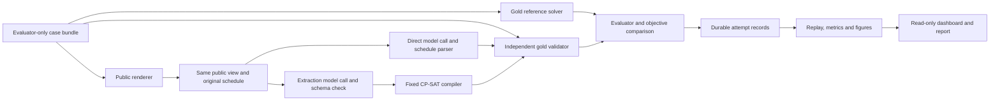

# Development and submission plan

## 1. Authority, current status and delivery target

This is the active plan for Group 23's **Direct LLM versus LLM-to-CP-SAT dynamic scheduling study**. The core implementation, both full development comparisons, offline replay and result figures are complete. The current deliverable is a reviewed report and reproducible repository based on that evidence. Do not restart delivered components from historical member plans.

The user requested final repository publication and a report based on the completed runs on 2 October 2026. The report therefore presents an **exploratory study** using these existing inputs. This is an explicit change of delivery focus from the earlier proposed fresh frozen study, not a claim that development inputs became held out. The earlier detailed plan is preserved in [development-plan-history.md](docs/development-plan-history.md). A further frozen study is conditional on teaching-team feedback or a separately agreed scientific need.

| Authority | Requirement or decision |
| --- | --- |
| Course | Course-related formal problem; direct/model-to-tool comparison; evidence and analysis; responsible AI; actual contributions and AI disclosure; prescribed report/presentation format |
| Proposal | Schedule generation and minimum-disruption repair; controlled difficulty, realistic scenarios and equivalent wording; feasibility, solution quality, extraction and resources |
| Team scientific choices | Single day, 30-minute slots, fixed assignments, lexicographic repair, paired comparison, independent gold checking, immutable evidence |
| Current report scope | Completed two-model exploratory comparison; known synthetic and AI-assisted development inputs; no held-out or production claim |
| Conditional future study | Fresh instance holdout, independently human-authored scenarios, additional models/repeats or pinned backend only with an explicit rationale and authorization |
| Routine engineering | Choose compatible helpers, paths, packaging and focused checks autonomously; do not change scientific semantics silently |

**Remaining course questions:** confirm whether the hosted Qwen aliases satisfy the handout's frontier-model wording, actual proposal submission/feedback, and any later Canvas arrangements. The handout suggests considering SoCLaaS/open weights but does not explicitly approve these aliases. Constructed or downloaded cases are permitted. No exact call count, external dataset, commercial API, third model, ablation or target accuracy is prescribed.

| Milestone | Date / evidence |
| --- | --- |
| Proposal | Course deadline 28 September 2026; actual private receipt/feedback must be confirmed |
| Repository and report preparation | Current publication; complete scientific draft, preserved evidence and repeatable checks |
| Complete reviewed draft | Internal target 30 October 2026, Week 11 |
| Presentation | Week of 9 November; 15 minutes plus five minutes Q&A, or recording if requested |
| Report | Course deadline 13 November; verify exact Canvas cutoff and upload receipt |

The earlier 18 October freeze was an internal target for the conditional fresh study. It is not a course deadline. Report format: at most **10 single-column, single-spaced body pages**, at least 11-point type, one-inch margins; title/references excluded, all substantive figures/tables included. Keep names, matriculation numbers and emails on the private submitted title page; public Git omits the private identifiers.

## 2. Research questions and supported conclusions

1. When do structural size, slack, resource sharing and constraint interactions affect direct and solver-assisted scheduling?
2. How do interpretation, hard validity, optimality and service failures contribute separately to end-to-end results?
3. How well do both methods repair the same starting schedule under the declared priorities?
4. What changes under equivalent wording, conditional on matched canonical partners?

The contribution is the integrated formulation, implementation and transparent comparison, not a new solver algorithm. Strong direct performance is informative: the report must explain it rather than introduce tasks or scoring changes to force a solver win. No grade is guaranteed by accuracy, test count or extra features.

## 3. Maintained scope

Mandatory fixed-duration non-preemptive activities use fixed participants and capacity-one resources on a single-day grid. Hard constraints cover full-window availability, release/deadline, fixed appointments, precedence and non-overlap. Generation minimizes preference penalty; repair minimizes moved activities, total shift, then preferences. Preserve the schema's exact interval and preference semantics.

Both pipelines, independent validator, gold references, bounded extraction diagnostics, explanations, dashboard, durable request accounting, failure continuation, supervised execution, frozen controls and offline replay are implemented. Multi-day scheduling, changing assignments, live calendars, RAG, training, arbitrary provider integration and automatic calendar actions are out of scope. Verifier feedback and additional optimizations remain optional follow-up studies, not missing submission features.

## 4. Collaboration and repository responsibilities

The baseline job split is complete. Members coordinate the next concrete deliverable rather than repeating their original streams. Existing branches are `lihao-llm-baseline`, `yaoxiang-formal-core` and `yongqing-evaluation`; shared integration is `main`. Do not use `codex/` for new project branches. Explicit user authorization may allow a direct main publication; otherwise use reviewed PRs.

| Concern | Coordination |
| --- | --- |
| Provider, packaging, CLI and operational run controls | Li Hao |
| Schema, compiler, repair objectives, extraction and mathematical proof boundaries | Yao Xiang |
| Benchmarks, independent evaluation, statistics and replay | Yong Qing |
| Scientific interpretation, responsible AI, report, presentation and whole-system understanding | All members; actual actions recorded individually |

These contacts do not prove authorship or completed human review. An authorized integrator may fix cross-component issues. Read [AGENTS.md](AGENTS.md), preserve existing changes and avoid simultaneous edits to shared files.

Directory roles: `src/scheduling/` contains the single package; `evaluation/` thin experiment entry points; `tests/` independent fixtures/regressions; `benchmarks/`, `configs/`, `prompts/` versioned inputs; `results/` summaries/figures/approved archives; `docs/` scientific report, methods, usage and handoffs; `presentation/` demo/rehearsal preparation. `runs/` and private credentials remain ignored. Historical archive paths may retain the old `report/` spelling.

## 5. Current task queue and acceptance evidence

### Delivered and preserved

- R1-R4 formal invariants, extraction contract, bounded constraint diagnostics and evidence-bound explanations.
- F1 saved-failure regressions; F2 provider metadata/qualification and complete two-model development execution; F3 candidate construction and mathematical checks; F4 supervised multi-block execution; F5 scoring/replay/archive integrity.
- Two full campaigns, each 480 controlled + 24 realistic + 96 wording attempts; zero retries; preserved failures and two Qwen3.8 pauses.
- Current report narrative, grouped bar charts, claim index, compressed replay archives and private historical preservation bundle.

These are engineering/evidence completions. They do not claim human sign-off, held-out data, teaching-team approval or submission.

### Remaining delivery work

| Work | Concrete action and acceptance |
| --- | --- |
| Course-model decision | Check actual feedback or obtain teaching-team interpretation for these exact hosted models. Record genuine evidence privately. If an additional model is required, plan only that justified extension |
| Human problem/metric review | Review request/gold meaning, reference assumptions, all cited failure mechanisms, objective denominators, small-cell difficulty and wording results; record reviewer/date/findings |
| Report ownership and private title | All members revise/understand [submission-report.md](docs/submission-report.md), confirm actual contributions, add identifiers only to the private copy, and rebuild/recheck the final PDF |
| Presentation and Q&A | Produce the actual deck/recording, explain both pipelines and the strong-model ceiling, demonstrate generation/repair, rehearse 15+5 minutes |
| Independent handoff | A teammate verifies checked-in archive hashes and replays in a clean compatible environment; automated replay is already delivered but does not supply that human action |
| Submission | Check course feedback/cutoffs, final files, private title data and upload; retain actual receipts |

Prioritize analysis and delivery. Fix a demonstrated correctness defect if review finds one; assess its effect on prior results and preserve the original evidence. Do not add features or commission another full run merely because some administrative/human gates remain open.

### Agent execution from a short prompt

Inspect current Git state and these documents, select the agreed task above, then implement and verify its concrete deliverable. Ask focused questions only for unresolved identity/workspace, conflicting requirements, scientific scope, credentials availability, live budget or publication authority. Routine engineering choices are autonomous. A request to write code does not authorize inference or publication. Human approvals and contributions must come from actual human actions.

## 6. System architecture and contract

This section describes the implemented version-1 contract. Human team review/sign-off is still pending; schema v1 is distinct from the project checkpoint number. Source types in `schema.py` and the shipped prompts concretize the wire fields. Reconcile this description, callers, tests and prompts together if review changes the contract.

### System architecture and data flow

Keep one installable Python package, one CLI and one shared provider interface. The current implementation has one SoCLaaS adapter; a new provider adapter is conditional on an explicit future study decision. Local computation is CPU-only; only the provider sends model requests. The dashboard reads saved records and adds no alternate execution path. Gold access is an explicit evaluation boundary, not a distinction inferred from file names.



| Boundary | Existing implementation | Design rule / next extension |
| --- | --- | --- |
| Formal data | `schema.py`, `objectives.py` | One typed schema and deterministic wire serialization; shared semantics are reviewed/versioned, not copied into each pipeline |
| Provider | `providers/types.py`, `soclaas.py`, `tls.py` | Credentials stay local; explicit timeouts/caps and per-attempt usage/errors; both paths inject the same adapter |
| Direct path | `pipelines/direct.py`, `prompts/direct/` | One call, strict public schedule parsing, no solver or gold repair of A's answer |
| Solver path | `pipelines/solver_augmented.py`, `solver.py`, `prompts/extraction/` | One extraction, validated schema, fixed compiler and bounded lexicographic solving; preserve extracted input and native solver outcomes |
| Independent correctness | `validation.py`, `extraction_diagnostics.py`, `evaluation/scoring.py` | Recompute gold feasibility/objectives independently; compare extraction separately and retain conditional objective denominators |
| Data and experiment control | `evaluation/benchmark.py`, `cases.py`, `manifests.py`, `runner.py` | Render equal public information, protect source-family splits, preflight references, reserve calls durably; preserve compatible frozen-study controls |
| Analysis and presentation | `evaluation/metrics.py`, `figures.py`, `dashboard/` | Consume saved evidence; no model calls from dashboard/replay and no second metric definition in the UI |

Paths in this table are relative to `src/scheduling/` except `prompts/`. The gold validator can check final outputs regardless of whether B's extracted specification is faithful; these are separate measurements. Gold reference solver success is infrastructure evidence, not a third natural-language competitor. For UNSAT, compare the prediction with the independently established gold label; a timeout remains unresolved.

### Run lifecycle and stored evidence

The implemented development path is: load/validate cases and config → check references and estimate requests → establish immutable run contract → reserve each attempt → call A or B → save output → independently score → persist completion → export/replay. Reservation precedes the external request so a crash cannot silently erase possible spending. A saved failure is a completed observation; a pending/uncertain reservation needs explicit reconciliation, not automatic reissue. Fatal authentication, TLS, quota and identity failures stop while retaining completed work; the selected development policy records eligible transient transport/service failures and continues with the next distinct attempt. An exclusive lock prevents overlapping writes; a stale lock alone does not prove an active process.

A run stores `manifest.json`, `cases.json`, `references/` and `attempts/` under an ignored run directory. The manifest identifies cases, prompts, model/solver configuration, source and runtime; reference and attempt records carry their checksums and statuses. Offline replay verifies stored records and recomputes validation/metrics from saved pipeline outputs and references without calling the provider or rerunning CP-SAT. It demonstrates reproducibility of recorded evidence, not identical future live answers. Both completed full-run reproduction archives are now included in results/archives/; fuller operational and historical records are preserved in the private checksummed bundle. See docs/evidence.md for exact coverage and replay.

The implemented frozen mode adds protocol and eligibility/cap decision references to this lifecycle. Section 5 specifies remaining preparation and analysis work; it does not require a database, web service, generic agent framework or new scheduler. Keep the current serial execution until measured runtime/rate-limit evidence justifies bounded parallelism.

### Gold problem and natural-language view

`ProblemSpec`: `schema_version`, `instance_id`, `task_type` (`generation` or `repair`), `horizon_slots`, `slot_minutes` (30), participant records, resource records, activities, and constraints. Each participant/resource has a unique ID and explicit availability windows; capacity is one in v1. Activity records contain unique stable IDs, positive integer `duration_slots`, participant/resource IDs, and an explicit list of zero or more availability windows. Constraints/preferences have stable IDs and typed operands; unknown types and dangling IDs are errors.

- Store `horizon_start` and `timezone` explicitly; slot zero is that start, with `0 <= start < end <= horizon_slots`. No implicit current date/timezone. Initial scenarios use a single fixed-offset day.
- Activity, participant, and resource IDs are visible labels in every language rendering. Extracted constraints use their own IDs; hidden gold constraint IDs are never required for a correct extraction. Match constraints by normalized type, operands, and values.
- Intervals are half-open `[start,end)`. Adjacent activities are permitted.
- An activity must fit completely within one allowed window for the activity and for each required participant/resource, not span gaps. Explicit full-horizon availability means unrestricted; an empty list means unavailable.
- A blocked interval identifies its target kind (`participant` or `resource`), target ID, and half-open endpoints. Its effect applies to every activity using that entity. No unstated availability defaults.
- Mandatory activity IDs must occur exactly once in a schedule. Missing, duplicate, and invented activities are invalid.
- Release times, deadlines, fixed starts, precedence, and blocked intervals have explicit semantics. No inferred travel/rest constraints unless stated.
- Resources and participants cannot be double-booked. Multiple required participants must all be available for the full interval.
- A preferred start window uses explicit inclusive lower/exclusive upper start bounds and an integer penalty weight. Generation minimizes the sum of violated-preference weights.
- A repair benchmark case retains `original_problem`, `original_schedule`, `event`, and `updated_problem` separately. The original schedule must pass validation against the original problem; it may violate the updated problem. Evaluate all repaired schedules against the updated problem. Both systems receive the same original schedule and the complete updated natural-language description; the evaluator keeps both gold specifications private.
- Reject malformed types, endpoints, and references as schema errors. Preserve well-formed contradictions (such as a deadline earlier than the release time, or insufficient available time) as scheduling instances whose feasibility must be solved, not filtered away as invalid data.

`NaturalLanguageView` contains the user-visible text, variant ID, base-instance ID, and, for repair, the common original schedule. Evaluated pipelines receive this view and the public output/schema instructions. They do not receive gold constraints, oracle solutions, hidden labels, or expected objective values.

Authored prose is an opt-in case-bundle **2.0** extension (`AuthoredBenchmarkCase`), separate from canonical `ProblemSpec` schema 1.0. It carries exact variant text plus evaluator-only provenance/review records. Bundle 1.0 remains supported with unchanged legacy hashes. Runner, replay, dashboard and explanation consumers use the same version-aware loader. Missing requested authored variants fail preflight; no template fallback or fabricated review is permitted.

### Output and outcomes

`Schedule`: a list of activity IDs and integer start slots. End times are computed from fixed durations. Claimed textual times must be normalized without guessing or rounding invalid inputs.

`PipelineResult`: `instance_id`, `variant_id`, `approach`, `status`, optional schedule, optional extracted specification, diagnostics, timings, and usage. Pipeline status is one of `SAT`, `UNSAT`, `UNKNOWN`, `INVALID_OUTPUT`, or `ERROR`. A SAT claim requires a complete schedule; an UNSAT claim from a direct LLM is a prediction, not a proof.

Record the model's declared status separately from parsing/execution status and final gold validation; a parseable SAT claim is not an accepted solution. Preserve the underlying solver status separately: `OPTIMAL`, `FEASIBLE`, `INFEASIBLE`, `UNKNOWN`, or `MODEL_INVALID`. Also store objective value, best bound where available, time limit, elapsed time, and whether each lexicographic stage was proven optimal. Never report a feasible incumbent as a proven optimum, or a timeout as UNSAT.

`ValidationResult`: structural validity, hard-feasible flag, violations with constraint IDs, objective components recomputed from gold, and repair distance. The validator consumes a schedule and gold specification; it must not call CP-SAT or reuse the solver's constraint-building implementation.

### Implemented Python interfaces

```python
solve(spec, limits, repair_context=None) -> SolveResult
validate_schedule(gold_spec, schedule, repair_context=None) -> ValidationResult
run_direct(nl_view, model_config, *, provider_complete=None) -> PipelineResult
run_solver_augmented(nl_view, model_config, solver_limits, *, provider_complete=complete) -> PipelineResult
evaluate(case, pipeline_result, gold_reference, *, repeat=0) -> dict
```

These entry points live in `solver.py`, `validation.py`, `pipelines/` and `evaluation/scoring.py` under `src/scheduling/`. The evaluator currently returns a JSON-serializable mapping; there is no separate `EvaluationRecord` class. Inject the shared provider or canned callable through the pipeline keyword argument.

`RepairContext` contains the common original schedule, including stable activity IDs and start slots. It is required for a repair task and absent for generation; missing repair context is an explicit error. Both the solver and validator use it to compute moved count and total shift. The evaluator first checks the original schedule against `original_problem`, then checks repairs against `updated_problem` with this context. The solver-augmented path builds the same context from the public original schedule; it must not receive the original or updated gold specification.

Li Hao provides the implemented typed `complete(messages, model_config) -> ModelResponse` interface with content, returned model, timing, usage, and sanitized error fields. Both pipelines use this adapter. Review it alongside the shared schema; injected canned responses support offline development without live access.

Use explicit typed models and deterministic serialization. Validate generated JSON before compilation. Do not execute model-generated code. Schema-valid JSON is not proof of semantic correctness.

## 7. Formalization, solver design and reasoning-core improvements

### Course fit and implemented technical contribution

The teaching team's *Project Topic* and *Project Evaluation Guidelines* ask for an explicit course-related mathematical formulation, correct implementation, technical depth, and analysis of why direct reasoning or tool use succeeds or fails. They do not require inventing a new general-purpose solver. The proposal selects a scheduling CSP/COP and minimum-disruption repair. The technical contribution is a **faithful, inspectable and mathematically justified translation-and-solving system**, with evidence explaining where its guarantees begin and end.

Retain the two core paths and fixed v1 domain. R1–R4 are implemented; the specification below defines their behavior and ongoing acceptance criteria. These are team engineering/research choices, not extra grading requirements. Human review remains distinct from technical verification. The optional preprocessing/search refinements below are conditional alternatives, not unfinished core work.

### Explicit CSP/COP formulation

Let `I` be the mandatory activities, `H <= 48` the number of 30-minute slots, `d_i > 0` the fixed duration, and `s_i` the integer start variable. End time is `e_i = s_i + d_i`. Let `D_i` contain every start in `{0,...,H-d_i}` satisfying all unary requirements: full containment in an allowed activity window and in an allowed window for every assigned participant/resource; release, deadline and fixed-start conditions; and avoidance of applicable blocked intervals. Empty `D_i` is a well-formed contradiction, not malformed JSON.

The finite-domain **CSP** is `(variables {s_i}, domains {D_i}, hard constraints C)`. Feasibility asks whether a complete assignment exists. The **COP** adds the preference or repair objective below. A schedule cannot omit an activity to make an infeasible problem appear feasible.

| Requirement | Mathematical meaning | Existing CP-SAT representation |
| --- | --- | --- |
| Unary availability/time bounds | `s_i in D_i`; each full interval `[s_i,e_i)` fits one window in each applicable window list | `legal_starts` and `new_int_var_from_domain` |
| Precedence `i -> j` | `s_i + d_i <= s_j` | Linear inequality |
| Shared participant/resource | For each conflicting pair, `e_i <= s_j OR e_j <= s_i` | One fixed-duration interval per activity and a `NoOverlap` constraint for each entity |
| Release / deadline / fixed start | `s_i >= r_i`, `e_i <= deadline_i`, `s_i = f_i` | Incorporated into legal domains |
| Preferred start `k` | Penalty `w_k` if `s_activity(k)` is outside `[lower_k,upper_k)` | Boolean violation linked to the start by an allowed-assignment table |
| Repair change indicators | `m_i = 1` exactly when `s_i != old_s_i`; `t_i = abs(s_i-old_s_i)` | Reified equalities/inequalities and `add_abs_equality` |

Define `P(s) = sum_k w_k * 1[s_activity(k) outside preferred_window_k]`. Generation minimizes `P(s)` subject to all hard constraints. This is a weighted **violation count**, not distance from a preferred time. Each preference contributes separately, including intentional repeated preferences/weights; normalization must not silently change this objective.

For repair, use the common original schedule `old_s` and minimize the tuple lexicographically:

```text
M(s) = sum_i 1[s_i != old_s_i]          # number of moved activities
T(s) = sum_i abs(s_i - old_s_i)         # total shift in slots; minutes = 30*T
objective(s) = (M(s), T(s), P(s))
```

Thus `(1,10,5)` is better than `(2,2,0)`: avoiding a second moved activity has priority over smaller total shift or better preferences. This priority is a declared user-impact choice. It is not an intrinsic definition of the best schedule. Never turn hard constraints into penalties, use unspecified large weights, or switch to makespan minimization just because a job-shop example does so.

**Exact sequential algorithm, already implemented:** minimize `M`; only after proof of its optimum `M*`, add `M=M*` and minimize `T`; only after proof of `T*`, add `T=T*` and minimize `P`. Generation needs only the preference stage. Give the entire repair solve one wall-time budget and pass the remaining time to each stage. If proof is incomplete, retain a feasible incumbent, stop claiming full lexicographic optimality, and preserve the stage objective, bound and native status. A later timeout must not erase an earlier valid solution. Prior-stage solution hints are already implemented.

For exact stages/references use integer coefficients, `absolute_gap_limit=0` and `relative_gap_limit=0`, as the current solver does. The [pinned v9.14 parameter definitions](https://github.com/google/or-tools/blob/v9.14/ortools/sat/sat_parameters.proto) explain stopping limits; a nonzero gap setting changes what a reported `OPTIMAL` status establishes. Retain the existing numeric-range checks and never round a floating bound into an unsupported exact proof. Compare secondary gaps only when all preceding objective components match their proven optima. Raw component values remain reportable without such a match.

The unpruned assignment space is `product_i |D_i|`; it is an upper bound on combinations, not CP-SAT's observed search count. Explain how precedence and shared entities couple those choices. CP-SAT combines SAT/constraint reasoning and linear techniques, as described by its [developers](https://drops.dagstuhl.de/entities/document/10.4230/LIPIcs.CP.2023.3). Keep interval/global constraints and the pinned default search as the starting point. Implementing another general backtracking, SAT or MILP solver is unnecessary; independent tiny enumeration supplies a comprehensible correctness check.

### Implemented core and acceptance criteria

The integrated `solver.py` compiles finite legal domains, global non-overlap, precedence, preferences and the three repair stages. `objectives.py` computes the tuple, while `validation.py` checks schedules independently. Existing tests exercise tiny exhaustive optima, boundaries and timeout/incumbent handling. These features are delivered and should be preserved.

The [expanded study](docs/expanded-development-100.md) reports **4.69 ms mean solver time over 99 B solves**, compared with **10.12 s mean model-response time over 100 B calls**. The malformed response never reached CP-SAT. These conditional measurements cover 3–12 activities and 48 slots; they are not a large-instance scaling benchmark. A faster CP-SAT run cannot repair an omitted constraint or malformed specification. Prioritize formal correctness and extraction reliability; claim a runtime improvement only after measuring it.

| Component | Owner / integration partner | Implemented capability | Acceptance evidence |
| --- | --- | --- | --- |
| **R1 — repair correctness** | Yao Xiang; Yong Qing independently reviews | Enforce stable repair time frame, activity durations and assignments at the shared boundary; broaden mathematical checks | Reject unsupported changes; accepted v1 events preserve meaning; tiny solver/validator/enumerator agreement |
| **R2 — reliable formalization** | Yao Xiang for schema/prompt/diffs; Li Hao for prompt packaging; Yong Qing for scoring consumers | Executable extraction examples, precise schema errors, and typed semantic-review differences | Extra-field errors remain failures with exact paths; examples parse; altered/omitted requirements are inspectable without gold feedback |
| **R3 — constraint reasoning** | Yao Xiang; Yong Qing checks reasoning independently | Small domain-analysis record with actual rule provenance and supported contradiction explanations | No feasible schedules lost; empty-domain reasons are checkable; compiled-model UNSAT remains distinct from source-request correctness |
| **R4 — evidence-based output** | Li Hao for shared formatting/CLI; Yao Xiang for proof semantics; Yong Qing for evaluation labels | Deterministic before/after, objective and proof-status explanations from saved records | No extra LLM call; timeout/extraction/gold distinctions survive; works on existing recorded outputs |

R1–R4 are integrated through shared records and consumers. Maintain their regressions and coordinate serialization changes, preserving old archives. R3 intentionally covers named unary exclusions and simple proven contradictions; a general minimal-conflict service remains optional.

### R1 — repair invariants and mathematical qualification

The integrated baseline audit found that `RepairCase.__post_init__` checked types and activity-ID coverage but permitted changes to time origin, horizon length, duration and assignments. R1 now rejects those changes and is included in main at `bc165bc`; human review remains pending. The shared boundary and evaluator both protect the time frame. This closes the earlier v1 contract gap without changing the research task. The reviewed development cases keep the intended time frame, durations and assignments; this finding does not invalidate their recorded acceptance counts.

Compare original/updated `horizon_start`, timezone, slot length and horizon length, and compare each retained activity's duration, participant IDs and resource IDs by stable ID. Order alone is irrelevant. Keep activity presence fixed. Accept the supported availability/deadline/fixed-commitment disruptions; reject changing an activity's meaning under the same ID. A future task-duration, assignment, new/cancelled-activity or time-resolution feature requires a new explicit repair contract. Original-schedule feasibility remains independently checked against the original specification.

Do not give B an evaluator-only original specification to enforce this boundary. Its solver receives the extracted updated specification and the public original schedule. Shared-case validation protects supplied benchmark/application pairs; extraction fidelity against the public request is still a separate issue. The common public description must state the time frame and immutable activity facts clearly, and both approaches receive the same information.

Extend the existing tiny enumerator cases to three/four activities with unequal durations, multiple participants, asymmetric resource sharing, gapped domains and competing preferences. Compare the feasible set or proven objective tuple, not the exact schedule when ties exist. Include movement-versus-shift disagreement, preference tie-breaking, no-op repair, contradictory complete requests, and existing timeout/incumbent regressions. Keep the enumerator/validator independent of compiler helpers.

**Worked repair counterexample:** three one-slot activities share resource R over slots `[0,3)`. Original starts are A0/B1/C2; legal starts before disruption are A `{0,1}`, B `{1,2}`, C `{0,1,2}`. A new participant block removes A's start 0. The only repaired schedule is A1/B2/C0, with `(M,T,P)=(3,4,0)` when there are no preferences. B and C must move although their own unary windows did not change. Freezing an apparently unaffected activity can wrongly make a feasible repair appear impossible. This independently enumerable example is covered by the formal qualification regressions; preserve it when changing repair or search behavior.

Document the original-schedule policy: initially a saved feasible schedule from the pinned gold-solver configuration, supplied identically to both approaches. Discuss its influence on repair patterns. [Minimal-perturbation research](https://www.unitime.org/papers/ercimprelimin03.pdf) grounds the idea of minimizing departure from a prior assignment; our fixed activity set and three-component objective are a narrower team choice, not a new general repair theory.

### R2 — make extraction an explicit, inspectable contract

In `schema.py`, `prompts/extraction/specification.txt` and `pipelines/solver_augmented.py`, maintain one canonical accepted format. Maintain the complete minimal valid `ProblemSpec` example and compact exact-field reference checked against the parser. Keep it separate from few-shot benchmark solutions and verify that examples do not accidentally add activities or constraints to a request. State explicitly that unit capacity is implicit and there is **no `capacity` field**. The five saved extra-field failures motivate this change; they do not prove a prompt revision will improve accuracy.

Give schema failures safe structured detail: error code, JSON path, missing/unsupported field names, and a concise message, while retaining the raw response in its existing protected record. An extra `participants[0].capacity` should remain `INVALID_OUTPUT`, with an actionable location; do not drop it silently. Keep duplicate-key, invalid-number, unknown-type and dangling-reference rejection. If a formal JSON Schema artifact is introduced, derive/check it against the canonical parser and distinguish structural checks from semantic constraints. Do not depend on provider-enforced structured decoding unless SoCLaaS support is verified; adding that feature would need a recorded new inference configuration.

Maintain the implemented `compare_specifications` typed details beyond top-level labels and omitted/invented totals. Report changes by entity/activity ID and field, with unmatched typed constraint records and multiplicity. Examples: duration A `2 -> 1`, a missing participant P, reversed precedence, or deadline A `4 -> 5`. Pair an alteration only when correspondence is unambiguous; otherwise retain unmatched records. Rename/order differences that do not change meaning may normalize away. Availability windows must not be merged blindly: under whole-window containment, two adjacent windows `[0,2)` and `[2,4)` do not admit a three-slot activity, while the merged window `[0,4)` does.

Keep structural comparison separate from semantic equivalence. For tiny cases with the same time frame and immutable activity facts, an evaluator-only exhaustive comparison may establish equality of feasible start assignments and objective values over that finite horizon. This is an instance-specific mathematical equivalence, not proof of general natural-language understanding. A counterexample demonstrates a difference; failure to find one within a limited search does not prove equivalence. Larger/alternative encodings remain subject to human semantic review. Gold differences never feed corrections into the core extraction call. This addresses the formalization boundary highlighted by [ACL 2025 research](https://aclanthology.org/2025.acl-long.242/) without assuming syntactically valid JSON captures the user's meaning.

### R3 — explainable domains and sound preprocessing

The implemented `domain_analysis.py` provides legal domains and bounded reason records. Maintain this shared analysis with the compiler; extend it only for a demonstrated diagnostic need. Each rejected start can cite an explicit constraint ID or a stable specification path for activity/entity availability. Group identical reasons for display. Index entities and relevant constraints once per solve if useful; with at most 48 slots, straightforward enumeration remains appropriate. Keep this helper out of the independent validator.

Unary domain wipeout can then explain, for example, that a task needs two slots but no start survives its deadline and participant availability. A directed precedence cycle with positive durations is another checkable contradiction: summing the inequalities would require a start time to be strictly later than itself. Report the actual rule chain. These are **sufficient contradictions**, not necessarily smallest explanations. Do not convert failure to derive a simple explanation into a claim that the problem is feasible.

Optional precedence-domain filtering may use this sound rule for `i -> j`, while both domains are nonempty:

```text
D_i <- {s in D_i : s + d_i <= max(D_j)}
if D_i is empty: stop with a contradiction
D_j <- {t in D_j : t >= min(D_i) + d_i}
if D_j is empty: stop with a contradiction
repeat affected arcs until no domain changes
```

Each removed value lacks support on that precedence relation. Preserve holes in domains and retain all original precedence/NoOverlap constraints in CP-SAT. The prepass need not solve resource conflicts; nonempty domains are not a SAT proof. Verify that preprocessing preserves every feasible tiny schedule and therefore the exact objective optimum. If this optional helper is implemented, independently enumerate tiny chain/domain/duration combinations, including empty support and boundary cases. Such checks support the argument but do not establish correctness on every possible instance; retain the support argument and consumer regressions in implementation review.

CP-SAT already propagates constraints internally. The main reason for an explicit prepass is interpretable reasoning and inspectable domains; keep pruning optional until its extra complexity and runtime are justified. If analysis finds a contradiction, either compile an explicit false condition and obtain the actual backend outcome as today, or introduce a distinctly labelled analytical proof record. Never fabricate a native CP-SAT status for a solve that did not occur.

**Optional general conflict diagnostic, after R1–R4:** if simple reasons are insufficient and a report example warrants it, a small offline deletion-based check may rebuild a feasibility-only model while removing named requirement groups. Begin only after the complete feasibility model is proven INFEASIBLE; an initial UNKNOWN cannot establish a conflicting set. Keep immutable background facts explicit. Removing a requirement must relax it: removing an availability requirement means allowing the full horizon, not deleting an allowed window and accidentally narrowing availability. Remove a group permanently only when the remaining model is proven infeasible; preserve it on UNKNOWN. Bound checks and total time, and label an interrupted result merely a sufficient conflicting set. A deletion-minimal set is not necessarily minimum-cardinality. This analysis is separate from ordinary replay, which does not rerun CP-SAT, and from primary measured inference.

Do not obtain misleading explanations by blindly attaching assumptions to every compiled constraint. Unary requirements are currently baked into domains, and installed OR-Tools 9.14 rejects direct enforcement of `NoOverlap`. Its [assumption-core contract](https://github.com/google/or-tools/blob/v9.14/ortools/sat/cp_model.proto) also does not guarantee a minimum conflict and limits core reduction for optimization/multi-worker runs. An assumption-based diagnostic would require a separately validated encoding that exposes all relevant requirements; it is unnecessary for the small initial explanation scope.

### R4 — explanations tied to actual evidence

Implemented by Li Hao and merged through PR #4 (`61d9fbb`, 29 September): shared `explanations.py` and the read-only `scheduling explain` CLI consume current and saved results. The original formatter made no schema, prompt or solver changes. Formal semantic/evaluation sign-off remains pending; the integrated Yao Xiang extension adds compatible recorded R3 reasons. See [Li Hao follow-up](docs/lihao-development-followup.md) for tests, measured failures and the participant-burden example. The behavior requirements below remain the review criteria.

The shared formatter consumes `ProblemSpec`, `SolveResult`, `OptimizationStage`, repair context and validation records through the CLI and read-only case view. A formatter does not solve, call a model, change the schedule or invent a proof. Keep gold/extraction comparisons evaluator-only and visibly separate from what B itself knows.

For a feasible repair, show before/after clock times, moved activity IDs, `(M,T,P)`, and the proof status/bound of each attempted stage. For a timeout after proving movement only, say that minimum moved count is established but minimum shift is not. Explain preference penalties using the actual windows/weights. For infeasibility, distinguish a proven contradiction in the **extracted specification** from a correct infeasibility judgment about the original request; show a supported reason if available and otherwise state that a detailed conflict was not derived. Parsing failure, solver UNKNOWN and gold-invalid output each retain their own explanation.

Connect this to the responsible-AI objective-choice discussion: for each participant p, compute moved-event count and `30 * sum(abs(s_i-old_s_i))` over that participant's activities. These describe participant inconvenience under fixed assignments, not fair workload allocation. Shared events contribute to each affected participant, so participant totals need not equal the activity-level objective. Use one existing realistic/development case to show how minimizing moved activities can distribute inconvenience unevenly. Changing the primary objective to participant weights, minimax burden or soft hard-constraint relaxation would be a separate agreed experiment, not an implementation fix.

New `SolveResult` records carry a versioned exact specification/repair-context binding. Verify it before attributing optimality, infeasibility or domain reasons to supplied standalone files. A matching hash establishes input correspondence, not authenticity of arbitrary evidence. Legacy unbound standalone results may validate a candidate but must withhold proof correspondence; historical run explanations use their checked case/record context. Never replace raw records to manufacture a binding.

### Conditional solver optimizations and boundaries

The following are optional candidates for a separately authorized follow-up; existing evidence does not make them a current priority. Make one change at a time, use the same difficult development specifications and total budget, and retain it only when the evidence or explanatory value justifies the maintenance cost.

| Candidate | Implementation direction | Correctness/performance boundary |
| --- | --- | --- |
| Initial repair hints | Before the first stage, suggest public original starts still in their legal domains. Keep existing later-stage hints | [v9.14 hints](https://github.com/google/or-tools/blob/v9.14/ortools/sat/docs/model.md#solution-hinting) guide search and do not constrain it. Never hard-fix unaffected tasks or import gold starts. Bounded-run incumbents may change even though exact optima do not |
| Compact preference encoding | Keep the present allowed-assignment tables initially. If model construction becomes significant, compare a correctly reified inside/outside-window encoding | Both directions of each Boolean equivalence must hold. Check every legal start and preference penalty; reducing variables alone is not evidence of faster solving |
| Skip a provably constant stage | Reuse a feasible incumbent when the remaining objective is demonstrably constant, e.g. absent preferences | Record analytical constancy separately from solver `OPTIMAL`; update proof consumers/versioning. Do not skip feasibility search when no incumbent exists. Retain three stages if the bookkeeping costs more than it saves |
| Component solving | Only consider it if profiling finds useful disconnected groups in the full precedence/shared-entity interaction graph, with separable objectives | A disruption's local neighborhood is not necessarily an independent component. Prove decomposition and maintain one total budget and global proof accounting before implementation; unnecessary for current tiny solves |

Instrument only what resolves a performance question: compilation time, per-stage elapsed time/status/bounds and, where available, branches/conflicts and time to first incumbent. Compare medians/tails and proof completion on offline cases, retaining all failures. Keep the primary CPU/worker/seed configuration stable; additional workers, hand-chosen branching or large-neighborhood search are not automatic upgrades. Do not promise deterministic elapsed time or identical tied schedules across machines. A change after the evaluation freeze needs a new configuration and assessment of affected results.

Source-grounding spans and explicit ambiguity abstention may be useful later interface variants: a single response could cite public text for extracted fields, or return unresolved required facts without solving. A quotation's presence is not proof of its interpretation. Such output changes need their own schema/prompt version, compatible parsing and token-budget qualification. Complete contradictions must still be formalized and solved; incomplete information must not be invented. Keep these variants in the bounded responsible-AI/diagnostic work unless the team deliberately adds a separate research arm. Multi-call correction, different objectives, new constraint families and new solvers are separate scope decisions.

### Core completion and ongoing verification

R1–R4 have reviewable implementation and evidence. Qualification requires the worked boundary/repair cases and broader tiny enumeration to pass, with explanations accurately distinguishing syntax, interpretation, feasibility and optimality. Human sign-off remains open. No-op and coupled repair work; UNKNOWN remains distinct from UNSAT; malformed extraction cannot become a silently corrected success. Optional optimizations may be declined with a measured or complexity-based reason.

The report should then explain three technical insights using this implementation: **how domains/global constraints reduce the scheduling search; why minimum-disruption repair can propagate beyond the changed activity; and why solver proof does not guarantee faithful language interpretation.** These connect the project's core to the course's formulation, technical-depth, analysis and responsible-AI criteria without requiring a broader product or a new optimization algorithm.

## 8. Dataset, metrics and final report evidence

### Actual data used

| Block, per model | Source and pairing | Attempts |
| --- | --- | ---: |
| Controlled | 240 canonical cases / 120 source families; 120 generation and 120 repair; each task 60 SAT / 60 UNSAT | 480 |
| Realistic | Twelve AI-assisted fictional scenarios, canonical prose, three cases per joint task/label stratum | 24 |
| Additional wording | 24 selected controlled bases from distinct families; paraphrase and reordered versions; matched to their canonical partners | 96 |

The two models used identical input bytes and request-prompt hashes. Four controlled sweeps cover activity count, slack, resource contention and interaction density at three levels. All are known development cases. No public benchmark or real calendar was imported. Historical v1/v2/v3 pilots, the 200-call comparison and inspected candidate structures remain development evidence. See [data preparation](docs/final-data-preparation.md) and the source-family exclusion registry for future draws.

### Metrics and reporting contract

- Primary acceptance: gold-valid SAT schedule or correct UNSAT answer over all labelled attempts. Preserve every provider/parser/solver failure in the denominator.
- SAT validity and UNSAT accuracy: separate task/label denominators. Direct UNSAT is a prediction; solver infeasibility proves only the compiled problem.
- Optimization: compare proven reference objectives only on valid SAT schedules; secondary repair gaps require equality on earlier components. Also report how many attempts reached that conditional subset.
- Extraction: parsing, structural equality, bounded semantic evidence and end-to-end gold validity are distinct. Structural mismatch alone does not establish semantic error.
- Resources: request/model/solver time, reported tokens and missing coverage; no invented zero usage or monetary cost. CP-SAT times are conditional on actual solver execution.
- Pair A/B on case, rendering and repeat. Canonical controlled, realistic and wording rates stay separate. Wording reuses base problems, so the 1,200 attempts are not 1,200 independent cases.
- Existing controlled paired intervals use family bootstrap, 10,000 resamples, seed 3263, within each task/model. Do not interpret a ceiling or degenerate interval as equivalence/perfection.
- Difficulty cells with five SAT cases are descriptive. Domain-product size is a bound on naive combinations, not measured CP-SAT search nodes. Preserve nonmonotonic results and avoid cherry-picked thresholds.

### Verified findings and scope

Qwen3.6 controlled acceptance is A 95/240 and B 229/240; realistic 6/12 and 12/12; wording 8/48 and 47/48. Qwen3.8 is 239/240 and 240/240; 11/12 each; and 46/48 and 44/48 respectively. Its nine rejected attempts are all operational failures. On controlled valid repairs, Qwen3.8 A matches the optimum on 59/60 and B on 60/60. Explain model-dependent usefulness, interpretation failure, optimality and cost rather than claiming universal solver superiority.

The [report](docs/submission-report.md), [audit](docs/two-model-development-audit.md), [claim index](docs/claim-evidence.md), [portable summary](results/summary/two-model-development-20261002.json) and [figure data](results/figures/two-model-development-20261002/figure-data.json) identify exact values and limitations. Do not mix old and current settings or update immutable result files to reflect later documentation status.

### Conditional future evaluation

If a further study is required, define the question and model eligibility first. Freeze the construction policy, prompts, metrics and explicit budget before new outcomes; use fresh structural families excluded from every inspected/rejected development structure. Review prose/gold semantics and keep related renderings in one split. Use implemented frozen controls and compatible separate blocks. Additional repeats require their explicit repeat mapping and tests; they are not already supported by assuming a larger loop. Do not rename current inputs as fresh or reuse consumed allowances. The historical detailed plan supplies candidate policies and optional experiments, not current obligations.

## 9. Provider, execution and resource contract

Only the approved NUS SoCLaaS adapter is implemented. The reported model IDs are `qwen3.6:35b` and `qwen3.8:27b`; their hosted weights and unexposed inference defaults are not independently known. Both complete runs used revision-3 prompts, 32,768 requested output tokens per completion, 30-second connect and 1,800-second read/write/pool limits, no retries, one worker and solver seed 0. B uses 30 seconds; references use 60 seconds. HTTPX read timeout concerns waiting for response chunks, not a guaranteed whole-request wall limit.

Each consumed campaign allowance covered 603 HTTP requests: one metadata request, two capability completions and 600 scheduling completions. The 19,726,336 reserved output tokens are not actual consumption, an input-inclusive cap or a currency budget. Reported totals including capabilities are 1,773,823 tokens with 602/602 coverage for Qwen3.6 and 3,994,657 with 593/602 for Qwen3.8.

The authorized development policy `strict_model_observe_backend_v1` requires the exact model while recording backend variation. Qwen3.6 returned three fingerprints; Qwen3.8 one. `continue_transient_v1` retains timeout/transport/HTTP 408/500/502/503/504 failures and cools down before the next distinct attempt. It never retries failed attempts. Fatal authentication, permission/quota, TLS, malformed-envelope, model-identity, integrity or budget errors still stop. Frozen mode retains the strict backend rule. Preserve every prior policy under its original run identity.

Run long campaigns through an independent one-shot service with automatic restart disabled. Check heartbeat, worker state, real OS lock ownership and exit receipts. A stale lock file alone does not prove a live run. An uncertain request reservation cannot be reissued without reconciliation. App independence does not prevent Mac sleep, logout or reboot. The completed Qwen3.8 run has two verified safe pauses; elapsed wall and monotonic clocks include different effects and cannot be labelled pure inference time. See [operations](docs/usage.md) and [recovery evidence](docs/benchmark-process-recovery.md).

Keys stay in ignored `.env` or a secret source, never in chat/code/archives. TLS validation remains enabled. No further live model request is authorized by this publication or these examples.

## 10. Verification and readiness gates

| Gate | Current status | Remaining evidence |
| --- | --- | --- |
| Formal/implementation | Both paths, repair/diagnostics and independent validator implemented; mathematical fixtures and regression suite verified | Actual member semantic/code review and any defect-specific follow-up |
| Complete development evaluation | Both 600-attempt runs, preserved failures, fresh scoring and archive replay complete | Genuine interpretation of limitations and optional independent teammate replay |
| Reproducible repository | Source, tests, figures, summaries and verified replay archives included; historical raw evidence privately backed up | Successful publication and matching clean-checkout handoff |
| Scientific course fit | Proposal scope and constructed-data direction fit | Exact hosted-model eligibility and actual teaching feedback |
| Report/delivery | Full exploratory report and formatted PDF prepared | Member revisions/contributions/private title; final render audit; actual deck/rehearsal and submission receipt |

[Publication verification](docs/publication-verification.md) records the exact commands and results, including platform-specific TLS handling. Run targeted checks first; full suites are appropriate for shared runtime changes. Do not repeat live benchmarks or unchanged full suites for documentation edits. If a semantics-changing fix is needed, record its scientific impact before making updated performance claims.

## 11. Acceptance criteria

The report must trace every numerical claim to a saved artifact, retain all failures and metric denominators, distinguish interpretation from measured evidence, explain why direct and solver-assisted methods differ, and discuss synthetic-data assumptions and realism. Uncertainty and small samples stay visible. A strong direct result is a valid outcome.

The submission must include the course-required private title information, actual contributions and AI disclosure, member understanding, a compliant PDF and complete presentation. Only real review dates, approval evidence and upload receipts satisfy those gates. An agent cannot sign for a member or award course-model eligibility.

If teaching feedback requires an additional comparison, establish that limited follow-up explicitly, with exact provider/model, inputs, outcomes, cap and source snapshot. Existing report scope stays exploratory. Otherwise focus on completing the report and human delivery rather than reopening architecture.

## 12. Responsible AI

Analyse concrete consequences: participant inconvenience can concentrate despite low total disruption; minimizing moved count may increase total time shift; unsupported/ambiguous requirements require clarification; explanations must distinguish extracted-model proof from source correctness. Preserve user control and never silently relax hard constraints. Fictional data reduces privacy exposure but does not establish real-calendar consent or anonymity. Prompt-boundary tests are not live adversarial-robustness evidence. See report Section 7 and the genuine review/contribution records.

## 13. Risks and responses

| Risk | Response |
| --- | --- |
| Course model interpretation unresolved | Check real feedback; obtain targeted clarification before claiming eligibility |
| Gold/text mismatch or compiler bug found | Preserve original evidence, diagnose independently, record impact; new study only if claims require it |
| Strong-model ceiling | Analyse optimum quality, resources and limits; do not change scores or benchmark to manufacture a win |
| Provider/backend variation | Preserve failure coverage/fingerprints; keep shared-service interpretation and no causal speed claim |
| Private historical records lost | Verified local preservation bundle plus tracked full-run replay archives; a same-machine backup is not protection against device loss |
| Report overclaims human work | Keep assistance explicit; require actual member revisions and review records |

## 14. Git, portability and evidence preservation

Use the Python 3.12 hashed lockfile and noneditable installed checks for handoff. macOS and Linux are documented targets; this publication's current suite was executed on macOS and prior Linux receipts apply to their recorded source. Native Windows is unqualified. The runner uses POSIX file locks. CPU-only computation is local; remote model latency includes hosted service conditions.

Preserve existing work, inspect diffs, stage explicit paths and scan for secrets before publication. No force pushes, history rewrites, silent branch switches or deletion of run history. Publish only with user authorization. After publication verify the actual remote SHA and a clean source/artifact checkout, not just command exit status.

The former `report/` directory is now `docs/`. Active links and scripts use the new path; original paths inside immutable archives/receipts remain unchanged. Keep the approved byte-for-byte reproduction archives in `results/archives/` and verify them against `results/evidence-manifest.json`. Private full-run/source/capability/supervisor/pause and historical traces are preserved in the separately checksummed bundle described by [evidence.md](docs/evidence.md). Do not overwrite either original or archived results. Saved traces are recorded final outputs and metadata, not complete raw HTTP captures or hidden reasoning.

## 15. Active decisions

| Decision | State |
| --- | --- |
| Report evidence | Completed two-model exploratory comparisons; explicitly not held out |
| Major implementation | Delivered; only defect-driven maintenance needed for this report |
| Extra model/fresh holdout | Conditional future work, not automatically required by course |
| Provider eligibility | Pending exact interpretation/feedback |
| Human review/authorship | Actual actions still required; cannot infer from tests, branches or assigned roles |
| Publication | User authorized commit and push to GitHub main for this finalization |
| Further inference | Not authorized by publication; prior full-run allowances consumed |

## 16. Source grounding

The original *Project.pdf*, *CS3263-Project-Guidelines 2627.docx*, *ResponsibleAI.pptx* and Group 23 proposal govern scope and grading. They are private course inputs, not uploaded to public Git. [The source audit](docs/two-model-development-audit.md#course-proposal-and-remaining-delivery) and [submission checklist](docs/submission-checklist.md) give page/paragraph locators.

The report cites NATURAL PLAN, minimal-perturbation work, language models as planning formalizers, CP-SAT-LP and official OR-Tools statuses. These primary sources motivate design; they do not establish our scores or course rules. [The historical research plan](docs/development-plan-history.md#research-basis-for-the-recommendations) preserves the broader literature review and release-matched technical sources without making them mandatory features.

## 17. Report and presentation delivery

The canonical source is [docs/submission-report.md](docs/submission-report.md), rendered by `scripts/render_report.py` to `docs/submission-report.pdf`. The previous 200-call report is preserved as historical material. The current narrative covers abstract, motivation/questions, related work, CSP/COP and repair, architecture, provenance/protocol, acceptance/SAT/UNSAT/difficulty/optimization/extraction/wording/resources, implications, responsible AI, reproducibility, contributions and conclusion. [claim-evidence.md](docs/claim-evidence.md) connects these to artifacts.

Regenerate figures offline from the portable summary. Compact report figures use labels at least 11 pt at the final page width. Rebuild and inspect every page after substantive changes; confirm body page count, single column/spacing, text size and one-inch margins. Title and references are excluded from the ten-page body maximum. Actual final revisions may change the current count.

Produce the actual presentation using a clear problem example, formal repair objective, comparison diagram, three evaluation blocks, the model-dependent finding, one extraction failure, the quality/cost trade-off and responsible-AI limits. Rehearse the whole pipeline and questions on gold independence, generated data, backend failures and solver proof. A storyboard is preparation, not delivery. Record genuine contributions, citations, AI assistance and final submission receipts; no grade or course acceptance is inferred from repository publication.
