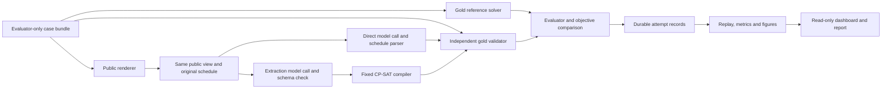

# Four-week project plan

## 1. Authority, status, and completion target

This is the working implementation and evaluation plan for Group 23's **AI Assistant for Dynamic Constraint-Aware Scheduling: Direct LLM Reasoning vs Constraint-Solver-Augmented Reasoning**. It defines scope, interfaces, responsibilities, milestones, and evaluation criteria. Design decisions remain provisional until the corresponding review gate is complete.

- Setup and contract agreement: **28 September–4 October 2026**.
- Four implementation weeks: **5–30 October 2026**.
- Completion target: **Friday 30 October 2026**, in Week 11 (26–30 October).
- Mandatory proposal deadline: **28 September 2026**; confirm the Canvas submission receipt. Its body is limited to one single-spaced, single-column page with 1-inch margins, excluding title/references.
- Course presentation: week of **9 November 2026**, normally 15 minutes plus 5 minutes of questions; a recording may be requested.
- Course final report: **13 November 2026**.
- The Week 11 target includes implementation, evaluated results, a complete report draft, and presentation/demo material. The remaining course window is for review and required submission adjustments, not planned core development.
- Current integration status (30 September): main `1de9e7e` incorporates Yao Xiang's reference review (PR #8), R1–R4, v2/frozen controls and Li Hao's runtime follow-up. Yong Qing's current branch builds on it with an authorized separate v3 development challenge set. The request audit found label-bearing IDs exposed only to B in earlier runs; historical counts are retained with that confound. See [the v3 construction and audit](report/yongqing-v3-development.md). Human review and final-study gates remain open.
- Immediate coordination check: the proposal deadline has passed, but its Canvas receipt is not recorded here. Yao Xiang should confirm submission/receipt status now and follow up with the teaching team if needed. Missing documentation is not evidence that submission was missed.
- Development implementation is operational; scientific contract review, benchmark refinement, realistic/wording review, final-model eligibility and the evaluation freeze remain open. Use Section 5 for current work and Section 11 for gate status.

The course project carries 25% of the course grade. The mandatory proposal is ungraded. The final report is at most 10 single-spaced, single-column pages, excluding title/references, with 1-inch margins and at least 11-point font. Figures, tables, and substantive discussion count toward the limit. Contributions, responsible AI, source attribution, and disclosure of AI assistance are required. The submitted proposal and report must clearly list every member's name, matriculation number, and email; place those identifying details on the private submission title page. Write for classmates with general AI knowledge. Check Canvas announcements and proposal feedback for subsequent changes before the experimental freeze and final submission.

### Baseline assessment and next goal

**The current version is a valid, usable development baseline.** It is suitable for end-to-end debugging, small authorized SoCLaaS pilots, failure diagnosis, offline replay and demonstration. Both approaches, both task types and independent gold checking are connected; the audit reproduced the saved results. It is not yet the final scientific baseline for the course comparison because the benchmark and protocol have not passed the evaluation freeze.

The next goal is a stronger reasoning core and an evaluation-ready version of this same system: enforceable repair invariants, more reliable and inspectable extraction, explanations tied to actual constraint/optimality evidence, structurally varied and independently checked data, a qualified eligible model, and an explicit frozen-run mode. Section 7 defines the formal-core implementation roadmap, including conditional optimizations and their proof obligations. Success is reliable measurement and explainable evidence, not reaching a predetermined accuracy or forcing B to outperform A. Preserve the first run as the initial development reference. No architecture rewrite is justified by the current audit.

Read this plan in order of purpose: Section 5 for current work and implementation tasks; Sections 6–7 for system design and semantics; Sections 8–9 for data, metrics and model execution; Sections 10–11 for milestones and gates; Sections 12–17 for responsible AI, operations, decisions, sources and course delivery. The README is the installation/use guide; AGENTS.md defines how contributors and coding agents carry out this plan.

### Requirements and implementation discretion

The course requires a course-related formal subproblem, a frontier-model direct-versus-tool comparison, evidence-based analysis, responsible AI, honest contributions/AI disclosure, and the specified submissions. The proposal commits to scheduling generation and repair, CP-SAT, gold specifications/validation, difficulty and language-robustness evaluation, with feedback and UI as optional extensions. The revised roles and earlier internal milestones in this plan change delivery arrangements, not that scientific direction; the course permits actual work allocation to differ from the proposal when reported honestly.

The 30-minute single-day representation, lexicographic objective, provisional sample counts, Python/package layout, and portability checks are team design choices, not additional teaching-team requirements. Keep agreed scientific semantics consistent and freeze the comparison before held-out evaluation. Component owners can choose and test routine engineering details without team-wide approval; coordinate shared semantic changes and record material decisions. Prefer a small working research system and deep analysis to extra infrastructure or features.

### Decision guide for members and agents

| Decision level | Examples in this project | How to act |
| --- | --- | --- |
| Course requirements | Formal AI subproblem; frontier-model direct-versus-tool comparison; responsible AI; evidence, contributions and disclosure; report/presentation limits and deadlines | Satisfy them and keep evidence. If a proposed deviation affects compliance, obtain teaching-team clarification through the team; do not reinterpret the requirement away. |
| Agreed project direction | Generation and repair, CP-SAT, two comparable paths, gold specifications, independent validation, SoCLaaS development, member responsibilities | Implement as planned. Ask the relevant member/team before changing these commitments. The final-model decision remains open until Section 9's gate. |
| Shared scientific contract | Slot/window semantics, constraint meaning, repair objective order, status meanings, gold separation, fair input access | Use Section 6's working draft and Section 7 consistently; resolve semantic ambiguity with affected owners before dependent work. After contract review, changes need a versioned migration and affected tests. |
| Provisional experiment choices | Sample counts, difficulty bands, prompt wording, seeds, request/solver limits and repeat counts | Owners develop and pilot these on development cases within the approved budget. Record choices for team review at the evaluation freeze; do not ask for every development-only adjustment. After freeze, preserve the prior run/config and explicitly version any revision. |
| Routine engineering | Helper functions, internal classes, test layout, local environments, serialization mechanics, CLI organization, internal refactoring | The owner chooses the simplest suitable implementation, tests it, and proceeds. New shared dependencies go through the packaging owner; no all-team approval is needed unless they change scope or the shared contract. |

A local choice stops being routine when it changes a consumer's public interface, the meaning of an input/output, experimental comparability, spending authorization, or another member's work. Explain that impact when asking; do not send the member a vague request to choose an architecture.

### Recommended implementation defaults

These recommendations guide implementation; they are not extra assessment criteria. Keep an existing tested solution when it already meets the contract. An owner may use an equally simple alternative and explain a material trade-off in the handoff.

| Area | Recommended starting approach | Reason / verification |
| --- | --- | --- |
| Overall system | One Python package with explicit functions and a small CLI; pass typed data between components | Keep the scheduling study understandable. A web service, generic agent framework, database, or plugin system is unnecessary for the core. |
| Shared data | One canonical set of typed schema models with validation at file/model boundaries; stable IDs and deterministic serialization | Avoid separate definitions for each pipeline. Round-trip fixtures and reject malformed structure while retaining well-formed infeasible problems. |
| Direct pipeline | Natural-language view → one model call → parse and normalize → independent gold validation during evaluation | Never silently repair a bad answer with the solver or hidden gold hints. Preserve the original response and each status. |
| Solver pipeline | Natural-language view → one extraction call → schema validation → fixed CP-SAT compiler → independent gold validation | No execution of model-written code. Measure translation errors separately from compiled-model feasibility. |
| Repair optimization | Sequential lexicographic solving as the initial approach; retain objective values, bounds and proof status for each stage | Easier to audit than inventing large combined weights. A tested equivalent bounded encoding remains allowed. |
| Provider layer | One small shared adapter; inject canned responses in offline tests; configure model and limits outside source | Both paths share transport/accounting behavior. Check malformed output, transient failure, timeout and missing usage without live calls in routine tests. |
| Development order | First connect one tiny generation case and one tiny repair case, then expand constraint coverage and benchmark scale | Integration errors surface early. Passing two cases is an integration checkpoint, not scientific validation. |
| Runs and results | Per-attempt records with immutable configuration hashes; serial pilot first; one analysis path for live records and offline replay | Resume without duplicate calls and recompute metrics from saved evidence. Increase concurrency only if pilot evidence justifies it. |
| Demonstration | A reproducible CLI or recorded before/after schedule example with visible constraints, changes and validation | Show what repair achieves and where extraction can fail. Build a visual UI only if core evidence and time allow. |

Examples: proceed with a helper refactor that preserves its public behavior, additional offline edge-case tests, or development prompt iteration within an agreed cap. Ask before changing 30-minute slots to 15 minutes, reordering repair objectives, relaxing a hard constraint, selecting a different provider/model, adding live calendar integration, or inspecting held-out results to tune a prompt. A time limit never proves UNSAT: preserve a feasible incumbent when available and mark unfinished optimization as unproven; otherwise report UNKNOWN.

## 2. Research questions and contribution

1. How do problem size, slack, constraint interactions, and shared resources affect direct versus solver-assisted scheduling?
2. How often do formalization, schedule construction/optimization, and operational failures occur, and which causes can diagnostic checks substantiate?
3. How well does each approach repair a common starting schedule while preserving unaffected activities?
4. How stable is performance under semantically equivalent paraphrases and constraint reorderings?

Hypotheses: solver assistance may improve hard-constraint satisfaction as interactions increase, but extraction mistakes may dominate end-to-end failures; direct models may be adequate on simpler cases; equivalent wording may affect both paths. These hypotheses can be rejected by the results. Do not claim superiority or novelty in advance.

The intended contribution is a reproducible, bounded comparison combining generation, repair, language robustness, and failure attribution. The report should explain conditions under which each approach is useful and the limits of the constructed instances.

## 3. Scope and explicit exclusions

### Core

- Both schedule generation and minimum-disruption repair.
- One-day horizon, integer 30-minute slots, explicit date/timezone context when rendered as clock times.
- Mandatory fixed-duration, non-preemptive activities; fixed participants and required capacity-one resources.
- Hard constraints: full-activity availability, release times, deadlines, fixed appointments, precedence, participant non-overlap, resource non-overlap.
- Soft constraints: weighted penalties for a task starting outside a preferred start window; preferences and weights explicitly described to both approaches.
- Initial repair events: a new blocked interval, a tightened deadline, or a changed fixed appointment. Events supply an authoritative updated problem; no ambiguous conversational state.
- Direct LLM, LLM-to-CP-SAT, a gold reference solver, and an independent validator.
- Controlled synthetic instances, a small human-written realistic set, and selected paired language variants.

### Supporting tooling and remaining stretch

The authorized read-only dashboard is implemented as development/demo tooling: it monitors saved runs and inspects results, with no run control or calendar actions. It supports presentation and diagnosis but is not additional scientific evidence. Prioritize the open research gates over further UI expansion.

Remaining stretch, after the core gates pass:

- One verifier-feedback correction round, reported separately with its exact information and budget.
- A second research model beyond the required primary comparison, or a second initial-schedule policy sensitivity check.

Participant assignment, multi-capacity resources, new/cancelled tasks, longer horizons, and repeated disruption sequences are future extensions, outside the four-week delivery.

Live calendars, account integrations, RAG, autonomous calendar edits, mobile applications, model training, and production deployment are outside the four-week delivery. Do not add them as implicit dependencies.

Generation-only is the proposal's fallback. Taking it requires an explicit team decision and a documented scope reduction; it does not satisfy the original generation-and-repair completion claim.

## 4. Team responsibilities and workload

Working assumption: **8–10 hours per member per week**, approximately 32–40 hours each for implementation, with lightweight setup beforehand. Confirm availability at kickoff and rebalance at each weekly review. These are planning estimates, not records of work performed.

| Member | Branch | Primary deliverables | Approximate total effort |
| --- | --- | --- | --- |
| Tea Li Hao | `lihao-llm-baseline` | SoCLaaS adapter; direct-LLM generation/repair baseline; direct prompts and parsing; provider tests; package/CLI/CI setup; demo integration | 22h implementation/tooling + 6h review/analysis + 8h writing/demo |
| Tham Yao Xiang, leader | `yaoxiang-formal-core` | Shared schema; CSP/COP formulation; CP-SAT compiler; generation/repair objectives; reference labels; NL-to-specification extraction and solver-augmented pipeline | 24h technical + 4h coordination + 4h review/analysis + 4h writing |
| Woo Yong Qing | `yongqing-evaluation` | Synthetic generator/rendering; independent validator; runner; metrics; result tables/figures | 24h technical + 6h review/analysis + 6h writing/demo |

The independent validator is implemented by Yong Qing, with Yao Xiang reviewing mathematical rules. Separate implementations and cross-checks reduce shared solver/validator bugs. Changes to validation rules require team review. All members are responsible for the overall result.

Review rotation: Li Hao reviews benchmark wording, provider/runner integration, and user-facing diagnostics; Yao Xiang reviews direct-baseline assumptions and formal validity rules; Yong Qing reviews solver and extracted-constraint behavior against independently enumerated cases. Any member may flag a correctness problem outside their ownership.

Report ownership: Li Hao drafts motivation, related work, the direct baseline/provider method, and AI-assistance disclosure, and assembles the demo; Yao Xiang drafts formulation, solver/repair method, and the extraction pipeline; Yong Qing drafts benchmark and results. All jointly write discussion, limitations, responsible AI, and conclusion, and rehearse questions about the entire system.

### Current file ownership

| Area | Lead | Review/coordination |
| --- | --- | --- |
| `src/scheduling/schema.py`, `src/scheduling/solver.py`, `src/scheduling/objectives.py` | Yao Xiang | Other two approve contract changes |
| `src/scheduling/providers/`, `src/scheduling/pipelines/direct.py`, `prompts/direct/` | Li Hao | Yao Xiang reviews scientific assumptions |
| `src/scheduling/pipelines/solver_augmented.py`, `src/scheduling/extraction_diagnostics.py`, `prompts/extraction/` | Yao Xiang | Yong Qing reviews extraction/validation boundaries and owns scoring consumers |
| `src/scheduling/validation.py`, `src/scheduling/evaluation/`, `benchmarks/`, `evaluation/` | Yong Qing | Yao Xiang cross-checks validity rules |
| Deterministic result-explanation formatter (Section 7 R4) | Li Hao | Yao Xiang reviews proof/objective semantics; Yong Qing reviews gold/evaluation labels; keep one shared formatter |
| Corresponding component tests | Component owner | Rotating reviewer |
| `pyproject.toml`, lockfile, CI, shared CLI, `src/scheduling/dashboard/`, README | Li Hao implements/integrates | Routine owned edits proceed; coordinate interface changes and avoid overlapping edits |
| `planning.md`, `AGENTS.md` | One editor at a time | Team agrees material scope/contract changes; factual corrections and status updates need normal review |

The baseline modules, R1–R4, v2 benchmark, frozen-run controls and Yao Xiang's formal review are integrated on `main` at `1de9e7e` (verified 30 September). Sections 5 and 7 specify the pending improvements to existing components. Preserve the single canonical schema and component boundaries. Remaining empty `.gitkeep` markers can be removed when touching their populated directories, but cleanup is not a development prerequisite. New work belongs on member branches and normally enters `main` through reviewed PRs.

### Directory backbone and artifact placement

| Directory | Intended contents | Owner |
| --- | --- | --- |
| `src/scheduling/`, `src/scheduling/providers/`, `src/scheduling/pipelines/` | Shared schema, solver/objectives, validator, provider adapter, and two pipelines; exact module ownership above | Component owners |
| `prompts/direct/`, `prompts/extraction/` | Versioned prompt templates; no hidden gold answers | Li Hao / Yao Xiang |
| `configs/development/` | SoCLaaS development model/settings, solver limits, small pilot caps; no credentials | Li Hao, reviewed by all |
| `configs/experiments/` | Frozen model, prompt, solver, sampling, and budget references for main runs | Yong Qing, approved by all |
| `benchmarks/fixtures/`, `benchmarks/manifests/` | Small synthetic development cases and versioned split/seed/hash manifests; declare split explicitly and keep gold evaluator-only | Yong Qing |
| `src/scheduling/evaluation/`, `evaluation/` | Implemented benchmark/rendering, orchestration, scoring, metrics/replay and figures in the package; root `evaluation/` contains the canned demo | Yong Qing |
| `src/scheduling/dashboard/`, `tests/frontend/` | Read-only local run monitor/case explorer and frontend regression tests | Li Hao |
| `tests/unit/`, `tests/integration/` | Offline component tests and shared-contract/end-to-end checks | Component owners; Li Hao integrates |
| `.github/workflows/` | Installed-package offline macOS/Linux CI and reference preflight; hosted run status must be checked separately | Li Hao |
| `results/summary/` | Reviewed aggregate tables and claim-to-run references | Yong Qing |
| `report/`, `report/figures/`, `presentation/` | Report/presentation sources, selected figures, and demo materials; no private submission identifiers in Git | Section owners; Li Hao assembles |

Keep real implementation, verified commands and evidence; do not add placeholder modules, pretend CI jobs or fabricated sample results. Generated large/raw outputs go to ignored local `runs/`, `artifacts/`, or `results/raw/`; private inputs go to ignored `data/private/`. These runtime directories need not exist until used. Preserve reproducibility through the reviewed archive and checksums described in Section 14, rather than committing raw outputs.

## 5. Parallel start and dependency management

Before implementation, each member completes the onboarding confirmation in `AGENTS.md`: identity, own local clone path, assigned branch/scope, credential configuration method, and first milestone. Agents ask focused questions or offer choices for unresolved decisions and wait before dependent work. Missing provider access permits offline work; it does not change component ownership.

### Current priorities after the first baseline

The first component checkpoints are implemented. Do not restart packaging, schemas or pipelines from the bootstrap plan. Preserve the original development records and historical method notes; their pending-dependency statements describe earlier checkpoints, not current missing components. The following table is the current handoff. Dates are team targets within the existing delivery window, not new course deadlines.

| Priority / target | Owner and reviewer | Existing evidence | Next deliverable and acceptance evidence |
| --- | --- | --- | --- |
| Immediate: proposal receipt and feedback | Yao Xiang; another member verifies | Proposal and course deadlines documented; receipt unconfirmed in repository | Confirm Canvas status, retain private receipt, and record any teaching-team feedback or changed requirement |
| By Oct 4: contract and mathematical review | Yao Xiang; Yong Qing reviews, Li Hao checks consumers | Implemented schema, solver/repair, validator, tiny tests and 30 reference checks | Human review of supported semantics, fixtures and objective proofs; record contract version/sign-off. Enforce common time frame, fixed activity durations and assignments at `RepairCase`; follow Section 7 R1 and its independent mathematical checks. The evaluator already guards the time frame. Preserve current recorded outputs |
| By Oct 11: benchmark redesign and language review | Yong Qing; Yao Xiang reviews constraints, Li Hao wording | 144-case v2 development generator, structural audit/family grouping and balanced event/label matrix integrated | Review realized difficulty and structural independence; complete independently written realistic prose and human-reviewed equivalent renderings. Preserve existing evidence; allocate fresh held-out cases only after development review |
| By Oct 11: diagnose model failures and qualify the current runtime | Li Hao for direct/provider, Yao Xiang for extraction; Yong Qing checks scoring | A: ten invalid schedules/two false UNSAT; B: five extra-field schema failures; current-source replay agrees | Analyze raw development failures, test any prompt/parser revision under a new configuration and authorized cap, preserve original denominators. Requalify changed installed code on macOS/Linux; include frontend checks in verification/CI when maintaining the dashboard |
| By Oct 11–15: reasoning-core improvements | Yao Xiang leads R2/R3; Li Hao leads R4; Yong Qing independently reviews | R2–R4 implemented: parser-checked examples, typed differences, bounded domain reasons and proof-aware explanations | Review Section 7 reasoning, gold/solver boundaries and consumer behavior; retain measured evidence. Keep optional search tuning conditional on measured value |
| By Oct 15, freeze by Oct 18: final-evaluation support | Yong Qing for runner, Li Hao for provider, Yao Xiang for eligibility; team reviews | Development guard retained; separate frozen modes and offline checks integrated on main at `f12e521` | The explicit frozen-evaluation mode and separate evidence/run identity are implemented and tested offline; complete the reviewed freeze/model/budget decisions before real evaluation. Keep development rejection safeguards; do not relabel test data as development to bypass them. Resolve eligible model/access and qualify it on development data before final runs |
| Weeks 3–4: analysis, reproduction and course deliverables | All; existing report-section owners | Replayed development summary, component method drafts and dashboard | Execute the frozen study, audit uncertainty/failures, complete four responsible-AI cases, share sanitized replay evidence, write/rehearse and record actual human/AI contributions |

Work can continue in parallel: Li Hao on direct/provider diagnostics and verification, Yao Xiang on formal/semantic review, and Yong Qing on generator and evaluator improvements. The source is a working shared contract pending human review, not permission to create competing schemas. The packaging owner maintains the existing manifest and lock; consumers use the existing canonical types. Agree behavior changes with affected owners and version scientific changes before dependent runs.

Li Hao follow-up (29 September, local branch): Work package 3's A/provider error table and three offline semantic-failure regressions are complete; R4 is implemented against existing records. CLI explanations, CI frontend checks, demo instructions and four responsible-AI discussion cases are prepared. Prompt policy and the original 60-call evidence are unchanged. Review/qualification status is in [the follow-up handoff](report/lihao-development-followup.md); this is not Gate B sign-off or publication.

Yao Xiang follow-up (29 September, member branch; publication authorized after assignment audit): R1 repair invariants, R2 extraction/schema/typed-difference diagnostics and R3 bounded domain reasons are implemented. The compatible R4 consumer update builds on Li Hao’s checkpoint, now included in main through PR #4; Yao Xiang’s branch incorporates that latest main (`61d9fbb`). A fresh installed macOS build passed 365 Python and 3 frontend tests; all 30 references checked and the original 60-record aggregate stayed unchanged. An independently validated four-call development pilot accepted both B answers and one A answer on two previously failed B cases; this selected pilot is not a general accuracy estimate. See [the formal-core handoff](report/yaoxiang-formal-followup.md). Human reviews, current Linux qualification and final-evaluation gates remain pending.

Yong Qing follow-up (29 September, local `yongqing-evaluation`, incorporating GitHub main `bc165bc`): implemented a versioned 144-case structural development matrix, conservative duplicate/family audit and candidate ledger; compatible frozen-run preflight/CLI controls; supplementary error/stratum/language analysis and uncertainty-aware figures. The original generator and 60-call aggregate remain unchanged. A fresh installed macOS wheel passed 398 Python and three frontend tests; 864 canned integration attempts passed. See [the assignment audit and evidence](report/yongqing-evaluation-followup.md) for the separately authorized 24-call pilot, scientific limitations and remaining human/model/course gates. No final-study freeze, human approval or publication is implied.

Li Hao integration follow-up (30 September, local `lihao-llm-baseline` incorporating main `f12e521`): completed current installed macOS/Linux ARM64 qualification (416 Python and three frontend tests on each), packaged-asset checks, 864 canned v2 attempts on each, exact replay of both saved development summaries and demo explanations. With explicit coordination approval, malformed HTTP-200 provider envelopes now stop the runner and matching resume; invalid model answers remain ordinary outcomes. The provider records deeply nested response failures safely. A clock-dependent dashboard test was corrected without changing dashboard behavior. The 432-view technical wording audit preserves evaluator-only metadata separation but confirms limited template variation; human review remains pending. See [the assignment audit and handoff](report/lihao-integration-followup.md). No new model calls or publication are implied.

Yao Xiang reference review (30 September, local `yaoxiang-formal-core` incorporating main `84cc95c`): independent arithmetic certifies all 144 v2 references, 84 original-family precedence-edge effects, 1,152 unary domains and 46,734 excluded-start reasons. All 72 UNSAT cases share a two-activity resource conflict, and all 36 SAT repairs attain M=T=1; this limits difficulty/repair-burden conclusions. The saved pilot’s 16 added bounds are implied by unchanged availability for that pair; its structural mismatch and scores remain untouched. The new durable tests pass in the 422-test macOS/Linux installed suites. See [the formal review and handoff](report/yaoxiang-reference-review.md). These are AI-assisted technical checks, not human sign-off, a scientific freeze or new live evidence.

Yong Qing v3 follow-up (30 September): the user authorized a separate development construction/selection policy. V3 adds resource-displacement and precedence-propagation chains plus unary controls, competing preferences, conservative source-family grouping and an exhaustive independent test oracle. The seed-3265 matrix contains 108 cases in nine source families, all three events and balanced labels/tasks. Current installed macOS/Linux builds pass 434 Python tests, 648 v3 and 864 v2 canned attempts each, dependency/resource checks and exact replay of both historical summaries. V1/v2 remain unchanged. A boundary audit found that existing B requests expose case IDs containing labels (2/30 original cases, 12/12 v2 pilot cases); A does not receive those IDs. Opaque v3 IDs remove that leak for the new dataset; a broader B-builder fix requires the requested coordination. Preserve historical scores and qualify comparisons; see [the new handoff](report/yongqing-v3-development.md).

### Implementation work packages

These packages refine the agreed study. They are implementation recommendations and acceptance evidence, not extra teaching-team requirements. Owners may choose equally simple designs that preserve the scientific contract. Keep changes small enough for another member to review and reproduce.

**1. Formal core and repair contract — Yao Xiang, reviewed by Yong Qing; Li Hao integrates explanations.** Implement Section 7 R1, then R2/R3: enforce shared repair invariants, qualify richer tiny mathematical cases, improve extraction/schema diagnostics and expose bounded domain reasoning. Li Hao can implement R4 over existing result records in parallel. Preserve independent validation and exact lexicographic proof handling. Section 7 gives formulas, current-code findings, implementation points, worked counterexamples and acceptance evidence. Optional propagation/hints/encoding changes are measured choices, not prerequisites or assumed speedups.

**2. Benchmark generation and grouping — Yong Qing, reviewed by Yao Xiang and Li Hao.** Extend `evaluation/benchmark.py` and manifests rather than adding another benchmark engine. Use seeded structural choices for activity durations, windows, participant/resource assignments and nonredundant precedence graphs within the supported schema. Construct a SAT witness, derive repair cases from a saved valid original schedule, and create UNSAT candidates with checked contradictions. Record rejected/unresolved candidates and reasons under a predeclared selection policy. Balance event types within repair difficulty levels or hold events constant for a controlled comparison. Store realized slack/contention/density, event type and source-family identity. Follow Section 8's provenance and two-direction review process; decide on the bounded optional external check before freezing the protocol. Normalize away incidental IDs when auditing hard structure, and separately compare full objective-bearing instances: deliberate related cases share a family/split; duplicates must not inflate independent sample counts. Acceptance: deterministic generation, witness/UNSAT checks, structural variation across seeds, duplicate/family tests, reviewed language and quotas for the selected matrix. Prove the intended constraint effect on tiny examples; more listed edges alone is insufficient.

**3. Development failure analysis — Li Hao for A/provider, Yao Xiang for B, Yong Qing for scoring.** Use saved responses to separate schedule mistakes, false infeasibility, malformed JSON, extra fields and semantic extraction errors. For the five B `capacity`-field failures, apply Section 7 R2's parser-checked examples and precise error paths; do not silently discard fields or retrospectively accept old responses. A deliberate parser-policy change needs a documented contract, tests and a new comparison configuration. Improve prompts only on development cases, record both paths' settings, and use the same verified model and comparable task information. Acceptance: a concise error table and representative examples, offline regression tests, and any separately authorized live pilot labelled with its actual configuration. Improvements that do not increase measured accuracy may still explain a failure mode; retain them as findings rather than hiding unsuccessful attempts.

**4. Frozen evaluation mode — Yong Qing, coordinated with Li Hao and Yao Xiang.** Extend the existing `RunConfig`, CLI preflight and runner after the team fixes the final protocol. Introduce an explicit evidence mode separate from `live_development`, linked to a versioned experiment configuration in `configs/experiments/` and a reviewed benchmark manifest. Record the study/protocol identity, intended model/backend, input/prompt/configuration hashes, eligibility decision reference and authorized cap. Preflight checks split membership, reference labels/proofs, planned attempts and budget before any model request; it cannot itself certify human approval or eligibility. Preserve development-mode rejection of test cases. Tests must reject missing/mismatched manifests, changed frozen inputs and incompatible resumes; a completed matching resume must make zero new calls. Reuse the existing reservation, accounting, stop and replay paths. Version new record/config formats explicitly and keep the original development archives readable; do not mutate saved records to fit a new schema. Acceptance: offline fixture/canned validation of both modes, reviewed freeze receipt, then a separately authorized run.

**5. Reproducibility and final analysis — Yong Qing for metrics, Li Hao for packaging, all interpret.** Requalify the final package from fresh macOS/Linux environments and run the dashboard frontend checks where relevant. Produce a sanitized, checksum-addressed archive containing sufficient synthetic records for a teammate to recompute results without a key. Verify canonical-only primary aggregation, SAT/UNSAT/error denominators, source-family pairing, conditional repair gaps and missing usage. Report language transitions/repeats separately and state when uncertainty is too weak for a conclusion. Acceptance: independent teammate replay, claim-to-run/figure mapping, Section 8's analysis outputs, and documented environment limits. Preserve failed attempts and original figures when a later correction creates a new result version.

The delivery work in Sections 12 and 17 proceeds alongside these packages: maintain method drafts and actual contribution records now, then complete responsible-AI cases, results discussion and presentation rehearsal. Do not wait for a large final benchmark before drafting the formulation or explaining the baseline's limitations.

When a dependency blocks execution, the agent names the owner, missing interface/version, and smallest requested deliverable, then continues other owned tasks using the agreed contract. The member passes that handoff to the teammate; agents are not assumed to have access to each other's chats or permission to message them. After reviewed shared work reaches `main`, fetch and merge it into the member branch, preserve local work, and verify integration. A newly created local branch without its remote counterpart or an unavailable dependency is reported explicitly, never silently replaced with another branch or implementation.

Mocks/canned outputs unblock new interface work but never count as live-model research evidence. The shared implementation is already merged; sync from current `origin/main` before new work and integrate small reviewed increments every 1–2 days. Do not reset member branches to make all heads identical.

If a contract change is needed, record its motivation, affected consumers, migration, and schema version; coordinate before editing shared files. Never copy divergent schemas into separate components.

## 6. Version-1 shared contract

This section describes the implemented version-1 draft contract. Human team review/sign-off is still pending; the original Sep 29 review target is not a claimed completion. Source types in `schema.py` and the shipped prompts concretize the wire fields. Reconcile this description, callers, tests and prompts together if review changes the contract.

### System architecture and data flow

Keep one installable Python package, one CLI and one shared provider adapter. Local computation is CPU-only; only the provider sends model requests. The dashboard reads saved records and adds no alternate execution path. Gold access is an explicit evaluation boundary, not a distinction inferred from file names.



| Boundary | Existing implementation | Design rule / next extension |
| --- | --- | --- |
| Formal data | `schema.py`, `objectives.py` | One typed schema and deterministic wire serialization; shared semantics are reviewed/versioned, not copied into each pipeline |
| Provider | `providers/types.py`, `soclaas.py`, `tls.py` | Credentials stay local; explicit timeouts/caps and per-attempt usage/errors; both paths inject the same adapter |
| Direct path | `pipelines/direct.py`, `prompts/direct/` | One call, strict public schedule parsing, no solver or gold repair of A's answer |
| Solver path | `pipelines/solver_augmented.py`, `solver.py`, `prompts/extraction/` | One extraction, validated schema, fixed compiler and bounded lexicographic solving; preserve extracted input and native solver outcomes |
| Independent correctness | `validation.py`, `extraction_diagnostics.py`, `evaluation/scoring.py` | Recompute gold feasibility/objectives independently; compare extraction separately and retain conditional objective denominators |
| Data and experiment control | `evaluation/benchmark.py`, `cases.py`, `manifests.py`, `runner.py` | Render equal public information, protect source-family splits, preflight references, reserve calls durably; extend the same runner for frozen evaluation |
| Analysis and presentation | `evaluation/metrics.py`, `figures.py`, `dashboard/` | Consume saved evidence; no model calls from dashboard/replay and no second metric definition in the UI |

Paths in this table are relative to `src/scheduling/` except `prompts/`. The gold validator can check final outputs regardless of whether B's extracted specification is faithful; these are separate measurements. Gold reference solver success is infrastructure evidence, not a third natural-language competitor. For UNSAT, compare the prediction with the independently established gold label; a timeout remains unresolved.

### Run lifecycle and stored evidence

The implemented development path is: load/validate cases and config → check references and estimate requests → establish immutable run contract → reserve each attempt → call A or B → save output → independently score → persist completion → export/replay. Reservation precedes the external request so a crash cannot silently erase possible spending. A saved failure is a completed observation; a pending/uncertain reservation needs explicit reconciliation, not automatic reissue. Authentication, TLS, rate-limit and transport stops retain completed work. An exclusive lock prevents overlapping writes; a stale lock alone does not prove an active process.

A run stores `manifest.json`, `cases.json`, `references/` and `attempts/` under an ignored run directory. The manifest identifies cases, prompts, model/solver configuration, source and runtime; reference and attempt records carry their checksums and statuses. Offline replay verifies stored records and recomputes validation/metrics from saved pipeline outputs and references without calling the provider or rerunning CP-SAT. It demonstrates reproducibility of recorded evidence, not identical future live answers. Raw records must remain preserved locally and be supplied through a reviewed team archive when omitted from Git; sharing that archive is still a Gate C deliverable.

The frozen-evaluation extension in Section 5 adds protocol and eligibility/cap decision references to this lifecycle; it does not require a database, web service, generic agent framework or new scheduler. Keep the current serial execution until measured runtime/rate-limit evidence justifies bounded parallelism.

### Gold problem and natural-language view

`ProblemSpec`: `schema_version`, `instance_id`, `task_type` (`generation` or `repair`), `horizon_slots`, `slot_minutes` (30), participant records, resource records, activities, and constraints. Each participant/resource has a unique ID and explicit availability windows; capacity is one in v1. Activity records contain unique stable IDs, positive integer `duration_slots`, participant/resource IDs, and an explicit list of zero or more availability windows. Constraints/preferences have stable IDs and typed operands; unknown types and dangling IDs are errors.

- Store `horizon_start` and `timezone` explicitly; slot zero is that start, with `0 <= start < end <= horizon_slots`. No implicit current date/timezone. Initial scenarios use a single fixed-offset day.
- Activity, participant, and resource IDs are visible labels in every language rendering. Extracted constraints use their own IDs; hidden gold constraint IDs are never required for a correct extraction. Match constraints by normalized type, operands, and values.
- Intervals are half-open `[start,end)`. Adjacent activities are permitted.
- An activity must fit completely within one allowed window for the activity and for each required participant/resource, not span gaps. Explicit full-horizon availability means unrestricted; an empty list means unavailable.
- A blocked interval identifies its target kind (`participant` or `resource`), target ID, and half-open endpoints. Its effect applies to every activity using that entity. No unstated availability defaults.
- Mandatory activity IDs must occur exactly once in a schedule. Missing, duplicate, and invented activities are invalid.
- Release times, deadlines, fixed starts, precedence, and blocked intervals have explicit semantics. No inferred travel/rest constraints unless stated.
- Resources and participants cannot be double-booked. Multiple required participants must all be available for the full interval.
- A preferred start window uses explicit inclusive lower/exclusive upper start bounds and an integer penalty weight. Generation minimizes the sum of violated-preference weights.
- A repair benchmark case retains `original_problem`, `original_schedule`, `event`, and `updated_problem` separately. The original schedule must pass validation against the original problem; it may violate the updated problem. Evaluate all repaired schedules against the updated problem. Both systems receive the same original schedule and the complete updated natural-language description; the evaluator keeps both gold specifications private.
- Reject malformed types, endpoints, and references as schema errors. Preserve well-formed contradictions (such as a deadline earlier than the release time, or insufficient available time) as scheduling instances whose feasibility must be solved, not filtered away as invalid data.

`NaturalLanguageView` contains the user-visible text, variant ID, base-instance ID, and, for repair, the common original schedule. Evaluated pipelines receive this view and the public output/schema instructions. They do not receive gold constraints, oracle solutions, hidden labels, or expected objective values.

### Output and outcomes

`Schedule`: a list of activity IDs and integer start slots. End times are computed from fixed durations. Claimed textual times must be normalized without guessing or rounding invalid inputs.

`PipelineResult`: `instance_id`, `variant_id`, `approach`, `status`, optional schedule, optional extracted specification, diagnostics, timings, and usage. Pipeline status is one of `SAT`, `UNSAT`, `UNKNOWN`, `INVALID_OUTPUT`, or `ERROR`. A SAT claim requires a complete schedule; an UNSAT claim from a direct LLM is a prediction, not a proof.

Record the model's declared status separately from parsing/execution status and final gold validation; a parseable SAT claim is not an accepted solution. Preserve the underlying solver status separately: `OPTIMAL`, `FEASIBLE`, `INFEASIBLE`, `UNKNOWN`, or `MODEL_INVALID`. Also store objective value, best bound where available, time limit, elapsed time, and whether each lexicographic stage was proven optimal. Never report a feasible incumbent as a proven optimum, or a timeout as UNSAT.

`ValidationResult`: structural validity, hard-feasible flag, violations with constraint IDs, objective components recomputed from gold, and repair distance. The validator consumes a schedule and gold specification; it must not call CP-SAT or reuse the solver's constraint-building implementation.

### Implemented Python interfaces

```python
solve(spec, limits, repair_context=None) -> SolveResult
validate_schedule(gold_spec, schedule, repair_context=None) -> ValidationResult
run_direct(nl_view, model_config, *, provider_complete=None) -> PipelineResult
run_solver_augmented(nl_view, model_config, solver_limits, *, provider_complete=complete) -> PipelineResult
evaluate(case, pipeline_result, gold_reference, *, repeat=0) -> dict
```

These entry points live in `solver.py`, `validation.py`, `pipelines/` and `evaluation/scoring.py` under `src/scheduling/`. The evaluator currently returns a JSON-serializable mapping; there is no separate `EvaluationRecord` class. Inject the shared provider or canned callable through the pipeline keyword argument.

`RepairContext` contains the common original schedule, including stable activity IDs and start slots. It is required for a repair task and absent for generation; missing repair context is an explicit error. Both the solver and validator use it to compute moved count and total shift. The evaluator first checks the original schedule against `original_problem`, then checks repairs against `updated_problem` with this context. The solver-augmented path builds the same context from the public original schedule; it must not receive the original or updated gold specification.

Li Hao provides the implemented typed `complete(messages, model_config) -> ModelResponse` interface with content, returned model, timing, usage, and sanitized error fields. Both pipelines use this adapter. Review it alongside the shared schema; injected canned responses support offline development without live access.

Use explicit typed models and deterministic serialization. Validate generated JSON before compilation. Do not execute model-generated code. Schema-valid JSON is not proof of semantic correctness.

## 7. Formalization, solver design and reasoning-core improvements

### Course fit and the next technical goal

The teaching team's *Project Topic* and *Project Evaluation Guidelines* ask for an explicit course-related mathematical formulation, correct implementation, technical depth, and analysis of why direct reasoning or tool use succeeds or fails. They do not require inventing a new general-purpose solver. The proposal selects a scheduling CSP/COP and minimum-disruption repair. The next technical contribution should therefore be a **faithful, inspectable and mathematically justified translation-and-solving system**, with evidence explaining where its guarantees begin and end.

Retain the two core paths and fixed v1 domain. Improve the existing compiler, repair contract and extraction boundary; do not restart the architecture. The recommendations below are team engineering/research choices grounded in the code audit and cited sources, not extra grading requirements. R1–R4 are the recommended next core deliverables; the search refinements are conditional options. Owners may choose a simpler equivalent design when it meets the stated behavior and acceptance evidence.

### Explicit CSP/COP formulation

Let `I` be the mandatory activities, `H <= 48` the number of 30-minute slots, `d_i > 0` the fixed duration, and `s_i` the integer start variable. End time is `e_i = s_i + d_i`. Let `D_i` contain every start in `{0,...,H-d_i}` satisfying all unary requirements: full containment in an allowed activity window and in an allowed window for every assigned participant/resource; release, deadline and fixed-start conditions; and avoidance of applicable blocked intervals. Empty `D_i` is a well-formed contradiction, not malformed JSON.

The finite-domain **CSP** is `(variables {s_i}, domains {D_i}, hard constraints C)`. Feasibility asks whether a complete assignment exists. The **COP** adds the preference or repair objective below. A schedule cannot omit an activity to make an infeasible problem appear feasible.

| Requirement | Mathematical meaning | Existing CP-SAT representation |
| --- | --- | --- |
| Unary availability/time bounds | `s_i in D_i`; each full interval `[s_i,e_i)` fits one window in each applicable window list | `legal_starts` and `new_int_var_from_domain` |
| Precedence `i -> j` | `s_i + d_i <= s_j` | Linear inequality |
| Shared participant/resource | For each conflicting pair, `e_i <= s_j OR e_j <= s_i` | One fixed-duration interval per activity and a `NoOverlap` constraint for each entity |
| Release / deadline / fixed start | `s_i >= r_i`, `e_i <= deadline_i`, `s_i = f_i` | Incorporated into legal domains |
| Preferred start `k` | Penalty `w_k` if `s_activity(k)` is outside `[lower_k,upper_k)` | Boolean violation linked to the start by an allowed-assignment table |
| Repair change indicators | `m_i = 1` exactly when `s_i != old_s_i`; `t_i = abs(s_i-old_s_i)` | Reified equalities/inequalities and `add_abs_equality` |

Define `P(s) = sum_k w_k * 1[s_activity(k) outside preferred_window_k]`. Generation minimizes `P(s)` subject to all hard constraints. This is a weighted **violation count**, not distance from a preferred time. Each preference contributes separately, including intentional repeated preferences/weights; normalization must not silently change this objective.

For repair, use the common original schedule `old_s` and minimize the tuple lexicographically:

```text
M(s) = sum_i 1[s_i != old_s_i]          # number of moved activities
T(s) = sum_i abs(s_i - old_s_i)         # total shift in slots; minutes = 30*T
objective(s) = (M(s), T(s), P(s))
```

Thus `(1,10,5)` is better than `(2,2,0)`: avoiding a second moved activity has priority over smaller total shift or better preferences. This priority is a declared user-impact choice. It is not an intrinsic definition of the best schedule. Never turn hard constraints into penalties, use unspecified large weights, or switch to makespan minimization just because a job-shop example does so.

**Exact sequential algorithm, already implemented:** minimize `M`; only after proof of its optimum `M*`, add `M=M*` and minimize `T`; only after proof of `T*`, add `T=T*` and minimize `P`. Generation needs only the preference stage. Give the entire repair solve one wall-time budget and pass the remaining time to each stage. If proof is incomplete, retain a feasible incumbent, stop claiming full lexicographic optimality, and preserve the stage objective, bound and native status. A later timeout must not erase an earlier valid solution. Prior-stage solution hints are already implemented.

For exact stages/references use integer coefficients, `absolute_gap_limit=0` and `relative_gap_limit=0`, as the current solver does. The [pinned v9.14 parameter definitions](https://github.com/google/or-tools/blob/v9.14/ortools/sat/sat_parameters.proto) explain stopping limits; a nonzero gap setting changes what a reported `OPTIMAL` status establishes. Retain the existing numeric-range checks and never round a floating bound into an unsupported exact proof. Compare secondary gaps only when all preceding objective components match their proven optima. Raw component values remain reportable without such a match.

The unpruned assignment space is `product_i |D_i|`; it is an upper bound on combinations, not CP-SAT's observed search count. Explain how precedence and shared entities couple those choices. CP-SAT combines SAT/constraint reasoning and linear techniques, as described by its [developers](https://drops.dagstuhl.de/entities/document/10.4230/LIPIcs.CP.2023.3). Keep interval/global constraints and the pinned default search as the starting point. Implementing another general backtracking, SAT or MILP solver is unnecessary; independent tiny enumeration supplies a comprehensible correctness check.

### Baseline audit and improvement priorities

At `895e523`, `solver.py` already compiles finite legal domains, global non-overlap, precedence, preferences and the three repair stages. `objectives.py` computes the tuple, while `validation.py` checks schedules independently. Existing tests exercise tiny exhaustive optima, boundaries and timeout/incumbent handling. These features are delivered and should be preserved.

The [saved development aggregate](results/summary/main-development-20260929.json) reports B's mean solver time as approximately **5.1 ms for generation (13 schema-valid cases)** and **6.4 ms for repair (12 schema-valid cases)**, versus extraction times of **9.37 s** and **6.77 s** on those subsets. These are historical, conditional measurements on small cases, not a scaling benchmark. A faster CP-SAT run cannot repair an omitted constraint or malformed specification. Prioritize formal correctness and extraction reliability; claim a runtime improvement only after measuring it.

| Priority | Owner / integration partner | Next core deliverable | Acceptance evidence |
| --- | --- | --- | --- |
| **R1 — correctness first, target Oct 4** | Yao Xiang; Yong Qing independently reviews | Enforce stable repair time frame, activity durations and assignments at the shared boundary; broaden mathematical checks | Reject unsupported changes; accepted v1 events preserve meaning; tiny solver/validator/enumerator agreement |
| **R2 — reliable formalization, target Oct 11** | Yao Xiang for schema/prompt/diffs; Li Hao for prompt packaging; Yong Qing for scoring consumers | Executable extraction examples, precise schema errors, and typed semantic-review differences | Extra-field errors remain failures with exact paths; examples parse; altered/omitted requirements are inspectable without gold feedback |
| **R3 — explainable constraint reasoning, target Oct 15** | Yao Xiang; Yong Qing checks reasoning independently | Small domain-analysis record with actual rule provenance and supported contradiction explanations | No feasible schedules lost; empty-domain reasons are checkable; compiled-model UNSAT remains distinct from source-request correctness |
| **R4 — evidence-based output, target Oct 15** | Li Hao for shared formatting/CLI; Yao Xiang for proof semantics; Yong Qing for evaluation labels | Deterministic before/after, objective and proof-status explanations from saved records | No extra LLM call; timeout/extraction/gold distinctions survive; works on existing recorded outputs |

Implement R1/R2 before optional search tuning. Li Hao can develop R4 against the already implemented result/stage records while Yao Xiang handles schema/compiler work and Yong Qing improves data. Coordinate changes to shared records and serialization with their owners; preserve old archives. R3's explanation scope is small: named unary exclusions and simple proven contradictions, not a general minimal-conflict service.

### R1 — repair invariants and mathematical qualification

The integrated baseline audit found that `RepairCase.__post_init__` checked types and activity-ID coverage but permitted changes to time origin, horizon length, duration and assignments. R1 now rejects those changes and is included in main at `bc165bc`; human review remains pending. The evaluator already checks the time frame, but that does not protect every shared caller. This is an existing v1 contract gap, not a proposal to change the research task. The reviewed development cases keep the intended time frame, durations and assignments; this finding does not invalidate their recorded acceptance counts.

Compare original/updated `horizon_start`, timezone, slot length and horizon length, and compare each retained activity's duration, participant IDs and resource IDs by stable ID. Order alone is irrelevant. Keep activity presence fixed. Accept the supported availability/deadline/fixed-commitment disruptions; reject changing an activity's meaning under the same ID. A future task-duration, assignment, new/cancelled-activity or time-resolution feature requires a new explicit repair contract. Original-schedule feasibility remains independently checked against the original specification.

Do not give B an evaluator-only original specification to enforce this boundary. Its solver receives the extracted updated specification and the public original schedule. Shared-case validation protects supplied benchmark/application pairs; extraction fidelity against the public request is still a separate issue. The common public description must state the time frame and immutable activity facts clearly, and both approaches receive the same information.

Extend the existing tiny enumerator cases to three/four activities with unequal durations, multiple participants, asymmetric resource sharing, gapped domains and competing preferences. Compare the feasible set or proven objective tuple, not the exact schedule when ties exist. Include movement-versus-shift disagreement, preference tie-breaking, no-op repair, contradictory complete requests, and existing timeout/incumbent regressions. Keep the enumerator/validator independent of compiler helpers.

**Worked repair counterexample:** three one-slot activities share resource R over slots `[0,3)`. Original starts are A0/B1/C2; legal starts before disruption are A `{0,1}`, B `{1,2}`, C `{0,1,2}`. A new participant block removes A's start 0. The only repaired schedule is A1/B2/C0, with `(M,T,P)=(3,4,0)` when there are no preferences. B and C must move although their own unary windows did not change. Freezing an apparently unaffected activity can wrongly make a feasible repair appear impossible. This example was checked by exhaustive enumeration and the current CP-SAT solver during the planning audit; add it as a durable regression when implementing R1/search refinements.

Document the original-schedule policy: initially a saved feasible schedule from the pinned gold-solver configuration, supplied identically to both approaches. Discuss its influence on repair patterns. [Minimal-perturbation research](https://www.unitime.org/papers/ercimprelimin03.pdf) grounds the idea of minimizing departure from a prior assignment; our fixed activity set and three-component objective are a narrower team choice, not a new general repair theory.

### R2 — make extraction an explicit, inspectable contract

In `schema.py`, `prompts/extraction/specification.txt` and `pipelines/solver_augmented.py`, maintain one canonical accepted format. Add one complete minimal valid `ProblemSpec` example plus a compact exact-field reference checked against the parser. Keep it separate from few-shot benchmark solutions and verify that examples do not accidentally add activities or constraints to a request. State explicitly that unit capacity is implicit and there is **no `capacity` field**. The five saved extra-field failures motivate this change; they do not prove a prompt revision will improve accuracy.

Give schema failures safe structured detail: error code, JSON path, missing/unsupported field names, and a concise message, while retaining the raw response in its existing protected record. An extra `participants[0].capacity` should remain `INVALID_OUTPUT`, with an actionable location; do not drop it silently. Keep duplicate-key, invalid-number, unknown-type and dangling-reference rejection. If a formal JSON Schema artifact is introduced, derive/check it against the canonical parser and distinguish structural checks from semantic constraints. Do not depend on provider-enforced structured decoding unless SoCLaaS support is verified; adding that feature would need a recorded new inference configuration.

Extend `compare_specifications` beyond top-level labels and omitted/invented totals. Report changes by entity/activity ID and field, with unmatched typed constraint records and multiplicity. Examples: duration A `2 -> 1`, a missing participant P, reversed precedence, or deadline A `4 -> 5`. Pair an alteration only when correspondence is unambiguous; otherwise retain unmatched records. Rename/order differences that do not change meaning may normalize away. Availability windows must not be merged blindly: under whole-window containment, two adjacent windows `[0,2)` and `[2,4)` do not admit a three-slot activity, while the merged window `[0,4)` does.

Keep structural comparison separate from semantic equivalence. For tiny cases with the same time frame and immutable activity facts, an evaluator-only exhaustive comparison may establish equality of feasible start assignments and objective values over that finite horizon. This is an instance-specific mathematical equivalence, not proof of general natural-language understanding. A counterexample demonstrates a difference; failure to find one within a limited search does not prove equivalence. Larger/alternative encodings remain subject to human semantic review. Gold differences never feed corrections into the core extraction call. This addresses the formalization boundary highlighted by [ACL 2025 research](https://aclanthology.org/2025.acl-long.242/) without assuming syntactically valid JSON captures the user's meaning.

### R3 — explainable domains and sound preprocessing

Extend `legal_starts` or a small compiler-local analysis helper to return legal domains plus bounded reason records. Each rejected start can cite an explicit constraint ID or a stable specification path for activity/entity availability. Group identical reasons for display. Index entities and relevant constraints once per solve if useful; with at most 48 slots, straightforward enumeration remains appropriate. Keep this helper out of the independent validator.

Unary domain wipeout can then explain, for example, that a task needs two slots but no start survives its deadline and participant availability. A directed precedence cycle with positive durations is another checkable contradiction: summing the inequalities would require a start time to be strictly later than itself. Report the actual rule chain. These are **sufficient contradictions**, not necessarily smallest explanations. Do not convert failure to derive a simple explanation into a claim that the problem is feasible.

Optional precedence-domain filtering may use this sound rule for `i -> j`, while both domains are nonempty:

```text
D_i <- {s in D_i : s + d_i <= max(D_j)}
if D_i is empty: stop with a contradiction
D_j <- {t in D_j : t >= min(D_i) + d_i}
if D_j is empty: stop with a contradiction
repeat affected arcs until no domain changes
```

Each removed value lacks support on that precedence relation. Preserve holes in domains and retain all original precedence/NoOverlap constraints in CP-SAT. The prepass need not solve resource conflicts; nonempty domains are not a SAT proof. Verify that preprocessing preserves every feasible tiny schedule and therefore the exact objective optimum. The rule was independently checked on 1,372 tiny three-variable chain/domain/duration combinations during this planning audit; this is a bounded sanity check, not a proof of an unimplemented production helper. The support argument and broader regression cases remain part of implementation review.

CP-SAT already propagates constraints internally. The main reason for an explicit prepass is interpretable reasoning and inspectable domains; keep pruning optional until its extra complexity and runtime are justified. If analysis finds a contradiction, either compile an explicit false condition and obtain the actual backend outcome as today, or introduce a distinctly labelled analytical proof record. Never fabricate a native CP-SAT status for a solve that did not occur.

**Optional general conflict diagnostic, after R1–R4:** if simple reasons are insufficient and a report example warrants it, a small offline deletion-based check may rebuild a feasibility-only model while removing named requirement groups. Begin only after the complete feasibility model is proven INFEASIBLE; an initial UNKNOWN cannot establish a conflicting set. Keep immutable background facts explicit. Removing a requirement must relax it: removing an availability requirement means allowing the full horizon, not deleting an allowed window and accidentally narrowing availability. Remove a group permanently only when the remaining model is proven infeasible; preserve it on UNKNOWN. Bound checks and total time, and label an interrupted result merely a sufficient conflicting set. A deletion-minimal set is not necessarily minimum-cardinality. This analysis is separate from ordinary replay, which does not rerun CP-SAT, and from primary measured inference.

Do not obtain misleading explanations by blindly attaching assumptions to every compiled constraint. Unary requirements are currently baked into domains, and installed OR-Tools 9.14 rejects direct enforcement of `NoOverlap`. Its [assumption-core contract](https://github.com/google/or-tools/blob/v9.14/ortools/sat/cp_model.proto) also does not guarantee a minimum conflict and limits core reduction for optimization/multi-worker runs. An assumption-based diagnostic would require a separately validated encoding that exposes all relevant requirements; it is unnecessary for the small initial explanation scope.

### R4 — explanations tied to actual evidence

Implemented by Li Hao and merged through PR #4 (`61d9fbb`, 29 September): shared `explanations.py` and the read-only `scheduling explain` CLI consume current and saved results. The original formatter made no schema, prompt or solver changes. Formal semantic/evaluation sign-off remains pending; the integrated Yao Xiang extension adds compatible recorded R3 reasons. See [Li Hao follow-up](report/lihao-development-followup.md) for tests, measured failures and the participant-burden example. The behavior requirements below remain the review criteria.

Add a small shared formatter over existing `ProblemSpec`, `SolveResult`, `OptimizationStage`, repair context and validation records, consumed by the CLI and optionally the existing read-only case view. A formatter does not solve, call a model, change the schedule or invent a proof. Keep gold/extraction comparisons evaluator-only and visibly separate from what B itself knows.

For a feasible repair, show before/after clock times, moved activity IDs, `(M,T,P)`, and the proof status/bound of each attempted stage. For a timeout after proving movement only, say that minimum moved count is established but minimum shift is not. Explain preference penalties using the actual windows/weights. For infeasibility, distinguish a proven contradiction in the **extracted specification** from a correct infeasibility judgment about the original request; show a supported reason if available and otherwise state that a detailed conflict was not derived. Parsing failure, solver UNKNOWN and gold-invalid output each retain their own explanation.

Connect this to the responsible-AI objective-choice discussion: for each participant p, compute moved-event count and `30 * sum(abs(s_i-old_s_i))` over that participant's activities. These describe participant inconvenience under fixed assignments, not fair workload allocation. Shared events contribute to each affected participant, so participant totals need not equal the activity-level objective. Use one existing realistic/development case to show how minimizing moved activities can distribute inconvenience unevenly. Changing the primary objective to participant weights, minimax burden or soft hard-constraint relaxation would be a separate agreed experiment, not an implementation fix.

### Conditional solver optimizations and boundaries

The following are options for Yao Xiang after the core fixes. Make one change at a time, use the same difficult development specifications and total budget, and retain it only when the evidence or explanatory value justifies the maintenance cost.

| Candidate | Implementation direction | Correctness/performance boundary |
| --- | --- | --- |
| Initial repair hints | Before the first stage, suggest public original starts still in their legal domains. Keep existing later-stage hints | [v9.14 hints](https://github.com/google/or-tools/blob/v9.14/ortools/sat/docs/model.md#solution-hinting) guide search and do not constrain it. Never hard-fix unaffected tasks or import gold starts. Bounded-run incumbents may change even though exact optima do not |
| Compact preference encoding | Keep the present allowed-assignment tables initially. If model construction becomes significant, compare a correctly reified inside/outside-window encoding | Both directions of each Boolean equivalence must hold. Check every legal start and preference penalty; reducing variables alone is not evidence of faster solving |
| Skip a provably constant stage | Reuse a feasible incumbent when the remaining objective is demonstrably constant, e.g. absent preferences | Record analytical constancy separately from solver `OPTIMAL`; update proof consumers/versioning. Do not skip feasibility search when no incumbent exists. Retain three stages if the bookkeeping costs more than it saves |
| Component solving | Only consider it if profiling finds useful disconnected groups in the full precedence/shared-entity interaction graph, with separable objectives | A disruption's local neighborhood is not necessarily an independent component. Prove decomposition and maintain one total budget and global proof accounting before implementation; unnecessary for current tiny solves |

Instrument only what resolves a performance question: compilation time, per-stage elapsed time/status/bounds and, where available, branches/conflicts and time to first incumbent. Compare medians/tails and proof completion on offline cases, retaining all failures. Keep the primary CPU/worker/seed configuration stable; additional workers, hand-chosen branching or large-neighborhood search are not automatic upgrades. Do not promise deterministic elapsed time or identical tied schedules across machines. A change after the evaluation freeze needs a new configuration and assessment of affected results.

Source-grounding spans and explicit ambiguity abstention may be useful later interface variants: a single response could cite public text for extracted fields, or return unresolved required facts without solving. A quotation's presence is not proof of its interpretation. Such output changes need their own schema/prompt version, compatible parsing and token-budget qualification. Complete contradictions must still be formalized and solved; incomplete information must not be invented. Keep these variants in the bounded responsible-AI/diagnostic work unless the team deliberately adds a separate research arm. Multi-call correction, different objectives, new constraint families and new solvers are separate scope decisions.

### Definition of the next stronger core

The next core is ready when R1–R4 have reviewable code and evidence, supported semantics are explicit, the worked boundary/repair cases and broader tiny enumeration pass, and explanations accurately distinguish syntax, interpretation, feasibility and optimality. No-op and coupled repair work; UNKNOWN remains distinct from UNSAT; malformed extraction cannot become a silently corrected success. Optional optimizations may be declined with a measured or complexity-based reason.

The report should then explain three technical insights using this implementation: **how domains/global constraints reduce the scheduling search; why minimum-disruption repair can propagate beyond the changed activity; and why solver proof does not guarantee faithful language interpretation.** These connect the project's core to the course's formulation, technical-depth, analysis and responsible-AI criteria without requiring a broader product or a new optimization algorithm.

## 8. Benchmark and evaluation design

### Dataset provenance — verified 29 September 2026

**All inputs to the current development baseline are project-authored synthetic scheduling instances. No public benchmark instances or real personal calendars were imported.** SCHEDBench and NATURAL PLAN currently inform the methodology; citing them does not mean their datasets were used.

| Artifact | Origin and size | What it establishes |
| --- | --- | --- |
| Six fixed fixtures | `tiny_fixtures()` in [benchmark.py](src/scheduling/evaluation/benchmark.py); 5 generation + 1 repair, with explicit witnesses/justifications | Small correctness examples. The code was developed with AI assistance; human fixture/semantic review is still pending. “Handcrafted” does not mean human-validated |
| Twenty-four generated cases | `generate_development(3263)` in the same module; 4 sweeps × 3 levels × 2 task types = 12 generation + 12 repair | Procedural Python construction; original repair schedules are saved gold-solver outputs. Current seeds vary only preference weights, with the structural limitations below |
| Sixty live attempts | The above 30 cases, canonical text, 2 approaches, 1 attempt each; [tracked aggregate](results/summary/main-development-20260929.json) and [run receipt](report/main-baseline-validation.md) | Real SoCLaaS responses on synthetic inputs: 17 generation/13 repair and 28 SAT/2 UNSAT. These are development results |
| One hundred eighty offline attempts | The same 30 cases × 3 deterministic renderings × 2 approaches; [offline demo](evaluation/offline_demo.py) | Gold-derived canned responses with deliberate faults, zero model calls. Neither 180 independent problems nor a model benchmark |

The tracked [fixture JSON](benchmarks/fixtures/development-v1.json) and [manifest](benchmarks/manifests/development-v1.json) contain only the six fixed fixtures. The full 30-case inputs and responses belong to the saved run archives; raw `runs/` contents are ignored. Generators and renderers execute deterministic Python logic, not an LLM data-generation service. AI-assisted code authorship must still be disclosed. Human-written realistic cases and the proposed held-out matrix below have not yet been produced and reviewed.

“Synthetic” describes how data was constructed; “public/openly released” describes access. These are independent properties: a public benchmark can also be synthetic. Use precise labels in figures and the report: project-authored controlled, independently written realistic, externally sourced/adapted, live inference, or canned integration evidence.

### Dataset strategy and external resources

The teaching handout's *Project Topic* permits constructing instances or downloading available ones. Its *Information Resources* recommends trying public datasets/APIs. The proposal explicitly selects controlled construction plus a small realistic set. Thus a purpose-built primary benchmark is compliant; an external dataset is a useful possible supplement, not a missing mandatory requirement. The scientific rationale is control over difficulty, known constraints, SAT/UNSAT labels and common repair starting schedules. The cost is limited realism and possible generator bias, which the report must analyze.

| Public resource checked | Fit and limitation | Project decision |
| --- | --- | --- |
| [NATURAL PLAN data/repository](https://github.com/google-deepmind/natural-plan) and [Calendar Scheduling construction](https://arxiv.org/html/2406.04520v1) | Its calendar task uses synthetically constructed calendars to place one meeting. Single-day cases are close to our representation; they do not test our multi-activity repair. Repository software is Apache-2.0; other materials are CC-BY-4.0 | Preferred candidate for a small, separately reported external transfer check. Preserve attribution and record adaptations; do not pool it with the controlled matrix |
| [SCHEDBench release/card](https://huggingface.co/datasets/SCHEDBench/SCHEDBench/blob/main/README.md) | Public natural-language renderings span six operations-research families. The card includes source IDs and best-known objectives; canonical source matrices are not redistributed. Renderings are CC-BY-4.0; original source terms still apply | Keep as the primary wording/constraint-faithfulness reference. A faithful import needs compatible constraints, source formal data and checked scoring. Do not expand v1 into industrial rostering/multimode scheduling or label best-known values proven optima |
| [TCP, EMNLP 2025](https://aclanthology.org/2025.emnlp-main.1142/) and [released dataset](https://huggingface.co/datasets/Beanbagdzf/TCP) | Combines generated temporal problems with scenario/dialogue descriptions and sampled human quality checks. Break rules, time zones and longer horizons exceed parts of v1 | Use its separation of abstract correctness and language review to improve our construction process. Retain the current schema; importing TCP is not a core deliverable |

**Recommended optional external check:** Yong Qing screens NATURAL PLAN with Yao Xiang checking semantics and Li Hao checking wording. Limit initial adapter/feasibility work to roughly half a working day; decide by the evaluation freeze whether the added evidence merits the remaining effort. If feasible and budgeted, select 8–12 previously unused single-day generation cases using a declared eligibility rule and seed, adding 16–24 calls for one paired pass. These calls are outside the provisional 600-call core estimate and require inclusion in the authorized cap. No external cases are imported or evaluated by this planning update.

Implementation guidance for that optional check:

1. Pin the source revision/file hash and original IDs. Use one movable meeting, all attendees as participants, and existing commitments as blocked intervals. Accept only exact 30-minute-grid mappings within one day and unambiguous supported constraints/objectives; never round times, drop a preference, or manufacture a repair history to force compatibility. Record eligibility and exclusion counts before model inference.
2. Give both paths the same task text from `prompt_0shot`, with documented common wrapper/output-format changes. Keep `golden_plan`, upstream predictions and demonstration answers evaluator-only. Independently review the adapted gold specification; do not reconstruct it solely from the supplied answer or the model being evaluated.
3. Score constraint validity with our independent validator. The [upstream calendar evaluator](https://github.com/google-deepmind/natural-plan/blob/main/evaluate_calendar_scheduling.py) compares parsed day/start/end against its stored answer; that differs from accepting every valid schedule. Label our result an **adapted subset**, not an official NATURAL PLAN score or a comparison against published leaderboard numbers. Keep any separately computed upstream metric clearly named.
4. Keep this all-feasible, single-meeting sample separate from repair, UNSAT and controlled-difficulty conclusions. Public release does not establish absence from model pretraining. The source examples `calendar_scheduling_example_0` and `calendar_scheduling_example_1` were inspected during this feasibility review; reserve them for development, not a new untouched evaluation subset. Any further prompt/adapter debugging cases follow the same rule.

If a faithful bounded adapter is not practical, record the incompatibility and finish the stronger controlled/realistic study. Public data is valuable when it probes a new limitation; dataset prestige or additional rows alone do not improve the evidence.

### Provenance and quality checks for the next dataset version

Extend the existing benchmark manifest rather than adding another data system. Record dataset/schema/generator versions and code revision, creation method (`fixed_fixture`, `procedural`, `human_written`, or `external_adaptation`), generation/rendering seeds, source-family ID, split, realized difficulty/event counts, selection/exclusion reasons, gold proof status and review status. For external material, also record source URL/revision, original ID/hash, applicable attribution/terms and each transformation. For any future LLM-assisted rendering, record model/prompt/settings and human review; do not describe it as independently human-written. These are next-version requirements; existing v1 manifests do not yet contain every field.

Use two complementary review directions. Controlled cases start from formal specifications, checked witnesses/contradictions and reviewed renderings. For each of the 12 realistic cases, a member independently writes a fictional personal/shared situation with a brief rationale; a second member derives/checks its gold specification from the prose and resolves ambiguities. Record authorship, review and simplifications needed for the single-day/fixed-duration setting. This prevents template fidelity from being mistaken for realistic language coverage and avoids collecting private calendars.

For each supported constraint/event, keep a tiny valid witness and a deliberate violation checked by the independent validator. Retain exhaustive cross-checks on tiny problems; using the same CP-SAT implementation for reference generation and B does not independently validate its compiler. Audit rendered objective priorities as well as hard constraints. Group related source problems before splitting, then freeze sampling and semantics before held-out model responses. Review may inspect gold to ensure correctness; prompt tuning and case selection must not use held-out model performance.

### Construction and splits

- Development: approximately 20–30 manually checked cases. Cover boundaries, each constraint type, interactions, and known failure modes.
- Provisional main target: 120 generation + 120 repair base instances. Adjust after the pilot based on measured cost/runtime, and freeze the final count before inspecting test results.
- Add 12 human-written realistic scenarios, balanced across personal/shared settings and generation/repair. These assess plausibility; do not claim population representativeness.
- Select 24 base instances for two additional equivalent language variants each: paraphrase and constraint reordering. This yields a provisional total of 300 input renderings (240 + 12 + 48).
- Both core approaches use each rendering: 600 model calls per complete single-model, single-attempt pass. Repeats, pilot calls, feedback, and extra models are additional. This arithmetic is a planning estimate, not a budget authorization.
- Group all variants and related generation/repair scenarios from a common base in the same split. Keep prompt examples and tuning cases out of the held-out test set.

### Development benchmark audit — 29 September 2026

The saved first run covers 30 development cases (17 generation, 13 repair; 28 SAT, 2 UNSAT), one canonical rendering and one attempt per approach. Current-source replay reproduces accepted A 18/30 and B 25/30. This establishes functioning integration and identifies model failures; it does not establish held-out superiority, a balanced infeasibility study, language robustness, or realistic deployment performance.

Code review and offline structural checks identified three limits in `src/scheduling/evaluation/benchmark.py`:

- The interaction-density sweep uses 0, 7 and 13 precedence edges. Its highest level adds six edges already implied by the adjacent-task chain. It changes stated constraint load without adding those scheduling restrictions; label this as redundant-description load unless the generator is revised to change nonredundant interactions.
- Generated repair events are tied to level: level 0 uses blocked intervals, level 1 deadlines, and level 2 fixed appointments. Balance event types within levels or hold them constant before interpreting a repair difficulty trend.
- The seed changes preference weights, not durations, availability, assignments or hard-constraint structure. Three generation cases across sweeps share a hard problem but have different group IDs. A new seed or ID is not evidence of a fresh held-out instance. Add structural variation, normalized duplicate checks and common source-family grouping for related cases before allocation.

These limits qualify difficulty plots and uncertainty interpretations, not the independently checked acceptance counts. Preserve the original run/configuration and disclose its design. Revised benchmarks get new versions and runs; do not rewrite the existing development receipt. Development mode still rejects test cases. Yong Qing’s follow-up adds separately guarded frozen modes, technically qualified with synthetic fixtures; actual protocol review and evaluation freeze remain pending. Changing a case’s split label is not an acceptable workaround.

### V2 formal construction review — 30 September 2026

The 144-case development matrix at seed 3264 has independent label/optimum certificates in [Yao Xiang’s review](report/yaoxiang-reference-review.md). Every UNSAT case uses the same A0/A1 resource-conflict mechanism despite nonempty unary domains; every SAT generation reference has zero preference cost and every SAT repair has optimal movement/shift (1,1). Thus structural variation does not establish varied contradiction mechanisms or repair cascades. Yong Qing and Yao Xiang should review construction diversity before final allocation, including whether distinct contradiction mechanisms, unavoidable preference costs and coupled repairs are needed. Existing cases, scores and manifests stay unchanged. A changed generator/selection policy requires a new version; no new held-out set or live run is authorized here.

### V3 development challenges — 30 September 2026

The separately authorized v3 supplement tests three explicit construction mechanisms over 3/4/5 activities, all supported events and both task/label strata. It is not a replacement for the four difficulty sweeps or the twelve independently human-written scenarios. Binary-domain exhaustive checks establish reference labels and objectives; related variants remain in the same family. SAT repair movement varies across 1/3/4/5 activities, with positive unavoidable preferences. Opaque IDs replace label-bearing public metadata in the new dataset. No held-out allocation, final freeze, model advantage or live budget is implied. See [the construction and request audit](report/yongqing-v3-development.md).

### Confirmatory experiment matrix

Provisional controlled allocation, to confirm using development-only pilots before test generation:

| Sweep | Generation bases | Repair bases | Levels and allocation per task type | Other factors |
| --- | --- | --- | --- | --- |
| Activity count | 30 | 30 | 4/8/12 activities; 10 cases per level | Fix horizon and target slack/contention/density bands |
| Available slack | 30 | 30 | Low/medium/high; 10 cases per level | Fix 8 activities and target contention/density bands |
| Constraint interaction density | 30 | 30 | Low/medium/high; 10 cases per level | Fix 8 activities and target slack/contention bands |
| Resource contention | 30 | 30 | Low/medium/high; 10 cases per level | Fix 8 activities and target slack/density bands |
| **Total** | **120** | **120** | Each cell of 10: 5 proven SAT, 5 proven UNSAT | Unique bases across sweeps |

Balance the three disruption types within the repair set and record their counts. Target 6 SAT/6 UNSAT for the 12 realistic scenarios. Select the 24 language-variant bases in advance: 12 generation and 12 repair, balanced by SAT/UNSAT and spread across difficulty. Report how this artificial class balance differs from real scheduling demand.

Define unary slack using each activity's number of allowable starts after duration, windows, and deadlines, before interactions. Define interaction density and resource contention separately; record realized counts/bands. These factors are coupled, so report unmatched covariates and selection rates rather than claiming a perfect causal intervention. Freeze exact definitions, seeds, quotas, time limits, and exclusion rules in the benchmark manifest after the pilot.

Primary outcome for SAT cases is valid-schedule rate; UNSAT cases assess false SAT and correct infeasibility claims. Repair also measures lexicographic objective quality. Language variants assess paired changes in these outcomes, not exact schedule identity: multiple different schedules may be equally valid and optimal.

Generate feasible instances with a known witness. Establish UNSAT with the gold solver, including interacting contradictions rather than only obvious single-rule failures. Keep unresolved reference cases in a separately reported set, or exclude them using the frozen rule; do not silently assign a binary truth label to UNKNOWN. Record selection/exclusion counts and reasons.

Use targeted difficulty sweeps: task counts such as 4/8/12, several slack levels, low/high resource contention, and sparse/dense meaningful constraint interactions. Pilot for floor/ceiling effects. Avoid a full Cartesian product; separate controlled sweeps from mixed cases. Define density and slack operationally in the generator documentation and store realized values. More constraints do not automatically imply greater difficulty.

Natural-language renderings must state all information needed to solve the task, including objective priorities. Review paraphrases for meaning preservation and realistic prose using the provenance process above. Record limitations of fixed durations, the 30-minute grid, fixed assignments and single-day horizons. Off-grid input is unsupported; silently rounding it would change the problem.

### Metrics

- Valid-schedule rate on gold-SAT instances, including all failed attempts in the denominator.
- Hard violations by type and instance, plus missing/duplicate/extra activity counts.
- SAT/UNSAT confusion matrix; UNKNOWN, invalid output, transport errors, and timeouts shown separately. Also report overall coverage and correctness across all labelled cases.
- Preference objective gap on gold-feasible, validated outputs with proven reference optima. For other cases, report bounds or unknown gaps; do not invent an optimum. Show denominators to expose survivorship bias.
- Repair moved count, total shift, and excess disruption relative to a proven optimum; preserve component-wise reporting.
- Formalization errors: omitted, invented, or altered constraints; wrong IDs, durations, endpoints, preference weights, and objectives. Canonical structural comparison is a diagnostic, supplemented by semantic review where equivalent encodings differ.
- Paired changes in validity/objective across renderings, with repeated identical prompts on a small subset if resources permit to estimate model variability.
- End-to-end latency plus extraction/solver components; token usage; request count; retries; rate-limit events; cost where known. Missing prices/usage are marked unavailable, never zero.

Within each explicitly named evaluation subset, define accepted-answer rate as `(gold-valid SAT schedules + correct UNSAT answers) / all gold-labelled attempts`, with errors/unknowns contributing no successes. Report SAT validity and UNSAT accuracy separately so a high score on one class cannot hide failure on the other. A gold-UNSAT instance with an independently validated schedule signals a reference/validator defect: investigate before publishing any affected scores.

### Aggregation and uncertainty

Use one canonical rendering per controlled base for the primary A/B comparison, reporting generation and repair separately, with SAT/UNSAT strata and sweep-level results. Report the 12 realistic scenarios separately. Additional renderings and repeats belong to robustness/variability analyses; do not pool all 300 renderings into a primary score that gives selected bases three times the weight. For paired binary outcomes, show both succeed / only A / only B / neither, plus the B-minus-A percentage-point difference. These are project estimand choices, to freeze before test access.

Following [Miller's evaluation guidance, Sections 2.2 and 4.2](https://arxiv.org/html/2411.00640v1), preserve A/B pairing and dependence. Record a common source-problem group ID for related generation/repair cases, variants, and repeats. Recommended default for paired differences is a 95% paired cluster-bootstrap interval (10,000 resamples, frozen seed), resampling these groups within the reported subset. For a binary rate with independent canonical units, use a predeclared [Wilson interval](https://www.itl.nist.gov/div898/handbook/prc/section2/prc241.htm); use clustered estimates when units are related. These estimator settings are team choices, not course rules. Always show numerator/denominator and group count. Tiny cells or too few independent groups support descriptive counts, not strong significance claims; avoid ranking methods from unstable intervals. Uncertainty does not establish real-world representativeness. Keep changed model/backend configurations separate.

### Priorities and analysis outputs

The two approaches, both task types, gold validation, and failure accounting are mandatory. The 300-rendering plan is a provisional target, not a minimum required to claim completion. If the pilot exceeds time/quota, reduce the predeclared matrix proportionally while retaining every primary comparison; freeze the revised counts before test access. Do not select easy cases from main-run outcomes.

| Question | Controlled comparison | Required report evidence |
| --- | --- | --- |
| Difficulty and feasibility | A versus B within SAT/UNSAT strata and each sweep | Validity curves with uncertainty; status/coverage table; explanation of interactions |
| Formalization failure | Gold solver versus extracted-spec solver, with independent gold validation | Error-category table; one omitted/altered constraint case; semantic review notes |
| Repair quality | Common old schedule and disruption, A versus B versus gold optimum | Movement/shift results with valid-solution denominators; an annotated repair example |
| Language robustness | Matched canonical/paraphrased/reordered descriptions | Paired validity transitions and objective changes, grouped by base |

Use the same evidence to discuss privacy, participant inconvenience, and objective trade-offs. Bound responsible-AI case analysis to four synthetic cases, drawn from development/realistic examples where possible: unequal inconvenience, an objective trade-off, ambiguous negotiability, and instruction-like task text. Do not build a separate large adversarial benchmark.

For language-effect claims, repeat all three renderings of a preselected 12-base subset three times per approach if the pilot budget permits: 144 additional calls beyond the 600-call pass. Otherwise report observed one-attempt variation and the inability to separate it fully from model sampling variability. Extra models, feedback, and UI follow only after required analysis is complete.

Track benchmark-generation seed, rendering seed, and model-call repeat separately. SCHEDBench Section 4.3 varies rendering seeds; our identical-prompt repeats estimate inference variability and are not a replication of that test. One paraphrase and one reordering per base support claims about the selected renderings, not all possible wording. Keep canonical success alongside paired transitions: consistently invalid schedules are not evidence of useful robustness. Review all additional renderings (48 under the provisional matrix) for preserved semantics before main inference; correct renderer defects without consulting model performance, version the fixtures, and keep prompt tuning separate from that audit.


Explain technical depth through the start-domain search space `product_i |D_i|`, the constraints that couple choices, and the distinction between finding a witness, proving infeasibility, and proving optimality. Do not use constraint count alone as a complexity proof. Discuss when ambiguous/missing information, solver availability, translation cost, or time limits make tool use less helpful. Relate any forecast about improved models to observed failures and label it as a hypothesis.

### Fair comparison and error attribution

Use the same verified model ID, problem information, reasoning settings where supported, and predeclared per-call output budget for A and B. Pilot that budget on the longest supported outputs of both paths so one format is not artificially truncated. Freeze each approach's task-appropriate prompt and record both; do not give either path private hints or unreported tools; CP-SAT is the declared tool for B. Direct inference has no external solver/code execution or hidden agent tools. Record prompt lengths and token usage because output tasks differ. One model attempt per approach is the core condition; transport retries are bounded, recorded, and distinct from semantic corrections. Neither path gets hidden gold feedback.

Record an evaluation funnel: all attempts → parsed/schema-valid outputs → schedule or infeasibility prediction (and solver status for B) → independent gold outcome. Show both all-attempt and stage-conditional denominators where used. Separately assess extracted-spec semantics; successful parsing or finding a solution to an extracted model does not establish that it represents the request. Keep deterministic parsing/normalization rules fixed before main runs, retain the raw response, and never let normalization change constraints or repair an answer using gold.

Gold-to-Solver isolates the reference/modeling layer. Compare B's extracted specification to gold and validate B's final schedule against gold. A correct output despite an extraction mistake remains an end-to-end success but an extraction failure. If the gold solver or independent validator fails cross-checks, fix the infrastructure before interpreting model results.

Assign deterministic operational categories first: provider/transport error, malformed output, unsupported specification, solver model error, solver limit, or gold-invalid schedule. Track extraction mismatches separately; an associated mismatch does not alone prove the cause of a failure. On a preselected diagnostic sample of up to 20 B failures (or all if fewer), review normalized constraints and, where useful, replace one erroneous extraction component with gold in an explicitly labelled diagnostic rerun. Keep these reruns outside primary scores. A second member reviews ambiguous equivalences and disagreements. If sampling failures, state the sampling rule and denominator rather than extrapolating unsupported causal percentages.

Preserve malformed outputs and failures with appropriate redaction. Never hand-repair a test response or keep only successful retries. An optional feedback experiment must state whether feedback uses gold constraints or only the model's extracted specification; those are different information settings.

## 9. NUS SoCLaaS and execution budget

- Base URL: `https://soclaas-api.comp.nus.edu.sg/v1`.
- Environment names: `SOCLAAS_BASE_URL`, `SOCLAAS_API_KEY`, `SOCLAAS_MODEL`.
- **Development and integration: use SoCLaaS only for scheduling-model inference, without frontier scheduling-model calls.** The coding assistant used to develop the software is a separate choice. Development fixtures, integration checks, and bounded pilots can proceed before final evaluation model eligibility is resolved.
- `default` is the initial model alias. Query `/models`, inspect available model IDs, and choose a verified development ID before scheduling pilots. If only an alias is available, record it, the returned model identity, run time, and the resulting reproducibility limitation.
- SoCLaaS provides an OpenAI-compatible API. Verify completion endpoint, model access, output parsing, supported structured-output/reasoning parameters, quota, and rate limits; do not assume feature parity with another provider.
- Adapter must have explicit connect/read timeouts, bounded retries for transient errors, sanitized errors, and per-attempt accounting. Start with sequential requests; increase concurrency only within verified provider limits.
- Credentials stay in a local ignored `.env` or process environment. Each member supplies an authorized credential. Do not distribute the project owner's key through Git or team documents. Rotate any key shared through chat/screenshots.
- Validate authentication with a model listing and one small non-sensitive completion before scheduling experiments. These are connectivity checks, not research results.
- **Development readiness by 4 October:** Li Hao records the SoCLaaS model/backend identity, supported request options, output parsing, and authorized development cap. Final evaluation eligibility is not a prerequisite for live SoCLaaS development.
- **Final evaluation decision by 18 October, before held-out runs:** Yao Xiang documents how the selected primary model meets the course frontier-model requirement or obtains teaching-team acceptance of a SoCLaaS-only comparison. The course describes SoCLaaS open-weight evaluation as an additional option; an accessible model is not automatically eligible. A frontier model, if required, is introduced only for this later evaluation phase under separately authorized access and budget. If eligibility/access remains unresolved, continue development but hold the main comparison and record the schedule impact; do not claim course compliance.
- Keep `configs/development/` and `configs/experiments/` separate. Select models through configuration and the shared provider interface. Any necessary provider extension is an explicit, reviewed scope decision. Before freezing evaluation, qualify the selected model on development cases, rerun parsing/capability checks, and pilot its cost/runtime. Use the same primary model and equivalent information for both paths. SoCLaaS development outputs cannot substitute for missing final-model attempts or be pooled into its results.
- Before bulk execution, run a small pilot and estimate request/token cost and runtime. Set a maximum requests/tokens or currency cap, concurrency cap, and stop conditions. Agree the cap and stop conditions with the credential/budget owner before that run or session; requests within the agreed scope and cap do not need repeated confirmation. Course reimbursement is not an execution budget.
- The course guidelines allow a group claim up to $100 under their receipt rules. SoCLaaS accounting may differ; confirm institutional quota/cost rather than assuming it is free or reimbursable.

Store model ID, returned backend identity if available, prompt/config hashes, benchmark version/hash, code commit, dependency versions, solver parameters/seed/workers, host/CPU context, timestamps, and usage coverage in each run manifest. Keep raw responses local/private by default; publish reviewed synthetic fixtures, manifests without secrets, and aggregate results needed for reproducibility.

### Bootstrap connectivity evidence — 28 September 2026

An authenticated model listing and one non-sensitive chat completion returned HTTP 200. The `default` alias returned model ID `qwen3.6:35b`; the response was exactly the requested short acknowledgement, with 17 prompt and 2 completion tokens reported. This bootstrap check established connectivity only. The subsequent 60-call development benchmark provides measured scheduling results, documented in Section 8 and the [baseline validation report](report/main-baseline-validation.md). Structured-output support, rate limits and quota/cost still require verification before relying on them; final-model eligibility remains unresolved. Credentials must remain in an ignored local environment file with owner-only permissions.

## 10. Four-week delivery schedule

These are delivery checkpoints, not instructions to rebuild completed components. The baseline arrived ahead of the original implementation window; use Section 5's current priorities to spend that time on review, benchmark quality and analysis while preserving the October completion target.

| Week | Li Hao | Yao Xiang | Yong Qing | Shared gate |
| --- | --- | --- | --- | --- |
| **1: Oct 5–11** | Diagnose saved direct failures; review prompt packaging/runtime; build R4 explanations against existing records; begin related-work/report outline | Complete R1 repair/math review and R2 extraction contract/diffs; audit reference proofs | Revise structural generator/grouping; document provenance; coordinate realistic/variant review and optional external-data screening | Setup contract review targeted by Oct 4; generator audit addressed, reviewed development cases and failure analysis available by Oct 11. Existing live integration is preserved |
| **2: Oct 12–18** | Qualify final provider/runtime on development data within the agreed cap; installed integration checks and reproduction packaging | Complete bounded R3 domain explanations and formal proof review; resolve final model eligibility; draft formulation/methods | Complete frozen-evaluation mode, fresh splits/manifests and reference checks; validate metric/replay outputs offline | Gate B targeted by Oct 15; eligibility/access, qualification, human review, optional-data decision and benchmark/prompts/model/budget frozen by Oct 18 |
| **3: Oct 19–25** | Execute assigned model runs, audit direct-output failures, provider drift and run support | Reference/optimality audit, solver and extraction failure analysis | Execute remaining runs, aggregate records, paired analysis and figures | Planned runs complete or explicitly accounted for; provenance and denominators audited |
| **4: Oct 26–30** | Related work/direct-method draft, integration/demo, selected independent reruns | Formulation/solver/extraction draft, technical discussion, coordination | Benchmark/results draft, reproducibility rerun and figures | Complete report draft within limit; presentation and demo; all members can explain findings; core frozen Oct 30 |

Two brief team checkpoints each week: progress/blockers and integration/review. Leadership is coordination, not sole responsibility for integration. Rebalance workload based on remaining tasks, not only the original titles. Use a shared decision log for scope/API changes; record actual contributions as work occurs.

## 11. Verification and acceptance gates

### Current gate status — 30 September 2026

| Gate | Evidence available | Still needed |
| --- | --- | --- |
| A: trustworthy contract/reference | Main incorporates R1; 30 legacy and 144 v2 references pass. Local Yao Xiang review independently certifies v2 labels/optima and all recorded unary exclusions | Human mathematical/fixture/contract review and recorded sign-off |
| B: integrated core | Main `1de9e7e` integrates R1–R4, v2/frozen controls, Li Hao’s qualified follow-up and Yao Xiang’s 422-test formal review | Human reasoning/consumer/gold review; resolve label-bearing B request metadata before fair new comparisons; selected pilots are not final-study evidence |
| Evaluation freeze | V2 development provenance/grouping and offline-tested frozen controls implemented; development pilot separately capped | Human fixture/language review, realistic prose, fresh split allocation, final model/access qualification, final cap and reviewed frozen protocol |
| C: defensible results | Reproducible descriptive development results | Frozen main study, full analysis/robustness and independent teammate replay; share/review the local sanitized archive in the Li Hao follow-up |
| D: course delivery | Method notes and read-only demo tooling | Complete report/presentation, responsible-AI analysis, actual contribution/AI disclosure records and submission receipts |

The historical 29 September audit reran source tests with `PYTHONDONTWRITEBYTECODE=1 PYTHONPATH=src .venv/bin/python -m pytest -q -p no:cacheprovider`, plus `pip check`, JavaScript syntax and the frontend tests. A native TLS test initially failed under sandbox restrictions (`OSStatus -26276`); the isolated test and then all 284 tests passed with OS certificate-service access. No live requests were made. `benchmark-generate` and `evaluate-plan` regenerated/checked all 30 references, and `evaluate-replay` matched the tracked summary exactly. Linux was not rechecked in that historical audit. The 30 September installed qualification above supplies current Linux ARM64 evidence; hosted CI status and independent teammate review are still unverified.

### Gate A — contract and trustworthy reference

- Shared schemas reject unsupported constraints, invalid endpoints, duplicates, and missing references.
- Tiny hand-checked and exhaustively enumerated cases agree with CP-SAT on feasibility and objective values.
- Independent validator catches deliberate mutations: overlaps, missed deadlines, dropped/extra tasks, resource conflicts, and wrong repair accounting.
- No-op repair preserves a valid original schedule with zero movement when objectives permit; disruption cases have checked optimal repair distances.
- Section 7 R1 is enforced at the shared boundary. New preprocessing or search refinements preserve feasible schedules/objectives on independent tiny checks; a timeout never becomes an infeasibility proof.

### Gate B — integrated core

- Both generation and repair work through A and B with recorded live SoCLaaS development evidence. Frontier-model access is not needed to complete this development integration check.
- Provider errors, invalid JSON, valid-but-wrong extraction, model UNSAT predictions, and solver UNKNOWN remain distinguishable.
- Section 7 R2–R4 deliver parser-checked extraction guidance, actionable differences/domain reasons and deterministic result explanations. Current status remains pending until implemented/reviewed; optional performance refinements are not gate requirements.
- Dependency versions are locked, relevant tests pass, and installation/demo commands are verified from a fresh environment.
- A fresh macOS checkout and a fresh Linux checkout pass the offline reproduction checks in Section 14; unsupported platforms are documented.

### Evaluation freeze — by 18 October, after Gate B and before main runs

Target Gate B by 15 October, leaving 16–18 October for separately authorized final-model qualification and protocol review. Prepare access/eligibility decisions in parallel with development; do not defer them to the last day. If Gate B slips, revise the experiment schedule explicitly rather than skipping qualification or using held-out cases for debugging.

- Final primary-model eligibility or teaching-team acceptance, access, and execution budget are documented.
- The selected evaluation model passes capability/parsing checks and a bounded qualification pilot on development cases, even if it differs from the SoCLaaS development model.
- Model, prompts, seeds, test manifests, metrics, and execution caps are frozen. No held-out results inform these choices. Structural duplicate/family checks, nonredundant difficulty definitions and repair-event balancing have been reviewed; revised sample counts remain provisional until this gate.
- Dataset origin, selection rules and human review are documented; controlled, realistic and any adapted external cases remain separately identified. Decide whether to include the optional external check and account for its calls before freeze. Synthetic construction is valid without it.
- A reviewed frozen-evaluation runner mode enforces the final manifest/configuration and produces a distinct evidence identity; the development-only guard is not bypassed.
- Development and main evaluation have distinct configurations/run IDs. An unresolved eligibility or access decision blocks main runs, not development.

### Gate C — defensible results

- Every planned attempt has a record, or an explicit exclusion/failure reason.
- Gold labels/objective proof status and all reported denominators are checked.
- Analysis includes difficulty, repair, language robustness, extraction failures, uncertainty, and limits of realism.
- A teammate independently replays saved synthetic outputs and recomputes validation, metrics, and figures without an API key. New live inference uses an authorized credential and is reported as a new run, not an exact text reproduction.

### Gate D — four-week completion

- Complete report draft and presentation/demo with no fabricated or unverified claims.
- Responsible AI analysis includes concrete cases/measurements and objective trade-offs.
- Actual member contributions and AI assistance disclosed; every member understands the whole pipeline.
- Rubric evidence, report page allocation, timed presentation, and November submission responsibilities are checked against Section 17.
- Repository instructions reflect implemented commands and current limitations; no open critical correctness defects.

## 12. Responsible AI and limitations

Use synthetic schedules initially. Real routines can reveal identity and sensitive activities even after names are removed; any later real-data collection needs consent and a defined retention/access policy. Never commit raw private calendars or personal student identifiers.

Measure per-participant inconvenience for valid repairs: count moved activities involving each participant and sum their absolute start shifts; show the distribution and maximum burden. A shared activity contributes to every involved participant, so these totals need not equal the schedule-level objective. Fixed participant assignments permit analysis of unequal disruption, not a claim of fair workload allocation. Explain this simplification of the proposal's fairness ambition in the report. A fairness-aware alternative objective is optional and must disclose its trade-off with total disruption.

Explanations must refer to actual interpreted constraints and validation results. Do not present an LLM narrative as a solver proof or a purported minimum conflict set without verification. Keep ambiguous requests separate from clean benchmark cases; do not silently guess negotiability.

Treat instruction-like text embedded in activity descriptions as untrusted data. Schema validation and a fixed compiler restrict its effect; neither provides a guarantee that extraction is correct. Test this boundary on synthetic adversarial variants, separately from meaning-preserving paraphrases.

The system proposes schedules. It does not send messages or modify calendars. Future external actions require explicit user control. A mathematically optimal schedule can still be undesirable because of missing constraints or poorly selected objectives.

## 13. Risks and pre-agreed responses

| Risk | Response |
| --- | --- |
| Schema integration blocks parallel work | Freeze minimal v1 by day 2; use six shared fixtures; merge small PRs frequently |
| Final evaluation model eligibility/access is unresolved | Resolve by Oct 18 with a qualifying authorized model or documented teaching-team acceptance; keep SoCLaaS development progressing, hold main runs, and record any schedule impact |
| Unreliable formalization | Measure it explicitly; simplify supported language/schema before freeze; retain failures |
| Quota, cost, latency, or rate limits | Pilot first; bounded concurrency and retries; reduce predeclared sample size/repeats before dropping core comparisons |
| Reference optimality cannot be proven | Reduce pilot difficulty or report bounds/unknown gaps; never invent gold optima |
| Shared solver/validator defect | Separate implementations and exhaustive tiny-case cross-checks |
| Excessive scope | Cut UI, feedback, extra models, and long horizons first; generation-only fallback requires an explicit scope decision |
| Unequal workload or absence | Rebalance at weekly checkpoints; keep reviewable intermediate work on branches |
| Provider/model drift after freeze | Record change and separate or rerun affected experiment blocks within budget |

## 14. Git workflow and reproducibility

`main` contains the integrated baseline. Member branch tips may still point to earlier contributions; inspect ancestry and merge current `origin/main` normally before extending them. Matching branch heads are no longer a project invariant. Each member uses their own clone; agents must verify their branch and worktree before editing. Never switch branches in another member's active checkout.

After bootstrap, use small PRs from the assigned branch to `main`, with one other member reviewing and relevant checks passing. Include behavior, validation, and scientific impact. Sync from `origin/main` regularly by a normal merge on shared branches; do not rewrite published history or force push. When scope overlaps, agree a single editor. No branch protection is assumed until configured and verified.

Commit source code, tests, small synthetic fixtures, benchmark generation configuration/manifests, dependency lockfiles, report sources, and reviewed aggregate results. Keep secrets, raw/private data, caches, environments, and large run artifacts out of Git. Never use `git add .` without inspecting all candidate files.

Maintain immutable run directories and manifest hashes; fixes require a new run ID. Offline/mock success, provider connectivity, and actual benchmark results are separate evidence classes.

### Portable runtime and supported environments

Li Hao owns packaging and CI. The current `pyproject.toml` requires **Python 3.12** and `requirements.lock` pins and hashes the installed dependency set. Verify OR-Tools and provider-client compatibility before freezing versions. Use CPU execution locally and remote model inference; a GPU, local model server, paid desktop app, or developer-specific environment must not be required.

Supported targets are macOS and Linux, verified from fresh environments by Gate B. Windows users can use WSL2 with the Linux workflow; native Windows support is optional and must not be claimed without a check. Keep POSIX shell examples labelled. Use repository-relative paths or explicit CLI/config paths and `pathlib`; no hardcoded home directories, absolute personal paths, shell-only business logic, or implicit local timezone. Configuration changes must not require source edits.

Maintain the implemented installable CLI for fixture generation, gold solving, single-case A/B execution, validation, development batch/resume, offline replay and metric/figure export. Extend it for reviewed frozen evaluation without a parallel runner, generic plugin framework or service layer. Freeze the command syntax with the implementation and document only commands actually tested. Add one tiny offline example and one explicitly selected live smoke example. Routine tests and CI run offline. Validate outputs semantically across platforms: different tied optimal schedules are acceptable; compare feasibility, objective tuple, and recorded proof status.

When intentionally updating dependencies, regenerate the existing lock with pip-tools 7.5.1 and inspect the resulting pins/hashes; normal installation uses the committed lock:

```sh
pip-compile --allow-unsafe --extra dev --extra solver --extra plots --generate-hashes --strip-extras --no-emit-index-url --no-emit-trusted-host --output-file requirements.lock pyproject.toml
```

Pip-tools is a lock-maintenance tool, not a runtime prerequisite. Preserve the single lock and validate installation plus affected tests after a justified change. Current pins include HTTPX 0.28.1, truststore 0.10.4, certifi 2026.7.22, OR-Tools 9.14.6206 and Matplotlib 3.10.8; the `solver` compatibility extra is empty because CP-SAT is already a runtime dependency.

### Bounded execution and restart behavior

Yong Qing owns run bookkeeping. Identify attempts by base/variant/task/approach/model-config/repeat ID and immutable config hashes. Write each completed attempt atomically and save manifest/progress incrementally. Resume only matching configurations and reuse completed records without another API call; configuration changes create a new run. Keep interrupted/uncertain requests visible because the provider may already have charged them. Any retry is explicit, bounded, recorded, and counted toward the approved cap.

Begin with one worker and a small pilot. Scale with bounded concurrency and disjoint instance shards under verified rate limits; each attempt has one owner. Stream records and aggregate incrementally so memory does not grow with raw response volume. A database/service is unnecessary at this scale; per-attempt files plus a manifest are sufficient. Include stop conditions for budget exhaustion, persistent authentication/rate-limit failures, or invalid reference results.

### Reproduction package

By Gate C, preserve a versioned package containing synthetic benchmark inputs/gold references, frozen prompts/configs, sanitized attempt records, status/usage accounting, and scripts that regenerate all reported tables/figures. Include checksums and a short manifest-to-figure index. Keep small configurations and aggregate outputs in Git; share larger reviewed synthetic records in a team-accessible archive with a recorded checksum and location. Ignoring `runs/` must not make the reported results unrecoverable. Retain failed attempts and disclose any redaction affecting reproducibility.

Offline replay must reproduce metrics from saved outputs without credentials or live model access. Exact live text and exact tied solver schedules are not guaranteed; retain their original records and separate reruns. Keep a replay-based demo available for presentation failures and label it clearly as recorded evidence.

## 15. Decision log and next actions

Entries below retain historical checkpoints and authorization scope; later entries and Sections 5/11 define current technical status. Earlier pending dependencies or smaller test counts must not be read as current blockers.

| Date | Decision | Status / follow-up |
| --- | --- | --- |
| 2026-09-28 | Complete core by Week 11, Oct 26–30; target Oct 30 | Setup Sep 28–Oct 4; implementation Oct 5–30; presentation and submission follow the course schedule |
| 2026-09-28 | Use SoCLaaS only during development; local secret configuration | Connectivity verified; development model/cap due Oct 4; final evaluation model/access/budget decision due Oct 18 |
| 2026-09-28 | Li Hao: direct baseline and provider; Yao Xiang: formal model and solver pipeline; Yong Qing: evaluation | Responsibilities and interfaces defined in Sections 4–6 |
| 2026-09-28 | Single-day fixed-duration v1 and lexicographic repair | Proposed contract; freeze with team by Sep 29 |
| 2026-09-28 | Primary-model eligibility, portable replay, and rubric evidence are acceptance gates | Final eligibility due at evaluation freeze by Oct 18; portable replay and rubric evidence due at Gates B–D |
| 2026-09-28 | Broader literature review informs formalization diagnostics, canonical primary comparisons, and paired uncertainty | Sections 8 and 16; estimator and sample settings freeze after development pilots; core scope unchanged |
| 2026-09-29 | Li Hao confirmed own checkout/member branch, local implementation only, and approximately 8–10h/week; supplied authorized local SoCLaaS configuration | No commit/push/PR authorization; credentials remain ignored and private |
| 2026-09-29 | Li Hao selected explicit `qwen3.6:35b` for two tiny direct-component development checks, capped at 1,024 requested output tokens each, no retries | Both calls completed and parsed as SAT; cap consumed. README records usage and limitations. This is not a shared contract freeze, benchmark result or final-model eligibility decision |
| 2026-09-29 | Initial Python 3.12 package/hashed lock uses HTTPX 0.28.1 and OR-Tools 9.14.6206; component wire format is provisional | Offline and native-runtime macOS checks passed; Linux CI and canonical schema/validator integration pending owner review |
| 2026-09-29 | User authorized Li Hao commit/push; `b063fb9` published on `lihao-llm-baseline` | Supersedes the earlier local-only authorization for that contribution; no main integration or teammate review claimed |
| 2026-09-29 | Yao Xiang confirmed approximately 8–10h/week, sequential use of this checkout, `yaoxiang-formal-core`, and provisional Li Hao dependency | Branch fast-forwarded to dependency; new Yao work is local only; existing credential authorized without copying it |
| 2026-09-29 | User approved narrow Li Hao-owned CLI/packaging edits for solver commands and extraction prompt data | Provider/direct implementation unchanged; no responsibility transfer |
| 2026-09-29 | Canonical v1 draft concretized public view task_type/activity_ids and typed statuses/serialization; full core compiler and sequential repair implemented | Both teammates still review/freeze shared interfaces; no scientific semantics changed. Preference weight total above 2^53-1 is explicitly unsupported by the backend |
| 2026-09-29 | Approved B development check: qwen3.6:35b, 2 calls, 2,048 output tokens each, no retries, 5s solver per case | Both returned reversed precedence; total reported usage 2,482 tokens; cap consumed. Original run/source retained; prompt field-semantics clarification afterward is offline-only |
| 2026-09-29 | Formal formulation, failure analysis, contribution/AI disclosure and interface handoff drafted in report/yaoxiang-method-notes.md | Benchmark reference audit awaits Yong Qing fixtures/validator; no held-out runs, course approval or proposal receipt inferred |
| 2026-09-29 | Fresh credential-free macOS wheel install passed 203 tests, pip check, both solver demos and canned B pipelines | No Linux claim: local Docker daemon unavailable. Exact private snapshot/logs retained under runs/yaoxiang-offline-20260929-01 |
| 2026-09-29 | User reports no teaching-team feedback yet and confirms continuing development with explicit qwen3.6:35b | Proposal submission/receipt status remains unconfirmed; final evaluation eligibility remains unresolved; no new live-call cap granted |
| 2026-09-29 | User authorized committing/pushing Yao Xiang's completed work; published `69157d5` on `yaoxiang-formal-core` | Supersedes earlier local-only status for that contribution; no main merge or teammate review claimed |
| 2026-09-29 | Yong Qing confirmed sequential checkout reuse, his branch, provisional dependency, authorized credential and 8–10h/week | New Yong Qing implementation local only; a fresh cap is required before live calls |
| 2026-09-29 | User approved the narrow canonical direct adapter and shared CLI/package integration | Existing direct prompts/provider behavior preserved; no general ownership transfer |
| 2026-09-29 | Added independent validator, six justified fixtures and 24 generated development cases with grouped split/seed manifests | All current data development-only; human review and balanced held-out/realistic data remain pending |
| 2026-09-29 | Added capped serial records/resume, reference audit, offline replay, conditional objective gaps, paired metrics and PNG/PDF export | Missing usage stays null; failures stay in denominators; fewer than ten groups remain descriptive. Matplotlib 3.10.8 optional extra; existing lock pins preserved |
| 2026-09-29 | Offline demo completed 180 canned attempts; replay kept all six injected failures, with zero model calls | This is integration evidence only, not empirical model performance. Four prior live outputs independently checked: two direct valid, two B precedence failures; differing settings prevent a benchmark comparison |
| 2026-09-29 | Final current/fresh noneditable macOS verification passed 251 tests, dependency checks, generation/validation CLI and 180-attempt offline replay/figures | Exact secret-free source and logs retained in runs/yongqing-offline-20260929-02; Linux unverified |
| 2026-09-29 | User approved 4 qwen3.6:35b calls, max 2,048 output tokens each, no retries, 5s CP-SAT per B case | All 4 produced transport errors with no HTTP status or usage. Cap consumed. Credential-free TLS with provider CA bundle failed code 20: unable to get local issuer certificate. No TLS bypass or automatic new run |
| 2026-09-29 | User requested a TLS fix after the exhausted live check; provider now uses pinned truststore 0.10.4 native verification | Server supplied only the YE2-issued leaf. Patched macOS client passed credential-free HEAD HTTP 200; 255 offline tests and pip check passed, including untrusted-certificate/hostname rejection. No model calls, key changes or TLS bypass; Linux and authenticated rerun remain unverified |
| 2026-09-29 | User approved committing and pushing Yong Qing's tested development baseline to yongqing-evaluation | Includes evaluation implementation and the verified native TLS fix; supersedes local-only publication status. Live rerun, teammate review, Linux verification and experiment freeze remain pending |
| 2026-09-29 | User reported all member branches merged and authorized integration work on main; fetched eea2e09 | Routine cross-component fixes authorized; no additional main commit/push authorization inferred |
| 2026-09-29 | User approved 60 qwen3.6:35b development calls, 8,192 output tokens each, no retries, serial execution, 10s per B solve | Completed all 60 with HTTP 200/stop, 117,976 reported tokens, no transport errors. Accepted A 18/30 and B 25/30. All failures retained; this cap is consumed |
| 2026-09-29 | Installed macOS/Linux baseline tests and full 30-case reference checks pass; Linux certificate-chain gap fixed without new trust anchors | 278 tests; no credential required for preflight/replay; Linux recomputes the actual live summaries. Frozen run source is distinct from subsequent Linux TLS packaging changes |
| 2026-09-29 | User explicitly authorized committing and pushing the validated integration baseline directly to main | Supersedes the earlier local-only integration publication status; no new live calls authorized |
| 2026-09-29 | User requested a clean dashboard, then chose an interactive scheduling workspace with monitoring for future live runs | UI stretch scope is now explicitly authorized for local implementation on the integrated checkout; no new model-call cap or publication authorization inferred |
| 2026-09-29 | User refined the UI to remove the workspace and keep terminal-based execution; implemented read-only run monitoring, results and a case explorer | Removed editing, preview and launch/stop endpoints. Reuses independent replay/scoring and immutable records; no credential access, runtime dependency or model calls. AI-assisted local implementation requires normal team review |
| 2026-09-29 | User explicitly authorized committing and pushing the complete dashboard implementation and UI polish directly to main | Final checks: 284 Python tests, 3 frontend regression tests, JavaScript syntax, dependency consistency and wheel build passed. Dashboard remains read-only; no new model calls or private run artifacts published |
| 2026-09-29 | Audited integrated source at `c2eeffc` against supplied course materials and proposal | 284 Python/3 frontend tests pass; 30 references pass; offline replay matches all 60 records. Development benchmark limits and the shared repair API boundary gap remain follow-up work in Sections 5/8; no new model calls or held-out claims |
| 2026-09-29 | Documentation defines the usable development baseline, system boundaries and five implementation work packages | Continue from the integrated code; improve data/protocol/evidence before main evaluation; October delivery and course obligations remain unchanged |
| 2026-09-29 | Rechecked course/proposal data requirements, traced all 30 development cases and inspected primary public benchmark releases/evaluation | Current data is wholly project-authored synthetic; added provenance/review workflow and a bounded optional NATURAL PLAN subset strategy. No new dataset, model run, human sign-off or budget approval is claimed; weekly tasks now target remaining work |
| 2026-09-29 | Audited the formal core at `895e523` against course/proposal and primary solver/formalization research; expanded Section 7 and aligned owner tasks/gates | Confirmed implemented CSP/COP/lexicographic machinery, repair-boundary gaps and millisecond conditional solver times. Offline probes checked coupled repair, window semantics, 1,372 precedence-filter cases and pinned NoOverlap enforcement limits. R1–R4 are planned improvements, not implemented features or claimed speedups |
| 2026-09-29 | User authorized compatible versioned provenance and offline-tested frozen controls for Yong Qing | V2 generator and frozen modes implemented on the member branch; legacy summaries preserved. Real protocol/model/budget approval remains required; no held-out cases relabelled |
| 2026-09-29 | User authorized the preselected 12-case v2 development pilot: qwen3.6:35b, 24 serial calls, no retries, max 8,192 output tokens/call, 10 seconds per B solve | All 24 completed; A generation 2/6 and repair 1/6 accepted, B 6/6 each; 57,359 reported tokens, full usage coverage. Cap consumed; six families are descriptive evidence only |
| 2026-09-29 | Yong Qing installed qualification and reproducibility follow-up | 398 Python/3 frontend tests, 144 v2 references and 864 canned attempts passed on macOS; old 60-call summary unchanged. Local 193-file checksum archive unpacked/replayed exactly. Human reviews, current Linux checks, final study and independent teammate replay remain pending |

Integration checkpoint, 30 September: GitHub main `f12e521` incorporates Yong Qing’s published follow-up and was fast-forwarded into Li Hao’s member branch without dropping existing work. The user approved the narrow provider-error stop/resume fix in Yong Qing-owned runner code. Fresh installed macOS/Linux qualification passed; the original summaries and all raw evidence stay unchanged. This operational fix changes future source contracts, not prior scores. After the assignment audit, the user authorized committing and pushing this checkpoint to `lihao-llm-baseline`; the Git handoff records remote verification. No main merge, new live-call budget or human sign-off is authorized or implied.

Formal review checkpoint, 30 September: Yao Xiang’s branch fast-forwarded to main `84cc95c` while preserving previous commits. Independent v2 arithmetic certificates, R3 provenance checks and a saved-pair redundant-bound proof passed. Current installed suites pass 422 tests on macOS/Linux; no solver, schema, prompt, metric or historical record changed. Proposal receipt/new feedback/final-model eligibility remain unconfirmed; prior credential authorization persists and live caps remain consumed. The user subsequently accepted the proposal as the working scope and authorized committing and pushing this verified review to `yaoxiang-formal-core`. This is member-branch publication, not main integration, human sign-off or a new live-call budget. The review certificate retains its original pre-publication snapshot.

Publication checkpoint, 30 September: the user authorized committing and pushing Yong Qing’s verified follow-up to `yongqing-evaluation`. The 91 qualified code/prompt/test/config/build files, pilot records and local archive hashes were rechecked unchanged before publication. The [assignment audit](report/yongqing-evaluation-followup.md) retains the open human-review, Linux, final-study and course-delivery gates. This does not authorize merging main or publishing the raw archive. The archive’s earlier publication-status snapshot is superseded by this instruction; its bytes remain immutable.

Publication checkpoint, 29 September: the user authorized committing and pushing Li Hao's follow-up to `lihao-llm-baseline`. The [assignment audit](report/lihao-development-followup.md#assignment-audit-against-planningmd) distinguishes implemented development work from outstanding Linux qualification, human reviews, final-model qualification/runs and course delivery. No main merge, new model cap or completed human review is implied.

Next actions: follow Section 5's current owner/reviewer table. The user accepts the proposal as the working scope; that does not invent a Canvas receipt. Preserve the 60-call baseline as development evidence. Scientific and human-review gates remain open; new experiments need their own configuration, evidence identity and authorized cap.


V3 development checkpoint, 30 September: the user authorized the separate benchmark policy while retaining v1/v2. The branch includes main `1de9e7e`; new work is local only. Current source uses opaque v3 case IDs. The request audit documents earlier B-only label hints without changing raw evidence or scores. The broader B-boundary coordination and new pilot cap were requested separately; neither is inferred from benchmark authorization.

Yong Qing publication audit, 30 September: the user authorized committing and pushing the v3 checkpoint to `yongqing-evaluation`. The [assignment audit](report/yongqing-v3-development.md) distinguishes the qualified development implementation from remaining realistic-data, human-review, request-boundary, live-cap and final-study obligations. Rechecked qualified source hashes and archive integrity; no new inference or main merge is authorized by this publication request. The local archive preserves its earlier pre-publication snapshot.

## 16. Source grounding

- Group 23 project proposal: problem definition, two approaches, schedule repair, evaluation metrics, and research scope. The current implementation schedule and responsibilities are defined in this plan.
- CS3263 Project.pdf and CS3263-Project-Guidelines 2627.docx: course comparison requirement, deliverables, evaluation, responsible AI, team contributions, and AI-assistance disclosure.
- ResponsibleAI.pptx: privacy, fairness/trade-offs, transparency, adversarial behavior, unintended effects, and human control.
- [SCHEDBench](https://arxiv.org/abs/2608.00991): scheduling under equivalent language forms.
- [NATURAL PLAN](https://arxiv.org/abs/2406.04520): natural-language planning and complexity.
- [Hao et al., NAACL 2025](https://aclanthology.org/2025.naacl-long.176/): formal-tool-assisted planning and verification.
- [CP-SAT](https://developers.google.com/optimization/cp/cp_solver): integer modeling and distinct solver statuses.
- [SoCLaaS](https://dochub.comp.nus.edu.sg/cf/guides/soclaas/start) and NUS SoCLaaS connection instructions: API configuration. Institutional documentation access and actual provider capability are separate checks.

### Research basis for the recommendations — reviewed 28–29 September 2026

These sources inform design, not course rules or predicted scores. The implications below are project decisions; distinguish them from the authors' reported findings in the report. Cite the original research, and verify API details against the package version actually locked during implementation.

| Primary source | Relevant evidence | Implication and boundary for this project |
| --- | --- | --- |
| [NATURAL PLAN](https://arxiv.org/abs/2406.04520) and [authors' evaluation repository](https://github.com/google-deepmind/natural-plan) | Studies natural-language planning with supplied task information, complexity variation, and executable response evaluation | Supply sufficient information to both paths and evaluate saved outputs. This motivates the design; their older model scores are not predictions for our models or scheduling tasks. |
| [SCHEDBench, Sections 4.2–4.4 and Appendix A.6–A.7](https://arxiv.org/html/2608.00991v1) | Paired scheduling renderings, semantic audits, rendering-seed sensitivity, and feasible-only objective reporting | Preserve pairing and audit wording. Separate model-repeat noise from rendering variation. Do not equate a benchmark best-known solution with a proven optimum or adopt its scale as a course requirement. |
| [TCP, EMNLP 2025](https://aclanthology.org/2025.emnlp-main.1142/) and [construction details](https://arxiv.org/html/2505.19927v2) | Separates abstract temporal-problem construction, naturalistic language realization and quality checking | Audit structural correctness and language fidelity separately; use independent realistic prose to test renderer-specific assumptions. Its richer temporal rules and results do not justify expanding our schema or predicting our scores. Section 8 records dataset compatibility decisions. |
| [Hao et al., NAACL 2025](https://aclanthology.org/2025.naacl-long.176/) | Reports a formal-solver planning framework and handling of infeasible requests | Supports studying tool-assisted planning, but does not establish that our extraction is correct or guarantee its reported success rate here. Our fixed JSON-to-CP-SAT pipeline is a bounded design choice. |
| [Barták, Müller and Rudová, Minimal Perturbation Problem — A Formal View](https://www.unitime.org/papers/ercimprelimin03.pdf) | Formalizes changing a constraint problem while limiting deviation from its previous solution; also discusses broader partial-solution variants | Grounds the repair task in existing constraint research. Our complete schedules, fixed activity set and specific three-stage objective are a narrower chosen formulation; minimum-disruption repair itself is not a novelty claim. |
| [OR-Tools scheduling example](https://developers.google.com/optimization/scheduling/job_shop), [solver statuses](https://developers.google.com/optimization/cp/cp_solver), and [gap parameters](https://github.com/google/or-tools/blob/v9.14/ortools/sat/sat_parameters.proto) | Documents interval/non-overlap modeling, solver outcomes, and tolerance-based stopping | Use supported primitives and preserve proof/bound distinctions. Exact reference optimality needs appropriate settings; an infeasibility result applies only to the compiled specification. |
| [The CP-SAT-LP Solver, CP 2023](https://drops.dagstuhl.de/entities/document/10.4230/LIPIcs.CP.2023.3) | Describes the solver's integration of constraint/SAT reasoning, linear methods and search techniques | Keep global scheduling constraints and the mature backend. Our contribution is the problem formulation, faithful translation, repair design and analysis; extra search machinery is justified by evidence, not algorithm names. |
| [OR-Tools v9.14 scheduling](https://github.com/google/or-tools/blob/v9.14/ortools/sat/docs/scheduling.md), [hints](https://github.com/google/or-tools/blob/v9.14/ortools/sat/docs/model.md#solution-hinting), and [assumption/proof fields](https://github.com/google/or-tools/blob/v9.14/ortools/sat/cp_model.proto) | Release-matched modeling and search/explanation interfaces | Ground Section 7's interval/hint choices and conflict-diagnostic limits in the locked release. Installed model validation confirms direct NoOverlap enforcement is unsupported; do not assume generic reification or minimum conflict guarantees. |
| [On the Limit of Language Models as Planning Formalizers, ACL 2025](https://aclanthology.org/2025.acl-long.242/) | Finds formalization benefits in studied planning settings, but degradation as descriptions become more natural; analyzes syntax and semantic errors | Measure parsing, semantic fidelity, and final validity separately. Keep human-written scenarios distinct from templates. PDDL planning findings motivate diagnostics, not numerical predictions for CP-SAT scheduling. |
| [Language Model as Planner and Formalizer under Constraints (CoPE), ACL 2026](https://aclanthology.org/2026.acl-long.624/) | Tests direct planning and formalization with additional fine-grained natural-language constraints and reports substantial performance losses | Study meaningful constraint interactions and inspect omissions/alterations, not just task counts. Do not assume either path will win or transplant the paper's scores. Use the published ACL version when citing its experimental details. |
| [LLM-Modulo position paper, ICML 2024](https://proceedings.mlr.press/v235/kambhampati24a.html) | Advocates combining LLM proposals with external model-based verification and feedback | Motivates independent checking. Its position is not proof that every current LLM fails to plan; feedback is a separately budgeted optional arm, not hidden assistance to either core path. |
| [NL2Plan, version 2](https://arxiv.org/abs/2405.04215v2) | Develops a staged natural-language-to-PDDL planning pipeline with intermediate representations | Retain inspectable extracted specifications. A multi-call domain-generation pipeline is an alternative, not needed for our fixed scheduling schema; adopting it would change scope, latency, and comparison budget. |
| [Adding Error Bars to Evals](https://arxiv.org/html/2411.00640v1) and [NIST binary-proportion intervals](https://www.itl.nist.gov/div898/handbook/prc/section2/prc241.htm) | Explain paired/clustered evaluation uncertainty and alternatives to unreliable simple normal intervals for proportions | Preserve related-case grouping, show uncertainty and small-cell denominators, and freeze the analysis procedure. These sources inform Section 8's statistical choices; they do not prescribe our sample counts or make the constructed benchmark representative. |

Apply new literature selectively: a source may improve a diagnostic, explain a limitation, or justify deferring an alternative without becoming a new implementation requirement. The core remains a single direct call versus a single extraction call plus fixed CP-SAT, for both generation and repair. Further research is welcome when it resolves a concrete design uncertainty; record evidence and coordinate changes that affect the scientific contract.

The intended distinction from prior work is this study's combined analysis of direct versus extracted-spec solving, minimum-disruption repair, and wording sensitivity in a small personal/shared scheduling domain. Describe it as a scoped empirical contribution; any stronger novelty claim needs a broader literature review. A CLI, fixed compiler, sequential repair optimization, and simple file-based runner are engineering recommendations for auditability and the four-week budget, not methods proven universally best by these papers.

## 17. Rubric evidence and course delivery

The teaching handout provides qualitative criteria, not numerical weights or a guaranteed top-grade checklist. Use this mapping to gather substantive evidence; implementation claims and research conclusions still require validation. Prioritize a few well-explained findings: where solver assistance helps or fails, why translation errors matter, and what repair changes for users. A finding that direct reasoning is competitive or that solver assistance does not help can be valuable when the experiment and analysis are sound. The proposed small difficulty cells support exploratory patterns with uncertainty, not precise thresholds or broad causal claims.

| Teaching criterion | Project evidence | Lead and review |
| --- | --- | --- |
| Motivation, problem definition, relevance | Concrete personal/shared scheduling use case; explicit variables, domains, constraints, objectives, and assumptions | Li Hao + Yao Xiang; all review |
| Innovativeness and literature | Comparison of related work's task, method, metrics, and limitations; precise account of what this study adds without unsupported novelty claims | Li Hao; Yao Xiang reviews |
| Knowledge, technical depth, achievement | Section 7 CSP/COP equations, exact repair method, domain reasoning/proof boundaries, worked coupled-repair example and independent correctness checks | Yao Xiang; Yong Qing reviews |
| Methodology and implementation | Frozen paired design, clean split, fair model access, reference proofs/bounds, tested pipelines, portable reproduction package | All component owners |
| Analysis and insights | Section 8's four evidence outputs, failures, uncertainty, assumptions, tool limitations, and recommendations supported by results | Yong Qing integrates; all interpret |
| Responsible AI | Four bounded case analyses; privacy boundaries, unequal inconvenience, objective choice, transparency, and user control | All; Li Hao edits |
| Effort, initiative, teamwork | Actual contribution log linked to PRs, experiment/review work, and report sections; AI-assistance disclosure | Each member records; leader reconciles |
| Report quality | Technical accuracy, coherent argument, readable figures, clear writing, citations, strict page/format audit | Li Hao assembles; rotating review |
| Presentation and Q&A | Timed coherent explanation, legible results/demo, rehearsed questions, each member able to explain the whole study | All three |

### Report structure and evidence budget

Indicative body allocation totals **10 pages**, including figures and tables. Adjust within the fixed total and preserve space for analysis: motivation/problem (0.75), related work (0.75), formulation/repair (1.5), systems (1), benchmark/protocol (1.5), results/error analysis (2.5), responsible AI/limitations (1), conclusion/contributions/AI disclosure (1). Title and references are separate. Appendices may contain supporting outputs where allowed, but must not carry essential arguments that belong within the body limit.

Required evidence is the Section 8 status/coverage table, difficulty curves, error taxonomy, repair comparison, and paired robustness results, plus two annotated examples: a valid low-disruption repair and a translation failure or infeasible case. Reuse compact figures across related questions; do not fill the report with screenshots. Maintain a claim-to-run/figure mapping and distinguish measured findings from interpretation.

Start the report outline and related-work comparison in Week 1, method sections in Week 2, and result figures in Week 3. Week 4 synthesizes and edits existing material rather than starting the report from scratch.

### Presentation and submission schedule

Target a 15-minute presentation: problem/questions (2 min), formulation and systems (3), benchmark/fair comparison (2), results and failure cases (5), responsible AI/limitations (2), conclusion (1). Split speaking time approximately equally. Rehearse 5 minutes of Q&A on gold correctness, infeasibility versus timeout, extraction error, repair objectives, sampling, fairness, and when tools do not help. Prepare a recorded replay if live access fails.

| Date | Deliverable and verification | Owner |
| --- | --- | --- |
| Sep 28 | Confirm mandatory proposal uploaded through Canvas and retain receipt; possession of a PDF is not proof of submission | Yao Xiang; another member verifies |
| By Oct 4 | Read proposal feedback/announcements and teaching-team clarifications; confirm SoCLaaS development readiness and cap; record required plan changes | Li Hao checks provider; Yao Xiang checks feedback; all review |
| By Oct 18 | Confirm final evaluation model eligibility/access, qualification pilot, execution budget, and frozen protocol before held-out runs | Yao Xiang coordinates; Li Hao checks provider; Yong Qing freezes manifests |
| Oct 30 | Core freeze, audited experiment records, complete report draft, presentation/demo, contribution records | All three |
| Nov 2–6 | Cross-review report, verify claims/citations and format, conduct full timed rehearsal; confirm presentation/video arrangements and exact Canvas times | Li Hao assembles; all review; Yao Xiang checks Canvas |
| Week of Nov 9 | Present or submit the required recording/materials according to Canvas instructions; verify successful delivery | All present; Yao Xiang coordinates |
| By Nov 12 | Final report audit: <=10-page body, font/margins, references, private title-page identifiers, member contributions, AI disclosure; target early upload | Li Hao assembles; Yong Qing checks evidence; Yao Xiang uploads |
| Nov 13 | Confirm final report submission before the published Canvas cutoff and preserve receipt; resolve upload issues before the cutoff | Yao Xiang; another member verifies |

These are planned actions, not completed submissions or claimed instructor approval. Keep exact submission times and any changed requirements from Canvas in the decision log; do not infer them from the dates alone.
